# Content block

Use the *Content* block to display the contents of a post or page. This block is a child block of the [*Query Loop*](query-loop-block.md) block and helps to customize the appearance of the query loop. **The option to add this block is only available in [Site editor](../../../site-editor/README.md).**

To add a *Content* block, first ensure that you are editing the page or post template.

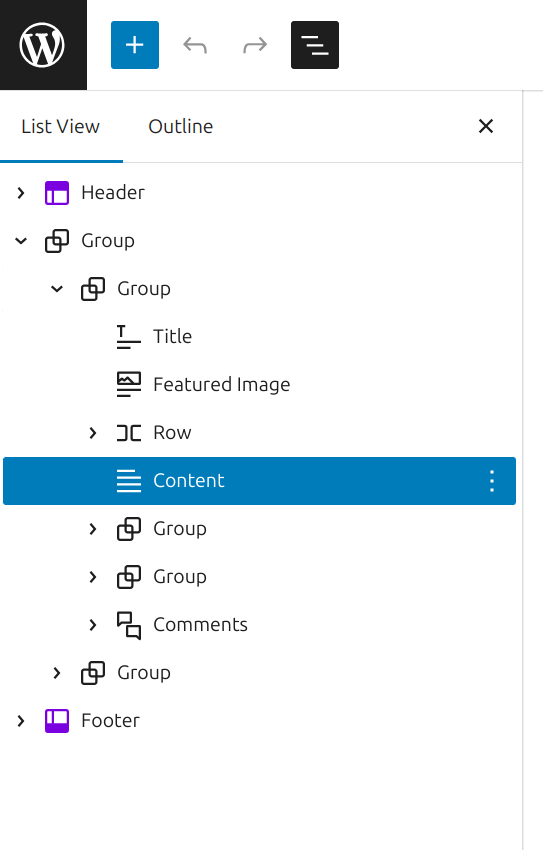

*The list view tab of the document overview*

After block you want to precede Content block, hover to activate the **inline block Inserter** and click to add the *Content* block in the desired location. You may need to type *Content* in the block search dialog to find it.

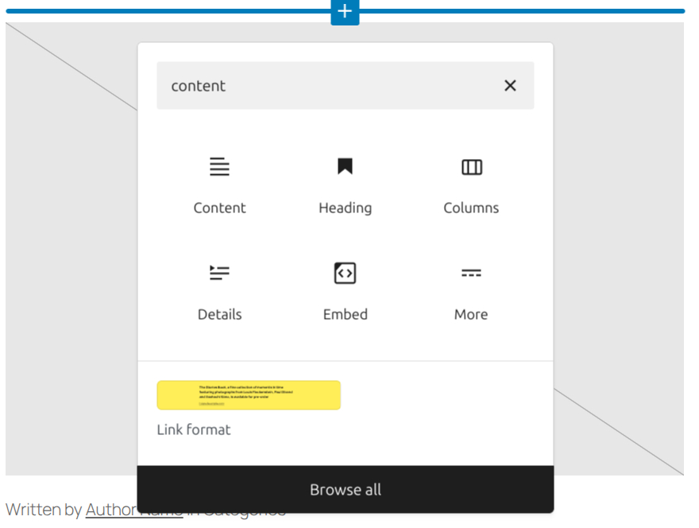

*Adding Content block via the inline block inserter*

You can also type <kbd>/content</kbd> and hit enter in a new paragraph block to add the *Content* block quickly.

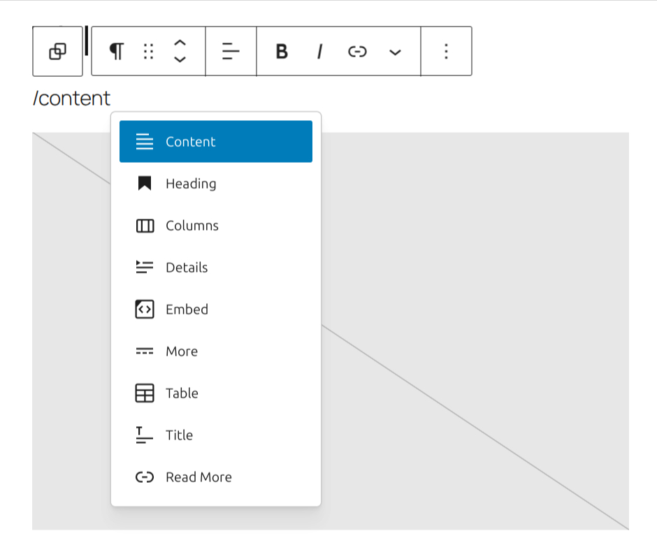

*Adding Content via “/” quick-add*

The inner blocks contain an empty paragraph as a template when the Content block doesn’t already have content in it.

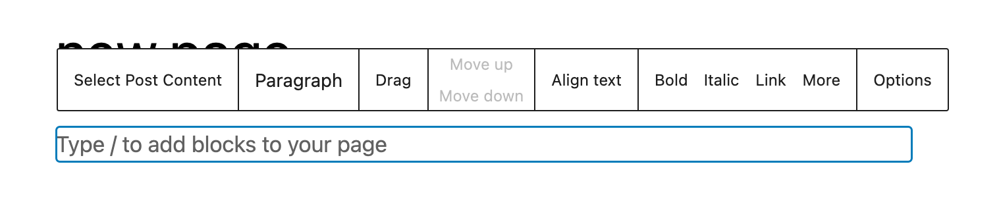

> [!NOTE]
> [Detailed instructions on adding blocks](../../working-with-blocks/adding-a-new-block.md)

## Block toolbar

To view the block toolbar, click on the block and the toolbar will be displayed.

Every block comes with unique toolbar icons. These block-specific controls allow you to manipulate the block right in the editor.

The *Content* block shows four buttons in the block toolbar:

-   Transform to
-   Drag icon
-   Move arrows
-   More options

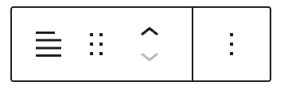

*Content block toolbar*

**Transform to**

Click on the **Transform** button to convert into Columns, Details, Group, or Excerpt blocks.

-   **Excerpt**: Display only a trimmed version of the post content, commonly used in blog listings or archive templates.
-   **Columns**: Organize your content into multiple columns for a more structured layout.
-   **Details**: Collapse content inside a toggle panel to display it on demand.
-   **Group**: Wrap the block in a container, allowing you to apply background, spacing, and layout styles.

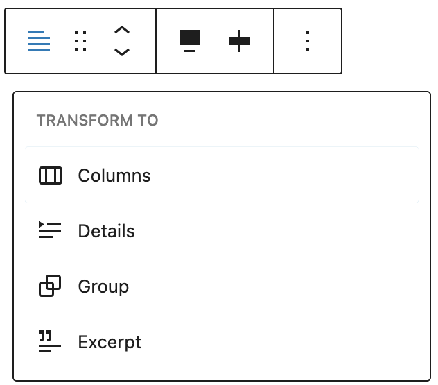

*Content block transform options*

**Drag icon**

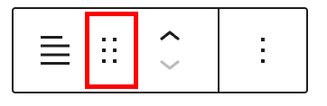

*Content block drag icon*

To drag and drop the block to a new location on the page template, click and hold the **drag** icon, then drag the block to the new location. The blue separator line indicates where the block will be placed. Release the left mouse button when you find the new location to place the block.

**Move arrows**

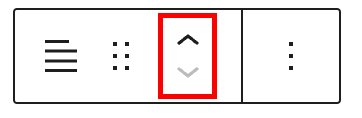

*Move arrows in the Content block*

The **up and down** arrow icons can be used to move the block up and down on the page.

> [!NOTE]
> [Get more information about moving a block within the editor.](../../working-with-blocks/moving-blocks.md)

### Options

The **Options** button on a block toolbar gives you more features to customize the block. These controls allow you to duplicate, and edit your block as HTML.

> [!NOTE]
> [Read about these and other settings.](../../working-with-blocks/more-options.md)

## Block settings

In addition to the block toolbar, every block has specific options in the editor sidebar.

*If you do not see the sidebar, click the **settings** icon next to the **Save** button.*

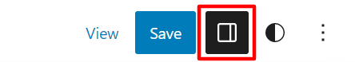

### Typography

This option allows you to set the font, color, size, line height and other typography-related settings for the block.

> [!NOTE]
> [Learn more about typography settings.](../../working-with-blocks/block-settings/typography-settings-overview.md)

### Background

The Background settings allow you to customize the appearance of supported blocks using background images, colors, and gradients.

> [!NOTE]
> For details, refer to the [Background Settings Overview](../../working-with-blocks/block-settings/background-settings-overview.md).

### Layout

The Layout menu under the Settings tab lets you add custom content width to the *Content* block.

When you toggle this option off, the *Content* block inherits the layout width options set by the theme.

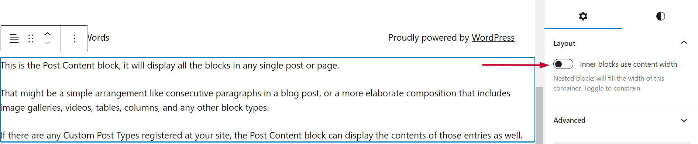

*Content width inherited from the layout*

Otherwise, you can customize the content width and justification when it’s toggled on.

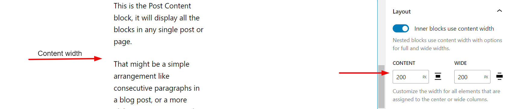

*Setting the custom Content width*

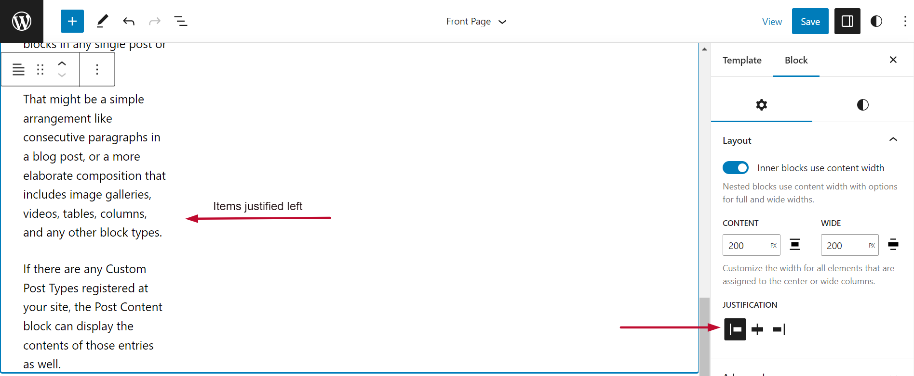

*Setting constrained layout justification*

> [!NOTE]
> [This article provides details about layout settings.](../../working-with-blocks/block-settings/layout-settings-overview.md)

### Dimensions

The option to control block spacing and padding is enabled for the block.

> [!NOTE]
> [Learn more about dimension controls.](../../working-with-blocks/block-settings/dimension-controls-overview.md)

### Border

This option allows you to set a border around the block, including the color, the width, radius, and the style of the border.

> [!NOTE]
> [Learn more about Border & Shadow settings.](../../working-with-blocks/block-settings/border-settings-overview.md)

### Elements

The Elements settings allow you to customize the appearance of links, buttons, headings, and heading levels H1 through H6. You can define a default color for headings (e.g., H1–H6) directly within the block settingsWhen applied, block-level heading color styles will take precedence over global settings.

### Advanced settings

The following Advanced settings options are available: HTML Anchor, Additional CSS Class(es), Additional CSS, HTML Element, and Styles.

> [!NOTE]
> [Learn more about advanced settings.](../../working-with-blocks/block-settings/advanced-settings-overview.md)

## Changelog

-   Updated 2026-09-06 (props @atachibana)
    -   Rearrange the Styles sections for WordPress 7.1 and add explanatory text.
-   Updated 2026-06-29
    -   Linked to advanced settings
-   Update 2025-04-22 (props to [@karthickmurugan](https://profiles.wordpress.org/karthickmurugan/) and [@milana_cap](https://profiles.wordpress.org/milana_cap/))
    -   Add Border and Spacing support
    -   Add Heading color support
    -   Update screenshots to 6.8 version
    -   Update title to Content block
    -   Update all instances for block name
    -   Update availability of the block (only in Site editor) and content that explains it.
-   Updated 2023-08-24
    -   Updated screenshots for 6.3
    -   Instructions now account for adding the block as a child block of a Query Loop
-   Updated 2023-04-25
    -   Updated screenshots for 6.2
    -   Added typography support
-   Created 2022-03-25
