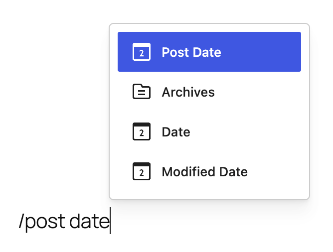
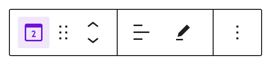
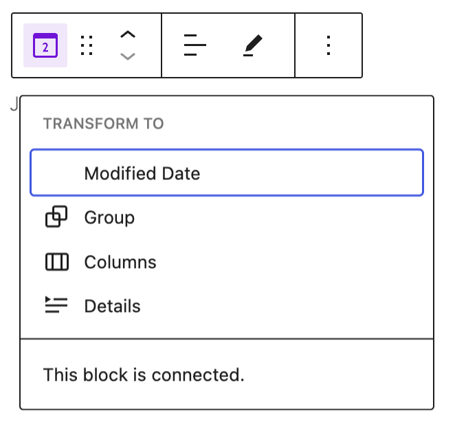
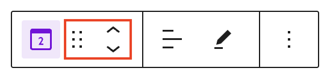
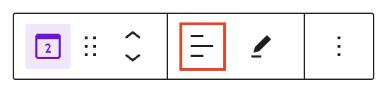
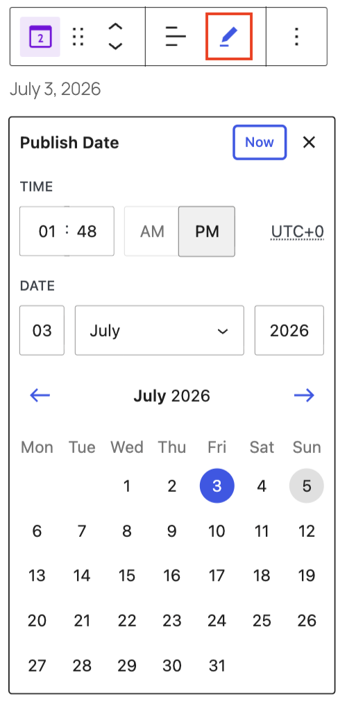
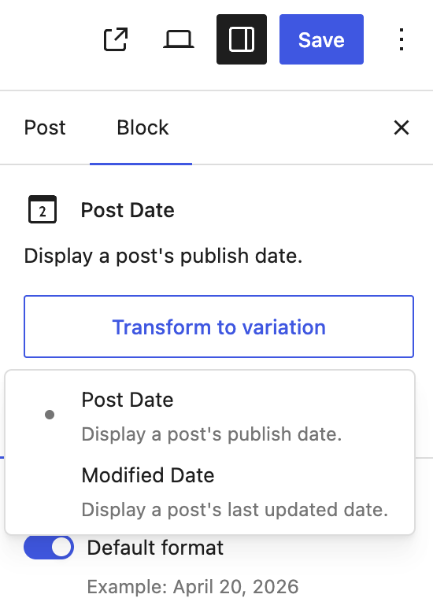

# Post Date block

Use the Post Date block to display the publication date of a post or page. You can add this block directly to a page template in the [Site Editor](../../../site-editor/README.md), such as the Single Post or Page template, to ensure a consistent layout across your site. You can also add it inside a [Query Loop block](query-loop-block.md) to customize the appearance and layout of your post feeds.

<!-- VideoPress embed (iframe removed): https://videopress.com/embed/lGL1k8QW -->

https://videopress.com/v/lGL1k8QW

*Adding a Post Date block to a single post*

## Add a Post Date block

To add the Post Date block, click the **+ Block Inserter** button in the top-left corner of the editor. Search for the Post Date block and click on the block to add it to the page.

You can also quickly add the Post Date block by typing `/post date` and pressing **Enter**.

> [!NOTE]
> [Detailed instructions on adding blocks.](../../working-with-blocks/adding-a-new-block.md)

### Add to a template

The Post Date block can be added to a template in the [Site Editor](../../../site-editor/README.md) to easily reflect the published date of a page or post across your website.

<!-- VideoPress embed (iframe removed): https://videopress.com/embed/WvGLmeK3 -->

https://videopress.com/v/WvGLmeK3

## Block toolbar

To view the block toolbar, click on the block and the toolbar will be displayed.

### Transform

Click on the **Transform** button to convert the Post Date block into a Modified Date, Group, Columns or Details block.

You will also see a “This block is connected” message indicating that the block has a binding to the Post’s published date.

### Block moving tools

The block-moving tools allow you to move the block in the editor. Use the **six dots icon** to drag and drop the block and place it anywhere on the page. Alternatively, click on the **up and down arrows** to move the block up or down.

> [!NOTE]
> [Get more information about moving a block within the editor.](../../working-with-blocks/moving-blocks.md)

### Change text alignment

Click the **Change alignment** button in the Block toolbar to display the alignment drop-down. You can align the block text to the left, make it center-aligned or align it to the right.

### Change date

Click the **Change date** button in the Block toolbar to display a modal with date settings.

You can select the publishing date and time through the input fields and options or select the date from the calendar. You can use the arrow buttons or drop down box to select a different month.

Click anywhere outside the modal, press the <kbd>Escape</kbd> key, or click on the button with the X to close the modal.

### More options

These controls give you the option to copy, duplicate, and edit your block as HTML.

> [!NOTE]
> [Read about these and other settings.](../../working-with-blocks/more-options.md)

## Block settings

Every block has specific options in the editor sidebar in addition to the options found in the block toolbar. If you do not see the sidebar, click on the **Settings** button next to the Save/Publish button.

### Transform to variation button

The Post Date block can be easily transformed into a [Modified Date](post-modified-date-block.md) block either by choosing the Transform button on the block toolbar or the Transform to variation button from the block settings.

The Post Date block settings panel is divided into two tabs – **Settings**, and **Styles**.

### Settings

#### Default format

This option is toggled on when you first add a Post Date block. Your site’s Default format can be changed in the site settings area, see [customize default date and time format](../../../../using-wordpress/writing-and-publishing/organizing-your-site/customize-date-and-time-format.md) to learn how.

To change the Post Date block to use a different format from your site’s default format, toggle off the **Default format** settings.

You can choose a format from a list of predefined selections under **Choose a format**.

Or you can choose **Custom** from the drop down and enter a new format string in the input box that appears.

#### Link to Post

Toggle on the **Link to post** option to link the post date to the URL of the post. In a Query Loop block, this enables the website visitor to go to the post by clicking on the Post Date.

#### Advanced

The following Advanced settings options are available: HTML Anchor, Additional CSS Class(es), Additional CSS, and Styles.

> [!NOTE]
> [Learn more about advanced settings.](../../working-with-blocks/block-settings/advanced-settings-overview.md)

### Styles

#### Color

The Post Date block provides Color settings options to change the text and background colors.

> [!NOTE]
> [See this guide for more information about changing colors.](../../working-with-blocks/block-settings/colors-settings-overview.md)

#### Typography

The Post Date block provides typography settings to change the font family, size, appearance, line height, letter case, letter spacing, and decoration.

> [!NOTE]
> [Get more details about changing typography settings.](../../working-with-blocks/block-settings/typography-settings-overview.md)

#### Dimensions

The Post Date block provides dimension settings options to change padding and margin size.

> [!NOTE]
> [Learn more about dimension controls.](../../working-with-blocks/block-settings/dimension-controls-overview.md)

#### Border

The Post Date block provides border settings options to add border color, width, and radius.

> [!NOTE]
> [Learn more about border settings.](../../working-with-blocks/block-settings/border-settings-overview.md)

## Changelog

-   Updated 2026-07-05 (props to @awetz583 @clk87 @poena @benazeer @atachibana)
    -   Updated text, screenshots and videos for 7.0
-   Updated 2026-06-29
    -   Linked to advanced settings
-   Updated on 2023-07-28
    -   Update the block toolbar screenshots and added relevant content for change date and updated screenshot for More option.
    -   Update the Block settings sidebar screenshots and relevant content for preview icon.
    -   Included the “Post date block variation for post modified date” content as a note under “Last modified date” in the Block settings sidebar.
-   Updated on 2023-07-23
    -   Corrected the headings for Block toolbar
-   Updated on 2023-07-16
    -   Added the Post Date block variation for Post Modified Date, as mentioned here [49111](https://github.com/WordPress/gutenberg/pull/49111)
    -   Added the video for only display the modified post date if the post has been modified, as mentioned here [46839](https://github.com/WordPress/gutenberg/pull/46839)
-   Updated on 2023-07-11
    -   Updated the video to show how to add post date block because it was shows “Post Categories” which now has been changed into “Categories block”
    -   Added option to display as the last modified date as suggested here [42312](https://github.com/WordPress/gutenberg/pull/42312) and also added the text under block settings
    -   Added information for typography support, as mentioned here [43340](https://github.com/WordPress/gutenberg/pull/43340)
    -   Added option for spacing support, as mentioned here [43406](https://github.com/WordPress/gutenberg/pull/43406)
    -   Made sure all the images have alt tag
    -   Made sure the headings are in sentence case
    -   Made sure the screenshots are updated and videos are relevant to the latest version 6.2.2
-   Created 2022-03-21
