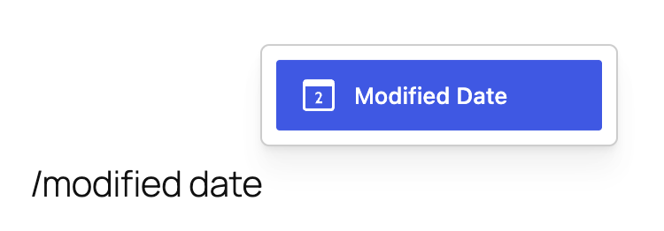
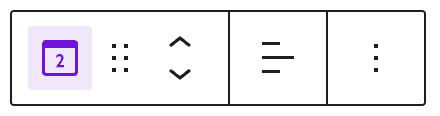
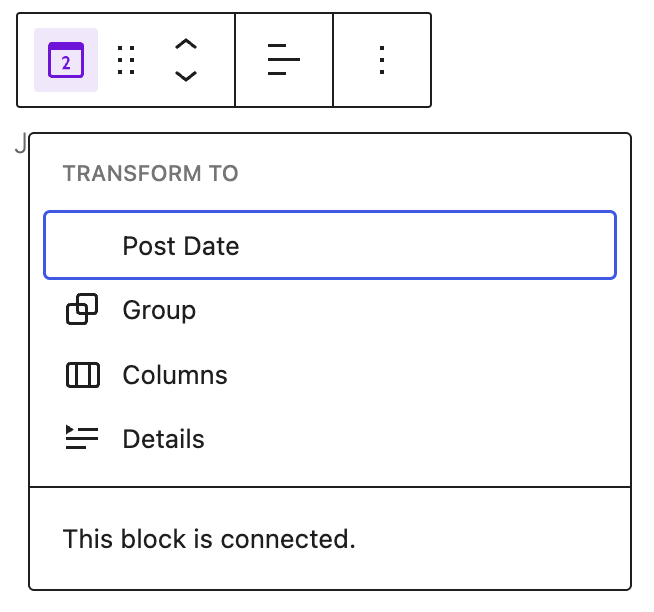
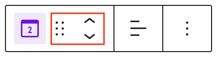
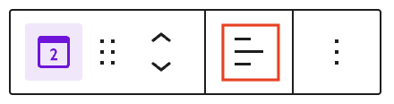
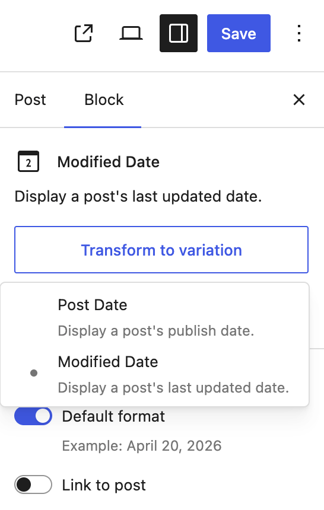

# Modified Date block

Use the Modified Date block to display the last modified date of a post or page. If a post has never been modified after publishing, the Modified Date will be blank on the front end published page.

You can add this block directly to a page template in the [Site Editor](../../../site-editor/README.md), such as the Single Post or Page template, to ensure a consistent layout across your site. You can also add it inside a [Query Loop block](query-loop-block.md) to customize the appearance and layout of your post feeds.

<!-- VideoPress embed (iframe removed): https://videopress.com/embed/zaXjRgMP -->

https://videopress.com/v/zaXjRgMP

## Add a Modified Date block

To add the Modified Date block, click the **+ Block Inserter** button in the top-left corner of the editor. Search for the Modified Date block and click on the block to add it to the page.

You can also quickly add the Modified Date block by typing `/modified date` and pressing **Enter**.

> [!NOTE]
> [Detailed instructions on adding blocks.](../../working-with-blocks/adding-a-new-block.md)

### Add to a template

The Modified Date block can be added to a template in the [Site Editor](../../../site-editor/README.md) to easily reflect the last modified date of a page or post across your website.

## Block toolbar

To view the block toolbar, click on the block and the toolbar will be displayed.

### Transform

Click on the **Transform** button to convert the Modified Date block into a Post Date, Group, Columns or Details block.

You will also see a “This block is connected” message indicating that the block has a binding to the Post’s last modified date.

### Block moving tools

The block-moving tools allow you to move the block in the editor. Use the **six dots icon** to drag and drop the block and place it anywhere on the page. Alternatively, click on the **up and down arrows** to move the block up or down.

> [!NOTE]
> [Get more information about moving a block within the editor.](../../working-with-blocks/moving-blocks.md)

### Change text alignment

Click the **Align text** button in the Block toolbar to display the alignment drop-down. You can align the block text to the left, make it center-aligned or align it to the right.

### More options

The **More options** menu represented by three vertical dots on the far right of the toolbar gives you more features such as the ability to duplicate or remove the block.

> [!NOTE]
> [Read about these and other settings.](../../working-with-blocks/more-options.md)

## Block settings

Every block has specific options in the editor sidebar in addition to the options found in the block toolbar. If you do not see the sidebar, click on the **Settings** button next to the Save/Publish button.

### Transform to variation button

The Modified Date block can be easily transformed into a [Post Date](post-date-block.md) block either by choosing the Transform button on the block toolbar or the **Transform to variation** button from the block settings.

The Modified Date block settings panel is divided into two tabs – **Settings**, and **Styles**.

### Settings

#### Default format

This option is toggled on when you first add a Modified Date block. Your site’s Default format can be changed in the site settings area, see [customize default date and time format](../../../../using-wordpress/writing-and-publishing/organizing-your-site/customize-date-and-time-format.md) to learn how.

To change the Modified Date block to use a different format from your site’s default format, toggle off the **Default format** settings.

You can choose a format from a list of predefined selections under **Choose a format**.

Or you can choose **Custom** from the drop down and enter a new format string in the input box that appears.

#### Link to Post

Toggle on the **Link to post** option to link the modified date to the URL of the post. In a Query Loop block, this enables the website visitor to go to the post by clicking on the Modified Date.

#### Advanced

The following Advanced settings options are available: HTML Anchor, Additional CSS Class(es), Additional CSS, and Styles.

> [!NOTE]
> [Learn more about advanced settings.](../../working-with-blocks/block-settings/advanced-settings-overview.md)

### Styles

#### Color

The Modified Date block provides Color settings options to change the text and background colors.

> [!NOTE]
> [See this guide for more information about changing colors.](../../working-with-blocks/block-settings/colors-settings-overview.md)

#### Typography

The Modified Date block provides typography settings to change the font family, size, appearance, line height, letter case, letter spacing, and decoration.

> [!NOTE]
> [Get more details about changing typography settings.](../../working-with-blocks/block-settings/typography-settings-overview.md)

#### Dimensions

The Modified Date block provides dimension settings options to change padding and margin size.

> [!NOTE]
> [Learn more about dimension controls.](../../working-with-blocks/block-settings/dimension-controls-overview.md)

#### Border

The Modified Date block provides border settings options to add border color, width, and radius.

> [!NOTE]
> [Learn more about border settings.](../../working-with-blocks/block-settings/border-settings-overview.md)

## Changelog

-   Updated 2026-07-08 (props to @awetz583 @atachibana)
    -   Updated screenshots and information for 7.0
-   Updated 2026-06-29
    -   Linked to advanced settings
-   Created 2023-08-08
