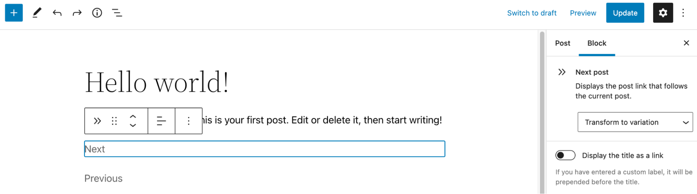
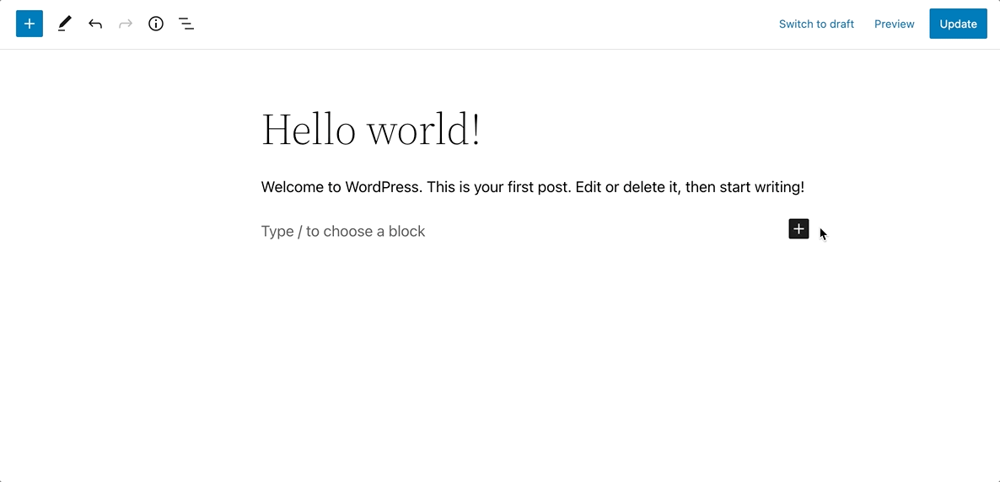
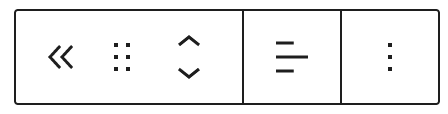
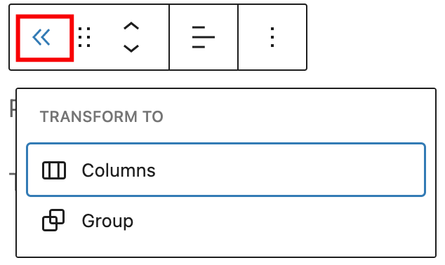
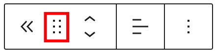
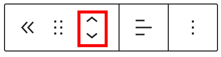
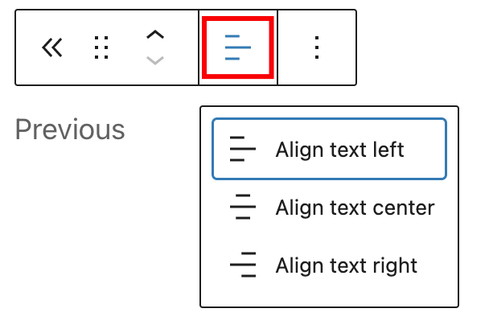
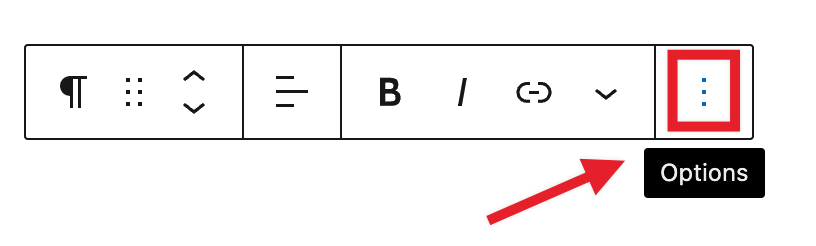
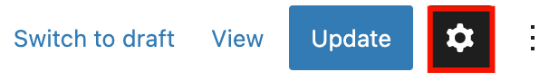
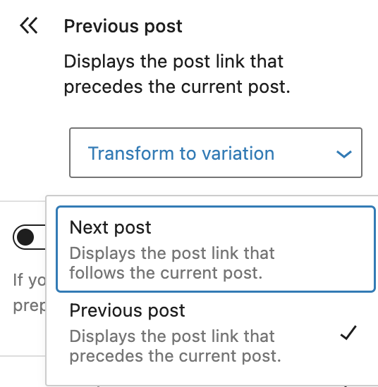

# Post Navigation Link block

Use the *Post Navigation Link* block to display the post pages link navigation for the previous and next pages.

Click the (**+**) icon to open the block inserter pop-up window and search for the *Next post* or *Previous post* blocks.

You can also use the keyboard shortcut <kbd>/next-post</kbd> or <kbd>/previous-post</kbd> to quickly insert a preferred *Post Navigation Link* block.

> [!NOTE]
> Detailed instructions on adding blocks can be found [here](../../working-with-blocks/adding-a-new-block.md).

## Block toolbar

To view the block toolbar, click on the block, and the toolbar will be displayed.

Every block comes with unique toolbar icons. These block-specific controls allow you to manipulate the block right in the editor.

Both the *Previous* *post* and *Next post* blocks show five buttons in the block toolbar:

-   Transform to
-   Drag
-   Move up/down
-   Change text alignment
-   Options

**Transform to**

Click on the **Transform** button to convert the *Post Navigation Link* blocks into *Columns* or *Group* blocks.

**Drag icon**

To drag and drop the block to a new location on the page template, click and hold the rectangle of dots, then drag it to the new location. The blue separator line indicates where the block will be placed. Release the left mouse button when you find the new location to place the block.

**Move arrows**

The **up** and **down** arrow icons can be used to move the block up and down on the page.

> [!NOTE]
> Detailed instructions on moving a block within the editor can be found [here](../../working-with-blocks/moving-blocks.md)

**Change text alignment**

Use the change text alignment tool to change the text alignment for the *Post Navigation Link* blocks. The following is a list of the block width options:

-   Align text left
-   Align text center
-   Align text right

**Options**

The [More Options menu](../../working-with-blocks/more-options.md) represented by **three vertical dots on the far right of the toolbar** gives you more features such as the ability to duplicate, remove, or edit your block as HTML.

*Example of the location of the “More Options” menu in a Paragraph block.*

> [!NOTE]
> [Read about these and other settings.](../../working-with-blocks/more-options.md)

## Block Settings

The block settings panel contains customization options specific to the block. To open it, select the block and click the cog icon next to the Publish button.

Here are the options for the *Post Navigation Link* block:

**Settings**

Click Transform to variation to convert the *Next post* or *Previous post* blocks to their opposite blocks.

It’s also possible to display the title as a link, or include the label as part of the link.

**Typography**

The *Post Navigation Link* block provides typography settings to change the font size, appearance, line height, letter case, and letter spacing.

For details, refer to this support article: [Typography settings overview](../../working-with-blocks/block-settings/typography-settings-overview.md)

**Advanced**

The following Advanced settings options are available: HTML Anchor, Additional CSS Class(es), Additional CSS, Filter by Taxonomy, and Styles.

The Filter by Taxonomy option allows you to only link to posts that have the same taxonomy terms as the current post. For example the same tags or categories.

> [!NOTE]
> [Learn more about advanced settings.](../../working-with-blocks/block-settings/advanced-settings-overview.md)

## Changelog

-   Updated 2026-06-29
    -   Linked to advanced settings
-   2023-07-25
    -   Fix broken images URLs
-   Created 2022-12-14
