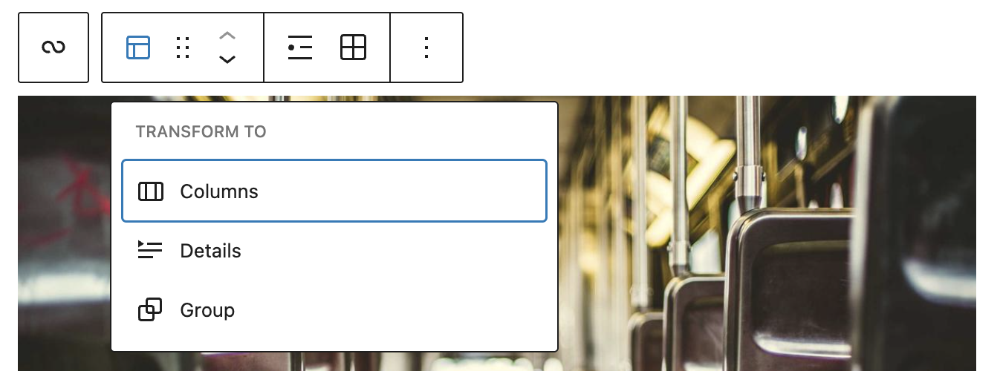
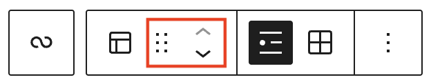
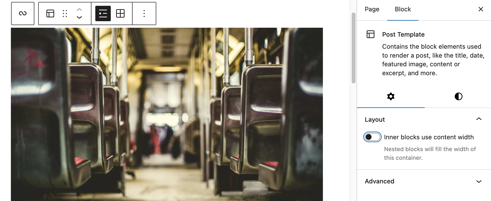
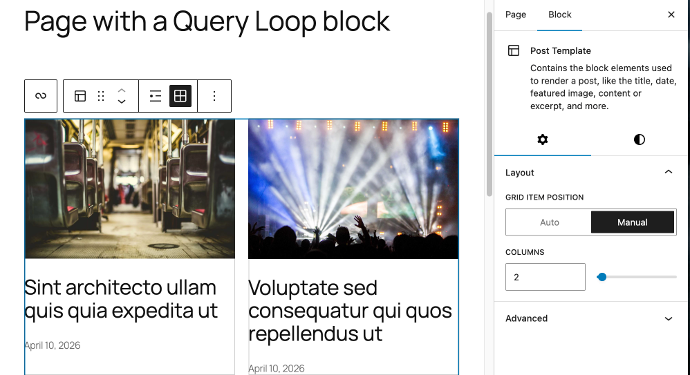
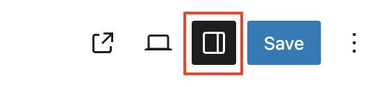

# Post Template block

The Post Template block is a container block that is nested in the [Query Loop](query-loop-block.md) block. This block contains inner block elements used to display a post in the Query loop block such as the post title, post content or excerpt, date, and featured image.

<video controls preload="metadata" src="https://wordpress.org/documentation/files/2022/11/Kapture-2026-04-10-at-12.47.19.mp4"></video>

## Add a Post Template block inside a Query Loop block

To find the Post Template block, click the **Block Inserter** icon, then search for the **Query Loop** block. Click on it to insert the block to the editor. Alternatively, you can type <kbd>/query-loop</kbd> to quickly insert the Query Loop block.

Click **Choose** to open a selection of patterns. Click on the pattern you would like to use to display your posts.

## Block toolbar

When users select a block, the block toolbar containing a number of control buttons will appear above the selected block. The Post Template block toolbar includes the following tools:

### Transform to

Users can transform the Post Template block into a **Columns** or a **Group** block.

### Block-moving tools

Use the block-moving tools to move the Post Template block. The six dots icon allows you to freely reposition the block anywhere within the editor by dragging and dropping it. You can also use the arrows icon to move the block up or down the editor.

### List view button

Display posts in a simple list. In list view, you will see a Layout toggle for Inner blocks use content width.

### Grid view button

Display posts in a grid. You can choose how many columns to display items in in the Block Settings panel.

### More options

The [More options menu](../../working-with-blocks/more-options.md) represented by **three vertical dots** on the far right of the toolbar gives you more features such as the ability to duplicate, remove, or edit your block as HTML.

> [!NOTE]
> [Read about the More options settings](../../working-with-blocks/more-options.md).

## Block settings

Every block has specific options in the editor sidebar in addition to the options found in the block toolbar. To access block settings, click the Settings button at the top-right corner of the editor.

### Layout

Depending if you have chosen List view or Grid view from the block toolbar, you will see different layout options.

-   List view: Inner blocks use content width toggle
-   Grid view: Column number option

> [!NOTE]
> [This article provides details about layout settings.](../../working-with-blocks/block-settings/layout-settings-overview.md)

### Color

The Post Template block provides color settings options to change the text and background colors.

> [!NOTE]
> [See this guide for more information about changing colors](../../working-with-blocks/block-settings/colors-settings-overview.md)

### Typography

The Post Template block provides typography settings to change the font family, appearance, line height, letter spacing, decoration, letter case, and font size.

> [!NOTE]
> [Get more details about changing typography settings](../../working-with-blocks/block-settings/typography-settings-overview.md)

### Dimensions

The Post Template block provides dimension settings options.

> [!NOTE]
> [Learn more about dimension controls](../../working-with-blocks/block-settings/dimension-controls-overview.md)

### Border

The Verse block provides border settings options to add border color, width, and radius.

> [!NOTE]
> [Learn more about border settings](../../working-with-blocks/block-settings/border-settings-overview.md)

### Advanced

The Post Template block provides the following Advanced settings options: HTML anchor, Additional CSS Class(es), Additional CSS, and Styles.

> [!NOTE]
> [Learn more about advanced settings](../../working-with-blocks/block-settings/advanced-settings-overview.md)

## Changelog

-   Updated 2026-05-26 (props to @kjoyner @awetz583)
    -   Updated “Advanced” section to refer to new overview page
-   Updated 2026-04-10 (props to @mosescursor @awetz583 @manuelaugustin @suascat)
    -   Updated screenshots and video
    -   Added List view and Grid view button information
    -   Updated Block settings list to include layout, color, dimensions and border
-   Created 2022-11-23
