# Site Logo block

The *Site Logo* block lets you add a logo or image representing your website identity and help increase brand recognition. Unlike a site icon or a favicon, a logo is only visible on website pages like the home page.

> [!NOTE]
> The Site Logo block is primarily used when editing the Template files in the [Site Editor](../../../site-editor/README.md).

## How to use the Site Logo block

To add a *Site Logo* block, create a new page or open the Site Editor. Click the Block Inserter icon and search for the *Site Logo* Block.

You can also type <kbd>/site-logo</kbd> and hit enter in a new paragraph block to add the *Site Logo* block quickly.

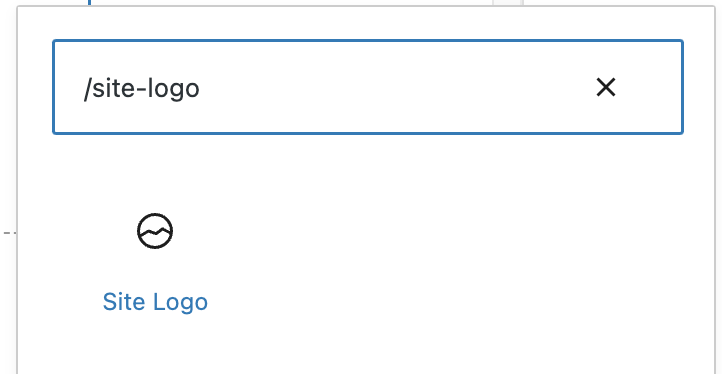

*How to add Site Logo block quickly*

Select the *Site Logo* placeholder icon and upload a new image or select one from the Media Library.

Once you have added an image logo, you can resize it using the drag handles.

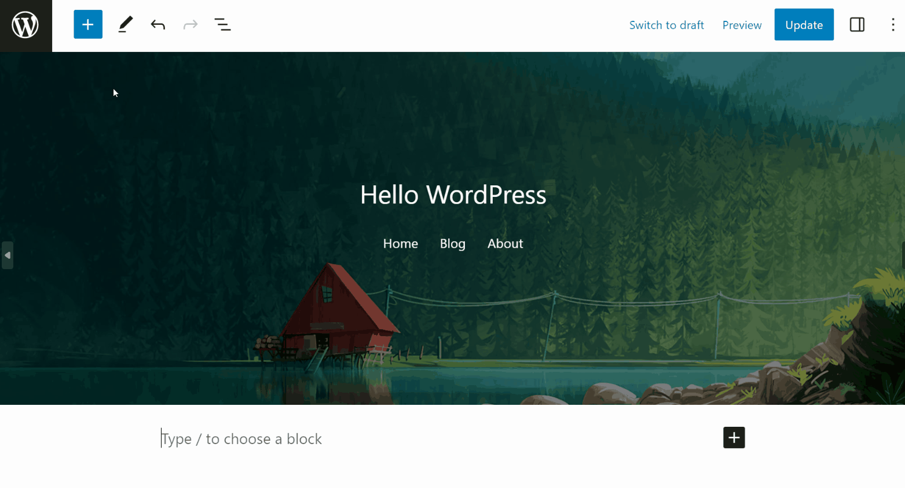

When you add an image to the *Site Logo* block, the change applies to all *Site Logo* blocks on your website.

To use the site logo image as the site icon in browser tabs, bookmark bars, and WordPress mobile apps, access the *Site Logo* block settings panel and enable the Use as site icon option. It automatically set the image in the *Site Logo* block as the site icon.

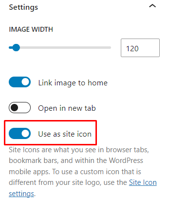

> [!NOTE]
> [Detailed instructions on adding blocks](../../working-with-blocks/adding-a-new-block.md)

## Block toolbar

A block toolbar lets you customize or modify each block in the editor. Select the *Site Logo* block to view its block toolbar. Below is a list of tools shown in this block toolbar:

-   Transform to
-   Block-moving tools
-   Change alignment
-   Apply duotone filter
-   Crop
-   Replace
-   More options

### Transform to

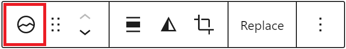

The **Transform to** button lets you convert the *Site Logo* block into a *Columns*, *Group*, or *Site Title* block. You can also change the *Site Logo* block style from **Default** to **Rounded**.

### Block-moving tools

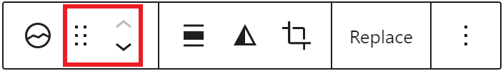

Use the block-moving tools to move the *Site Logo* block.

The drag or six dots icon allows you to freely reposition the block anywhere within the editor by holding the icon and dragging it to the new location.

Moreover, you can also use the arrows icon to move the block left or right within the group of nested blocks.

> [!NOTE]
> [Get more information about moving a block within the editor.](site-logo-block.md)

### Change alignment

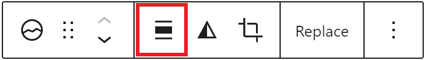

Use the **Change alignment** tool to modify the alignment of the *Site Logo* block. Select the icon and pick one of the following alignment options:

-   None – is the default block size.
-   Align left – makes the block left-aligned.
-   Align center – lets you align the block to the center.
-   Align right – makes the block right-aligned.

### Apply duotone filter

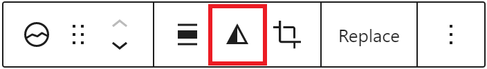

The **Apply duotone filter** option lets you create a two-tone color effect on the site logo without changing the original image. Note that the duotone effect works best on high-contrast images.

To apply the duotone filter, click the icon and choose the two colors from the provided duotone presets. You can create custom duotone colors using the Shadows and Highlights options. Choose from the provided color presets on each option, or use the color picker to set the custom colors.

If you want to undo all the changes, use the Clear button.

### Crop

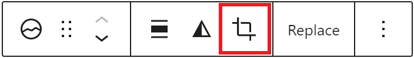

Use the **Crop** button in the block toolbar to open the Media Editor and make detailed edits to the *Site Logo* image directly in the editor.

The Media Editor has two tabs: **Crop** and **Details**.

#### Crop tab

-   Drag the handles on the image to make a freeform selection, or choose a preset from **Aspect ratio** (Free, Square – 1:1, and more).
-   Use **Zoom** (+/−) to magnify the image for finer adjustments before selecting your crop.
-   Use **Rotate** to turn the image left or right, or drag the ruler beneath the image to straighten it by degree.
-   Use **Flip** to mirror the image horizontally or vertically.
-   Crop handles snap to the source image’s pixels, so selections line up precisely.

#### Details tab

Select **Details** to update the image’s metadata without leaving the editor:

-   **Alt text** – describe the image for accessibility, or leave empty if the image is decorative.
-   **Caption** and **Description**.
-   Read-only file info: date added, author, file name, file type, file size, and dimensions.

Select **Save** to apply your changes, or **Cancel** to discard them and close the Media Editor.

> [!NOTE]
> WordPress saves the edited version as a new image file, so the original image remains available in your Media Library.

The Crop button only appears in the block toolbar after you have inserted an image into the *Site Logo* block.

<!-- VideoPress embed (iframe removed): https://videopress.com/embed/jymoNgwu -->

https://videopress.com/v/jymoNgwu

### Replace

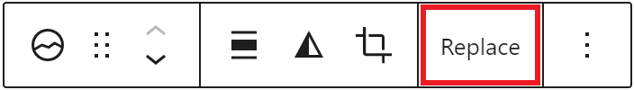

The **Replace** option lets you change the site logo by choosing another image from the Media Library or uploading a new one from your local computer. You can also remove the site logo image by clicking Reset.

### Options

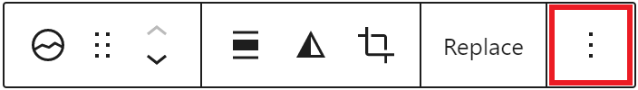

The **Option** icon on the *Site Logo* block toolbar lets you access more block options. A drop-down menu will appear when you click it, and below is a list of actions you can do with the *Site Logo* block:.

> [!NOTE]
> [Read detailed information about the Other settings.](../../working-with-blocks/more-options.md)

## Block settings

WordPress blocks have specific configuration options in the block settings panel. To access the *Site Logo* block settings panel, click the Settings button at the top-right corner of the editor. Moreover, the *Site Logo* block settings panel is divided into two tabs – **Settings** and **Styles**.

### Settings

The **Settings** tab has several options as follows:

**Media**

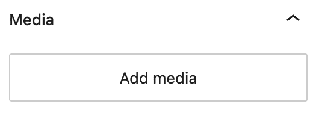

*The “add media” button to insert a site logo*

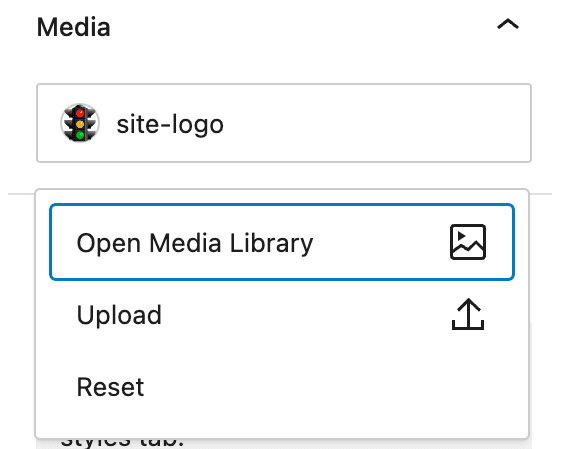

*Options to replace the site logo*

The media settings allows you to add an image to the *Site Logo* block. Here are the steps you can do with this settings:

1.  Click Add media to add an image to the *Site Logo* block.
2.  Once an image has been added, click the image name to update the image.
3.  You have three options to do so: select an image from the media library, upload a new image, or remove the image by resetting the media.

**Settings**

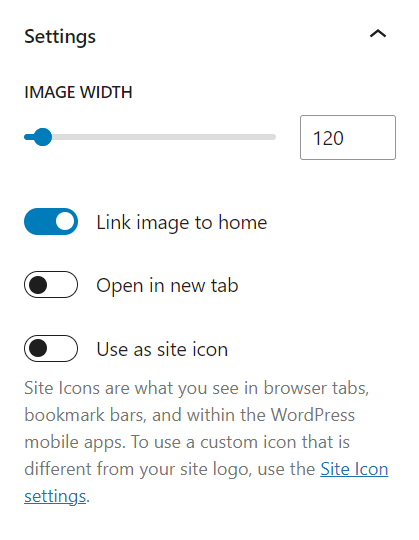

Change the image width using the slider or typing a numeric value in the text field next to the slider.

Enable the **Link image to home** option to make a hyperlink to your website’s home page. This option is turned on by default.

Turn on the **Open in new tab** option to automatically open the home page in a new tab when the site logo image is clicked.

Activate the **Use as site icon** option to set the site logo image as the site icon. A site icon is a small image next to the site title in a web browser tab.

Note that this option is only available after you add an image to the *Site Logo* block.

**Advanced**

The following Advanced settings options are available: HTML Anchor, Additional CSS Class(es), Additional CSS, and Styles.

> [!NOTE]
> [Learn more about advanced settings.](../../working-with-blocks/block-settings/advanced-settings-overview.md)

### Styles

The Styles tab has the following options:

**Styles**

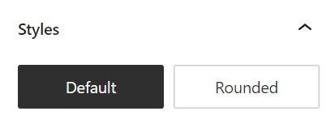

Use the Styles option to change the look of the *Site Logo* block. The initial configuration for the block’s style is Default. You can change the site logo shape to round by clicking the **Rounded** button.

**Dimensions**

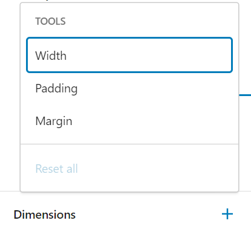

The Dimensions option adds additional settings for the *Site Logo* block, where you can set custom width, padding, and margin.

> [!NOTE]
> [Learn more about the Dimensions settings.](../../working-with-blocks/block-settings/dimension-controls-overview.md)

## Changelog

-   Updated 2026-08-18
    -   Updated Crop tool for the new Media Editor modal (7.1): freeform crop, flip, fine-rotation, pixel snapping, and the new Details tab (props @coreyhall93).
-   Updated 2026-06-29
    -   Linked to advanced settings
-   Updated 2024-02-20
    -   Updated to content for WordPress 6.3
-   Updated 2023-04-05
    -   Updated to content for WordPress 6.2
-   Created 2022-06-29
