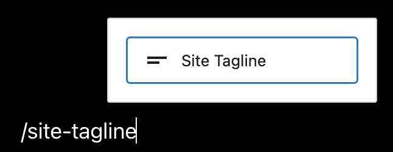
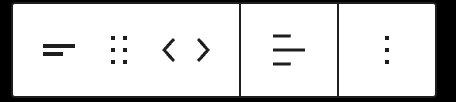
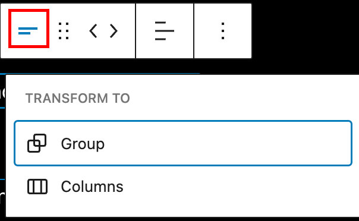
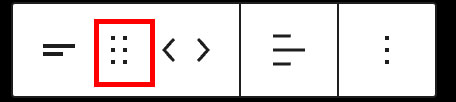
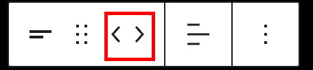
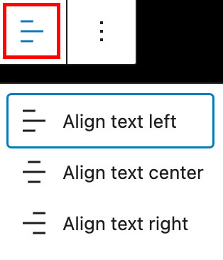
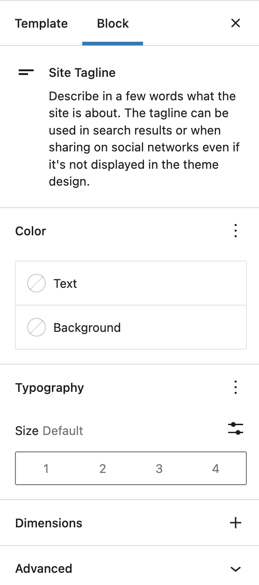
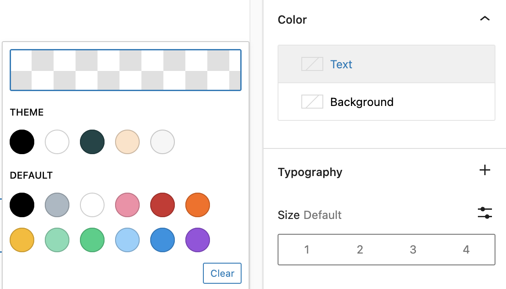
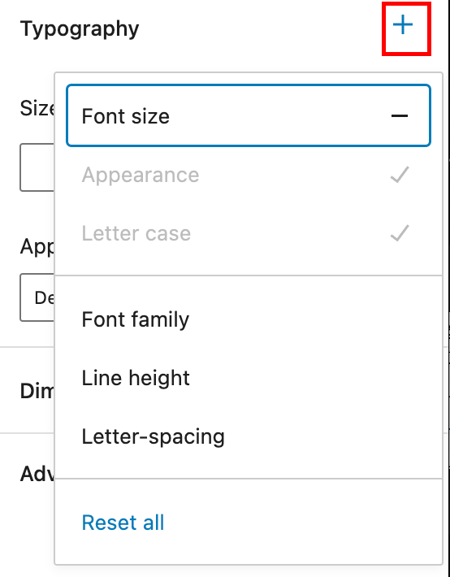
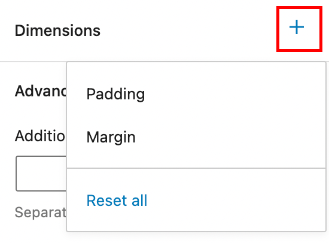

# Site Tagline block

Use the Site Tagline block to display the tagline of the site on the page or to edit the site tagline.

> [!NOTE]
> Updating this block and saving the template will apply the changes wherever the Site Tagline is used including the browser title bar, search results and the Tagline text field in Settings > General.

To add a Site Tagline block, click the **Block Inserter** icon when editing the page template. Search for the Site Tagline block. Click on it to add the block to your page template.

> [!NOTE]
> The Site Tagline block is primarily used when editing the Template files in the [Site Editor](../../../site-editor/README.md).

<video controls preload="metadata" src="https://wordpress.org/documentation/files/2022/04/Screen-Recording-2022-04-04-at-1.24.32-PM.mp4"></video>

*Video showing how to add the Site Tagline block*

You can also type /site-tagline and hit enter in a new paragraph block to add the Site Tagline block quickly.

*How to add Site Tagline block quickly*

> [!NOTE]
> [Detailed instructions on adding blocks](../../working-with-blocks/adding-a-new-block.md)

## Block Toolbar

To view the block toolbar, click on the block and the toolbar will be displayed.

Every block comes with unique toolbar icons. These block-specific controls allow you to manipulate the block right in the editor.

The Site Tagline block shows five buttons in the block toolbar:

-   Transform to
-   Drag icon
-   Move arrows
-   Change text alignment
-   More options

*Site Tagline Block Toolbar*

### Transform to

*Transform options for Site Tagline Block*

Click on the “Transform” button to convert the Site Title block into a “Group” block or “Columns” block.

### Drag icon

*Drag icon in the Site Tagline Block*

To drag and drop the block to a new location on the page template, click and hold the rectangle of dots, then drag to the new location. The blue separator line indicates where the block will be placed. Release the left mouse button when you find the new location to place the block.

### Move arrows

*Move arrows in the Site Tagline Block*

The left and right arrow icons can be used to move the block left or right inside the group of nested blocks.

> [!NOTE]
> [Get more information about moving a block within the editor.](../../working-with-blocks/moving-blocks.md)

### Change text alignment

*Change text alignment for the Site Tagline Block*

Click the “Change alignment” button in the Block toolbar to display the alignment drop-down. You can align the block text to the left, make it center-aligned or align it to the right.

### More option

These controls give you the option to copy, duplicate, and edit your block as HTML.

> [!NOTE]
> [Read about these and other settings.](../../working-with-blocks/more-options.md)

## Block Settings

In addition to the block toolbar, every block has specific options in the editor sidebar.

*If you do not see the sidebar, click the ‘cog’ icon next to the Save button.*

*How to turn on the Block Settings sidebar*

*Block Settings in the Site Tagline Block*

### Color

You can customize the text color and background color for the Site Tagline block. The color options available will vary based on the theme. Pick a color from the suggestions, or add a custom color using the color picker or by adding a color code.

*Color Settings in the Site Tagline Block*

> [!NOTE]
> [See this guide for more information about changing colors.](../../working-with-blocks/block-settings/colors-settings-overview.md)

### Typography

Typography settings allow you to change a block’s font size, appearance, line height, letter casing, and spacing.

*Typography Settings in the Site Tagline Block*

> [!NOTE]
> [Get more details about changing typography settings.](../../working-with-blocks/block-settings/typography-settings-overview.md)

### Dimensions

Dimension controls are used to control how groups of blocks are placed alongside one another, by changing the values for padding, margin, and other dimensions

*Dimension settings in the Site Tagline block*

> [!NOTE]
> [Learn more about dimension controls.](../../working-with-blocks/block-settings/dimension-controls-overview.md)

## Advanced

The following Advanced settings options are available: HTML Anchor, Additional CSS Class(es), Additional CSS, and Styles.

> [!NOTE]
> [Learn more about advanced settings.](../../working-with-blocks/block-settings/advanced-settings-overview.md)

## Changelog

-   Updated 2026-06-29
    -   Linked to advanced settings
-   Created 2022-04-04
