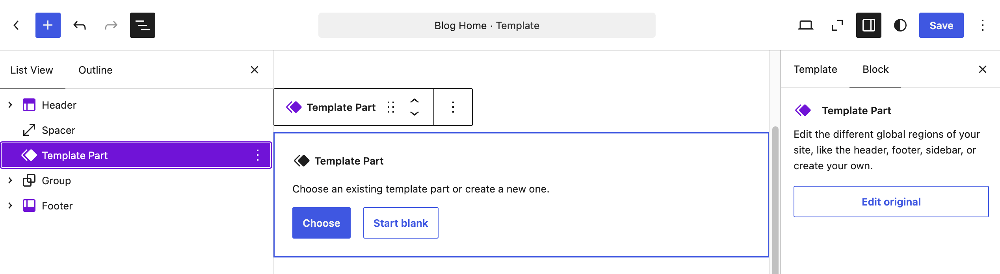
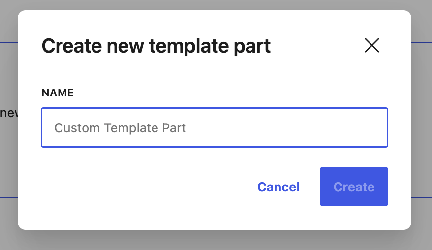
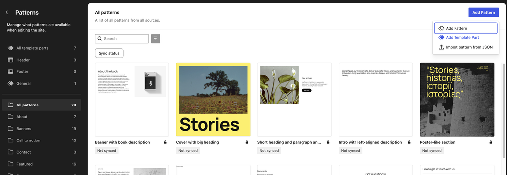
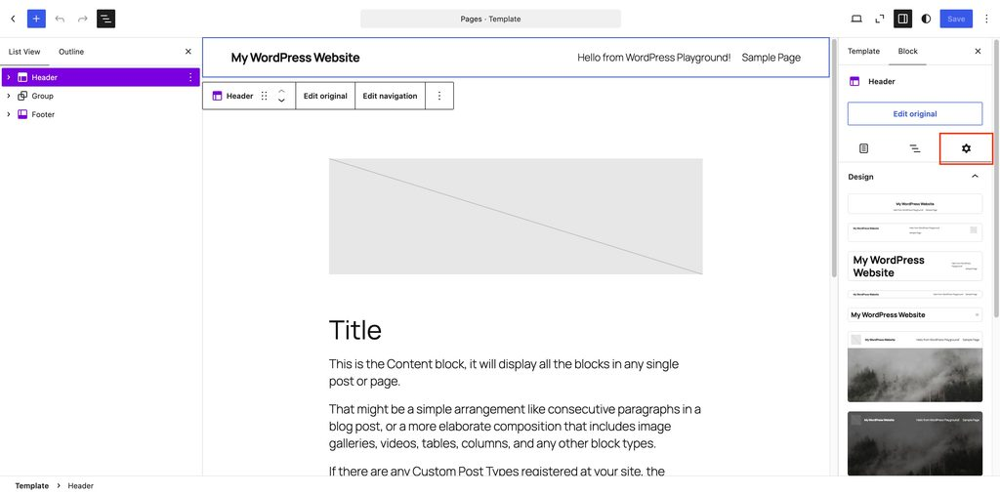
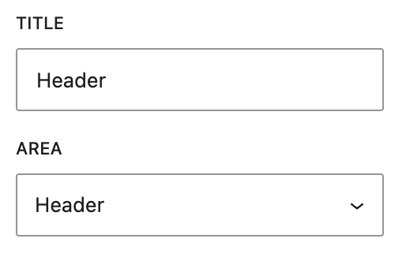
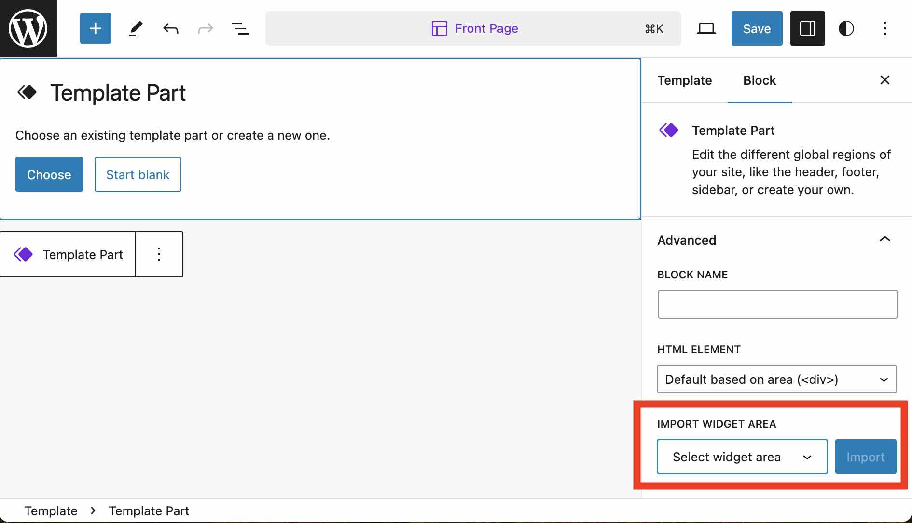

# Template Part block

The Template Part block is used while creating and editing templates to manage blocks in areas repeated across the website. This block is often used to create areas like your site header and site footer. When you change blocks inside a template part, the editor updates the blocks on every block template that includes the template part.

> [!NOTE]
> [Learn more about Template editing.](../../../site-editor/template-editor.md)

<!-- VideoPress embed (iframe removed): https://videopress.com/embed/GEDQAobI -->

https://videopress.com/v/GEDQAobI

## Add a Template Part

You can add templates when using the [Template Editor](../../../site-editor/template-editor.md) or [Site Editor](../../../site-editor/README.md) to edit templates directly. In order to add a Template Part block, click on the add block button and select the Template Part block. You can also type `/template part` and hit enter in a new paragraph block to add one quickly.

> [!NOTE]
> [Get detailed instructions on adding blocks](../../working-with-blocks/adding-a-new-block.md).

After adding a template part, you can choose from existing parts or create a new template part.

### Choosing from existing template parts

Selecting the button **Choose** opens a modal where you can search, preview, and select existing parts. These parts will depend on what your theme has provided.

### Creating new template parts

Selecting **Start blank** will open a modal and prompt you to add a name. Pick a descriptive name so that it’s easy to find in the future.

### Add a template part in patterns editor

If you are using a block theme, you can also create a new template in Administration Screen > Appearance > Editor > Patterns > All template parts. Click on the **Add Pattern** button and choose **Add Template Part** from the dropdown.

You can choose to create one of the following Template Parts:

-   **General** – General templates often perform a specific role like displaying post content, and are not tied to any particular area.
-   **Header** – The Header template defines a page area that typically contains a title, logo, and main navigation.
-   **Footer** – The Footer template defines a page area that typically contains site credits, social links, or any other combination of blocks.
-   **Navigation Overlay** – The Navigation Overlay template defines an overlay area that typically contains navigation links and can be toggled open and closed.

## Edit template parts

<!-- VideoPress embed (iframe removed): https://videopress.com/embed/ea2a8vn6 -->

https://videopress.com/v/ea2a8vn6

After adding or selecting a Template Part block, you can customize in various ways by adding additional blocks within it. To make it easier to find current template parts to edit, it’s recommended that you use [List View](../../working-with-blocks/list-view.md).

When you have a template part selected, choose the **Edit original** button to enter a focused mode where you can add or alter blocks. When editing is complete, press the **Save** button, then press the **Back** button next to the template part title to return to the Template Editor.

### Replacing one template part with another

If the theme has more than one pattern for the same template part area, you will see a pattern selector in the design tab of the template inspector panel. If you don’t see this selector, this is because the theme hasn’t provided multiple patterns for the same area.

## Advanced Settings

The Template Part block has the following unique Advanced Settings:

-   **Title:** Rename the template part.
-   **Area:** Select general, header, footer, or navigation overlay.

### Importing widget area

If you’ve switched from a classic theme to a block theme and have widgets that were created in the classic theme, you can import them from the **Import Widget Area** dropdown in the Advanced Settings.

In addition to these, the following Advanced settings options are available: Additional CSS Class(es), Additional CSS, and HTML Element.

> [!NOTE]
> [Learn more about advanced settings.](../../working-with-blocks/block-settings/advanced-settings-overview.md)

## Changelog

-   Updated 2026-09-25 (props @awetz583 @rinkalpagdar @anujrathore24 @bradley2083)
    -   Updated video and screenshots for 7.1
-   Updated 2026-06-29
    -   Linked to advanced settings
-   Updated 2024-09-23
    -   Updated Replacing one template part with another
-   Updated 2024-02-18
    -   Swapped block action places between Replace and Edit
-   Updated 2023-08-04
    -   [Sort template parts by type in navigation screen](https://github.com/WordPress/gutenberg/pull/50841).
    -   I have added screenshot that depicts the sorting under a new section that I created i.e **Creating new template parts from the template part list**
    -   [Add corresponding area icon to template part menu items](https://github.com/WordPress/gutenberg/pull/52102).
    -   I noticed the library has been replaced by Pattern so the screenshot from the section **Creating new template parts from the template part list** covers this as well.
    -   [Library: Rename template parts to library](https://github.com/WordPress/gutenberg/pull/50769).
    -   I noticed this PR is dated as May 19th and the one [52102](https://github.com/WordPress/gutenberg/pull/52102) was on June 29th so I am assuming the one dated with June 29th is the latest one. Is that correct?
    -   [Add chevrons to the templates and template parts in site editor](https://github.com/WordPress/gutenberg/pull/50076) and
    -   [Change “Browse all templates” to “Manage all templates” in template details popover](https://github.com/WordPress/gutenberg/pull/48496) 
        In the section **Creating new template parts from the template part list**, the screenshot shows chevron icons on the left of patterns and on the right of manage all template parts and manage all patterns. Since there is no description of template, I didn’t add screenshot for template’s chevron icon. In the same screenshot, the manage all template parts is shown.
    -   [Add “Added by” description to template part navigation sidebar](https://github.com/WordPress/gutenberg/pull/48732) 
        I created this section **Managing template parts and patterns**, and there I added a screenshot that shows the Added by for template parts.
    -   [Update Template Parts icon to use the symbol](https://github.com/WordPress/gutenberg/pull/50410) 
        I updated the screenshots to show the latest Template parts icon
-   Created: 2022-01-05
