# Term Description block

Use the Term Description block to display the description of the Category, Tag, or custom Taxonomy on the archive pages.

> [!NOTE]
> This block works only in the archive pages and will not be visible on other pages of the website. This block should be used only in the [Site Editor](../../../site-editor/README.md) to edit the archive page templates.

To add a term description block, click the **Block Inserter** icon when editing the archive page template. Search for the Term Description block. Click on it to add the block to your page template.

<video controls preload="metadata" src="https://wordpress.org/documentation/files/2022/03/Screen-Recording-2022-03-08-at-3.25.05-PM.mov"></video>

*Video showing how to add Term Description Block*

You can also type /term-description and hit enter in a new paragraph block to add the Term Description block quickly.

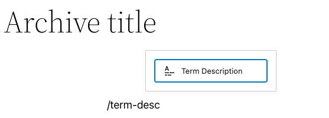

> [!NOTE]
> [Detailed instructions on adding blocks](../../working-with-blocks/adding-a-new-block.md)

## Block Toolbar

To view the block toolbar, click on the block and the toolbar will be displayed.

Every block comes with unique toolbar icons. These block-specific controls allow you to manipulate the block right in the editor.

The Term Description block shows six buttons in the block toolbar:

-   Transform to
-   Drag icon
-   Move arrows
-   Change alignment
-   Change text alignment
-   More options

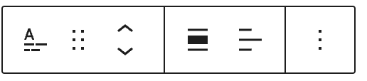

*Term Description Block Toolbar*

**Transform to:**

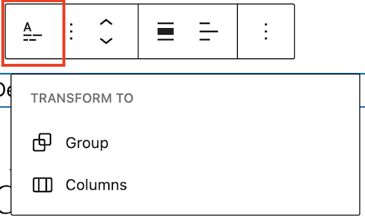

*Transform options in the Term Description Block*

Click on the “Transform” button to convert the Term Description block into a “Group” block or “Columns” block.

**Drag icon:**

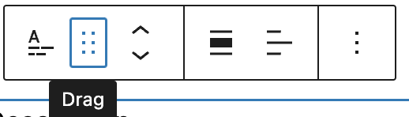

*Drag icon in the Term Description Block*

To drag and drop the block to a new location on the page template, click and hold the rectangle of dots, then drag to the new location. The blue separator line indicates where the block will be placed. Release the left mouse button when you find the new location to place the block.

**Move arrows:**

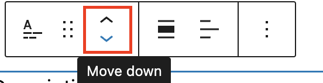

*Move arrows in the Term Description Block*

The up and down arrow icons can be used to move the block up and down on the page.

> [!NOTE]
> [Get more information about moving a block within the editor.](../../working-with-blocks/moving-blocks.md)

**Change alignment:**

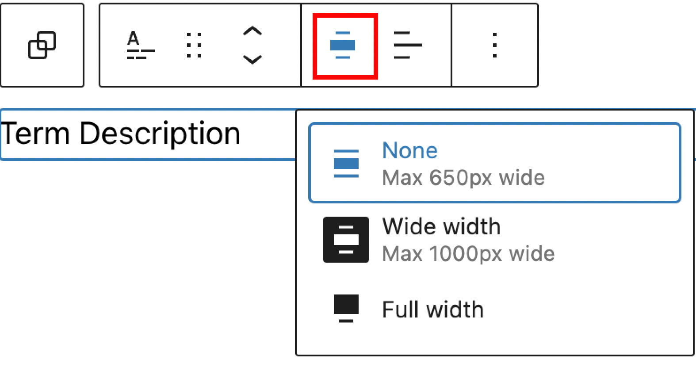

*Change alignment options in the Term Description Block*

-   **None –** Leaves the block the current size.
-   **Wide width –** Increase the width of the block beyond the content size.
-   **Full width –** Extend the block to cover the full width of the screen.

**Change text alignment**:

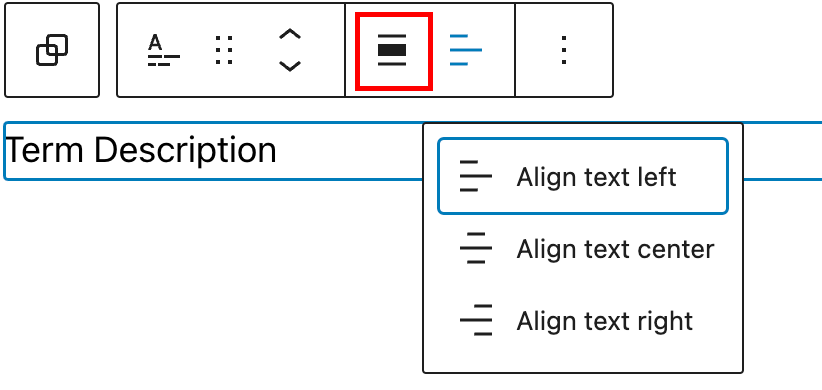

*Change text alignment options in the Term Description Block*

Click the “Change text alignment” button in the Block toolbar to display the options in the drop-down. You can align the block text to the left, make it center-aligned or align it to the right.

### More options

These controls give you the option to copy, duplicate, and edit your block as HTML.

> [!NOTE]
> [Read about these and other settings.](../../working-with-blocks/more-options.md)

## Block Settings

In addition to the block toolbar, every block has specific options in the editor sidebar.

*If you do not see the sidebar, click the ‘cog’ icon next to the Save button.*

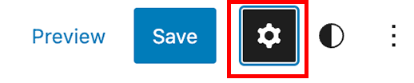

*How to turn on the Block Settings sidebar*

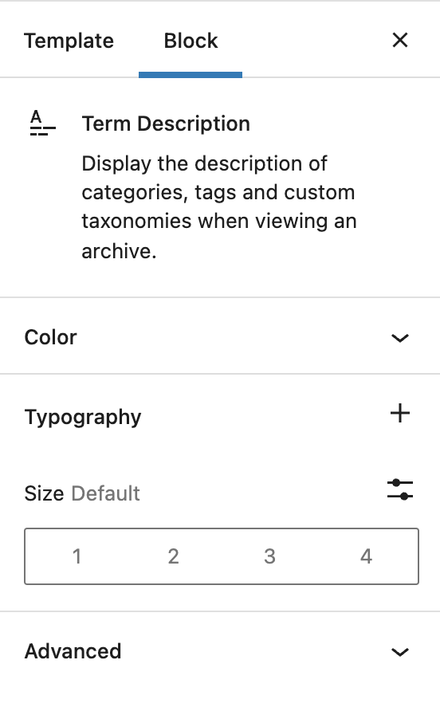

*Block Settings sidebar in the Term Description Block*

### Color

You can customize the text color, background color, and link color for the Term Description block. *The color options available will vary based on the theme.*

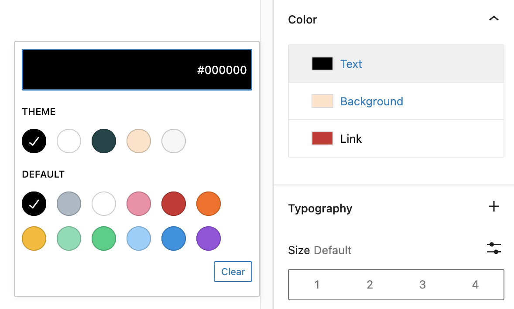

*Color Settings in the Term Description Block*

> [!NOTE]
> [See this guide for more information about changing colors.](../../working-with-blocks/block-settings/colors-settings-overview.md)

### Typography

On this tab, you can adjust the font size and line height of the Term Description block. To change the font size, select the numbers 1 (for small), 2 (for medium), 3 (for large) or 4 (for extra large).

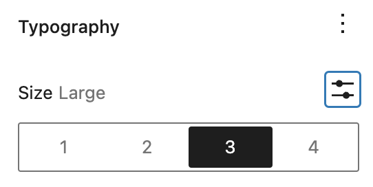

*Typography Setting in the Term Description Block*

> [!NOTE]
> [Get more details about changing typography settings.](../../working-with-blocks/block-settings/typography-settings-overview.md)

### Advanced

The following Advanced settings options are available: HTML Anchor, Additional CSS Class(es), Additional CSS, and Styles.

> [!NOTE]
> [Learn more about advanced settings.](../../working-with-blocks/block-settings/advanced-settings-overview.md)

## Changelog

-   Updated 2026-06-29
    -   Linked to advanced settings
-   Created 2022-03-09
