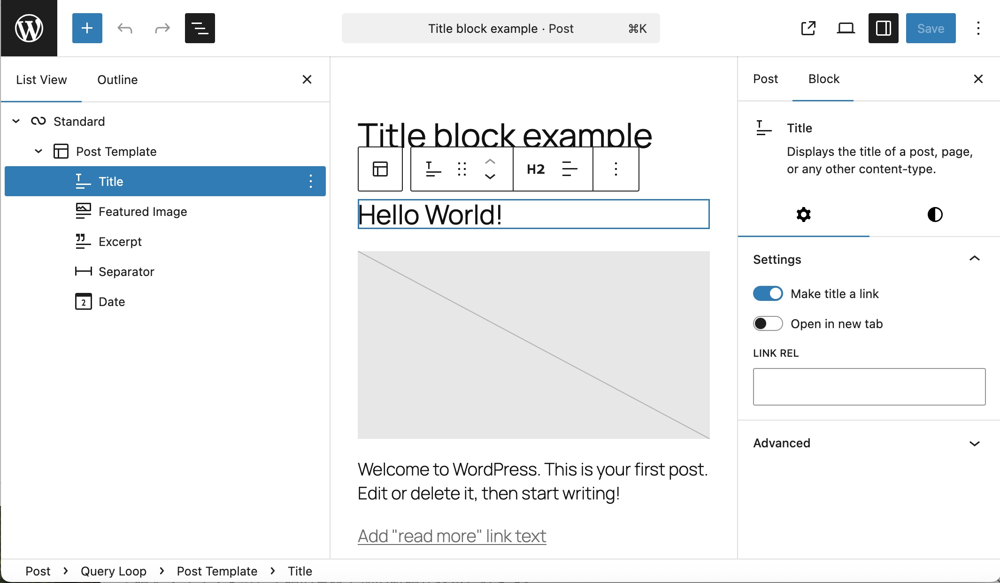
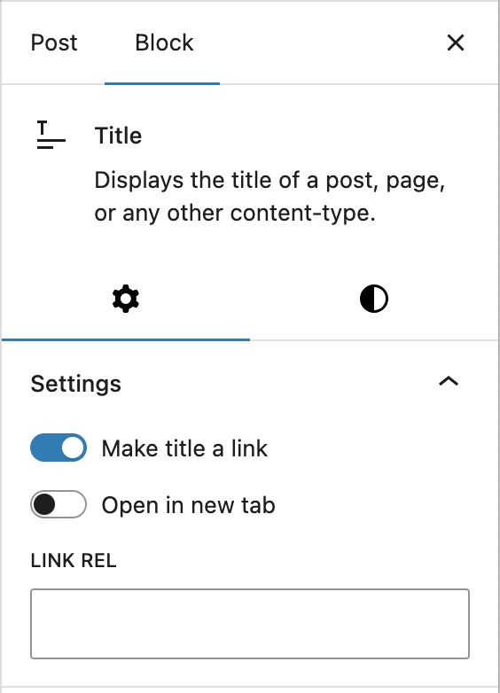

# Title block

Title block (formerly known as Post Title block) displays the title of a post or page. This block is primarily nested inside a [query loop](query-loop-block.md) block and helps to customize the appearance of the query loop.

> [!NOTE]
> See [here](../../working-with-blocks/work-with-blocks.md) for a description of how to use blocks in general and each component such as toolbars, settings panel, etc.

## Block settings

*Screenshot*

### Settings

#### Make title a link

It links the title to the URL of the post or page. This enables the website visitor to go to the page by clicking on the Title.

#### Open in new tab

It opens the linked page in a separate browser tab.

#### Link Rel

It controls the page link’s [`rel`](https://developer.mozilla.org/en-US/docs/Web/HTML/Reference/Attributes/rel) attribute (the relationship between the current document and the linked document), for adding nofollow amongst other things.

#### Advanced

The following Advanced settings options are available: HTML Anchor, Additional CSS Class(es), Additional CSS, and Styles.

> [!NOTE]
> [Learn more about advanced settings.](../../working-with-blocks/block-settings/advanced-settings-overview.md)

## Changelog

-   Updated 2026-06-29
    -   Linked to advanced settings
-   2025-08-02
    -   Renamed to Title block from Post Title block
-   2023-07-25
    -   Fix broken images URLs
-   2022-12-12
    -   Updated screenshots for 6.1
-   Created 2022-03-17
