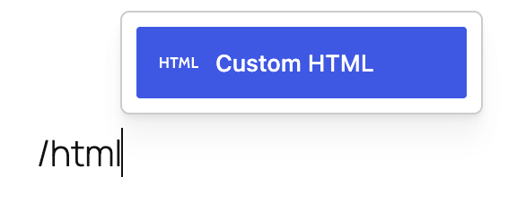
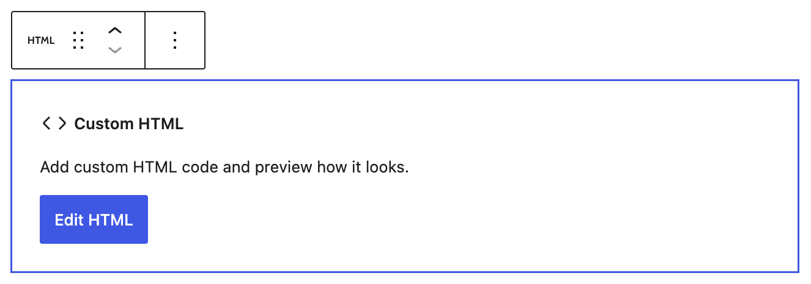
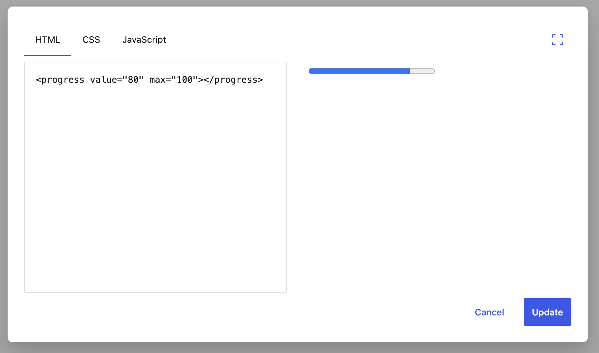
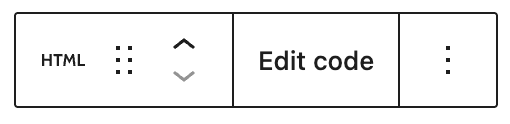
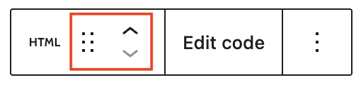

# Custom HTML

**Hypertext Markup Language (HTML)**, is language used to describe the semantic content of web pages. This can be added using the custom HTML block. This block allows you to insert your code so you can fine-tune your content.

Starting in WordPress 7.0, the Custom HTML block introduces separate editing panels for HTML, CSS, and JavaScript. The CSS and JavaScript panels are only available to users with the unfiltered_html capability. If a user lacks this capability (for example, a Contributor), WordPress will sanitize the block’s content using the function [wp_kses()](https://developer.wordpress.org/reference/functions/wp_kses/), stripping disallowed tags such as `<script>` and `<iframe>`. In this case, the CSS and JavaScript panels are not shown, and any disallowed markup is removed when the post is saved or updated.

> [!NOTE]
> [Learn more about WordPress user roles and capabilities](../../../../using-wordpress/users-roles-and-profiles/roles-and-capabilities.md)

<video controls preload="metadata" src="https://wordpress.org/documentation/files/2019/03/html-block-7-0.mp4" poster="../../../../assets/images/2019/03/Screenshot-2026-05-20-at-10.54.05-AM.jpg"></video>

## Add a Custom HTML block

In order to add a custom HTML block, click on the **Block Inserter** icon.

You can also type `/html` and hit enter in a new paragraph block to add one quickly.

> [!NOTE]
> [Detailed instructions on adding blocks](../../working-with-blocks/adding-a-new-block.md)

## Editing the block

Once you add the block, click on the Edit HTML button to open the editing modal.

Enter HTML code and see the preview of your output to the right of the code editor. You can expand the modal to fullscreen the Enable/disable fullscreen button on the top right of the modal. When you are done entering code, press the Update button.

## Block toolbar

The Custom HTML block has the following options on the block toolbar:

### Block moving tools

The block-moving tools allow you to move the block in the editor. Use the six dots icon to drag and drop the block and place it anywhere on the page. Alternatively, click on the up and down arrows to move the block up or down.

> [!NOTE]
> [Get more information about moving a block within the editor](../../working-with-blocks/moving-blocks.md)

### Edit Code button

Press this button to make changes to your Custom HTML block code.

### More options

These controls give you the option to copy, duplicate, or rename your block.

> [!NOTE]
> [Read about these and other settings](../../working-with-blocks/more-options.md)

## Block settings

While most blocks have specific options in the editor sidebar in addition to the options found in the block toolbar, the HTML block does not have extra options.

## Changelog

-   Updated 2026-05-20 (props to @awetz583 @atachibana @lanamiro1)
    -   Updated information, video and screenshots for 7.0
-   Updated 2026-05-01
    -   Updated formatting and added link to roles and capabilities
-   Updated 2025-07-21
    -   Added detail HTML processing
-   Updated 2022-11-26
    -   Removed redudant content
    -   Aligned images for mobile view
    -   Added heading
-   Updated 2022-04-20
    -   Update screenshots to 5.9
    -   Add More Options section
