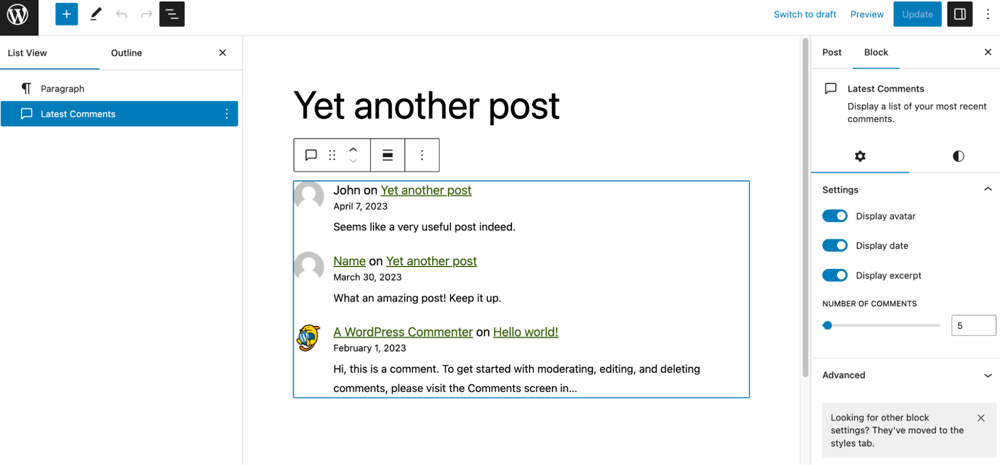
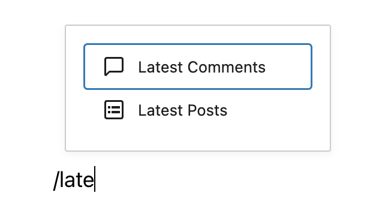
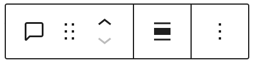
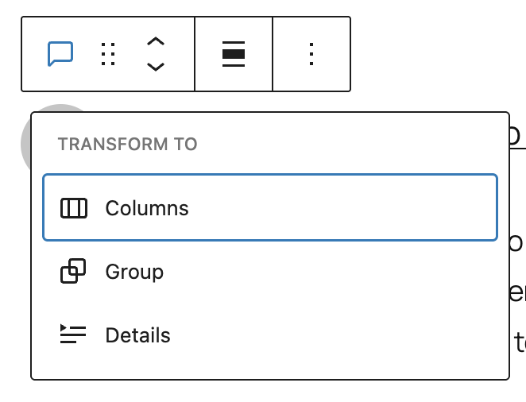
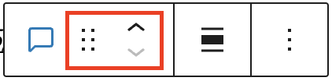
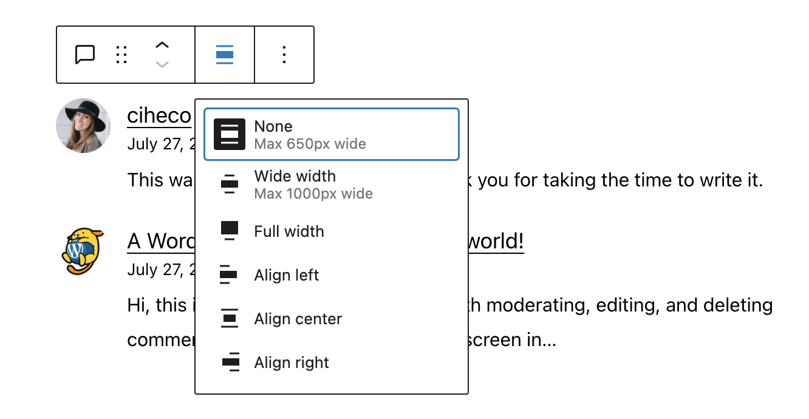
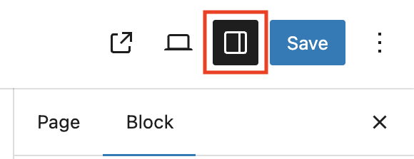
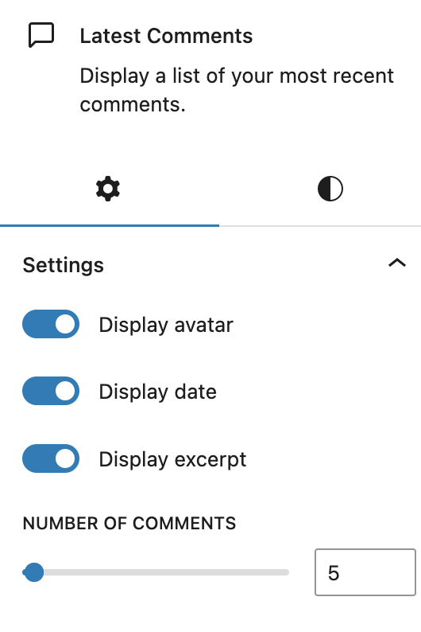
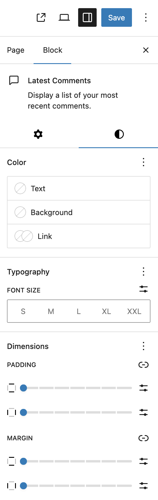

# Latest Comments block

The Latest Comments block displays the most recent comments readers have left on your blog, including the users and blog posts. This block is useful to show the recent activities and ongoing discussion on your blog.

Additional options for this block include to display the commenter’s avatar, comment date, and comment excerpt. Read the **Block settings** section to learn more about this.

<video controls preload="metadata" src="https://wordpress.org/documentation/files/2019/03/Kapture-2026-05-01-at-11.37.39.mp4" poster="../../../../assets/images/2019/03/Screenshot-2026-05-01-at-11.40.49-AM.png"></video>

## Add a Latest Comments block

It can be added to any template, template part, page, and widget area. Click the block inserter icon (**+**) to open the block inserter pop-up window and choose the Latest Comments block.

You can also use the keyboard shortcut <kbd>/latest-comments</kbd> to quickly insert a Latest Comments block.

> [!NOTE]
> [Detailed instructions on adding blocks](../../working-with-blocks/adding-a-new-block.md)

## Block toolbar

Every block has unique toolbar icons and blocks specific user controls that allow you to manipulate the block right in the editor. The Latest Comments block shows the following buttons:

To view the block toolbar, click on the block, and the toolbar will be displayed.

### Transform to

When you click the **Transform** button, you can convert the Latest Comments block into another block type using the existing content.You can transform the Latest Comments block into Columns, Group or Details blocks.

### Block-moving tools

Use the block-moving tools to move the block up and down the editor. Use the six dots icon to drag and drop the Latest Comments block and reposition it anywhere on the editor. Alternatively, click on the up and down arrows to move the block up or down the editor.

> [!NOTE]
> [Get more information about moving a block within the editor.](../../working-with-blocks/moving-blocks.md)

### Change alignment

Use the **Align** button to change the Latest Comments block’s position inside the block editor. Choose one of the following block alignment options:

-   **None** – the default option.
-   **Wide width** – increase the width of the block beyond the content size.
-   **Full width** – extend the block to cover the full width of the screen.
-   **Align left** – make the block left-aligned.
-   **Align center** – make the block alignment centered.
-   **Align right** – make the block right-aligned.

The “Wide width” and “Full width” alignment settings must be enabled by your WordPress theme.

### More options

The More options menu represented by three vertical dots on the far right of the toolbar gives you more features such as the ability to duplicate or remove the block.

> [!NOTE]
> [Read about these and other settings.](../../working-with-blocks/more-options.md)

## Block settings

Every block has specific options in the editor sidebar in addition to the options found in the block toolbar. If you do not see the sidebar, click on the **Settings button** next to the Save/Publish button.

### Latest comments settings

The Latest Comments settings let you to choose whether to display the avatar, the date, and/or the excerpt. They are all on by default. You may also adjust the number of comments to display within the block by using the slider tool or inserting the number in the available field.

### Advanced

The Latest Comments block provides the following Advanced settings options: HTML anchor, Additional CSS Class(es), Additional CSS, and Styles.

> [!NOTE]
> [Learn more about advanced settings](../../working-with-blocks/block-settings/advanced-settings-overview.md)

## Block Settings: Styles

Choose the styles panel for the options below:

### Color

The Latest Comments block provides Color settings options to change the text and background colors.

> [!NOTE]
> [See this guide for more information about changing colors](../../working-with-blocks/block-settings/colors-settings-overview.md)

### Typography

The Latest Comments block provides typography settings to change the font family, size, appearance, line height, letter case, letter spacing, and decoration.

> [!NOTE]
> [Get more details about changing typography settings](../../working-with-blocks/block-settings/typography-settings-overview.md)

### Dimensions

The Latest Comments block provides dimension settings options to change padding and margin size.

> [!NOTE]
> [Learn more about dimension controls](../../working-with-blocks/block-settings/dimension-controls-overview.md)

## Changelog

-   Updated 2026-05-25 (props @kjoyner @awetz583)
    -   Updated “Advanced” section to refer to new overview page
-   Updated 2026-05-01 (props to @awetz583 @webtrainingwheels @karthickmurugan)
    -   Added color, typography, dimensions settings
    -   Updated video
-   Updated 2023-04-11
    -   Screenshots for 6.2
    -   Revised formatting
    -   Added Dimensions settings support
-   Updates 2022-11-27
    -   Removed redadunt content
    -   Aligned images for mobile view
-   Updated 2022-11-08
    -   Screenshots for 6.1
-   Updated 2022-08-01
    -   Screenshots for 6.0
    -   Added transform and block moving tools info
    -   Added ALT tags for the images
-   Updated 2022-07-27
    -   Screenshots as per WordPress 5.9
-   Created 2019-03-07
