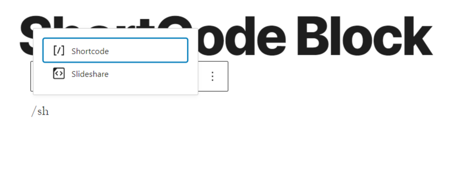
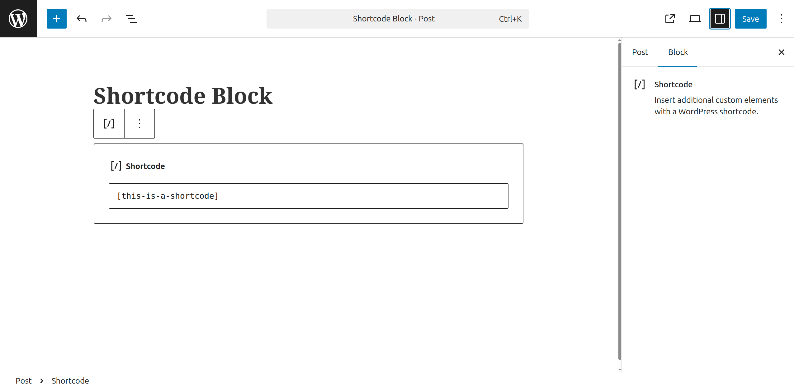
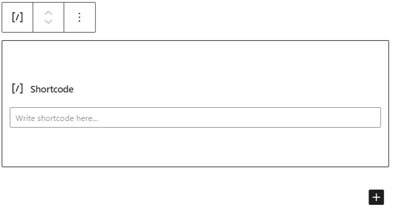
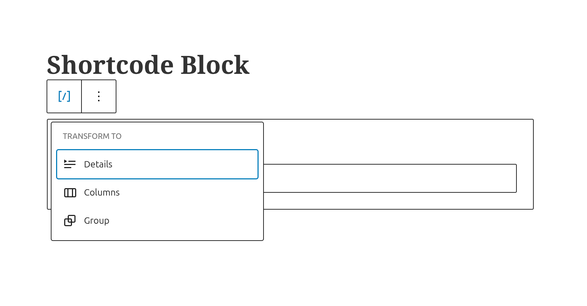

# Shortcode block

A shortcode is a WordPress-specific code that lets you do nifty things with very little effort. Shortcodes can embed files or create objects that would normally require lots of complicated, ugly code in just one line. **Shortcode = shortcut**.

The *shortcode block* can be added to a page by clicking on the Add Block button. It can be found in *Widgets* section. Alternatively, you can type /shortcode and press enter.

*Add shortcodes with a slash command.*

> [!NOTE]
> [Detailed instructions on adding blocks](../../working-with-blocks/adding-a-new-block.md)

In this video, you can see how you can use the short block and the different settings to modify how your content will appear.

<video controls preload="metadata" src="https://wordpress.org/documentation/files/2020/10/how-shortcode-block-works.mp4"></video>

*How the shortcode block works*

## Block Toolbar

Unlike other common blocks, the *shortcode block* does not include any specific settings in the block toolbar or editor sidebar.

*Shortcode Block Editor Sidebar*

**Writing Your Shortcode**

You may type your shortcode into the box provided or paste it from the available shortcodes.

*The shortcode block interface.*

**More Options**

These controls give you the option to copy, duplicate, and edit your block as HTML.

> [!NOTE]
> [Read about these and other settings.](../../working-with-blocks/more-options.md)

## Block Settings

Every block has specific options in the editor sidebar in addition to the options found in the block toolbar. *If you do not see the sidebar, simply click the ‘cog’ icon next to the Publish button.*

As you can see, the *shortcode block* doesn’t include specific settings in the block settings.

You can transform a *shortcode block* into a group or into a columns, so you can further apply custom settings to the block.

**Color**

Text and background colors can be set on a per-block basis, allowing you to call attention to important content.

Via the “Custom Color” link you can further modify the color choice.

> [!NOTE]
> [See this guide for more information about changing colors.](../../working-with-blocks/block-settings/colors-settings-overview.md)

Accessibility parameters are built into the new editor to warn you when the text may become illegible for persons with reading impairments.

![WordPress Gutenberg editor showing a Shortcode block containing \[embed_id_video\], with the Block settings panel open on the right.](../../../../assets/images/2019/03/shortcode-iframe.png)

**Advanced**

The shortcode block does not have any advanced settings available.

## Changelog

-   Updated 2026-08-28
    -   Replacing screenshot that included ifram (@rollybueno, @winglouie)
-   Updated 2026-05-18
    -   Updated block screenshot and transform (@rollybueno)
-   Updated 2022-11-27
    -   Added alt text to images
    -   Removed redundant content
-   Updated 2022-02-04
    -   Updated 5.9 screenshot
-   Updated 2020-09-07
    -   Updated 5.5 screenshot
    -   Added block settings
    -   Added changelog
    -   Added more options
    -   Added go to list block
-   Created 2019-03-07
