# Tag Cloud block

The *Tag Cloud block* allows adding tag/category cloud into the page/post. A tag cloud is a list of all [tags](../../../../using-wordpress/administration-screens/posts/posts-tags-screen.md) /categories on your site, displayed in alphabetical order.

Tag cloud helps your readers to discover and search content easily and quickly.

The *Tag Cloud block* displays each tag with the font size based on the number of times that tag has been associated with posts. The bigger the size, the more posts are tagged with that tag. This helps your readers know your favorite subjects and the topics you write about most frequently.

## How to add a Tag Cloud block to your post or page

Add the *Tag Cloud block* to your post or page by clicking on the “Block Inserter” (+) and then search for “Tag Cloud”. Alternatively, you can type `/tag-cloud` in a new paragraph block and press `enter`.

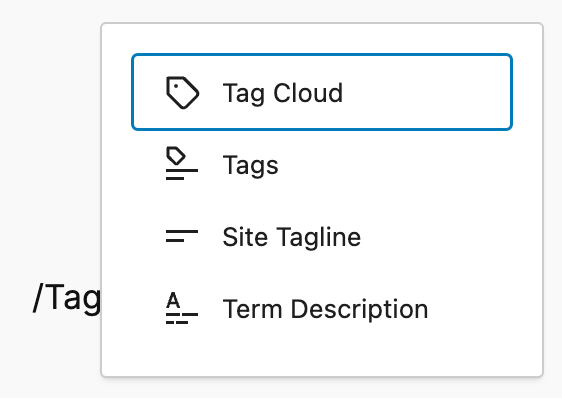

> [!NOTE]
> [Detailed instructions on adding blocks](../../working-with-blocks/adding-a-new-block.md)

If you have tags/categories on your site, the *Tag Cloud block* will display a list of the tags as follows:

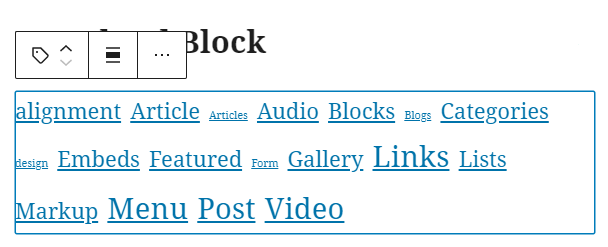

If the site doesn’t have any tags then it will display the message as shown below.

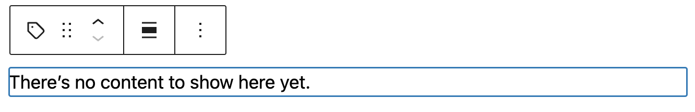

**Note:** Tags’ appearance varies based on the selected theme.

## Block toolbar

Each block has its own block-specific controls that allow you to customize the block right in the editor. The *Tag Cloud block* offers the following options in its toolbar:

-   Transform to
-   Drag
-   Move handles
-   Change alignment
-   More Options.

### Transform to

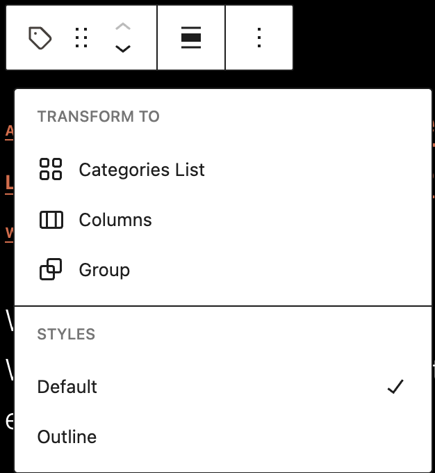

When you click on the **Transform** button you can convert the *Tag Cloud block* into a Categories List, Columns, or Group. The Group lets you change the background color around the Tag Cloud block. You can also change the Tag Cloud styles from Default to Outline.

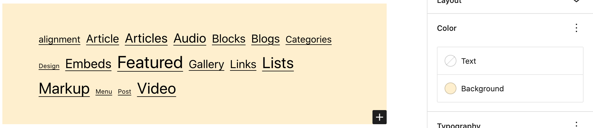

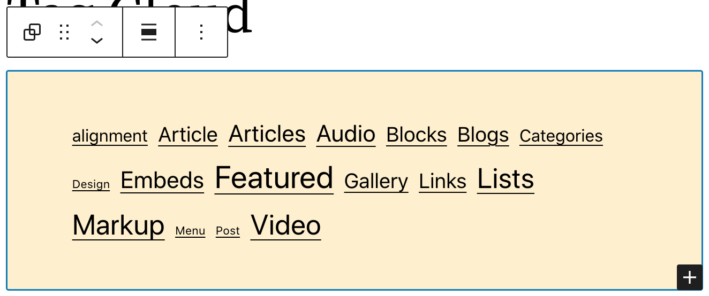

### Drag

To drag and drop the block to a new location on the page template, click and hold the rectangle of dots, then drag to the new location. The blue separator line indicates where the block will be placed. Release the left mouse button when you find the new location to place the block.

### Move handles

The up and down arrow icons can be used to move a block up and down on the page.

> [!NOTE]
> [Get more information about moving a block within the editor.](../../working-with-blocks/moving-blocks.md)

### Change alignment

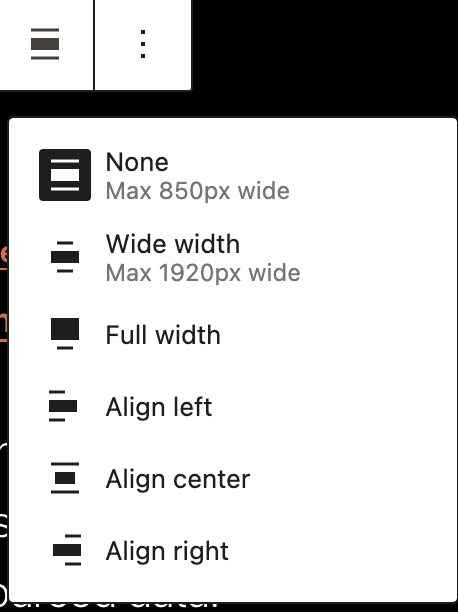

-   **Wide width** – Increase the width of the Tag Cloud block beyond the content size.
-   **Full width** – Extend the Tag Cloud block to cover the full width of the screen.
-   **Align left** – Make the Tag Cloud left aligned
-   **Align center** – Make the Tag Cloud aligned center.
-   **Align right** – Make the Tag Cloud right aligned.

**Note:** “Wide width” and “Full width” alignment is only available if it is enabled by the Theme of your site.

### More options

These controls give you the option to copy, duplicate, and edit your block as HTML.

> [!NOTE]
> [Read about these and other settings.](../../working-with-blocks/more-options.md)

## Block settings

Every block has specific options in the editor sidebar in addition to the options found in the block toolbar. If you do not see the sidebar, simply click the ‘settings’ icon next to the Publish button.

### Settings tab

#### Taxonomy

Select from the following three [taxonomy](../../../../using-wordpress/writing-and-publishing/organizing-your-site/taxonomies.md) types: Categories, Tags, or Pattern Categories. The Tag Cloud is displayed based on the selected taxonomy.

#### Show post counts

Toggle the switch to display the number of posts associated with the taxonomy.

#### Number of tags

Move the slider or type in a number to change the number of taxonomy terms that can be displayed in the Tag Cloud.

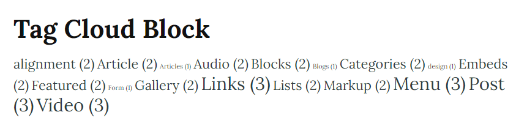

#### Smallest size/largest size

Change the smallest and largest font size that can be used in the Tag Cloud. You can change the font size unit between PX, %, EM, REM, VW, VH.

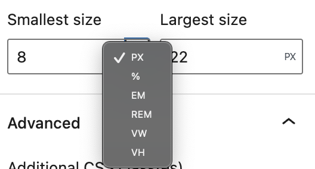

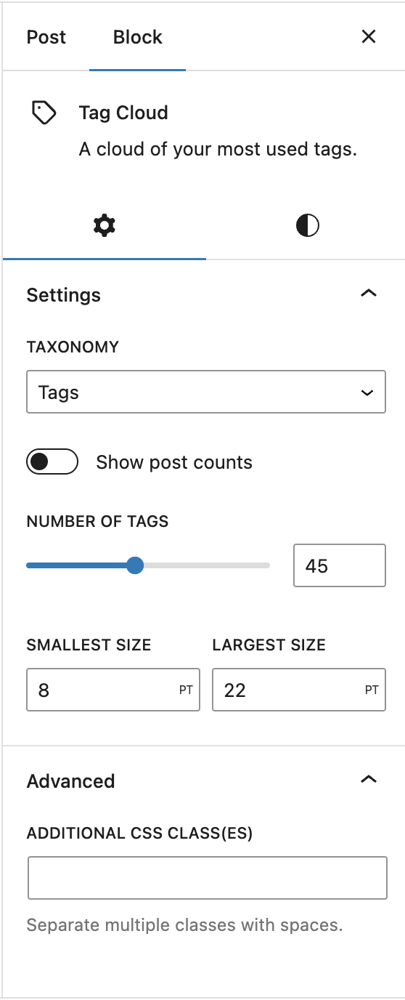

### Styles tab

#### Styles

You can modify the *Tag Cloud block* styles by choosing the ‘Default’ or ‘Outline’ buttons in the Styles settings panel. Hover over the ‘Default’ or ‘Outline’ buttons to get a preview of the styles.

The style options may vary based on your theme.

#### Typography

Typography settings allow you to change a block’s font size, appearance, line height, letter casing, and spacing.

> [!NOTE]
> [Get more details about changing typography settings.](../../working-with-blocks/block-settings/typography-settings-overview.md)

#### Dimensions

Dimension controls are used to control how groups of blocks are placed alongside one another, by changing the values for padding, margin, and other dimensions

> [!NOTE]
> [Learn more about dimension controls.](../../working-with-blocks/block-settings/dimension-controls-overview.md)

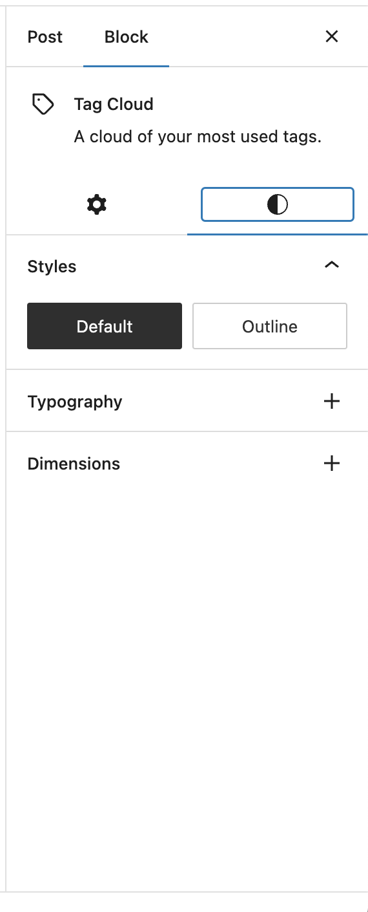

### Advanced

The Tag Cloud block provides the following Advanced settings options: HTML anchor, Additional CSS Class(es), Additional CSS, and Styles.

> [!NOTE]
> [Learn more about advanced settings](../../working-with-blocks/block-settings/advanced-settings-overview.md)

## Changelog

-   Updated 2026-05-25 (props @kjoyner @awetz583)
    -   Updated “Advanced” section to refer to new overview page
-   Updated 2024-04-23
    -   Updated formatting
-   Updated 2023-03-30
    -   Updated screenshots.
    -   Added information about typography options.
-   Updated 2023-01-26
    -   Updated for formatting consistency.
-   Updated 2022-11-26
    -   Alinged images for mobile view .
    -   Removed redundant content .
-   Updated 2022-11-17
    -   Updated screenshots and content for 6.1.
-   Updated 2022-07-19
    -   Added content and screenshots for 6.0.
    -   Added ALT tags for images.
-   Created 2020-08-17
