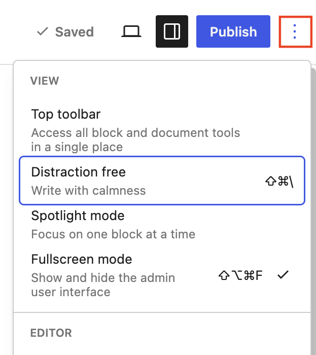

# Distraction Free mode

Distraction Free mode is a new visual option that creates a focused writing experience by hiding various parts of the editor interface. When enabled, any open sidebars are closed and toolbars fade away, leaving your content to take center stage. You can toggle this mode on/off as you write and as you’d like.

## How Distraction Free mode works

Distraction free mode works by adjusting the following interfaces and simplifying the writing experience:

-   Removing the Top toolbar, making it only appear when you hover your cursor over it.
-   Removes many Top toolbar buttons.
-   Automatically closes any open sidebars.
-   Hides various + options for adding new blocks.
-   Hides the block toolbar.

## How to use Distraction Free mode

### How to find Distraction Free mode

To find Distraction Free mode, use the three-dot menu on the top right and select the **Distraction free** option. Your choice will be stored in your browser’s local storage, meaning if you switch browsers or computers, you will have to switch into this mode once more.

Keep in mind that you can use Distraction free mode with additional modes like Fullscreen mode or Spotlight mode.

### How to toggle on and off

To toggle this mode off, move your cursor to the very top of the editor until the top toolbar appears. From there, you can select the three-dot menu on the top right and un-check the Distraction free mode.

You can also use the keyboard shortcut ⇧ ⌘ \ on Mac and Ctrl+Shift+\ for Windows.

### How to show the top toolbar

To see the top toolbar in this view, move your cursor to the top of the editor. As you do so, the top toolbar will come back into view and will fade if you move your cursor away again.

### How to add blocks

Because this mode is built for writing, you can create new paragraphs by hitting enter. To add different kinds of blocks though, like a Heading or Image, you must use the slash command (`/`) as it’s the only way to add additional blocks. [Learn more about how to add blocks.](working-with-blocks/adding-a-new-block.md#slash-command)

## Demonstration of Distraction Free mode

<!-- VideoPress embed (iframe removed): https://videopress.com/embed/G2qkhryC -->

https://videopress.com/v/G2qkhryC

**Changelog:**

-   Updated 2026-10-05
    -   Updated screenshot and recording for 7.1
-   Updated 2024-11-04
    -   Updated the screenshot as it appears in the latest Gutenberg editor.
    -   Updated the video record with one that shows how to navigate the top tool bar while in distraction free mode.
-   2023-04-16 Created
