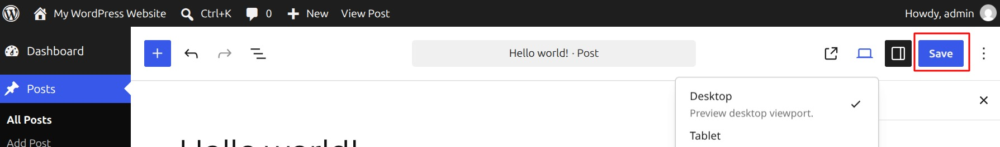
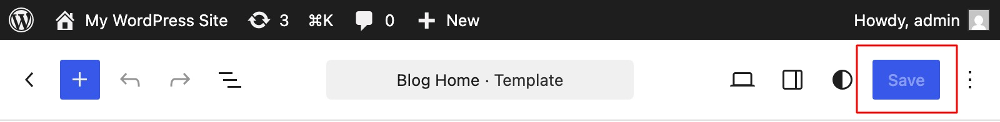
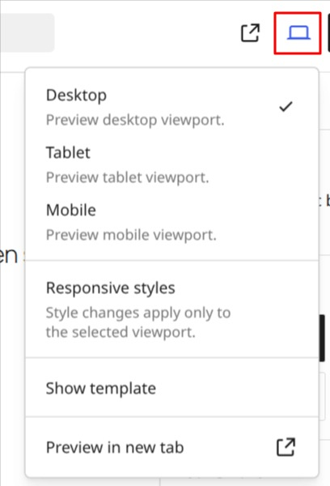
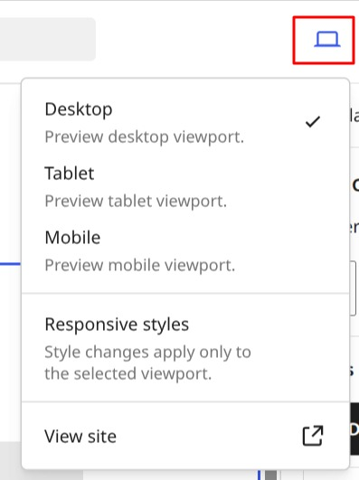
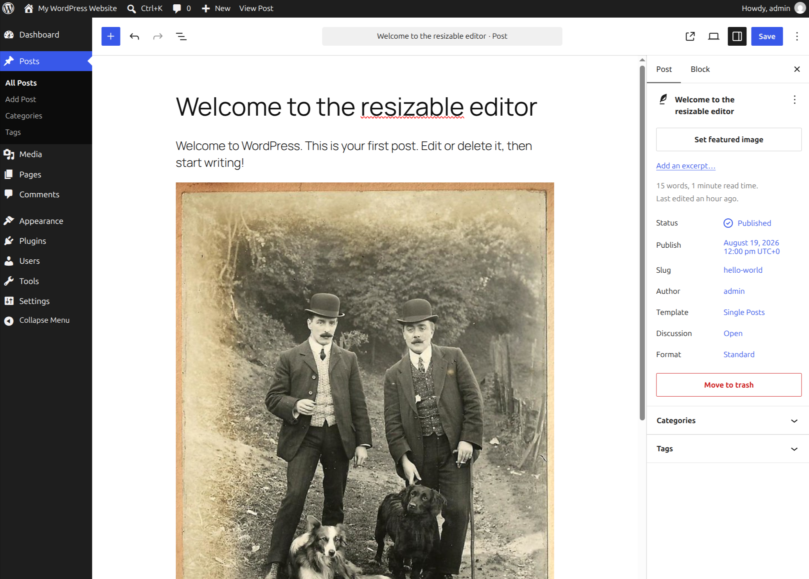
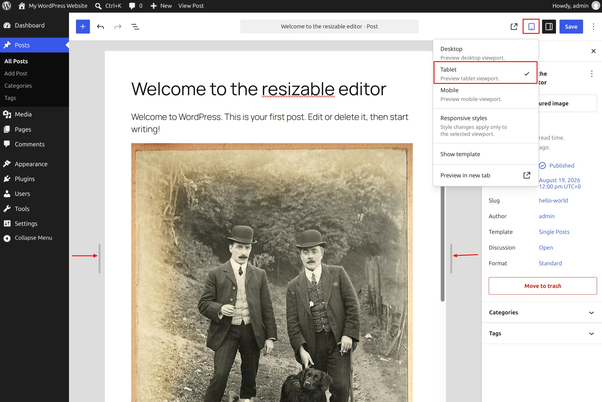
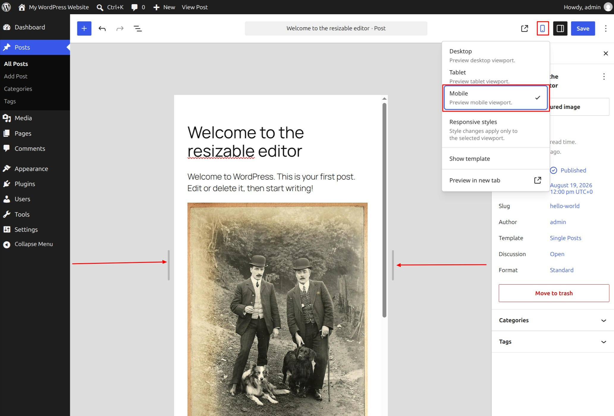

# How to use the View feature

The **View** button is available in the top toolbar in the [WordPress Block Editor](wordpress-block-editor.md) and [Site Editor](../site-editor/README.md). You can use it to preview how your current changes in a post, page, template, or site look at different screen widths before viewing it on the front end.

The View feature combines the Desktop, Tablet, and Mobile preview presets with a resizable editor canvas. You can select a preset screen size or manually resize the canvas to preview your content at widths between those presets.

The View menu is also where you can enable **Responsive editing** when you want to edit supported block styles for a specific viewport.

To save changes, click the **Save** button in the top right corner of the [Block editor](wordpress-block-editor.md) [or Site editor](../site-editor/README.md).

*Save button in Block editor*

*Save button in Site editor*

## Open the View menu

Select the **View** button to open the View menu.

The menu includes viewport presets you can use to change the width of the editor canvas:

-   **Desktop**
-   **Tablet**
-   **Mobile**

It also provides options for viewing your content on the front end and, when available, enabling **Responsive editing**.

**Block editor**

*View menu in Block editor.*

**Site editor**

*View menu in Site editor.*

## Preview at Desktop, Tablet, and Mobile widths

### Desktop

**Desktop** displays the editor canvas at its normal desktop width.

When the canvas is already using the full available Desktop width, resize handles may not be visible because there is no additional space beside the canvas.

By default, the Desktop view will be selected. You can preview how your page, post, or site will look on a desktop screen.

*Desktop view for the View option*

### Tablet

Select **Tablet** to resize the editor canvas to the Tablet preview width.

At this width, resize handles appear beside the canvas. Drag either handle to make the canvas wider or narrower.

*Tablet view for the View option*

### Mobile

Select **Mobile** to resize the editor canvas to the Mobile preview width.

*Mobile view for the View option*

## Resize the preview manually

The Desktop, Tablet, and Mobile options are preset canvas widths rather than completely separate preview modes.

When resize handles are visible beside the editor canvas, drag a handle horizontally to change the preview width.

As you resize the canvas, the View feature and the editor stay synchronized. If you drag the canvas to a width associated with another device preset, the current preview state updates accordingly.

This lets you test your content at widths that fall between the Desktop, Tablet, and Mobile presets instead of checking only three fixed sizes.

If you want to manually resize the canvas, first select **Tablet** or **Mobile**, then use the resize handles that appear beside the canvas.

<!-- VideoPress embed (iframe removed): https://videopress.com/embed/H8bSIs4a -->

https://videopress.com/v/H8bSIs4a

*Resizing the canvas in the Block editor.*

## Use Responsive editing

The View menu also provides access to **Responsive styles**. To learn how to use this feature, please refer to the Responsive styles article.

## Preview in a new tab

The editor canvas gives you a convenient preview while you are editing, but you can also view the content on the front end.

In the WordPress Block Editor, select **Preview in new tab** from the View menu to open the current post or page in a new browser tab.

In the Site Editor, use **View site** to open the site on the front end in a new browser tab.

Viewing the content in a new tab lets you check the actual front-end appearance separately from the editor canvas.

<!-- VideoPress embed (iframe removed): https://videopress.com/embed/RTO4j48Q -->

https://videopress.com/v/RTO4j48Q

*Previewing content at preset and custom canvas widths and opening the preview on the front end.*

#### Changelog

-   Updated 2026-08-19
    -   Updated content for WordPress 7.1.
    -   Documented the unified device preview and resizable editor canvas.
    -   Added information about manually resizing the preview between Desktop, Tablet, and Mobile widths.
    -   Updated image and video requirements for the WordPress 7.1 interface.
-   Updated 2022-10-25
    -   Updated screenshots and content for 6.1.
    -   Added info for Site Editor
    -   Added ALT tags for the images
    -   Added video to show the feature
-   Created 2020-08-22
