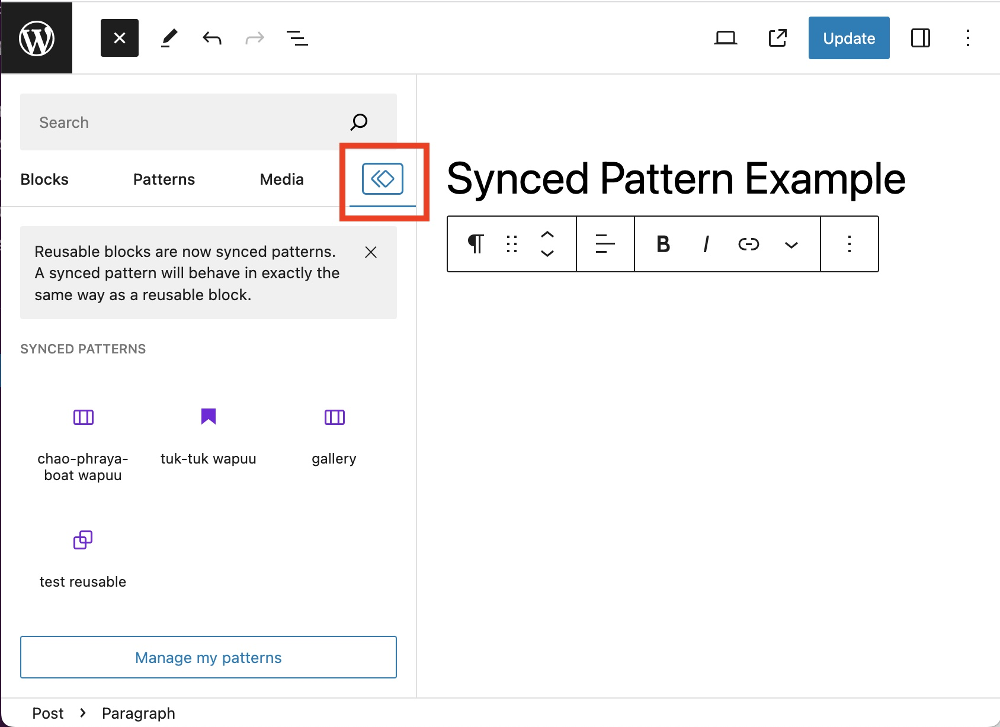
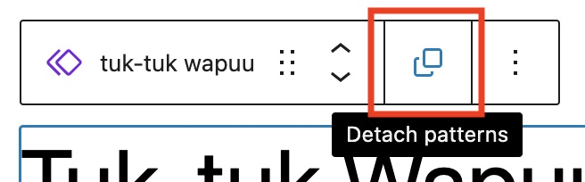
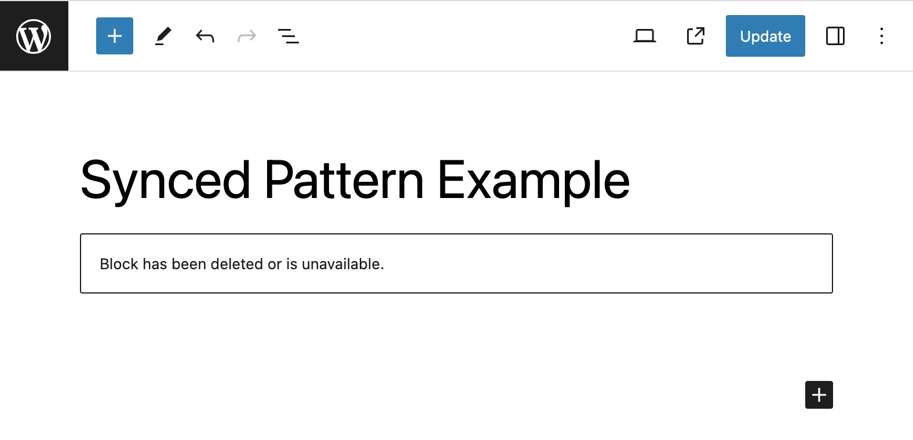
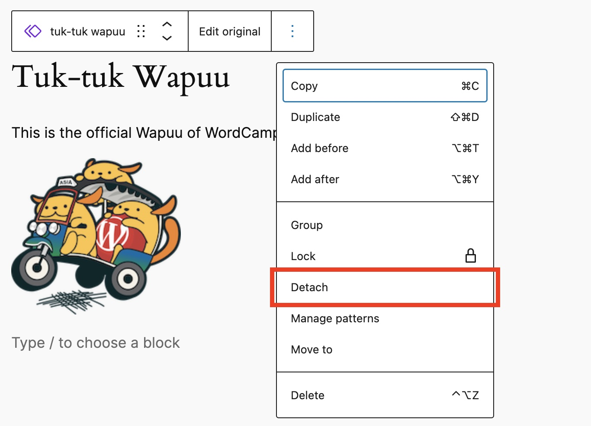

# Synced Patterns (Reusable blocks)

A Synced Pattern is a type of block pattern that enables the Synced option, and it will behave in exactly the same way as a reusable block. Editing the synced pattern will update it anywhere it is used. After creating a synced pattern, you can ‘detach’ it to a regular block, and edit the block without affecting your already saved synced pattern. For more information, you can learn more in the [Synced Pattern article](https://wordpress.org/news/2023/07/synced-patterns-the-evolution-of-reusable-blocks/).

> [!NOTE]
> WordPress 6.3 renamed Reusable Blocks to Patterns. A synced pattern will behave in exactly the same way as a reusable block.

## Creating a Synced Pattern

Let’s say you have a paragraph block which you often fill with the same text at the end of your post. This could be everything from how to get in touch to your business hours to your social media accounts. To avoid having to add the same content to a paragraph block every time you want to place it at the end of your post, you can make it a synced pattern. To accomplish this, follow these steps:

1.  Select the block or blocks you want to turn into a pattern.
2.  Click on the three dot menu that opens up the additional settings.
3.  Click on “Create pattern”.
4.  Enter the name of the pattern.
5.  Turn on the Synced option
6.  Click Create.

<video controls preload="metadata" src="https://wordpress.org/documentation/files/2023/08/256239744-52edd86c-a582-4719-97e3-d11159161e46.mp4"></video>

You’ll then be able to locate the created synced patterns at Synced Patterns (crossing rhombus icon) of Block Inserter.

## Using a Synced Pattern

After you’ve created a Synced Pattern, you can then use it wherever you’d like. You’ll also have a few more options for adding one into your content:

-   You can open up the **Block Inserter** and switch to the **Synced Patterns** section to add whichever option you want.
-   Click on the add block button and search for the name of the synced pattern you want to use.
-   You can type <kbd>/</kbd> followed by the name of the synced pattern you want to use.

After inserting the Synced Pattern you want to use, make sure to select the ‘**Detach pattern**‘ (formerly known as “**Convert to Regular Block**“) option shown below if you wish to make any changes to the block on that page or post only. Note that this option won’t be available if the Synced Pattern is locked.

## Selecting and editing a Synced Pattern

If you’d like to edit a synced pattern, you can do so in two ways:

-   You can add the block directly into a post or page and edit it from there. If you do this, you’ll see the synced pattern mentioned in the saving flow when you save the post or page itself.
-   You can go to **Options > Manage Patterns**, which will take you to a specific interface where you can directly edit patterns as you’d like.

*Keep in mind that, when a synced pattern is changed, the change will be reflected in all the places where the same synced pattern was used.*

## Removing a Synced Pattern

To remove a synced pattern, click on the **three dots** icon and select the option to **Manage Patterns**. From there you can edit and delete patterns as you’d like.

Keep in mind that when a synced pattern is removed, the removal will be reflected in all the places where the same synced pattern was used. You’ll see the message below where the removed synced pattern existed:

## Detaching a Synced Pattern

After inserting the Synced Pattern you want to use, make sure to select the ‘Detach‘ (formerly known as “Convert to Regular Block“) option shown below if you wish to make any changes to the block on that page or post only. Note that this option won’t be available if the Synced Pattern is locked.

## Demonstration of a Synced Pattern

In this demo, we insert Synced Patterns in the three ways described above (Block Inserter, Add Block icon, ‘/’ key). A change in one pattern (in this case, a change in text color) will be reflected in others. Next, detach the middle Synced Pattern. Synchronization is then lost. And if you look at it in the list view, it is back to a normal block.

<video controls preload="metadata" src="https://wordpress.org/documentation/files/2023/07/wp6.3-synced-pattern-demo.mp4"></video>

## Changelog

-   Updated 2024-01-09
    -   Updated for WordPress 6.4
-   Updated 2023-08-08
    -   Replaced “Reusable Blocks” with “Patterns”
-   Updated 2021-07-13
