# Submit your Block Pattern to the Directory

[Block Patterns](block-pattern.md) are a collection of designed core blocks that can be used in posts and pages. They are building blocks to get content created faster. Eg: a subscription form, a Call-to-Action, or a Price List.

[Learn more on how to use Block Patterns](block-pattern.md)

The [Block Pattern Directory](block-pattern-directory.md) has a myriad of block patterns that work with any site. Themes can reference patterns from the [Directory](../working-with-blocks/block-directory.md), without loading them with the theme on every site. This helps to share block patterns from one site to the next.

It is now possible for designers, site builders, and site owners to share their creations with the world and submit their best designs to the [Block Pattern Directory.](block-pattern-directory.md) This is a great way where #nocode contributors can share their creations with the WordPress community, in addition to the [WordPress Photo Directory](https://wordpress.org/photos/).

## How to submit a Block Pattern

Before your start, [check out the guidelines](https://wordpress.org/patterns/about/) for successfully submitting your pattern.

-   Keep placeholder content to a minimum, a few lines will be enough to demonstrate most blocks.
-   Use a descriptive name for your pattern. Names like “Test” or “My Pattern” will be declined.

Here is how to create a new Pattern and submit it to the [Block Pattern Directory](block-pattern-directory.md):

1.  Create an account on [WordPress.org](https://WordPress.org)
2.  After you log in, go to the [Pattern Creator page](https://wordpress.org/patterns/new-pattern/)
3.  On the page, you find a stand-alone [block editor](../wordpress-block-editor.md), where you can create your Block Pattern by adding and arranging the [blocks](../blocks/README.md).
4.  Give a **Title** for the Block Pattern.

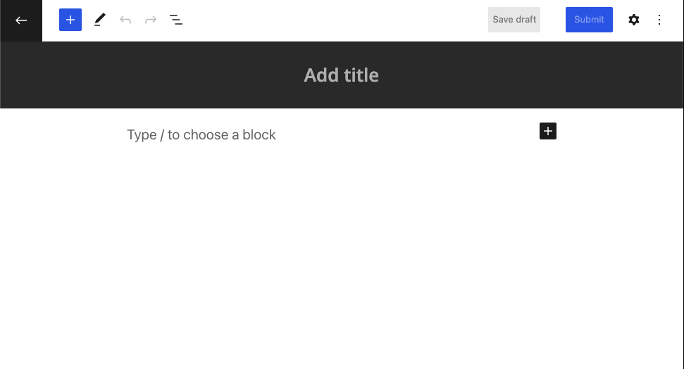

5.  Now populate the canvas with the available [blocks](../blocks/README.md).
6.  Use the Block toolbar and block settings sidebar to configure the blocks.
7.  Click **Save draft** to save the pattern as a draft. When you are finished click on the **Submit** button.
8.  When you click the **Submit** button, you will be prompted to give your pattern a **Title** and a **Description**. Make it distinct and helpful to the reader.
9.  Next, you will be asked to select a **Category** for your pattern. Categories help people find patterns and determine where your pattern will appear in the [WordPress Editor](../wordpress-block-editor.md). This also corresponds with the categories listed in the [Pattern Directory](https://wordpress.org/patterns/): Buttons, Columns, Footer, Gallery, Header, Images, Query, Text, and Wireframe.

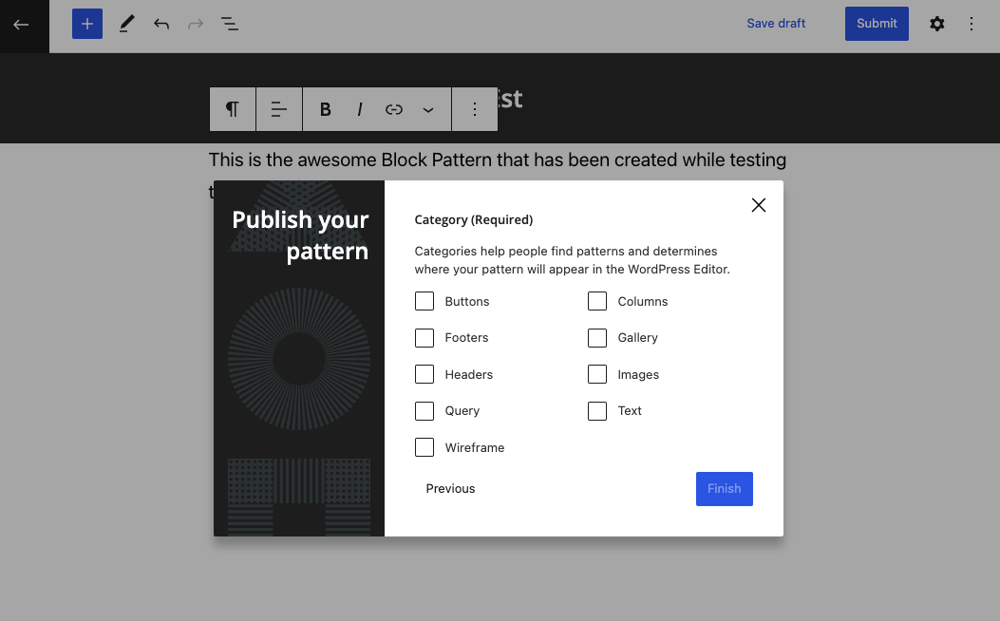

10. Once you click **Finish**, you will be taken to a **Thank you** dialog. At this stage, your Pattern is pending review. Once your Pattern is approved and published in the [public directory](block-pattern-directory.md), you will receive an email.

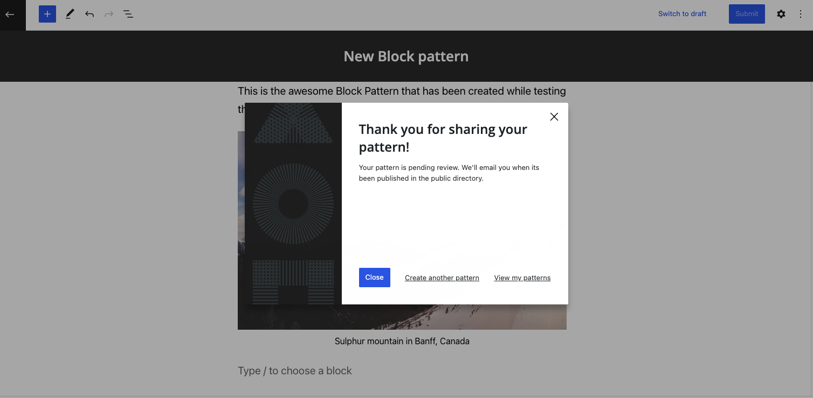

<video controls preload="metadata" src="https://wordpress.org/documentation/files/2022/03/submit-a-pattern-1.mp4"></video>

## How to view your Block Patterns

Click **View my patterns** in the Thank you dialog that appears after you click Submit button [in the previous step](#thank-you).

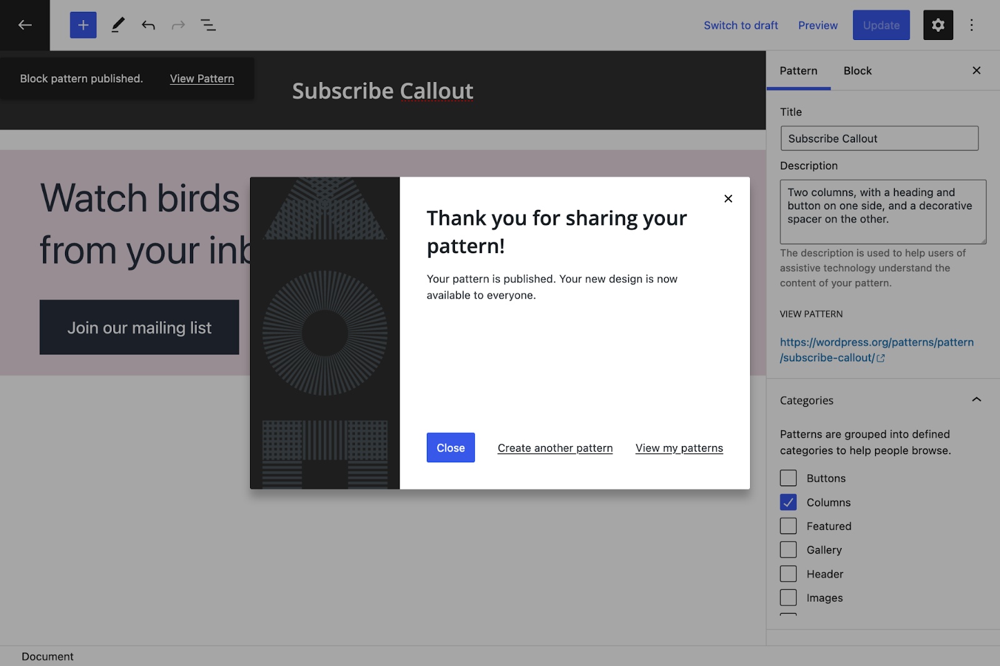

This will take you to the **[My Patterns](https://wordpress.org/patterns/my-patterns/)** page where you can browse all your patterns: draft patterns, submitted patterns and the onces that are pending review.

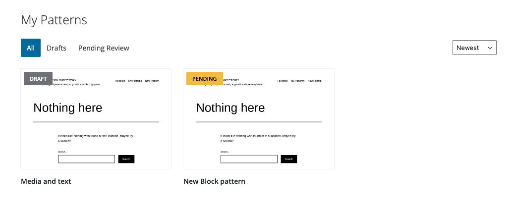

## How to use the My Patterns page

The **[My Patterns](https://wordpress.org/patterns/my-patterns/)** page will list all your patterns: draft patterns, submitted patterns and the onces that are pending review.

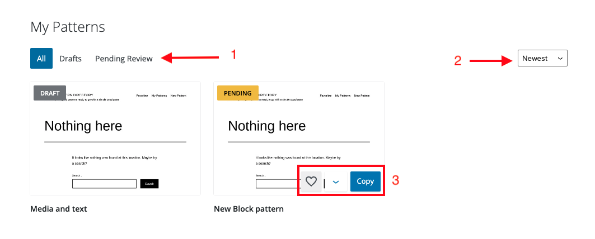

1.  You can use the filter at the top to show all the patterns that are in **Drafts**, **Pending Review** etc.
2.  You can sort the patterns by **Newest** or show only the **Favorites** by using the drop-down in the top right corner.
3.  You can click on any of the patterns to open it in the [single block pattern view](<#single%20Block%20Pattern%20view>).
4.  You can hover over a Pattern in the My Patterns page to display a menu at the bottom right corner with the following options:
    -   Click the heart icon to add the pattern to your **Favorites** list
    -   Click the down arrow icon to show a drop-down menu. Depending on the state of your pattern, you will see the following options in the drop-down.
        -   **Open in editor**: You can open the pattern in the editor
        -   **Revert to draft**: This is for submitted patterns only. You can revert to a draft.
        -   **Delete pattern**: You can delete the pattern.

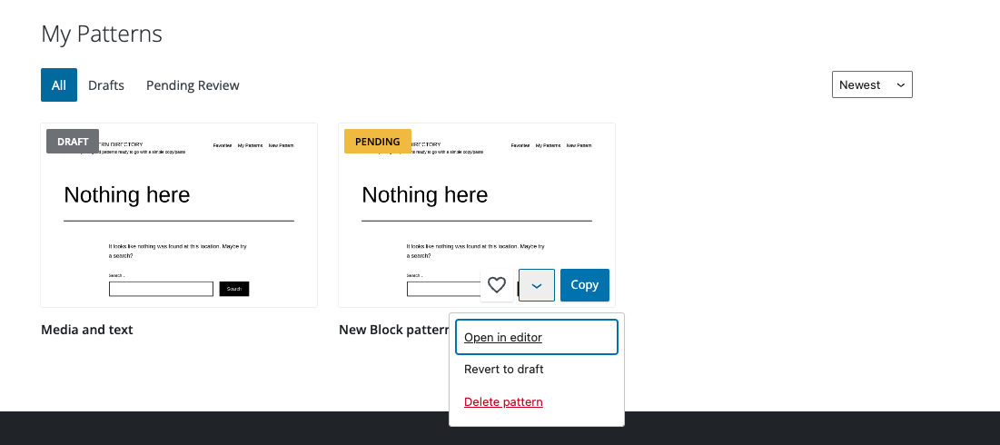

-   Click the **Copy** button to copy the pattern (you can then go to a Block editor and click **Paste** to paste that pattern into your Block editor.)

## How to use the single Block Pattern view

In the **[My Patterns](https://wordpress.org/patterns/my-patterns/)** page, click on any of the patterns to open the pattern in the single Block Pattern view as shown below:

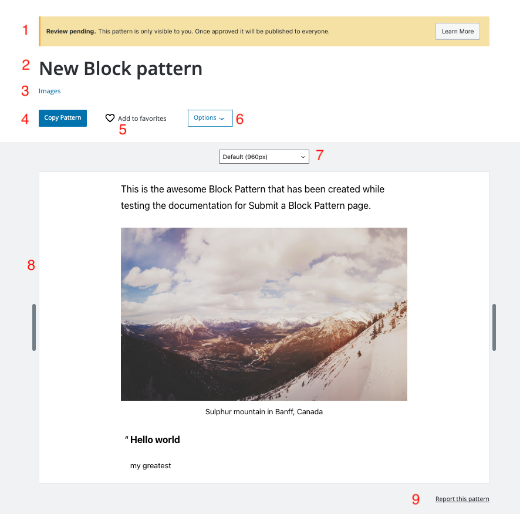

1.  The status of your pattern is displayed at the top. It also shows the vibsibility of your Pattern. Once a Pattern is approved it is visible to everyone. Until then the pattern is only visible to you.
2.  The title of the Block Pattern that you gave when creating the pattern is displayed here.
3.  The Categories you choose when submitting the pattern, is displayed here.
4.  Click **Copy Pattern** to copy the pattern. You can then go to a Block editor and click **Paste** to paste that pattern into your Block editor.)
5.  Click the heart icon to add the pattern to your **Favorites** list.
6.  Click the **Options** dropdown menu. Depending on the state of your pattern, you will see the following options in the drop-down.
    -   **Open in editor**: You can open the pattern in the editor
    -   **Revert to draft**: This is for submitted patterns only. You can revert to a draft.
    -   **Delete pattern**: You can delete the pattern.

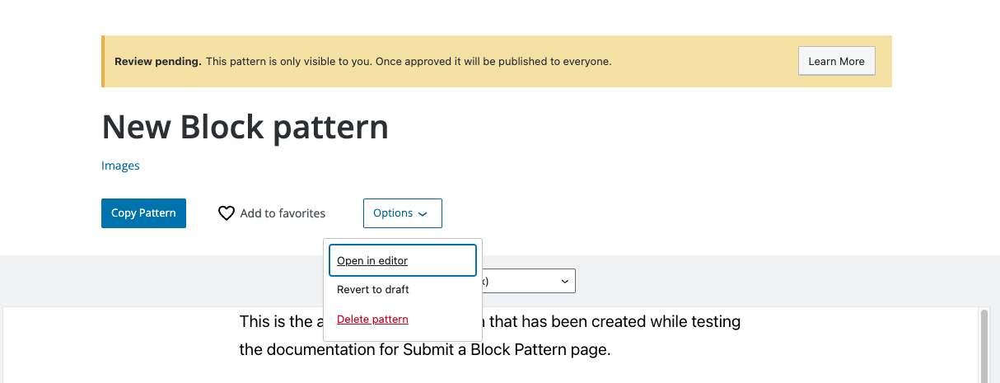

7.  You can test your Pattern in varying screen sizes by clicking on the drop down and selecting a different screensize such as 1200px, 960px, 480px or 320px.

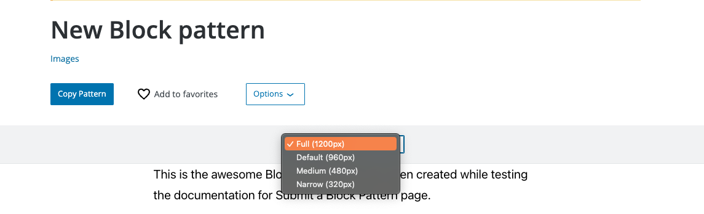

8.  The frame where the Block pattern is displayed.
9.  Click **Report this pattern** at the bottom right corner to report a problem with the pattern.

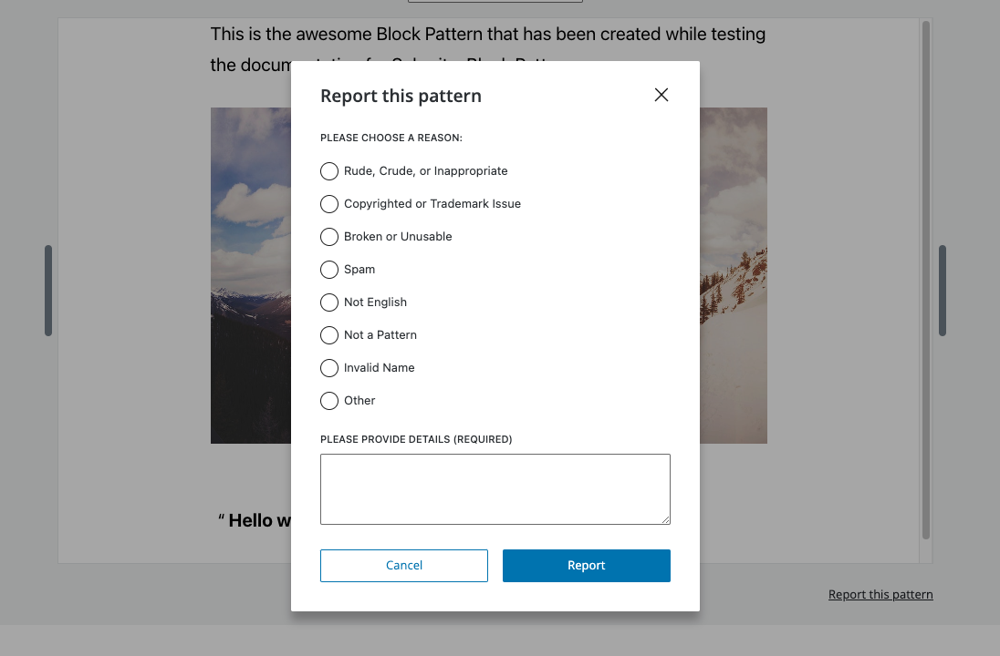

## How to edit a Pattern in the Pattern editor

When you choose **Open in editor** either from the [My Patterns](https://wordpress.org/patterns/my-patterns/) page by hovering over a pattern or in the [single Pattern view](#single-block-pattern-view) from the Options drop-down, it opens the Pattern in the Pattern editor. You can edit the Pattern further in this editor.

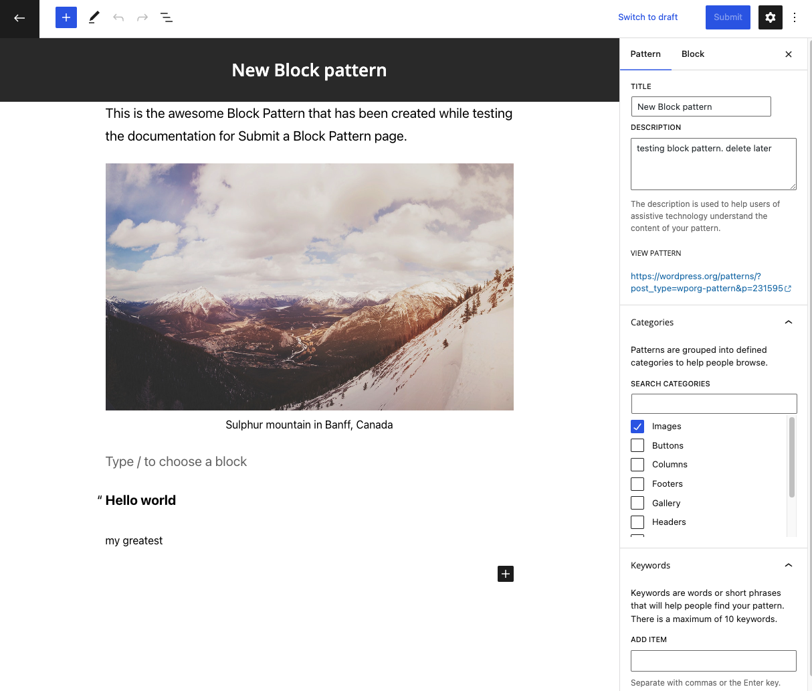

You can add [blocks](../blocks/README.md) using the **+** icon in the top toolbar and the **List view** icon to show the [List view](../working-with-blocks/list-view.md) and navigate the nested blocks easily.

Click the **Cog** icon at the top right to open the Settings side bar. Here you can edit the **Title**, **Description** and **Categories** for the Block Pattern and also add **Keywords** for the Pattern that helps people find your pattern.

Click **Submit** to update the changes.

## About the media library in the Pattern directory

The Media Library for the Pattern Directory is powered by [Openverse](https://wordpress.org/openverse/). You have direct access to the library of images published in the public domain or with the CC0 license, no attribution is needed.

You can search by keyword and then browse through the results to select the image you’d like to add to your block pattern.

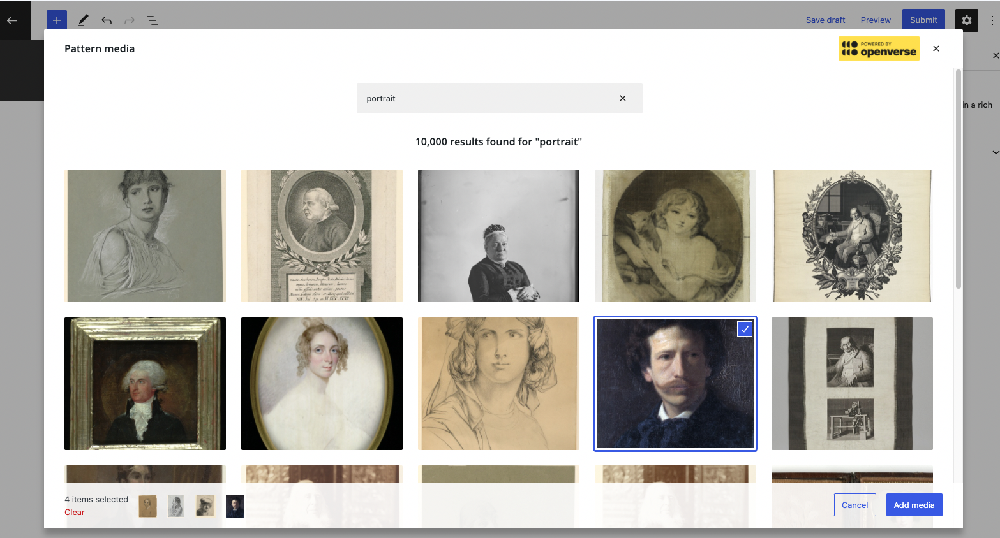

Using the [Openverse](https://wordpress.org/openverse/) library helps in the following ways:

-   The user of the Block Pattern can be fairly certain they can use the image on their website.
-   The creator of the Block Pattern doesn’t have to upload an image to the Block Pattern Directory.
-   The image is visible on any site, whether it is locally hosted on someone else’s computer or on their development site, or in production.

## Restrictions

As with any public directory on WordPress.org, there are a few restrictions when creating Block Patterns

-   You can only use Core blocks to create the Block Patterns.
-   You can only use the [Openverse](https://wordpress.org/openverse/) media.
-   Only core colors and duotone filters presets are available.
-   Images need explicit size value/settings .
-   Dynamic blocks won’t work (Query Block, Site Title, etc).

Make sure you read the official [Pattern Directory submission guidelines.](https://wordpress.org/patterns/about/)

Changelog:

-   Updated 2022-11-28
    -   Reworked the content and added screenshots for 6.1
-   2022-10-25 Spelling, grammatical, and capitalization updates. Add a link to Openverse. Add alt info to images.
-   2022-03-23 Created
