# Preferences overview

When you start using the [WordPress Block Editor](wordpress-block-editor.md) or the [Site Editor](../site-editor/README.md) and you find the number of choices and panels overwhelming, you can use the Preferences feature to turn on/off the various options, to your liking. This helps to remove the distracting elements in the layout that get in the way of your writing and create an editing experience that you prefer.

## How to find Preferences

In the [WordPress Block Editor](wordpress-block-editor.md) or the [Site Editor](../site-editor/README.md), select the three vertical dots icon in the upper-right corner of the top toolbar. This opens up a drop-down menu. Select **Preferences** to open the **Preferences** dialog.

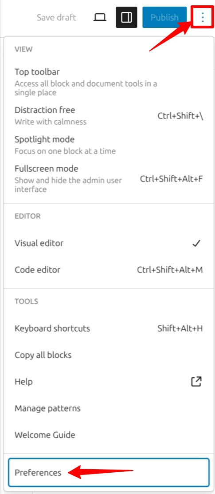

*Image showing the three dot menu > Preferences*

## Preferences in the WordPress Block Editor

This section covers preference settings when you are in the [WordPress Block Editor](wordpress-block-editor.md).

### General

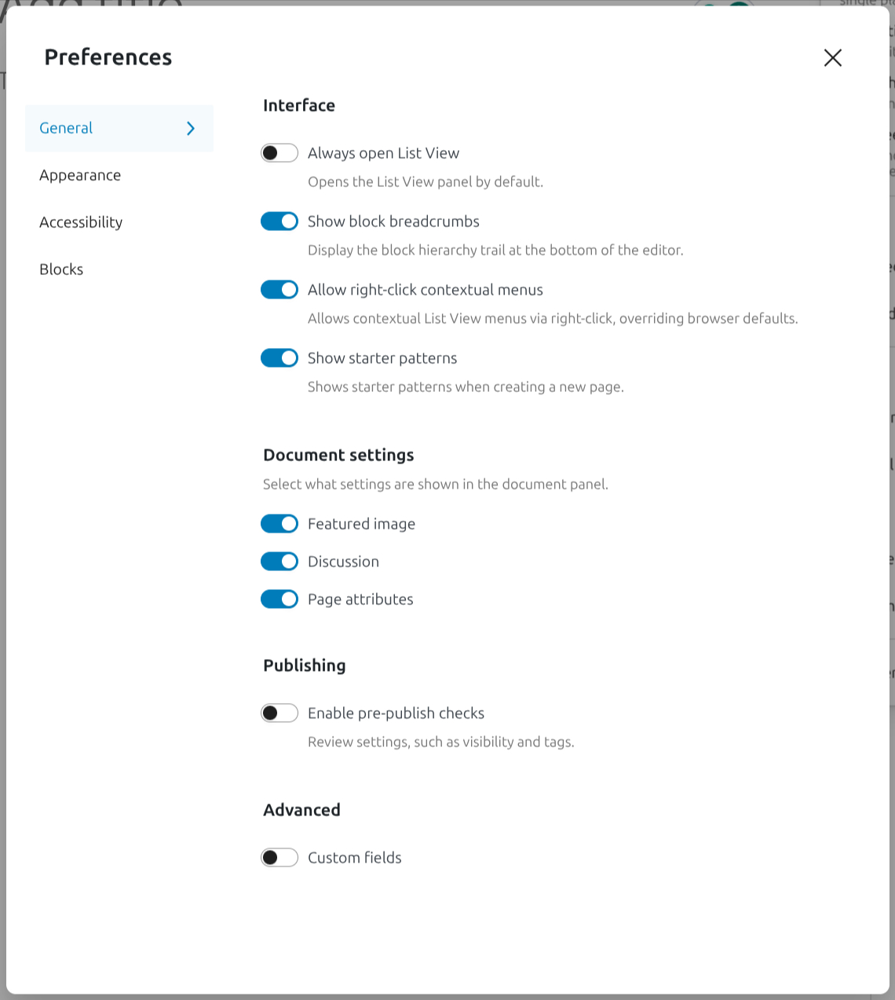

*General tab in Preferences in WordPress Block Editor*

**Interface**

-   **Always open list view:** When you toggle this on, the list view sidebar is open by default every time you open the Block Editor.

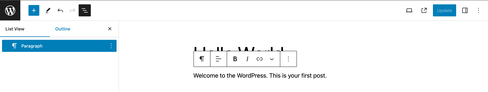

-   **Show block breadcrumbs**: When you toggle this one, WordPress Block Editor shows block breadcrumbs at the bottom of the editor. Block breadcrumbs allow you to easily get a sense of where you are in the content and offer a way to easily select parent blocks. This is particularly helpful when you’re dealing with layers of nested blocks or more complicated arrangements.

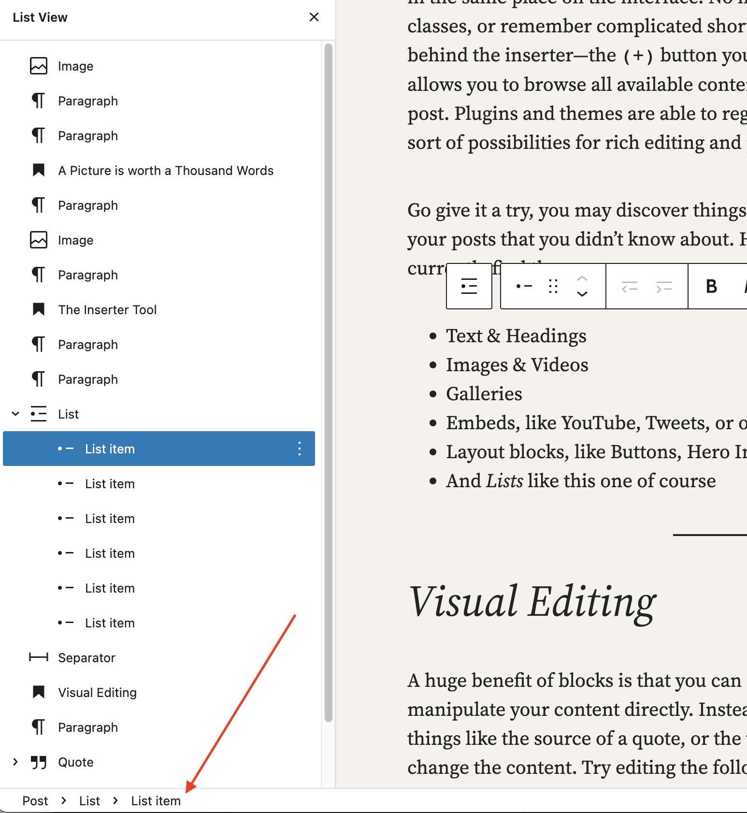

**Allow right-click contextual menus**

**Show starter patterns**: display all starter patterns in a modal when creating a new page.

<video controls preload="metadata" src="https://wordpress.org/documentation/files/2021/07/show-starter-patterns.webm"></video>

**Document settings**: This section lets you choose what panels appear in the [Page/Post Settings Sidebar](page-post-settings-sidebar.md). If you toggle an item off here, it will hide that section in the [page/post settings sidebar](page-post-settings-sidebar.md). If you find that you don’t use a specific panel in the settings sidebar and want to simplify your editing experience, this option is helpful.

**Publishing:** This lets you customize the options related to publishing a post or page.

-   **Include pre-publish checklist**: By toggling this on, you are enabling an extra step to appear before publishing a post/page. You will be asked to review the settings for **Visibility** and **Publish date** and add settings such as **Categories** and **Tags**. This checklist will only appear after you click **Publish**. You can make the relevant changes and click **Publish** one more time to Publish the post/page.

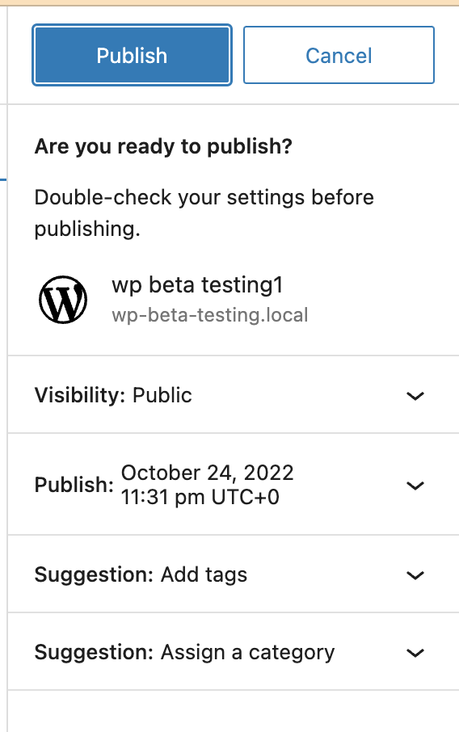

**Advanced**: This section lets you add extra areas to the editor.

<video controls preload="metadata" src="https://wordpress.org/documentation/files/2021/07/enable-custom-fields.webm"></video>

### Appearance

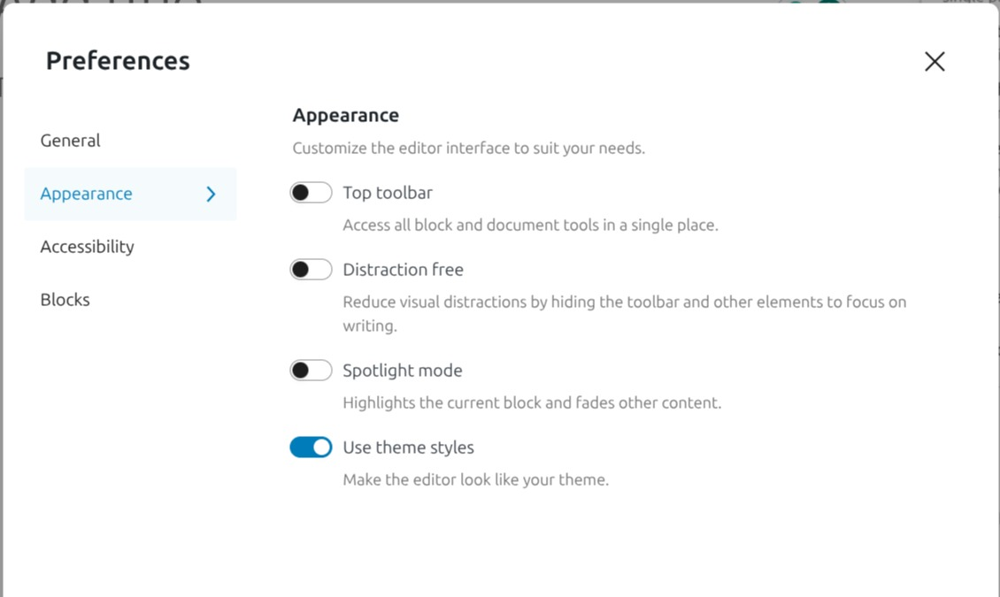

**Appearance**: This section covers preferences that are specifically related to how the editor looks and feels.

-   **Top toolbar**

_**Top Toolbar** when the option is turned off_

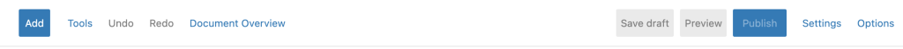

_**Top Toolbar** when the option is turned on_

-   **Distraction free**: When you toggle this on, it creates a clean interface with fewer distractions while you’re writing. WordPress turns off various options and panels in the toolbar and removes breadcrumbs at the bottom of the editor. **Keep in mind that these options don’t go away!** They are simply hidden while you’re writing. 
    Hovering over or moving focus to the top part of the editor reveals a limited toolbar with selection tools, undo and redo, save, publish, and the button with the tree dots, which opens the options menu.

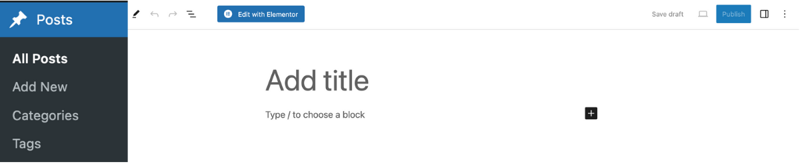

-   **Spotlight mode**: When you toggle this on, WordPress Block Editor is set to Spotlight mode. All blocks are greyed out except for the one you’re working on so that you can focus on a single block at a time.

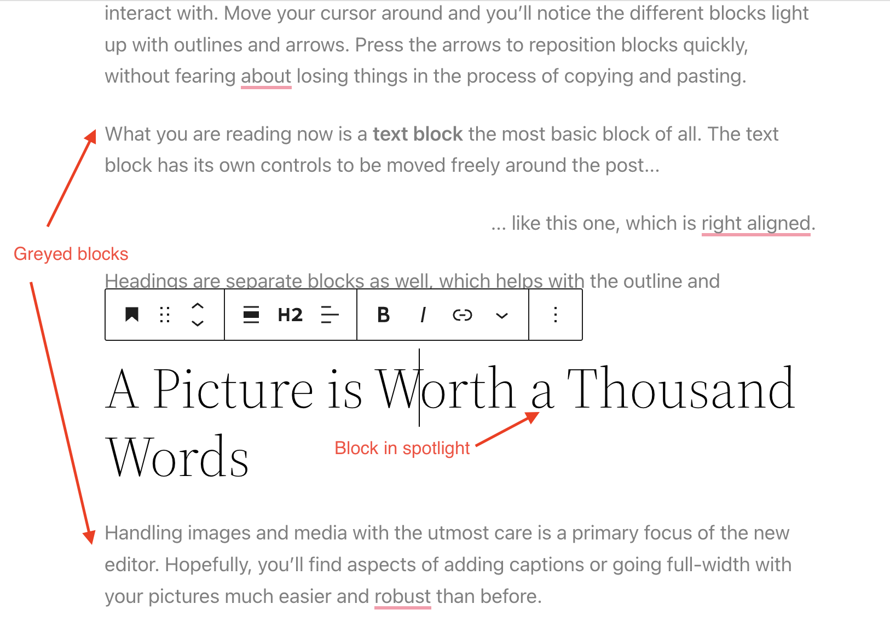

*Spotlight mode*

-   **Use theme styles**: This option is what allows your editor to look like your theme so that, as you’re creating content, you have a strong sense of what it will look like upon publishing. If you’d rather focus on the content itself and not necessarily on how it will look, you can toggle this option off to have your theme styles removed.

### Accessibility

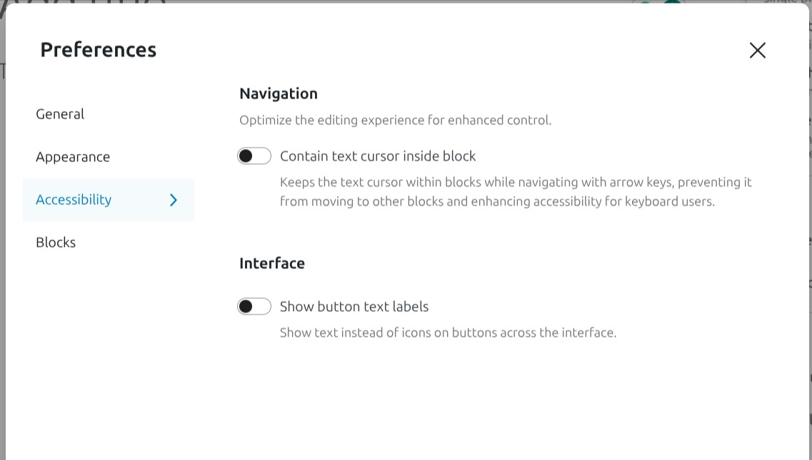

-   **Contain text cursor inside block**: This option aids screen readers by stopping the text caret from leaving blocks.

-   **Show button text labels**: When you toggle this option, it allows you to show text instead of icons in the Toolbar. This applies to both the Top Toolbar in the Block Editor and the individual Block Toolbar.

### Blocks

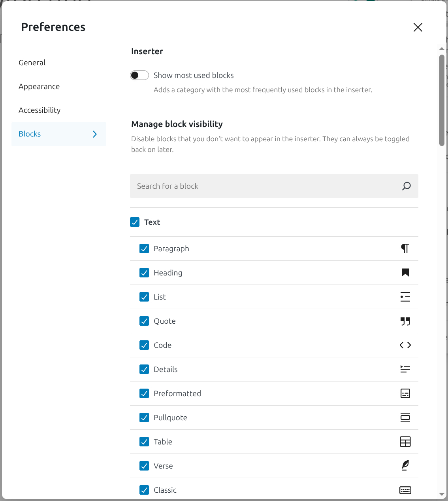

*Blocks tab in the Preferences in WordPress Block Editor*

**Block interactions**: This section helps to customize how you interact with blocks in the block inserter

-   **Show most used blocks**: When you toggle this option on, it enables a section in the Block Inserter that shows all the blocks that you use the most. This can be helpful to easily find the blocks that you use frequently to build your page or post content.

1.  You can search for blocks easily by typing in the name in the search box.
2.  You can check or uncheck the boxes to show or hide the blocks from the list.
3.  As you uncheck the blocks from the list, you will get a message at the top showing how many blocks have been hidden. If you want to undo these changes, just click the “**Reset**” button.

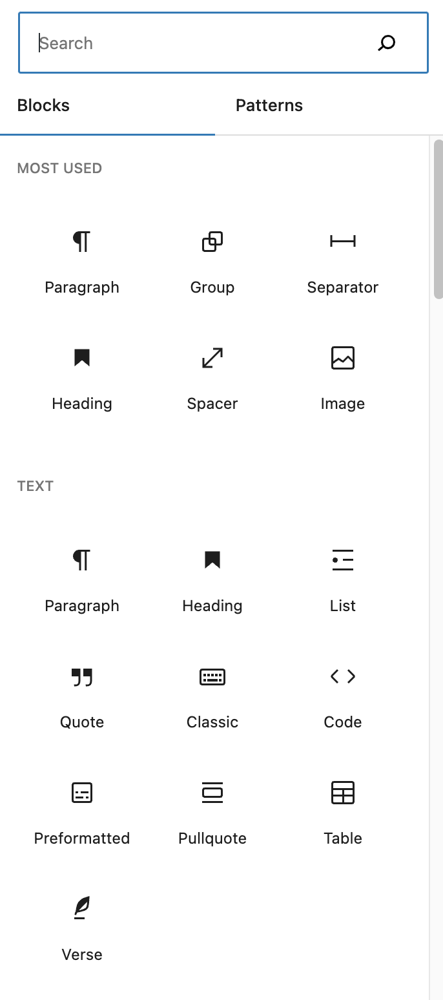

## Preferences in the Site Editor

This section covers preference settings when you are in the [Site Editor](../site-editor/README.md). There are fewer settings in the Site Editor but the options work similarly to the ones in the WordPress Block Editor Preferences.

### General

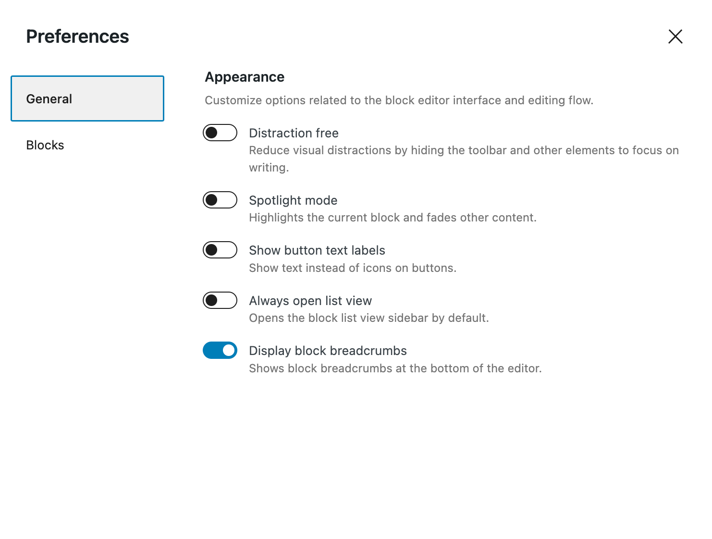

### Blocks

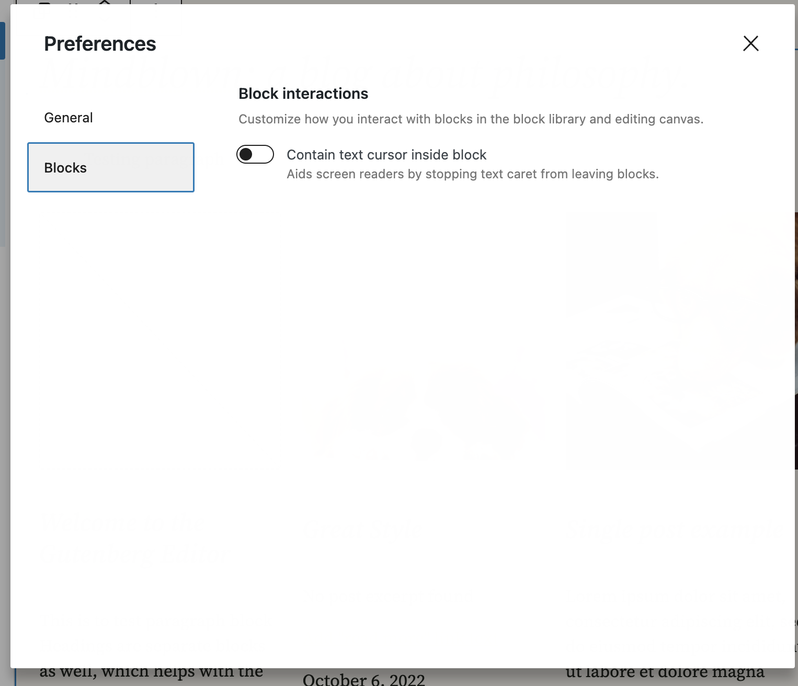

## Changelog

-   Updated 2025-11-25 (props @milana_cap)
    -   Update screenshots and videos for 6.8
    -   Add new “Show starter patterns” feature
-   Updated 2023-10-19
    -   Added content for New Feature “Reset”.
    -   Updated Screenshots with alt text.
-   Updated 2023-03-29
    -   Updated screenshots
    -   Replaced the “Reduce the interface” Block Editor preference with “Distraction free”.
-   Updated 2022-10-25
    -   Added screenshots and content update for 6.1
    -   Added content for Site Editor Preferences with screenshots
-   Created 2021-07-13
