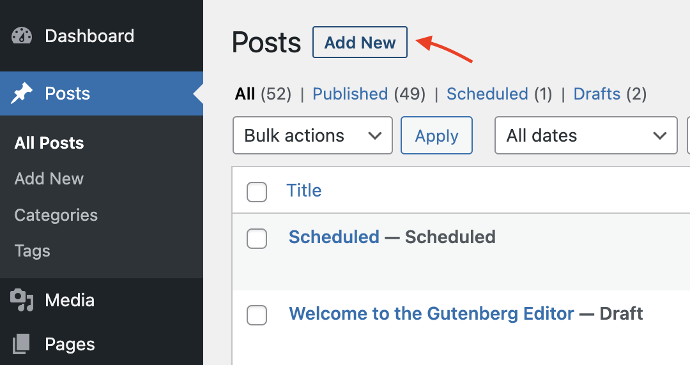
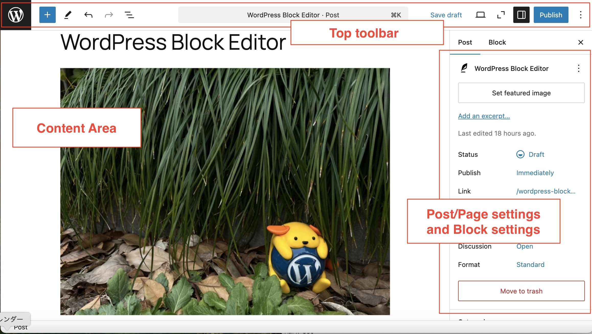
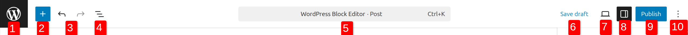
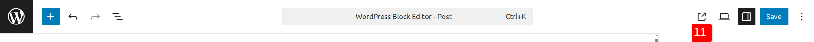
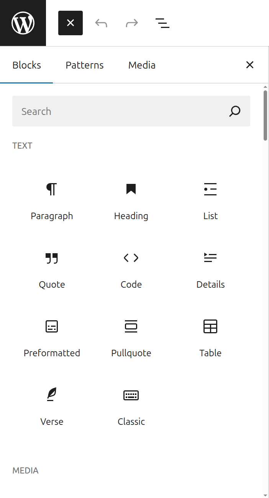
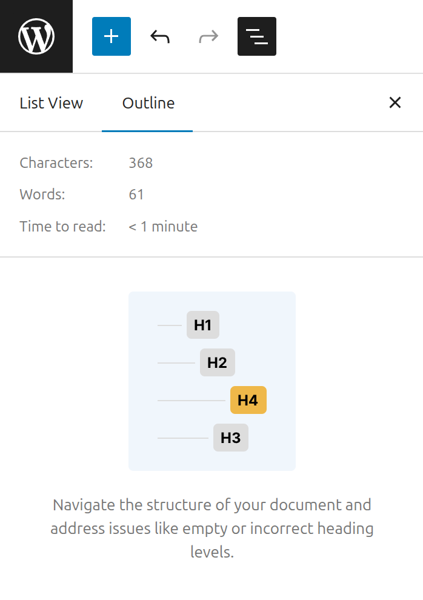
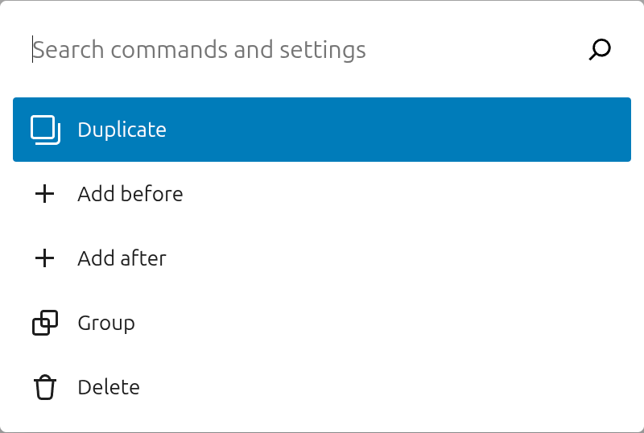
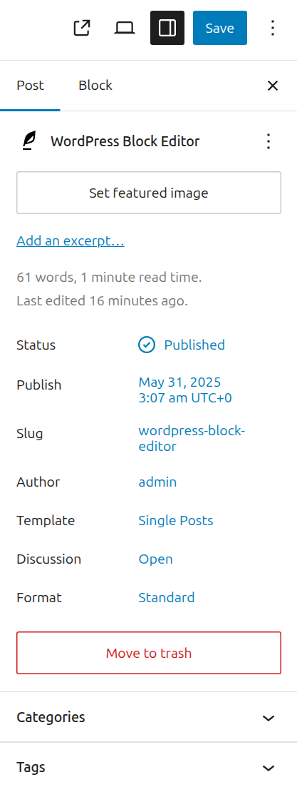
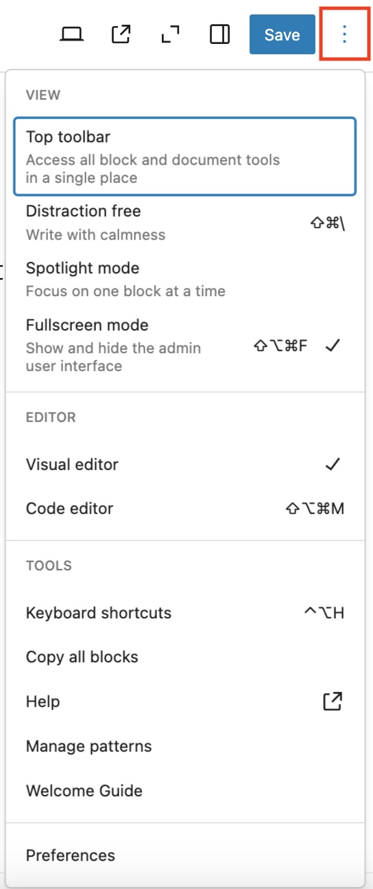

# WordPress Block Editor

The WordPress block editor also called the **block editor**, **WordPress editor** or **Gutenberg** **editor** is the new way of publishing content in WordPress.

Following the launch of WordPress 5.0 in December 2018, the WordPress block editor was set as the default editor and replaced the [classic editor](../../using-wordpress/writing-and-publishing/write-posts-classic-editor.md). To use the [classic editor](../../using-wordpress/writing-and-publishing/write-posts-classic-editor.md), you will need to install the [classic editor](https://wordpress.org/plugins/classic-editor/) plugin.

The WordPress block editor offers an array of [blocks](blocks/README.md) that can be used to create media-rich pages and posts.

[Blocks](blocks/README.md) are the content elements that you add to create content layouts. You can add [blocks](blocks/README.md) for paragraphs, images, headings, lists, videos, galleries, and more. You can control the layout of the blocks with ease, to build visually appealing web pages.

WordPress has blocks for all common content elements, and more can be added through [WordPress plugins](https://wordpress.org/plugins/browse/blocks/).

> [!NOTE]
> [Visit the Gutenberg demo website to try the Block Editor.](https://wordpress.org/gutenberg/)

## The block editor’s workspace

To launch the WordPress block editor, click on **Posts** > **Add New** or **Pages** > **Add New**.

*How to launch the WordPress block editor*

The block editor opens by default in fullscreen mode.

The WordPress block editor workspace has three main sections:

-   the top toolbar
-   the sidebar with the post/page settings and the block settings
-   the content area.

### The top toolbar

Before you publish your post or page, you will see the following options in the top toolbar.

After the publishing, you will see the following options.

The options corresponding to the numbers in the figure are as followings:

#### 1. View Posts / View Pages

Shows the W icon by default, or the Site Icon if available. Click to exit the editor and back to the list of Posts or Pages in Administrator Screens. This will prompt you to save the changes or leave the post or page.

#### 2. Toggle block inserter

Show or Hide block inserter that allows users to add block, patterns or media to your post or page.

#### 3. Undo and Redo

Undo an action, or redo an undone action.

#### 4. Document Overview

This option includes two tabs: List View and Outline.

-   List View: a list of all of the blocks that are on the post/page and easily navigate between the blocks on your post/page. [Read more about List View tool](working-with-blocks/list-view.md).
-   Outline: Show the the post/page details including the character and word count, estimated time to read, the number of paragraphs and blocks on the post/page, and the document outline showing the headings and how they are structured on the post/page.

*Outline tab in the Document Overview*

#### 5. Command Palette

The Command Palette helps you streamline your workflow in the WordPress editor by providing a centralized location to work on various aspects of your site’s design. Click this field, or press Cmd+k on Mac or Ctrl+k on Windows. For more details about Command Palete, refer [Editor Command Palette](../site-editor/site-editor-command-palette.md).

#### 6. Save draft / Saved

Save a draft of your post or page without publishing it. If the post or page is saved successfully, the label changes to **Saved**. Once the post or page is published, this label is hidden.

#### 7. View

View how your post/page looks on your site with the current changes applied. For more details, refer [How to use the View feature](how-to-use-the-preview-function.md).

#### 8. Settings

Show or hide the [post/page sidebar settings](page-post-settings-sidebar.md) and the [block settings](working-with-blocks/work-with-blocks.md#block-settings).

#### 9. Publish

Make your post/page available publicly.

#### 10. Options

Open up [more options](#more-options). See below section.

#### 11. View Post / View Page

After you publish your post or page, you will see this option. Opens a new tab where you can see how your post/page looks on the frontend.

### More options

If you click the three dots icon in the top toolbar, additional options are displayed. Here, you can customize your editing experience using various options.

#### View

-   **Top toolbar:** Display or hide the top toolbar in the editor. When you enable this option, block toolbars are pinned to the top of the WordPress block editor (right under the top toolbar) instead of appearing directly above the block.
-   **Distraction free**: When enabled, this option allows you to focus just on your words by adjusting various pieces of the interface, including closing any open sidebars, removing various block inserter options, and the block toolbar. [Read more here](distraction-free-mode.md).
-   **Spotlight mode**: With spotlight mode, all blocks are greyed out except for the one you’re working on so that you can focus on a single block at a time.
-   **Fullscreen mode**: When enabled, this mode hides the Administration screens user interface.

#### Editor

By default, you will be in the Visual editor. Switch to the Code editor to view the entire post or page in the HTML code editor.

#### Tools

Here, you can [manage patterns](patterns/block-pattern.md), learn [keyboard shortcuts](keyboard-shortcuts-block-editor.md), visit the WordPress block editor welcome guide, copy all content on the post/page, or view additional support articles.

#### Preferences

Use the [Preferences](preferences-overview.md) menu to:

-   Customize the editing experience.
-   Change how you interact with blocks and which blocks appear when searching for a block.
-   Show or hide individual panels from the [post/page settings](page-post-settings-sidebar.md)[.](https://wordpress.com/support/wordpress-editor/learn-the-interface/#settings)

## How to work in the WordPress block editor

<video controls preload="metadata" src="https://wordpress.org/documentation/files/2022/10/Screen-Recording-2022-10-24-at-5.00.54-PM.mp4"></video>

*How to use the WordPress block editor*

You can select multiple blocks by holding `shift+click` as show in the video below:

<video controls preload="metadata" src="https://wordpress.org/documentation/files/2023/11/select-multiple-blocks.mp4"></video>

*Selecting multiple blocks using shift+click*

You can select all blocks by pressing `Cmd+A` or `Control+A` as shown in the video below

<video controls preload="metadata" src="https://wordpress.org/documentation/files/2023/11/selecting-all-blocks.mp4"></video>

*Selecting multiple blocks using cmd + A or control + A*

When you select some text and press the back tick (`` ` ``), it will turn the selected text inline code as show in the video below:

<video controls preload="metadata" src="https://wordpress.org/documentation/files/2022/10/179496420-adcc09e7-40fc-4f49-b7c1-86d3de61cc1a.mp4"></video>

*Video showing how to easily create an inline code*

Uploading media from openverse category also uploads the item in media library.

<video controls preload="metadata" src="https://wordpress.org/documentation/files/2023/11/uploading-media-from-openverse.mp4"></video>

*Uploading media item from openverse category uploads to the media library as well*

> [!NOTE]
> [Visit the Gutenberg demo website to try the Block Editor.](https://wordpress.org/gutenberg/)

**Zoom out**

The Zoom out view is a powerful editing mode in the WordPress Site Editor that allows users to get a broader, high-level perspective of their page layout. **Note** The Zoom out icon is only visible when **Show Template** is activated within the Preview setting.

> [!NOTE]
> [Learn more about Zoom out mode.](../site-editor/zoom-out-view.md)

## Related topics

-   [How to work with blocks](working-with-blocks/work-with-blocks.md)
-   [List of blocks](blocks/README.md)
-   [Block directory](working-with-blocks/block-directory.md)
-   [Block patterns](patterns/block-pattern.md)
-   [Use the List View](working-with-blocks/list-view.md)
-   [Manage reusable blocks](patterns/reusable-blocks.md)
-   [Post/Page settings sidebar](page-post-settings-sidebar.md)
-   [How to add blocks](working-with-blocks/adding-a-new-block.md)
-   [How to move blocks in your post/page](working-with-blocks/moving-blocks.md)
-   [How to use the Preview function](how-to-use-the-preview-function.md)
-   [How to set the Preferences](preferences-overview.md)
-   [Keyboard shortcuts in Block editor](keyboard-shortcuts-block-editor.md)

**Change Log**

-   Updated 2026-09-14 (props @karthickmurugan @awetz583)
    -   Added Zoom out feature
-   Updated on 2025-07-20
    -   Remove Tools in the top toolbar 
        Updated screenshot for the top toolbar 
        Updated top toolbar items hierarchy
-   Updated on 2025-01-01
    -   Updated whole contents and screenshots for 6.7
-   Updated on 2023-11-11
    -   Updated screenshots for 6.4
-   Updated on 2023-11-08
    -   Headings changed to sentence case

-   Updated on 2023-09-26
    -   Improve “switch to draft” placement [50217](https://github.com/WordPress/gutenberg/pull/50217)
    -   Added a pair of new screenshots to add “Apply busy status to the publish button in progress and unify button width [48444](https://github.com/WordPress/gutenberg/pull/48444)“
    -   Added a new video to add “[Inserter – Media tab]: Upload Openverse images when inserted [48501](https://github.com/WordPress/gutenberg/pull/48501)“
-   Updated on 2023-08-
    -   Add component [50260](https://github.com/WordPress/gutenberg/pull/50260)
    -   Display device icon on “preview” and “view” buttons [50218](https://github.com/WordPress/gutenberg/pull/50218)
    -   Distraction Free Mode: Don’t show the metaboxes [48947](https://github.com/WordPress/gutenberg/pull/48947)
    -   Updates the behavior of the top toolbar fixed setting [49634](https://github.com/WordPress/gutenberg/pull/49634)

-   Updated 2023-08-08
    -   Replaced “Reusable Blocks” with “Patterns”
-   Updated 2023-06-27
    -   Added links to Gutenberg demo website.
-   Updated 2023-04-16
    -   Updated screenshot for more options.
    -   Added information about Distraction Free mode.
-   Updated 2022-10-24
    -   Add screenshot for **Time to read**.
    -   Updated screenshots to show the **View** button in the top toolbar
    -   Content tweaked. FAQ removed.
    -   Added new videos to show tips to work with the Editor
-   Update 2022-06-02
    -   Text updated for clarity.
-   Update 2022-05-13
    -   Updated content/screenshots for 6.0.
    -   Rewrote sections for clarity.
    -   The blocks section moved to a [new page](working-with-blocks/work-with-blocks.md).
-   Update 2022-01-18
    -   Added Section: List view
-   Update 2020-08-17
    -   Added Section: New to WordPress 5.5
    -   Added link to Block Directory page.
-   Update 2020-03-29
    -   Added section on default Fullscreen mode, introduced in WordPress 5.4
-   Update 2020-03-19
    -   Move the “Shortcuts” section above the FAQs
-   Update 2020-03-18
    -   Changed occurrences of “new editor” to “block editor”
    -   changed occurrences of “old editor” to “Classic editor”
    -   Added Anatomy of a Block graphic and explanations
    -   Reformatted the FAQ questions to Paragraphs with medium size bolded text instead of Capitalized H5
    -   Added link to Classic Block page and Shorcode Block page
    -   Changed the link to the Shortcut list to the [developer documentation page.](https://developer.wordpress.org/block-editor/principles/faq/#editor-shortcuts)
