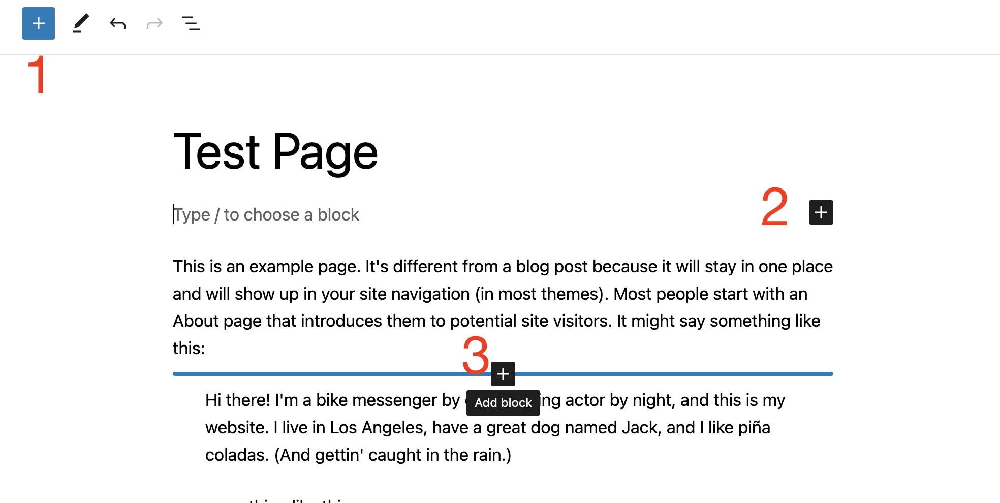
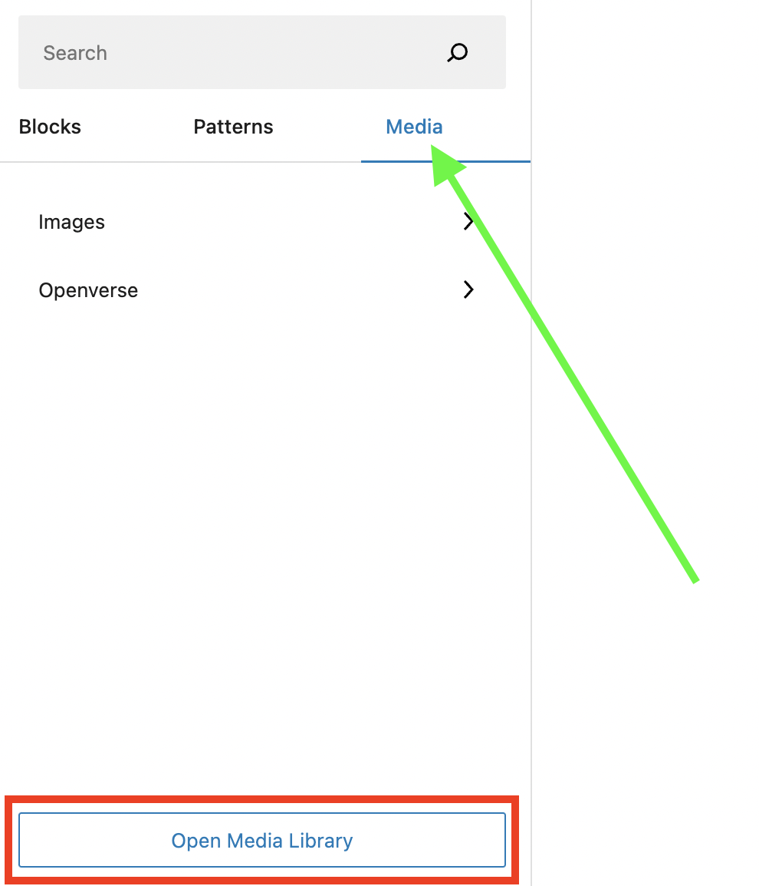
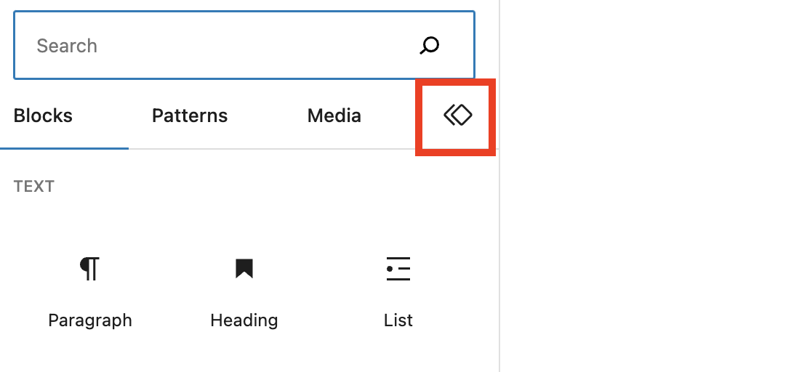
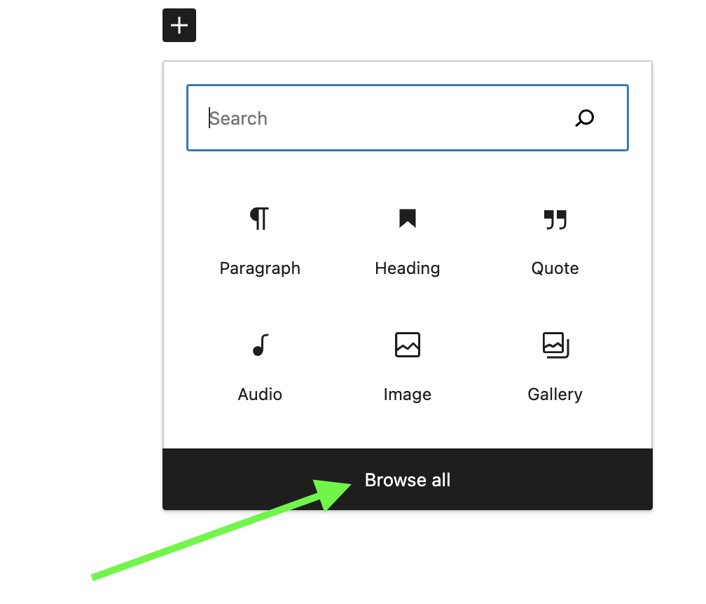
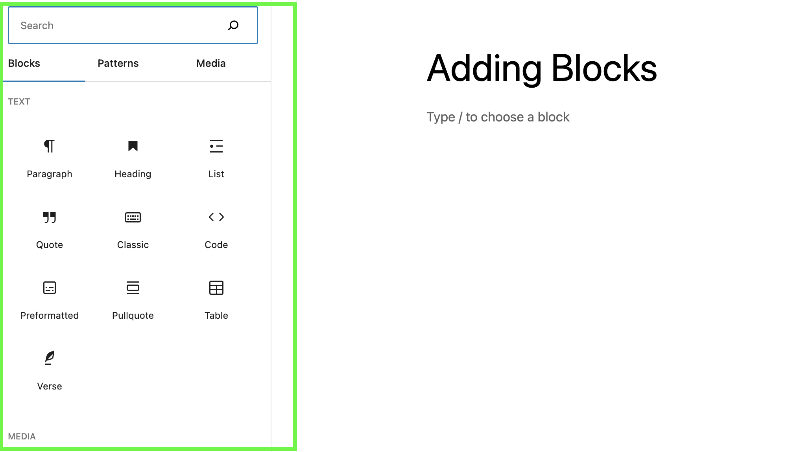
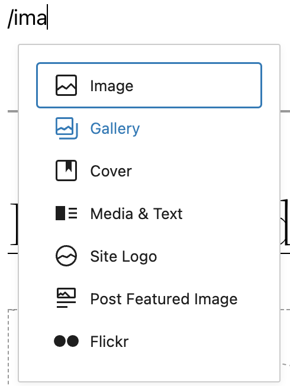
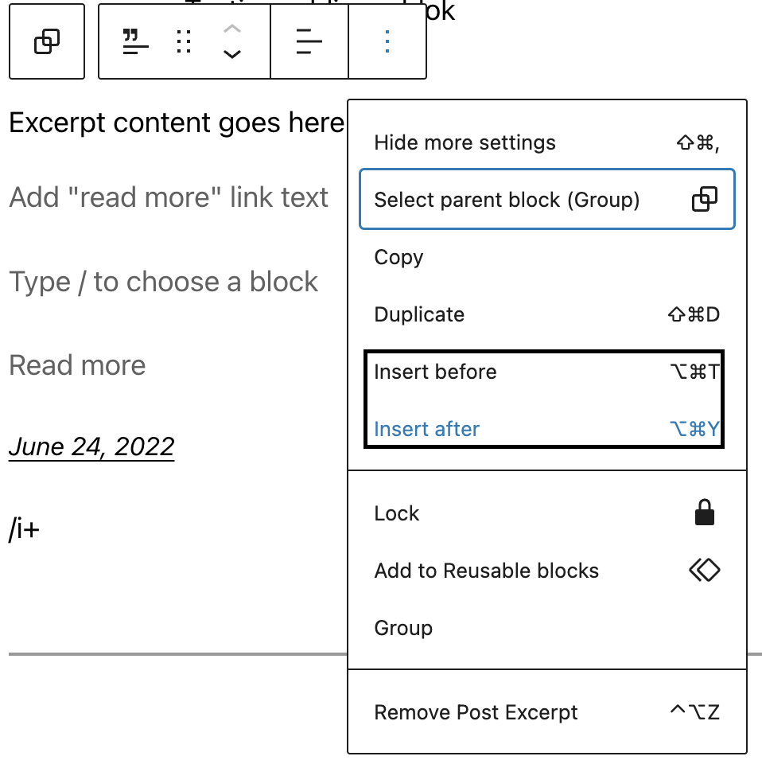
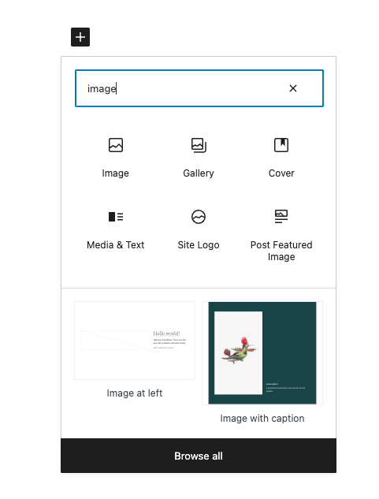

# Adding a new block

There are several ways to add a block to your post or page from the admin screen of the [WordPress block editor](../wordpress-block-editor.md) when you are editing your post or page.

You can use the Block Inserter **+** icon to add a block. You can also use a shortcut slash command to quickly add blocks or use the More options on any of the block’s toolbar to add a block. You can also [move blocks](moving-blocks.md) or search for a block in your post or page.

## How to add blocks using the Block Inserter

There are three ways to add a block using the **+** icon (also called the **Block Inserter**).

1.  Block inserter icon in the top toolbar
2.  Block inserter icon to the right of an empty block
3.  Block inserter icon in between blocks

### Using the Block inserter icon in the top toolbar

Click on the Block Inserter **+** icon in the top toolbar in the [WordPress block editor](../wordpress-block-editor.md).

You can find a list of all the [blocks](../blocks/README.md) available in the [WordPress block editor](../wordpress-block-editor.md). The most frequently used blocks are listed at the top (based on your [Preference](../preferences-overview.md#blocks) settings). Hovering over each block will show you a brief description and preview of the block.

You can scroll down the list to find blocks in categories, like Text, Media, Design, Widgets, Layout, Theme, or Embeds. You can also find third-party blocks from installed plugins.

Once you find the block, drag and drop it into the block editor.

<video controls preload="metadata" src="https://wordpress.org/documentation/files/2019/06/add-block.mp4"></video>

#### Adding Block Patterns using the top-toolbar inserter

[Block Patterns](../patterns/block-pattern.md) are a collection of predefined blocks that you can insert into pages and posts and then customize with your own content. Using a Block Pattern is an easy way to create beautiful layouts that combine different blocks to produce professional designs.

You can open the Patterns tab to view collections of patterns within a specific category like **Featured**, **Call to Action**, **Pages**, and so on, or click the **Explore** **all patterns** button at the bottom of that section to open the patterns in a new, larger, window.

Click on any pattern once, and it will be added to your page at the location of your cursor.

<video controls preload="metadata" src="https://wordpress.org/documentation/files/2019/06/adding-patterns.mp4"></video>

#### Adding Media using the top-toolbar inserter

The media tab allows you to view and add to the page images you have used, additionally, you can also view free media content from [Openverse](https://openverse.org/). You can also open your media library using the button at the bottom of the tab.

<video controls preload="metadata" src="https://wordpress.org/documentation/files/2023/03/add-media.mp4"></video>

#### Adding a synced pattern using the top-toolbar inserter

If you have synced patterns, you will see the Synced patterns tab in the form of an icon as shown below.

When you click on the tab, you should be able to view and add to the page all the synced patterns you have on the site.

<video controls preload="metadata" src="https://wordpress.org/documentation/files/2023/07/adding-synced-patterns-former-reusable-block.mp4"></video>

> [!NOTE]
> WordPress 6.3 renamed Reusable Blocks to Patterns. A synced pattern will behave in exactly the same way as a reusable block.

### Using the Block Inserter icon to the right of an empty block

Click on the Block Inserter **+** icon to the right of an empty block. If the **+** icon isn’t displayed, first click on the placeholder text.

Clicking the Block Inserter **+** icon will open a modal window with a list of the most frequently used [blocks](../blocks/README.md). You can also search for a block you would like to use. You can click on top of the block you want to use.

You can also press <kbd>Enter</kbd>/<kbd>Return</kbd> on your keyboard after selecting a block to create a new empty block, and click the + Block Inserter to the right of the empty block.

<video controls preload="metadata" src="https://wordpress.org/documentation/files/2019/06/adding-blocks-empty-block.mov"></video>

Select a block from the list or click on the “Browse all” button to get a list of all the [blocks](../blocks/README.md) available in the [WordPress block editor](../wordpress-block-editor.md).

When you pick the option to browse all, a larger window of the blocks available will be opened.

### Using the Block inserter icon in between blocks

When you hover over the gap between two blocks, you will notice a horizontal blue line appear with a **Block Inserter** **+** icon. You can click on this icon to open a modal window with a list of the most frequently used [blocks](../blocks/README.md).

<video controls preload="metadata" src="https://wordpress.org/documentation/files/2022/07/Screen-Recording-2022-07-20-at-2.06.16-PM.mp4"></video>

## How to add blocks using the slash command

You can quickly add a block to your post or page using the slash command. This shortcut will help with your writing flow with fewer interruptions searching for a block.

Begin by adding a new paragraph block by pressing <kbd>Enter</kbd> or <kbd>Return</kbd> on your keyboard.

Then hit the forward-slash (“<kbd>/</kbd>”) key followed by the block name. For example: `/image` or `/heading`.

*Add a block using the slash command*

<video controls preload="metadata" src="https://wordpress.org/documentation/files/2019/06/adding-block-slash.mov"></video>

## How to add blocks using the More option on a block’s toolbar

Finally, on any selected block’s Block toolbar, click on the three-dot icon and choose “insert before” or “insert after” to add a new block before or after the selected block.

*Add a block using the More options in a block toolbar*

## How to add blocks within nested blocks

You can easily add blocks within blocks that allow nesting, such as the Group block, Row block, or Stack block.

Select the Group block, Row block, or Stack block. You will find the Block Inserter **+** icon to the bottom right of the group of blocks. Click the Block Inserter **+** icon to quickly add a new block to the nested group.

<video controls preload="metadata" src="https://wordpress.org/documentation/files/2019/06/adding-nested-blocks.mp4"></video>

## How to add blocks using the block directory

You can also discover and install third-party blocks from within the WordPress block editor using the [WordPress block directory](block-directory.md).

To search the WordPress block directory, use the Block Inserter **+** icon on the top toolbar in the WordPress block editor and search for available blocks.

WordPress first runs a search on the available blocks that come with WordPress. If it’s unable to find any block that meets the criteria, it starts searching the block directory and gives you a list. Click on any from the list to install the third-party block.

<video controls preload="metadata" src="https://wordpress.org/documentation/files/2019/06/adding-custom-block.mp4"></video>

> [!NOTE]
> The block directory search functionality is only available to WordPress users who have permission to install plugins. If you add a third-party block from the block directory, the corresponding WordPress plugin will be installed on your site.

## How to search for blocks

When you click the Block Inserter **+** icon to insert a new block, you can use the **search box** at the top to search for blocks.

Type in a block name or a keyword, for example, `"image"` or `"heading"`. Then a list of blocks that fit the search term will show up in the modal window. You can also see a preview of the block below the list of blocks.

Select the desired block with the mouse click, tap, or arrow keys.

*Search for a block*

When you use the [slash command](#slash-command) to add a block, you get an auto-suggested list of blocks based on what you start typing. You can select from the list or keep typing until you find the desired block.

## How to move blocks

For information on how to move blocks, check out this article: [Moving blocks.](moving-blocks.md)

> [!NOTE]
> **Changelog**
>
> -   2024-04-23
>     -   Added missing ALT texts to a couple of images
> -   2023-03-28
>     -   Updated images and videos for 6.2
>     -   Added information about adding patterns, media, and reusable blocks
> -   2022-08-07
>     -   Removed the Moving block section to a separate page.
> -   2022-07-20
>     -   Updated for 6.0 with content, videos, and screenshots
>     -   Added section for nested block and block directory
>     -   Added ALT tags for the images
> -   2020-06-04
>     -   Corrected several typos.
>     -   Changed Inserter right of an empty block to the left of an empty block.
>     -   Removed Inserter between blocks section
>     -   Improved slash command option
>     -   Changed date format in the changelog
> -   2019-12-21
>     -   Added summary paragraph at the top
>     -   Added a short video to demonstrate the search box of the inserter modal
>     -   Tightened up the language a bit.
> -   2019-12-20
>     -   Updated graphics with a newer interface (WP 5.3)
>     -   Added videos for demo purposes
>     -   Updated headings for better readability
>     -   Added text about Inserter and Move handles
