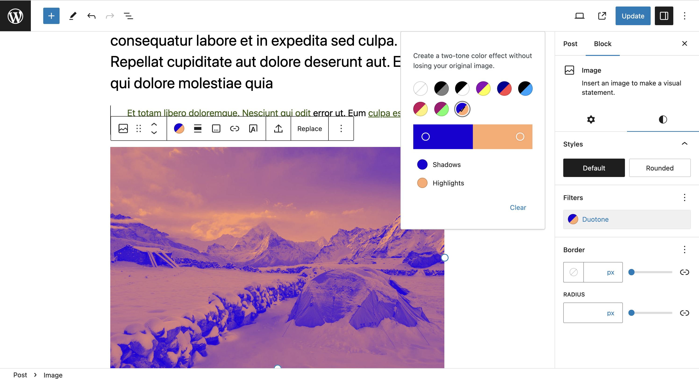
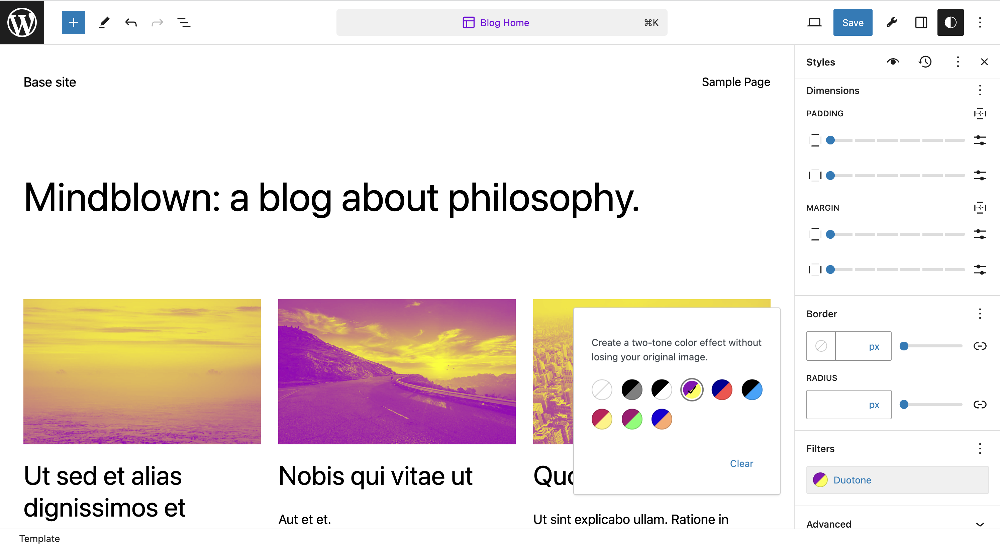
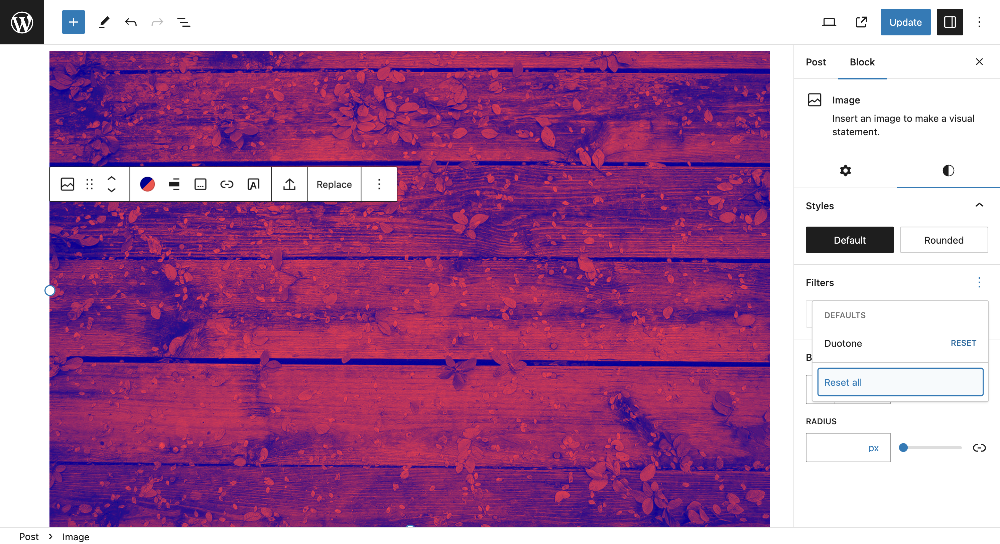

# Filters Settings overview

Use the filter settings to change image appearance with a duotone overlay.

To apply a filter to an image, add a block containing an image — some examples are the [Image Block](../../blocks/media-blocks/image-block.md) or the [Cover Block](../../blocks/media-blocks/cover-block.md).

> [!NOTE]
> Refer to this article for [detailed instructions on adding blocks](../adding-a-new-block.md).

## Using filters

While using a block with image, you can go to the **Style** tab and select a filter.

The filter options provide several duotone preset to choose from. Alternatively, you can set the color for shadows and highlights yourself by clicking the color bar.

## Adding to Global Styles

It is also possible to add filters to Global Styles — you can see more about that on the [Styles Overview](../../../site-editor/styles-overview.md) page.

When selecting a block containing an image on Global Styles, you have the option to apply a specific filter by default on all existing and new images.

## Reset options

While using the filter, you also have the option to revert whatever you want — this allow you to try and revert to experiement the image in different ways. To do so, click the **Filters options** button and select **Reset all**.

## Supported blocks

The filter is currently avaliable in the following blocks:

-   [Image Block](../../blocks/media-blocks/image-block.md)
-   [Cover Block](../../blocks/media-blocks/cover-block.md)
-   [Gallery Block](../../blocks/media-blocks/gallery-block.md)

## Changelog

-   Updated 2023-08-24
    -   Moved the category to Block Editor
    -   Edited some text
-   Created 2023-08-09
