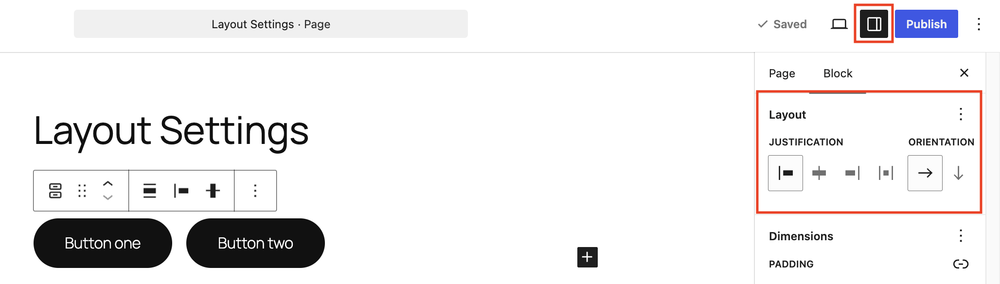
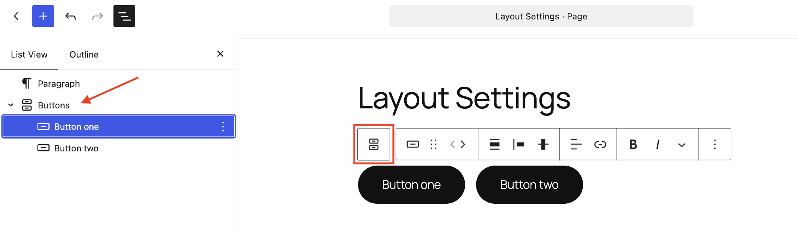
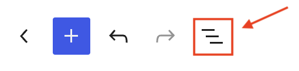
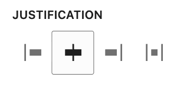
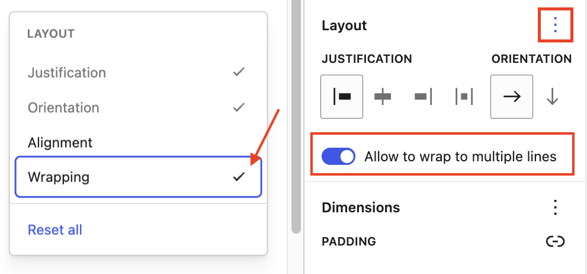
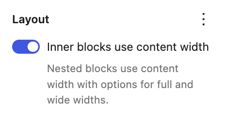
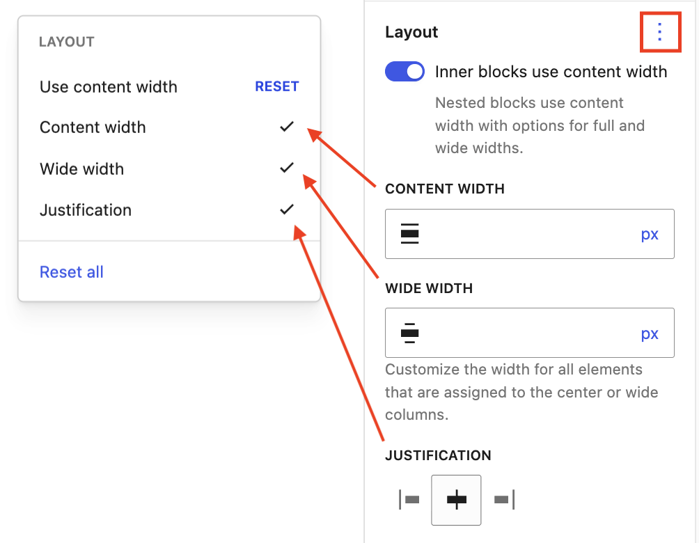
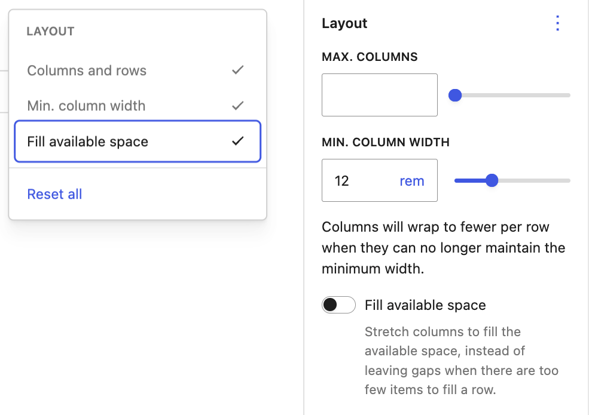
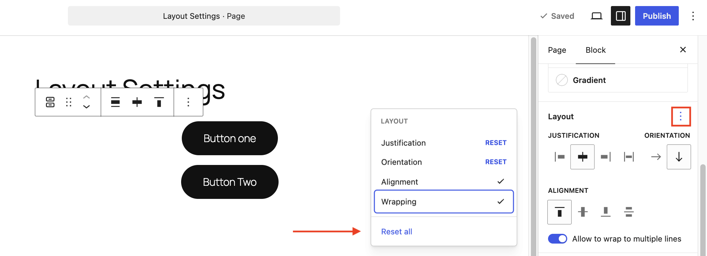

# Layout Settings overview

The layout settings in [blocks](../../blocks/README.md) allow you to change the justification and orientation of the nested child blocks inside their parent blocks. These settings can be found in the parent blocks within which the child blocks are nested.

## How to access Layout Settings

Click on the [Block Settings sidebar](../work-with-blocks.md#block-settings) button next to the Save/Publish button int the editor. Then look for the **Layout** section in the settings options of the parent block.

### Selecting the parent block

To access the layout settings in the parent block, click on any of the child blocks. The first icon in the block toolbar of the child block will select the parent block.

### Navigating through nested blocks

In addition to using the block toolbar, the [List View](../list-view.md) tool can be used to navigate between layers of content and nested blocks. This will make it easy to access the parent and child block. Click on the **Document Overview** button in the top left of the editor to open the **List View** panel.

> [!NOTE]
> [Learn more about List View](../list-view.md).

## Settings

Each supported block comes with different layout settings.

### Justification

You can set the justification of the child blocks inside the parent block. You can justify the child blocks to the **Left**, **Center**, or **Right**.

Some blocks, like the [Buttons block](../../blocks/design/buttons-block.md), include a **Space between items** setting that distributes child elements horizontally with equal spacing. This feature only applies to horizontal orientation layouts.

<!-- VideoPress embed (iframe removed): https://videopress.com/embed/E8BCQp3S -->

https://videopress.com/v/E8BCQp3S

### Orientation

When you first add multiple blocks to a parent block, the child blocks will be displayed next to each other horizontally.

Another option is to display the child blocks vertically, or stacked. When you choose vertical orientation for the button block, you will also see a **Justification** setting for **Stretch items** which will fill the available horizontal space with the button.

<!-- VideoPress embed (iframe removed): https://videopress.com/embed/Vhpf51dS -->

https://videopress.com/v/Vhpf51dS

### Allowing child blocks to wrap

The **Allow to wrap to multiple lines** setting is on by default, allowing child blocks to automatically flow onto a new line on smaller screens like mobile devices. If turned off, all child blocks will remain forced onto a single line regardless of screen width.

To find this setting, open the **Layout** panel, click the three-dot menu icon, and select **Wrapping** to reveal the toggle.

### Using and customizing layout width

Some blocks such as the [Query Loop](../../blocks/theme/query-loop-block.md) block that has nested inner blocks like [Post Template](../../blocks/theme/post-template-block.md) block and [Group block](../../blocks/design/group-block.md) will have the following layout option that lets you choose the layout width for the nested blocks.

Toggle off **Inner blocks use content width** so that the nested inner blocks fill the width of the parent container. You can also toggle on **Inner blocks use content width** so that the nested inner blocks use content width with options for full and wide widths.

To view **Content width**, **Wide width**, and **Justification** options, click on the three dot icon in the Layout panel and click on the options to view each option.

You can change the values and set the unit in PX, %, EM, REM, VW, or VH for the **Content width** and **Wide width**. You can also change the **Justification** for the nested elements to left, center or right aligned within the parent container.

<!-- VideoPress embed (iframe removed): https://videopress.com/embed/UxPNToqL -->

https://videopress.com/v/UxPNToqL

### Grid column options

The [Grid block](../../blocks/design/grid-block.md#layout) and Query Loop block in grid mode have layout options for **Max. columns**, **Min. Column width** and **Fill available space**.

### Reset All

If you make customizations to these settings and want to revert to the original settings quickly, you can do so by selecting the three-dot menu icon and clicking **Reset All**. This resets the settings and removes all of your changes.

> [!NOTE]
> [Learn more about the Reset all function.](../work-with-blocks.md#reset-controls)

## Changelog

-   Updated 2026-09-05 (props @awetz583 @atachibana)
    -   Updated screenshots and descriptions for 7.1
-   Created 2022-11-01
