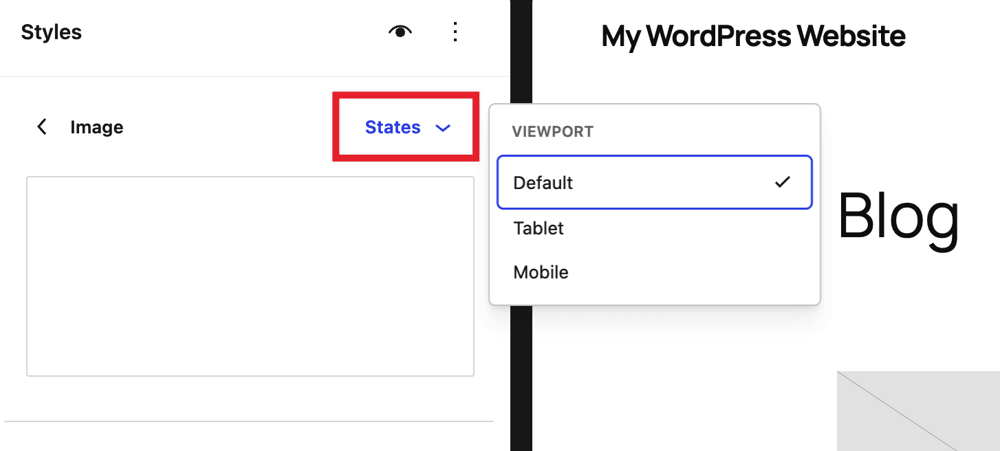
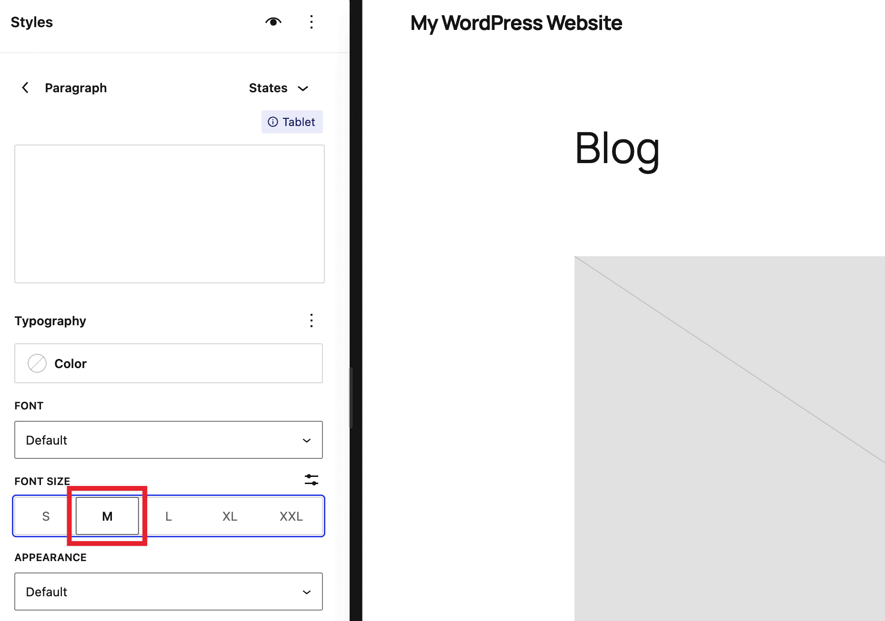
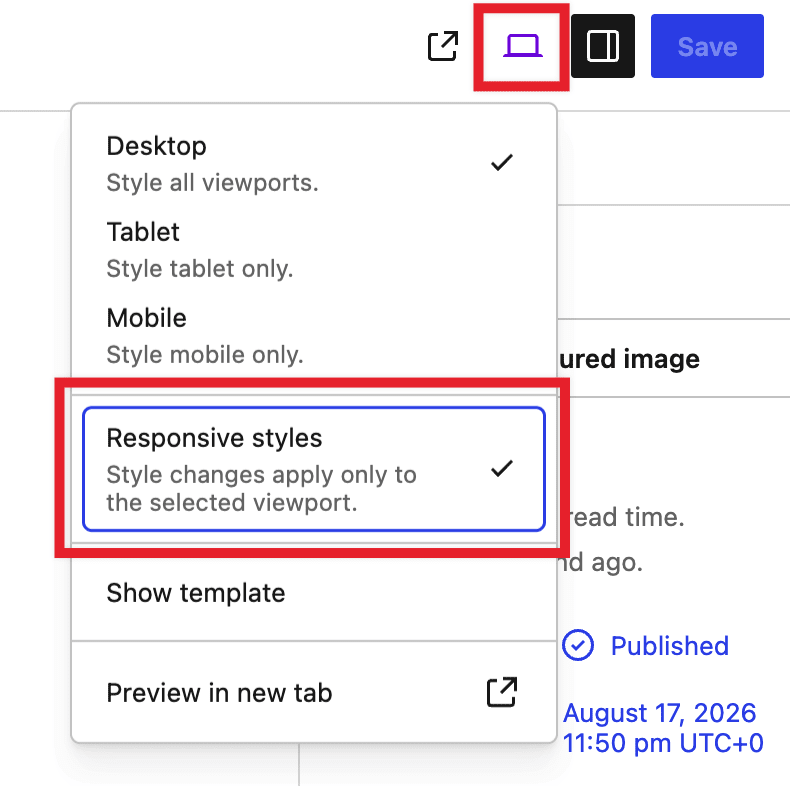
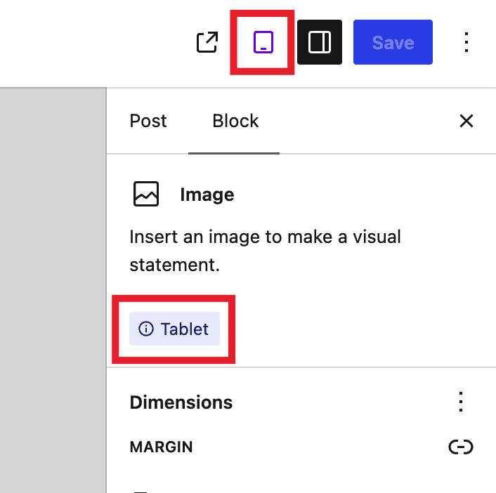

# Responsive styles

Responsive styles let you give a block different settings depending on the screen size it’s viewed on. For example, you can change the font size to be smaller on mobile viewports or make padding tighter on tablet viewports. It’s only included in [block themes](../../../themes/block-themes.md) and requires WordPress 7.1 or higher.

You can set responsive styles two ways: for a block *type* everywhere it’s used on your site, or for a single block in one post, page, template, or pattern. Both options allow you to make changes to typography, color, background, border, dimensions, spacing, and layout settings, whether you’re in the [Styles panel](../../../site-editor/styles-overview.md) or in an individual block’s Settings sidebar. What styling options are available depends on what a block supports.

## How responsive styles work

The style you set by default for a block is its base style, and it applies at every screen width unless you override it. Tablet and Mobile styles only override the base style within their own breakpoint:

| Viewport | Applies to |
| --- | --- |
| **Mobile** | Screens 480px wide and narrower |
| **Tablet** | Screens wider than 480px, up to 782px |
| **Default** | Every screen width, including as the fallback for anything you haven’t overridden at Tablet or Mobile |

Tablet and Mobile don’t interfere with each other’s styles. This means that if you set a Tablet style but leave Mobile untouched, Mobile doesn’t inherit your Tablet value. It falls back to the Default style. Set Mobile separately if you want a change to carry through to mobile-sized screens too.

**Theme customization**

Your theme can customize the exact widths that count as Tablet and Mobile, so the breakpoints on your site may be slightly different from the defaults above.

**Limitations**

Only settings found in a styles panel or a block’s Settings sidebar (typography, color, spacing, borders, dimensions, and layout) can have a separate Tablet or Mobile value. Controls in the block toolbar, such as text alignment, apply to every screen size no matter which device view is selected. Finally, if you want to remove a block at a certain screen size, use the option to show and hide blocks available in the three dot menu in the block toolbar.

## Setting responsive styles for a block type

Use this method to change how a block looks across your entire site. For example, making every Heading block smaller on mobile.

1.  Go to **Appearance > Editor**, open the **Styles** panel, and click **Blocks**.
2.  Select the block type you want to change.
3.  At the top of the block’s panel, open the **States** dropdown.
4.  Under **Viewport**, choose **Tablet** or **Mobile**.

5.  Change a style setting. For example, select a smaller font size. The styles panel filters down to just the settings that support responsive values, so you won’t see options that don’t apply.

6.  To go back to editing the block’s default (desktop) style, open the **States** dropdown again and choose **Default**.

## Setting responsive styles for a single block

Use this method to change one block on one post, page, template, or pattern, without affecting every other instance of that block type.

1.  Open the post, page, template, or pattern in the editor.
2.  Click **View** in the top toolbar and turn on **Responsive styles**.

3.  Switch the view to **Tablet** or **Mobile**.
4.  Select the block you want to change.
5.  Open the block’s Settings panel and change a style. For example, a smaller font size or different padding.

While **Responsive styles** are on and you’re viewing Tablet or Mobile, the selected block’s Settings panel shows a badge naming the device you’re editing. There’s no badge in Desktop view, because changes made there apply to every screen size.

Switch back to **Desktop** at any point to confirm the block’s default style is unchanged, or back to Tablet/Mobile to confirm your override is still there. Turning **Responsive styles** off returns you to editing the block’s default style, whichever device view you’re in.

This works the same way in the Post editor, the Template and Site editor, the Pattern editor, and the Navigation editor.

## Checking contrast

If you’re editing a text or background color while a viewport state is selected, the contrast checker still works. It checks the color combination that will actually be used at that breakpoint, the same way it does for pseudo states like Hover.

## If you don’t see these options

If you don’t see the **Viewport** group in the States dropdown, or the **Responsive styles** option in the View dropdown, your site administrator may have turned off responsive style editing for your site. Styles that were already set for Tablet or Mobile before this happened will keep displaying correctly. This only affects whether you can edit them.

## Demo

<!-- VideoPress embed (iframe removed): https://videopress.com/embed/O1hWGk3l -->

https://videopress.com/v/O1hWGk3l

## Changelog

-   Created 2026-08-18
