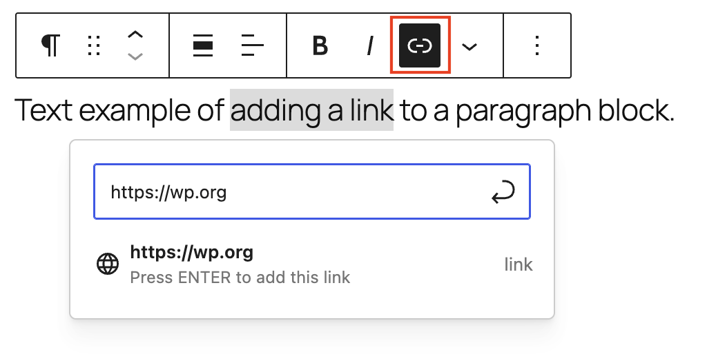
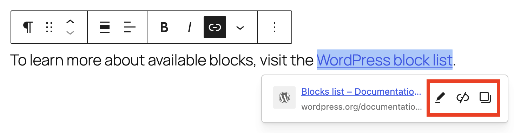
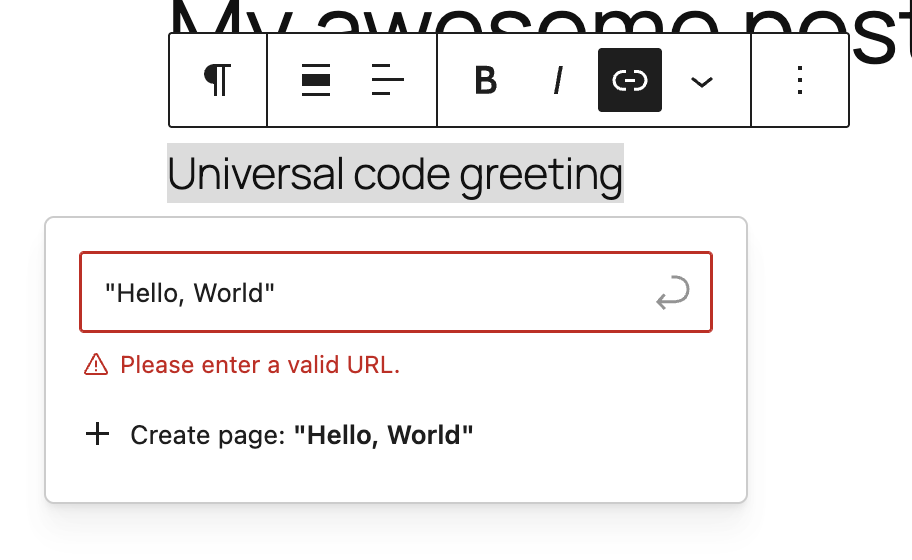
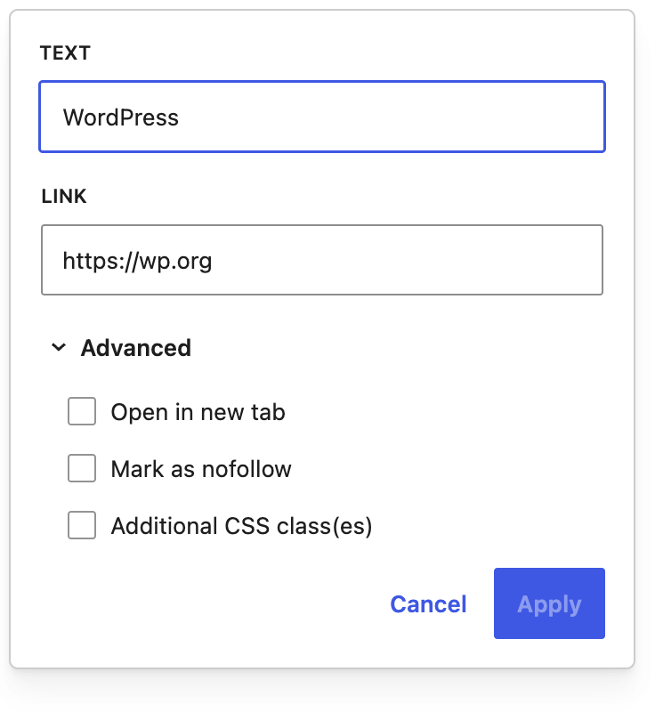

# Link control

Use the Link control to add, edit, search for, and configure links in supported blocks, like the [Paragraph block](../blocks/text/paragraph-block.md) and [Heading block](../blocks/text/heading-block.md). You can use it to link selected text, images, buttons, and other block content to another page, post, file, email address, phone number, or external website.

Link options may appear slightly differently depending on the block you are using.

> [!NOTE]
> Refer to this article for [detailed instructions on adding blocks](adding-a-new-block.md).

## Adding links

There are a few different ways to add links in WordPress.

### Link button

To create a text link, highlight and select the text first. This opens a dialog box where you can search for pages, posts, attachments, or images on your own website or type a URL.

Start typing a keyword, page title, or post title to search for content on your site. For links to another website, paste the full URL, including `https://`.

<!-- VideoPress embed (iframe removed): https://videopress.com/embed/pIgB8OPb -->

https://videopress.com/v/pIgB8OPb

### Keyboard shortcut

Highlight and select the text you want to link and use the **Ctrl+K** (or **⌘+K**) keyboard shortcut to quickly add a link.

### Copied URL

To turn selected text into a link, copy the URL you want to use. Then select the text and paste the URL using **Ctrl+V** on Windows or **⌘+V** on Mac.

**Note**: Pasting a URL by itself on a new line may create an Embed block or preview instead, depending on the URL.

## Edit an existing link

To edit an existing link, select the linked text. WordPress displays a link preview with options to open, edit, remove, or copy the link.

## Supported URLs

When adding a link, WordPress may ask you to “Please enter a valid URL” if the link looks incomplete or is not in a format WordPress recognizes.

*Valid URL error message*

Below is a list of supported URL formats:

-   **Full URL** – `https://wordpress.org`
-   **Page or file path on the same site** – `/about`
-   **Same-page anchor link** – `#contact`
-   **Email link** – `mailto:name@example.com`
-   **Phone link** – `tel:+123456789`

For links to another website, include the full address with `https://`.

**Note**: WordPress checks whether the link is formatted like a valid URL. It does not confirm that the destination page exists or loads successfully.

## Advanced options

When editing a link, expand the Advanced section to enable or disable the following settings:

-   **Open in new tab**
    -   Turn on **Open in new tab** to open the link in a separate browser tab. Leave it off to open the link in the same tab.
-   **Mark as nofollow**
    -   Turn on **nofollow** if you do not want search engines to associate your site with the linked page or crawl the linked page from your site.
-   **Additional CSS class(es)**

## Customizing link colors

Learn more about styling links in the [Color settings overview.](block-settings/colors-settings-overview.md)

## Changelog

-   Updated 2026-09-06 (props @awetz583 @jdy68)
    -   Added Additional CSS classes
    -   Updated video for 7.1
-   Updated 2026-06-13 (props to @blessingoye @kjoyner)
    -   Added more clarity to Link control intro and nofollow definition
    -   Added “Edit an existing link” section
    -   Placed different options for adding links into their own sections
    -   Combined changelogs
    -   Updated “Invalid URLs” heading to “Supported URLs” for clarity
-   Updated 2025-05-19
    -   Props to @get_dave, @0mirka00, @sirlouen, @jeryj, @paaljoachim, @wildworks, @scruffian
    -   Muted embedded video
    -   Updated screenshots with WordPress 7.0
    -   Minor updates to content on the Adding links section.
-   Updated 2025-06-05
    -   Updated screenshots with WordPress 6.8
-   Updated 2023-07-05
    -   Removed developer jargon and old links to Codex
