# More rich text editing options

The **More options** menu in the Rich Text toolbar gives you additional options to customize your text. You can access these additional options by clicking on the **arrow** icon in the toolbar.

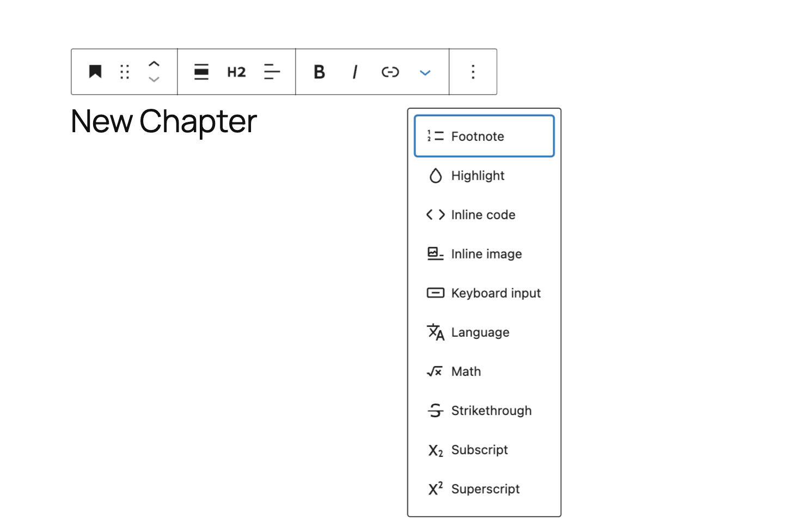

_Block toolbar with the drop-down for **More rich text options**_

## Footnote

The *Footnote* option will insert notes in your text. These notes will link to a new block that will be added at the bottom of your page. You will able to add the content of your notes in that new block and links will be added automatically.

> [!NOTE]
> Read more about the Footnotes block [here](../blocks/text/footnotes-block.md).

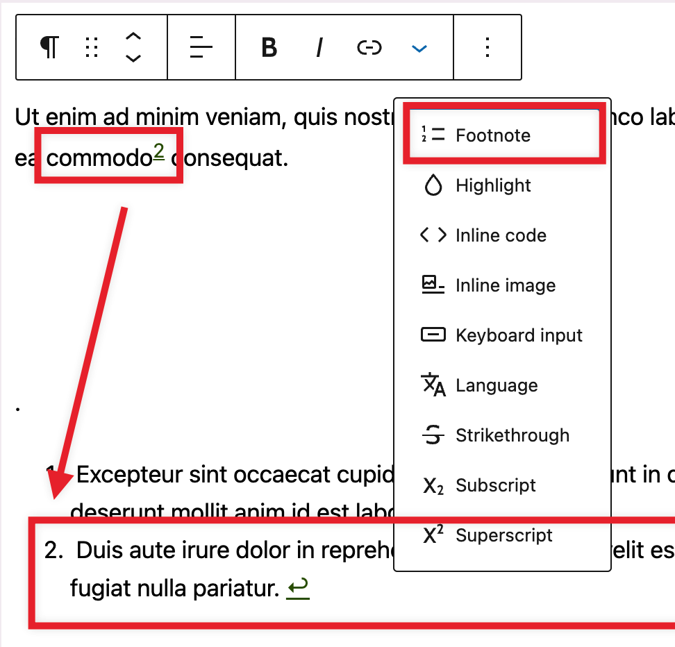

## Highlight

Using the *highlight* option allows you to change the color of the selected text and its background.

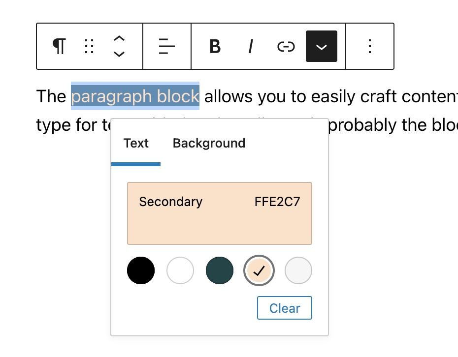

## Inline code

Use the *inline code* feature to format code snippets within your text differently. The *inline code* formatting also prevents the code to be executed instead of displayed.

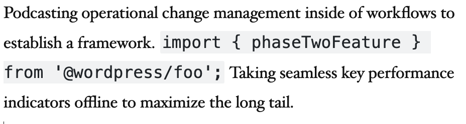

## Inline image

The *inline image* feature allows you to add an image from your media library to your text. It has an option to enter the desired pixel width for your image.

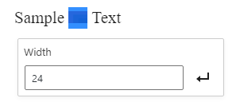

## Keyboard input

Using the *keyboard Input* option allows you to add the `<kbd>` tag to selected text.

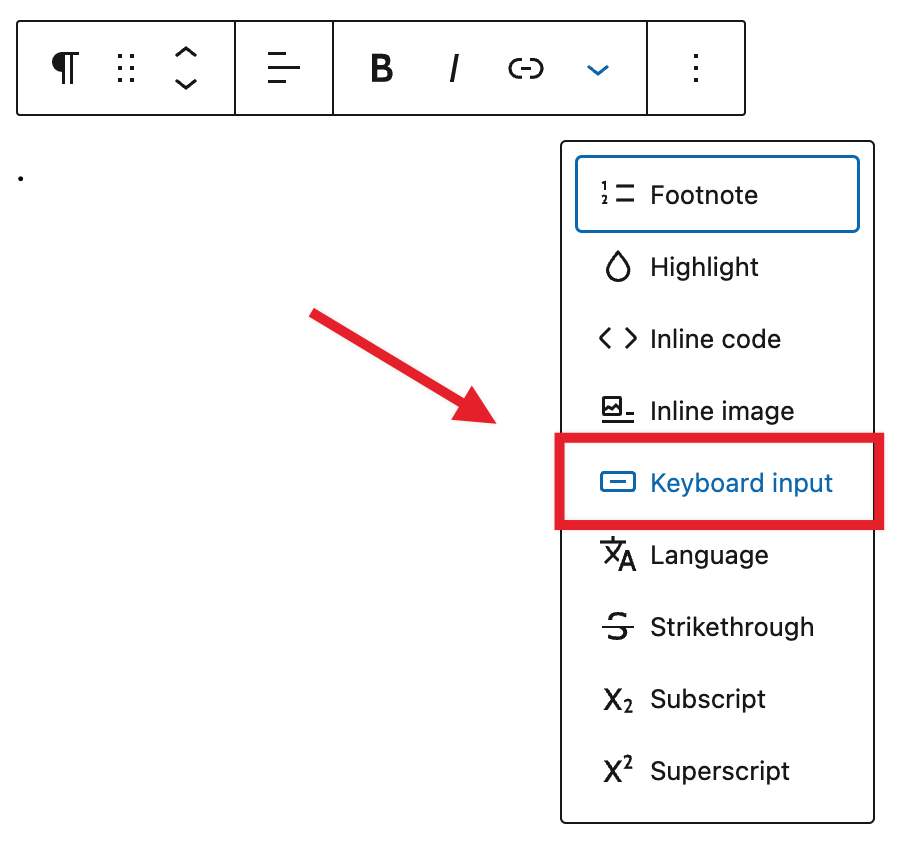

## Language

User the *Language* option to specify the language for the selected text. You will need to the languages abbreviation (es, en, fr, de) and specify the text direction (Left to Right or Right to Left).

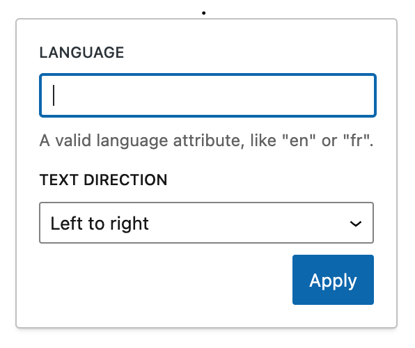

## Strikethrough

Using the *strikethrough* option adds a line through the selected text.

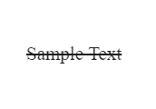

## Subscript

The *subscript* option allows you to add subscript to the selected text.

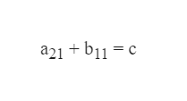

## Superscript

The *superscript* option allows you to add superscript to the selected text.

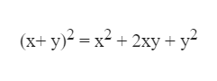

## Clear unknown formatting

In certain situations, you may come across an option in the block toolbar to *Clear unknown formatting*. This option will only appear if WordPress detects unrecognized formatting in a block. Choosing the *Clear unknown formatting* option will remove any unrecognized code that is affecting your content. That said, It is not necessary to clear the unknown formatting in order to apply other rich text editing.

For example, the *Clear unknown formatting* option might appear when you have copied and pasted content from a document editor such as Google Docs or Microsoft Word, or if you have used the *Edit as HTML* option in the [More options](more-options.md) menu.

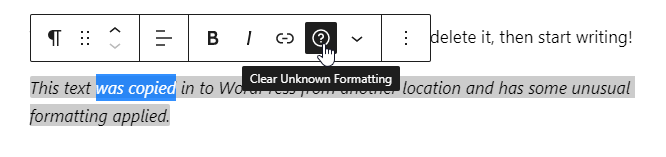

## Changelog

-   Updated 2023-08-08
    -   Added Footnotes & Languages
    -   Updated Screenshots
-   Updated 2023-06-08 with additional section for the new *Clear unknown formatting* option and added Changelog.
-   Created 2023-05-23
