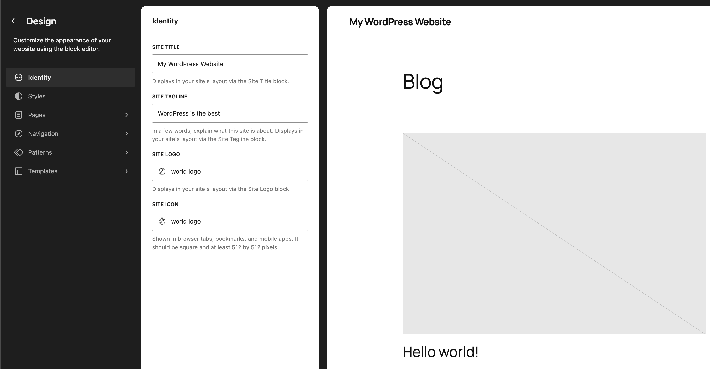
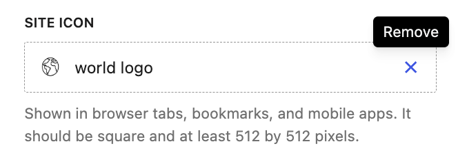

# Site Editor Identity

In the Site Editor, there is an Identity section where you can add and edit your Site Title, Site Tagline, Site Logo, and Site Icon at a high level without needing to edit any blocks directly. You can also edit these directly in the canvas of the Site Editor. Any changes you make in the Identity section will be reflected on the canvas and available after saving on your site.

> [!NOTE]
> The Site Editor Identity menu is **only** available when you install and activate a [Block theme](../themes/block-themes.md) on your site. You can learn about the Site Editor in this support article: [Site Editor](README.md).

## How to access the Identity section

Once you install and activate a Block theme on your site, go to **Appearance** > **Editor** to open the Site Editor. In the sidebar menu, select **Identity**:

## Identity features

In this section, you can edit important identity related parts of your site:

-   Site Title: Displays in your site’s layout via the Site Title block.
-   Site Tagline: In a few words, explain what this site is about. Displays in your site’s layout via the Site Tagline block.
-   Site Logo: Displays in your site’s layout via the Site Logo block.
-   Site Icon: Shown in browser tabs, bookmarks, and mobile apps. It should be square and at least 512 by 512 pixels.

For the Site Logo and Site Icon, you can replace any image you add and remove it using the X when you hover. If you click on the image itself, the media library will appear and you can upload or select a different image to use:

## Demo

<!-- VideoPress embed (iframe removed): https://videopress.com/embed/dvBHYnNg -->

https://videopress.com/v/dvBHYnNg

## Resource Links

-   [Site Editor](README.md)

## Changelog

-   Created 2026-08-18
