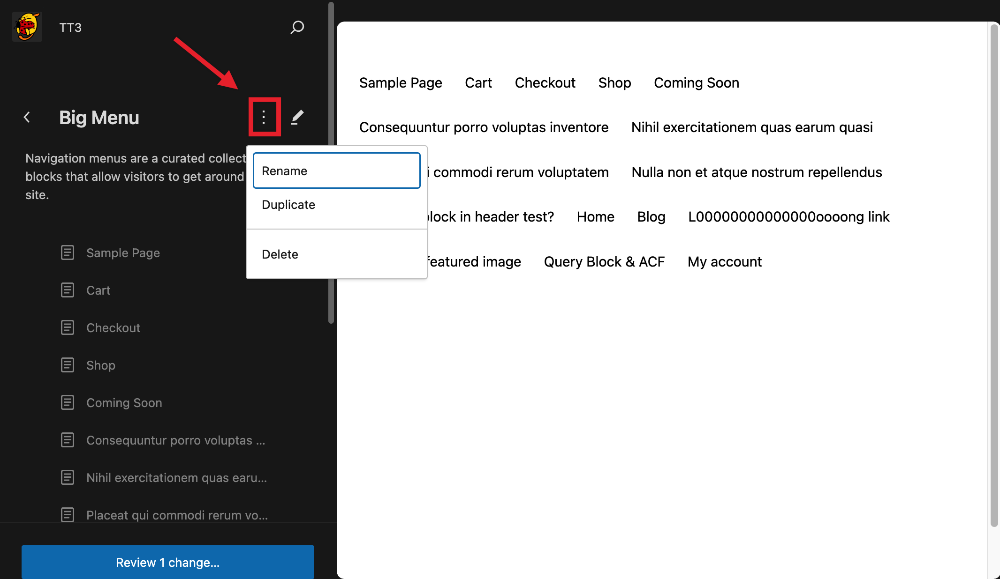
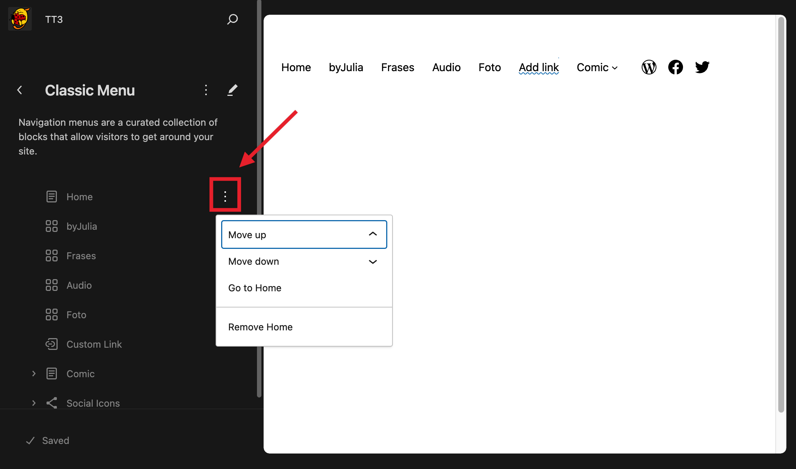

# Site Editor navigation

WordPress version 6.3 introduces the possibility to edit your site’s menus via the Site Editor.

You can view, manage, and modify your menus without having to find them in a specific template in the site editor. If your site has several menus, they will all be listed together and you will be able to edit them from there.

You can learn about the Site Editor in this support article: [Site Editor](README.md).

> [!NOTE]
> The Site Editor navigation is **only** available when you install and activate a [Block theme](../themes/block-themes.md) on your site.

You can do the follow actions using the Site Editor Navigation:

## Access all your menus

When you navigate to **Appearance > Editor > Navigation**, you will see all your menus listed there.

<video controls preload="metadata" src="https://wordpress.org/documentation/files/2023/08/Site-Editor-Navigation-menus-1.mp4"></video>

## Rename, duplicate, and delete menus

Once you select an individual menu, you will be able to rename, duplicate or delete it by clicking the **Actions** button next to its name.

## Reorder, delete, and opening menu items

You can reorder and delete menu items from the Site Editor navigation sidebar by clicking on the **Options for page link** button next to each menu item.

You can also reorder items by dragging and dropping items, and even create submenus.

<video controls preload="metadata" src="https://wordpress.org/documentation/files/2023/08/Site-Editor-Navigation-items-drag-drop.mp4"></video>

You can open any page from the Site Editor navigation section by clicking the **Options for page link** button and select **Go to page**. See the demostration video below.

<video controls preload="metadata" src="https://wordpress.org/documentation/files/2023/08/Site-Editor-Navigation-go-to-page.mp4"></video>

## Focus mode and advanced editing

The Site Editor navigation sidebar only allows you to do basic changes to individual menu items. If you need to edit menu item details, you can click on the menu itself (on the right) or on the **Edit** button (depicted by a pencil icon in the sidebar) to enter Focus Mode and access all menu settings.

<video controls preload="metadata" src="https://wordpress.org/documentation/files/2023/08/Site-Editor-Navigation-menu-items-focus-mode-details-1.mp4"></video>

## Saving your changes

Please note that you will need to save your changes. You will be asked to save these changes before you exit the Site Editor but you can also save them manually at any point.

<video controls preload="metadata" src="https://wordpress.org/documentation/files/2023/08/Site-Editor-Navigation-save-changes.mp4"></video>

You can also save them by clicking `cmd+s` in Mac or `ctrl+s` in Windows.

## Adding a navigation menu to your site

Creating a navigation menu in the Site Editor doesn’t automatically make it appear on your site. You need to add a Navigation block to a template part (such as the Header) and link it to the menu you created.

### 1. Add the Navigation Block

-   Go to the template part where you want the menu to appear (e.g., the Header template part).
-   Insert the **Navigation block** into the desired area.

### 2. Assign the Navigation Menu

-   Click on the Navigation block to open its settings in the sidebar.
-   Under the menu selector, choose the navigation menu you created earlier.
-   If the dropdown is empty, make sure your navigation menu was saved correctly and is available for selection.

### 3. Save and Preview

Save your changes and preview the site to confirm the navigation menu appears as expected.

If the Navigation block still appears empty, double-check the following:

-   The navigation menu was saved and published.
-   The Navigation block is correctly linked to the menu in its settings.
-   Clear any caching plugins or browser cache that might be affecting the display.

## Changelog

> [!NOTE]
> -   Updated 2026-06-30
>     -   Added section on assigning a navigation menu to the Navigation block. Props @karthickmurugan
> -   Updated 2023-11-11
>     -   Updating capitalisations.
> -   Updated 2023-08-24
>     -   Updated formatting
>     -   Changed the category to Site Editor
> -   Created 2023-08-08
