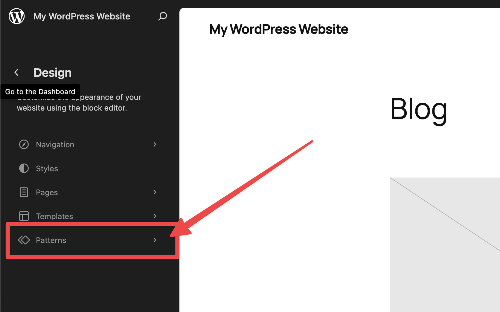
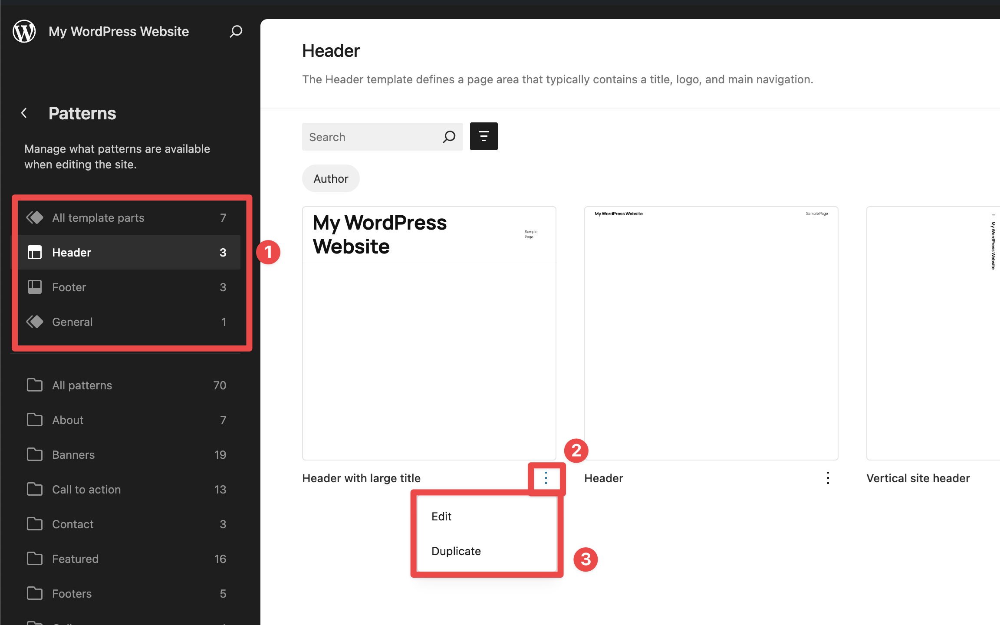
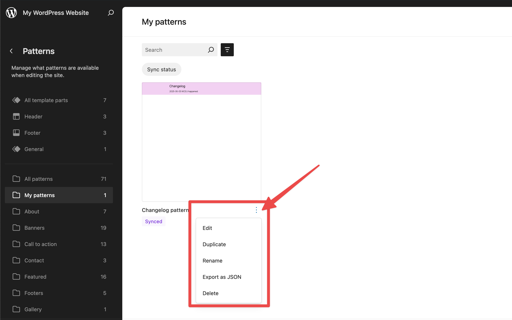
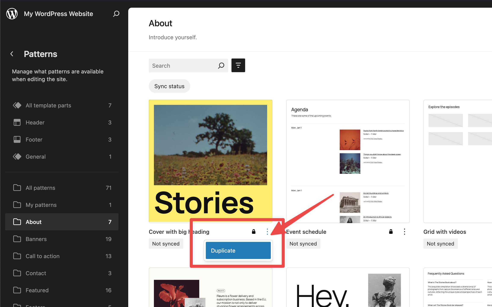
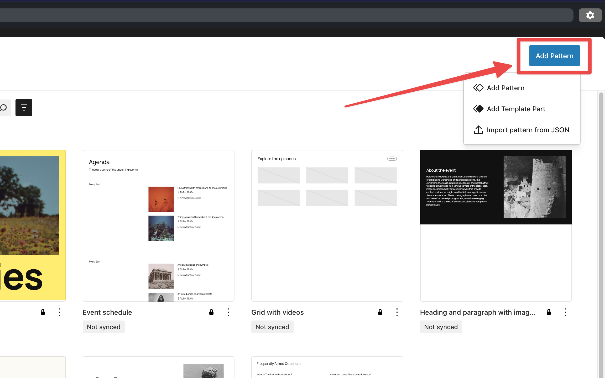
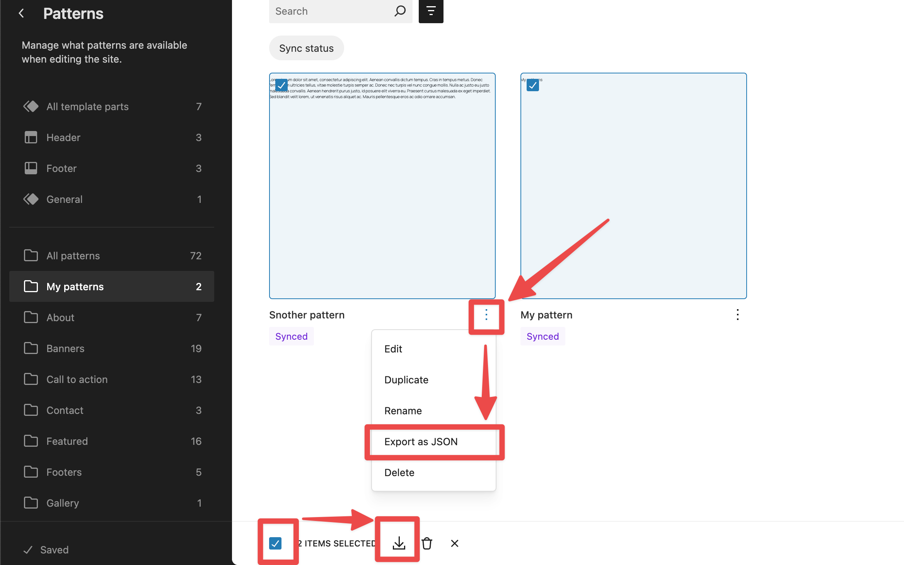
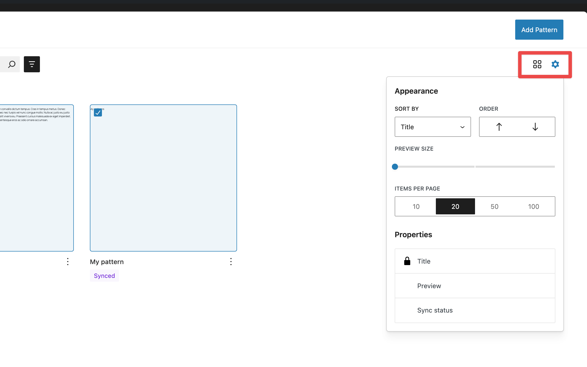

# Site Editor Patterns

Since WordPress version 6.3, it is possible to create and manage your site’s [Patterns and template parts](../block-editor/patterns/comparing-patterns-template-parts-and-reusable-blocks.md) via the Site Editor’s sidebar. You can learn about the Site Editor in this article: [Site Editor](README.md).

> [!NOTE]
> The Site Editor Patterns menu is **only** available when you install and activate a [Block theme](../themes/block-themes.md) on your site.

## Working with patterns

Navigate to **Appearance > Editor > Patterns** to access your Patterns and template parts.

Please note that template parts are now listed under **Patterns**.

## Template parts

The first type of pattern you will find are **Template parts**. Template parts are **included with block themes** and are typically used on multiple templates across your site.

If you click on the **Actions** (ellipsis) button, you will see options to **edit** or **duplicate** that Template part.

Finally, you can edit the Template part by clicking directly on it.

## My patterns

The first item in the Patterns section is **My patterns**. This section lists all the custom patterns you added to your site yourself. They can be filtered by [**Synced**](../block-editor/patterns/reusable-blocks.md) or **Standard** (non-synced).

> [!NOTE]
> If you have a lot of Patterns, the **Command Palette** is another great find them. Learn more about the [Command Palette here](site-editor-command-palette.md).

If you click on the **Actions** (ellipsis) button next to each pattern, you will see options to **Edit**, **Duplicate**, **Rename, Export as JSON** or **Delete** that pattern.

You can edit any pattern just by clicking on the pattern itself.

## Theme patterns

Underneath **My patterns**, you can find regular patterns that come bundled with your theme. These patterns **cannot be edited directly** (hence they are marked with a lock symbol). Instead, you can click on the **Actions** (ellipsis) button and click **Duplicate** to create an editable copy of that pattern. This copy will be listed under **My patterns**.

## Add or import new patterns

There is an **Add Pattern** button in the right corner that you can click on to create new patterns. If you click on it, you will see three options: **Add Pattern, Add Template part,** and **Import pattern from JSON**.

> [!NOTE]
> You can learn more about the difference between [Patterns and template parts here](../block-editor/patterns/comparing-patterns-template-parts-and-reusable-blocks.md).

## Export patterns

You can export patterns from the **My Patterns** section in the Site Editor. Patterns that come with a theme are locked and cannot be exported.

To export a single pattern, go to **Patterns > My Patterns**. Click the **Actions** (ellipsis) button next to the pattern. Select **Export as JSON**, which downloads the pattern as a .json file.

To export multiple patterns, in My Patterns, select the box to check all patterns located at the bottom. And then click the **Download icon**. This downloads a .zip file containing .json files for each pattern chosen.Besides that, the box to check all patterns located at the bottom allows you to bulk **Delete** patterns as well.

## Appearance Settings

In the top-right corner of the **Patterns** screen, just below the **Add Pattern** button, you’ll find options to customize how patterns are displayed.

The first icon, **Layout**, lets you switch between grid and list views, depending on your preference.

The second icon, **View Options**, provides more detailed controls. You can change the sort order of patterns, adjust the preview size, set the number of patterns per page, and choose which pattern details are displayed in the list.

## Changelog

> [!NOTE]
> -   Updated 2025-06-05
>     -   Completly rewritten all content to match WP 6.8 FSE capabilities
> -   Updated 2023-08-24
>     -   Updated formatting
>     -   Updated category and subcategory
>     -   Fixed some typos
> -   Created 2023-08-08
