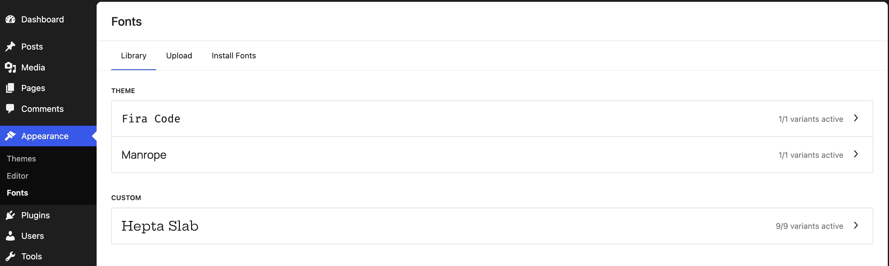
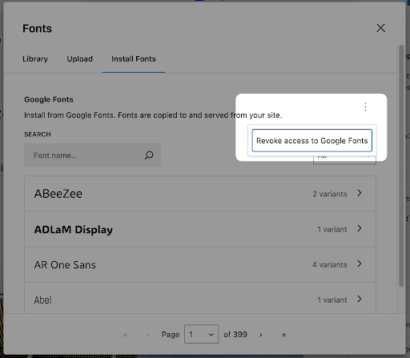
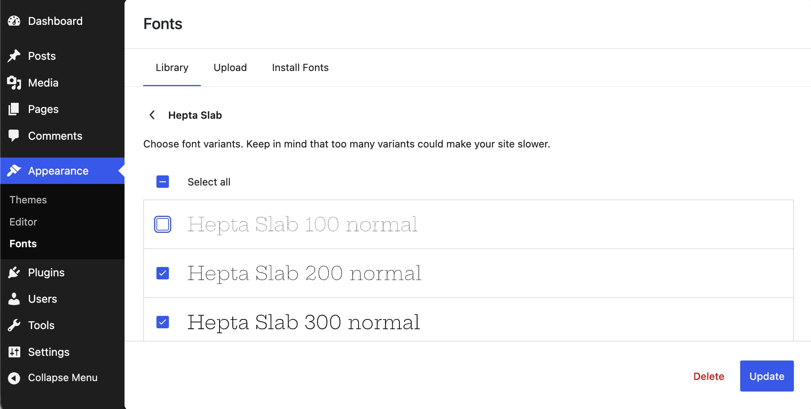

# The Font Library

The Font Library lets you upload font files, install fonts from Google Fonts, and manage the fonts available on your site.. Starting in 7.0, it is available globally for [block themes](../themes/block-themes.md) and classic themes.

## Using the Font Library

The Font Library lives in the Admin menu under **Appearance > Fonts**.

### Library

In the **Library** tab, view and manage fonts currently installed on your site, including fonts provided by your theme, uploaded fonts, and fonts installed from Google Fonts. Any newly added fonts will appear in this tab.

### Upload

In the **Upload** tab, upload a font file from your computer when the font you need is not already available. Make sure you have permission to use and distribute the font. The supported formats are .ttf, .otf, .woff, and .woff2.

<video controls preload="metadata" src="https://wordpress.org/documentation/files/2024/10/upload-font.mov"></video>

### Install Fonts

In the **Install Fonts** tab, browse and install fonts from Google Fonts for use on your site. WordPress downloads the selected font files and hosts them on your site rather than loading them from Google.

First, you need to give your site access to Google Fonts.

You can revoke this access by clicking on the three dots button on the right.

Find the font you wish to use using the search box. You can filter search results using the category dropdown menu at top right.

#### Install a Google Font

To install a font from Google Fonts:

-   Choose the desired font
-   Select the font variants in the next panel
-   Click install

You’ll see a notice indicating whether the font installed successfully. Newly installed fonts will appear in the Library tab.

The available variations will also appear in the Styles section.

<video controls preload="metadata" src="https://wordpress.org/documentation/files/2024/10/Kapture-2026-05-23-at-07.04.39.mp4" poster="../../assets/images/2024/10/Screenshot-2026-05-23-at-7.08.43-AM.jpg"></video>

## Removing fonts

To make specific font variants available or unavailable, select or clear their checkboxes, then click **Update**.

To completely remove the font family or single font, click on it, check the box for the font then click **Delete**. You’ll be prompted to confirm the deletion before the font family is uninstalled.

After a font is deleted, a “Font family uninstalled successfully” notice appears on the main Library tab.

## Change a default font

To update a block’s font across your site, navigate to **Appearance > Editor > Styles**.

From **Styles**, you can change the fonts used across your site or set a font for specific blocks, such as Heading or Paragraph. Available options depend on your theme.

<video controls preload="metadata" src="https://wordpress.org/documentation/files/2024/10/Kapture-2026-05-23-at-07.48.01.mp4" poster="../../assets/images/2024/10/Screenshot-2026-05-23-at-7.51.07-AM.jpg"></video>

## Changelog

-   Updated 2026-07-26 (props to @kjoyner @anujrathore24)
    -   Add intros to each tab description.
    -   Minor plain language upates.
-   Updated 2026-05-23 (props to @awetz583 @andfinally)
    -   Updated font menu location for 7.0
    -   Updated videos and screenshots
-   Created 2024-10-17
