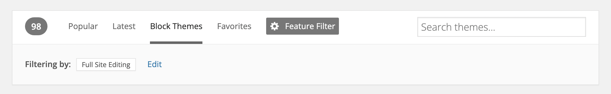

# Block themes

As of WordPress 5.9, block themes are now a part of the WordPress ecosystem as a new type of theme built with and for blocks.

## What is a block theme?

A block theme is a theme that uses blocks for all parts of a site, including navigation menus, header, content, and site footer. These themes are built for the newest features coming to WordPress that allow you to edit and customize all parts of your site. This allows you to switch up key parts of your theme without ever needing to change themes.

With a block theme, you can place and edit blocks outside your content using the [Template Editor](../site-editor/template-editor.md) or [Site Editor](../site-editor/README.md). You can use blocks in templates provided by a theme or plugin. For example, an archive page or a 404 page. You can also create custom templates.

For general information about themes, see the support article [What is a theme?](work-with-themes.md#what-is-a-theme)

**How does this impact widgets and widget areas?**

Instead of widgets, a block theme relies on blocks. This means that you can place blocks anywhere you might have previously wanted widgets to appear.

**How does this impact the Customizer?**

The [Customizer](../../classic-wordpress/widgets-menus-and-customizer/customizer.md) is not available in block themes unless you are using a plugin or theme that requires it to be activated. This is because you can make the same changes you might make with the Customizer with blocks. For example, there are now blocks for the site title, tagline, and site logo. You can also select colors for your website in the [Styles](../site-editor/styles-overview.md) setting by going to the **Administration Screen** > **Appearance** > **Editor (beta).**

## How to find block themes

You can find block themes in the [WordPress theme directory](https://wordpress.org/themes/tags/full-site-editing/) by selecting **Block Themes** in the toolbar. This automatically takes you to a filtered view of all themes with Full Site Editing functionality.

*Themes Directory – Block Themes*

For general information about how to get new themes, see the support article [Get new themes](work-with-themes.md#get-new-themes).

## What options are available with block themes?

After activating a block theme, more tools and features will be available to you, including the following:

-   [Site Editor](../site-editor/README.md): an editor that allows you to edit all parts of your site, navigate between templates, and more.
-   [Styles](../site-editor/styles-overview.md): a feature that allows you to customize your site, including individual blocks, as much as you’d like with different colors, typography, layouts, and more.
-   [Templates](../site-editor/template-editor.md): edit, create, and manage templates that a page or post uses.
-   [Template parts](../block-editor/blocks/theme/template-part-block.md): a way to organize and display groups of blocks as part of a block template mainly for site structure, like Headers and Footers.
-   Theme blocks including the [Navigation Block](../block-editor/blocks/theme/navigation-block.md), [Query Loop block](../block-editor/blocks/theme/query-loop-block.md), and more.

Using these options, you can create the desired look and feel of your site without switching themes as often.

## When should I use a block theme?

Block themes were introduced in WordPress since the 5.9 release. If you like exploring new things, enjoy building content with the [block editor](../block-editor/wordpress-block-editor.md) and like to have full control over all parts of your site, block themes are a great solution for you.

If you’re comfortable doing so, it might help to [set up a test site](https://developer.wordpress.org/advanced-administration/debug/test-driving/) to try out a block theme first to see if it will work for you.

## How are block themes different from classic themes?

Block themes are built for the newer functionality in WordPress and allow you to use blocks to edit all parts of your site, including easier ways to quickly customize everything from your background colors to font sizes for all Heading blocks, etc. Comparatively, classic themes are built with PHP templates, functions.php, and more that include features like Widgets, a dedicated Menus section, the Customizer, and more. Classic themes do not work with the [Site Editor](../site-editor/README.md).

## Resource Links

-   Learn WordPress course on [Simple Site Design with Full Site Editing](https://learn.wordpress.org/course/simple-site-design-with-full-site-editing/)
-   Build [a block theme](https://developer.wordpress.org/themes/block-themes/)

## Changelog

-   Update 2023-04-24
    -   Add link to building a block theme
-   Update 2022-07-14
    -   Add section on how to find block themes
-   Created 2022-01-05
