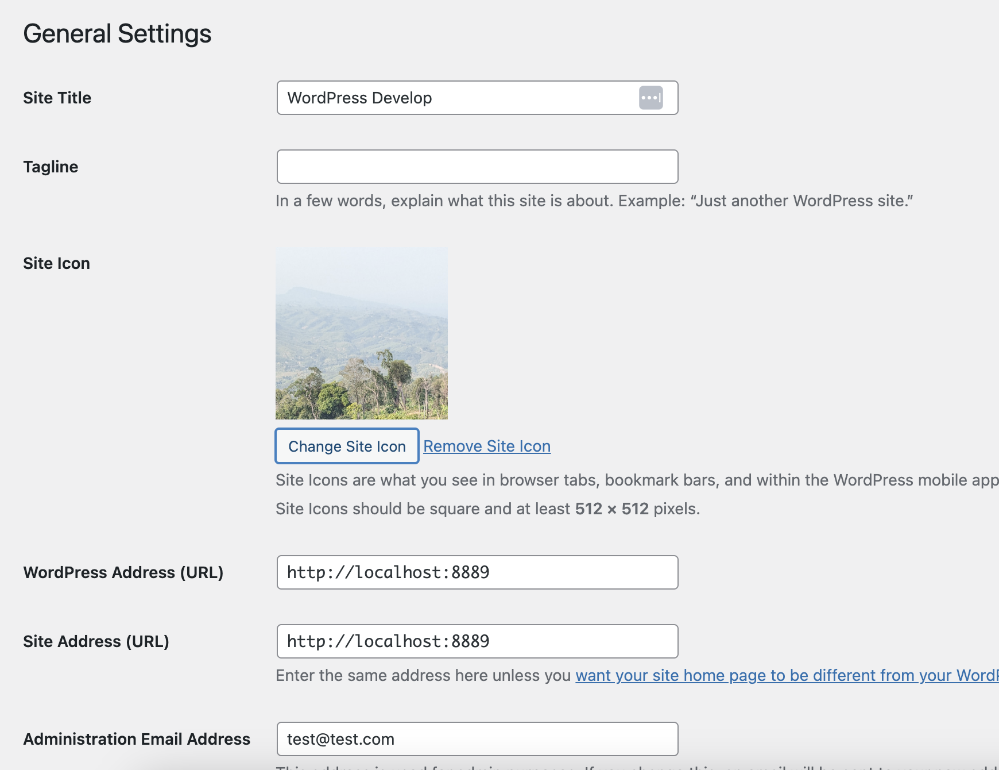
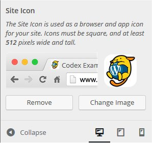

# Create a Favicon

A *favicon* (short for “favorite icon”) is an icon associated with a particular website or web page. It is generally intended to be used when you bookmark a web page. Web browsers use them in the URL bar, on tabs, and elsewhere to help identify a website visually. Favicons are also used as application icons on mobile devices.

## WordPress Version 6.5 or later

WordPress [Version 6.5](https://wordpress.org/documentation/wordpress-version/version-6-5/) moved the site icon to **General Settings**.

Follow the steps below to set **Site Icon** from General settings.

1.  Prepare the image file and upload to media library. (It must be square, having a height and width of at least 512 px. and a .png is the recommended format)
2.  Navigate to [General Settings](../../using-wordpress/administration-screens/settings/settings-general-screen.md)
3.  Click Choose a Site icon.
4.  Select image file that you prepared in the previous step.

## WordPress Version 4.3 to 6.4

WordPress [Version 4.3](https://wordpress.org/documentation/wordpress-version/version-4-3/) implemented a Site Icon feature that enables favicons on your web site.

When you use the Site Icon feature, you don’t need to prepare the `favicon.ico` file by yourself, or modify your template file. All you have to do is navigate to the Customize screen and specify a square image that has a height and width of at least 512 px.

Later paragraphs in this article contain instructions for manually setting up your own favicon. However, it is highly recommended that you use the Site Icon feature (a feature that is built-in to WordPress) instead.

Follow the steps below to use Site Icon to set up a favicon for your site.

1.  Prepare the image file. (It must be square, having a height and width of at least 512 px.)
2.  Navigate to [Administration Screen](../../using-wordpress/administration-screens/README.md) > Appearance > Customize
3.  Click **Site Identity**
4.  Click **Select Image** (located under the **Site Icon** subheading).
5.  Click on the **Upload Files** tab, then click **Select Files** to upload the image file that you prepared in the previous step.

|  |
| --- |
| **Changelog** **April 25, 2025** – Added the update for 6.5 and removed outdated sections:  – Creating a Favicon – Installing a Favicon in WordPress – How to create a favicon with a transparent background – Advantages of using .ico over .png or .gif |
