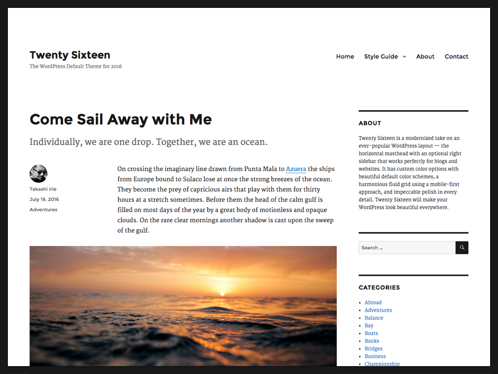
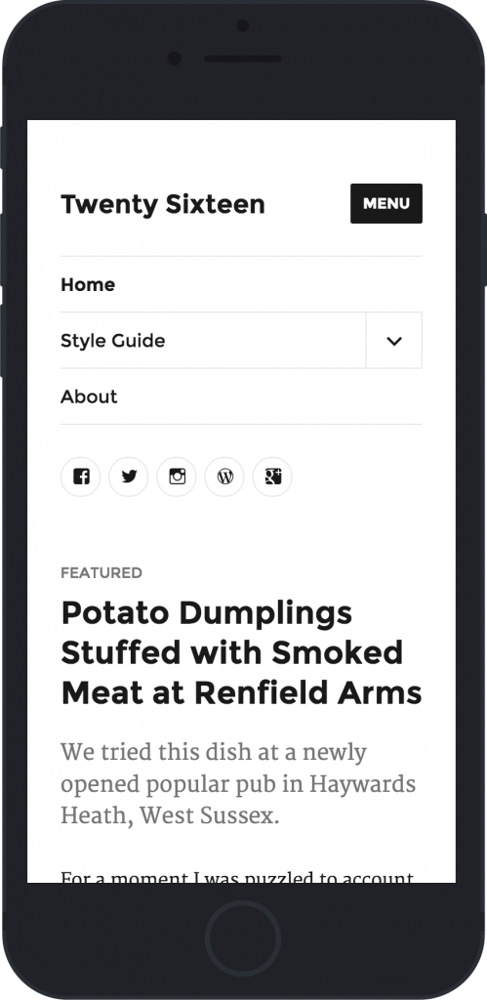
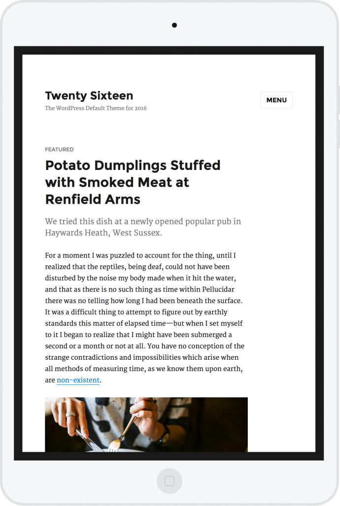
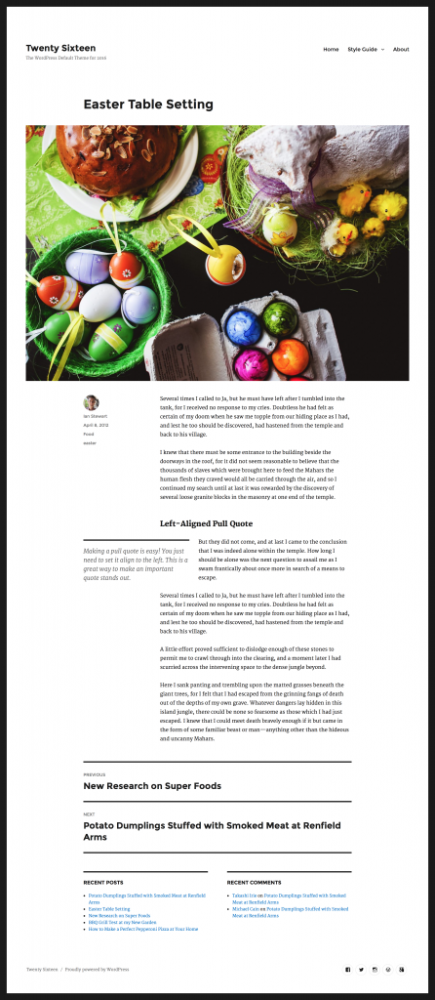
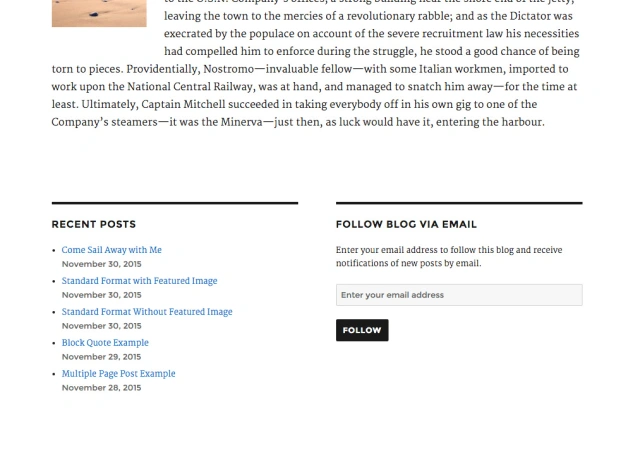
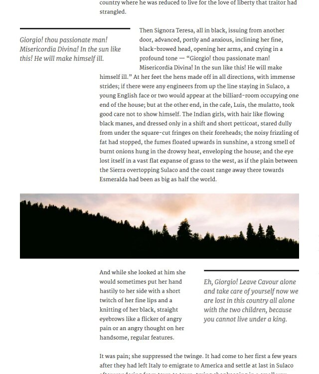
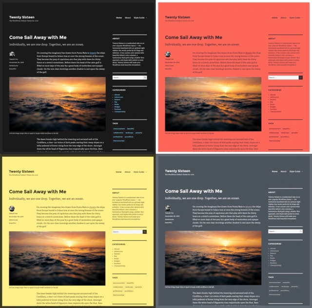

# Twenty Sixteen

[Twenty Sixteen](https://wordpress.org/themes/twentysixteen) is the default theme for WordPress in 2016.



Twenty Sixteen is a modernized take on an ever-popular WordPress layout — the horizontal masthead with an optional right sidebar that works perfectly for blogs and websites. It has custom color options with beautiful default color schemes, a harmonious fluid grid using a mobile-first approach, and impeccable polish in every detail. Twenty Sixteen will make your WordPress look beautiful everywhere.





**Quick Specs**

1.  The main column width is up to 840px.
2.  The sidebar column width is up to 300px.
3.  The recommended Featured Image size is 1200px wide.
4.  The recommended Custom Header image size is 1200px wide and 280px height.

## No-Sidebar Layout

If you’d like to keep your visitors’ focus squarely on your content, simply don’t add any [widgets](../../../../using-wordpress/administration-screens/appearance/manage-wordpress-widgets.md) to the sidebar widget area. This also allows you to give your posts a powerful visual boost by adding a large [Featured Image](../../../block-editor/page-post-settings-sidebar.md#featured-image), up to 1200px wide.



## Content Bottom Widget Areas

Twenty Sixteen’s two Content Bottom Widget Areas are handy spots where you can place supplementary content. On single posts and pages, these widget areas display below your content. To add widgets to them, Click **Appearance > Widgets** from the [Administration Screen](../../../../using-wordpress/administration-screens/appearance/appearance-widgets-screen-classic-editor.md) and add your favorite widgets to **Content Bottom 1** or **Content Bottom 2** or both.



## Post Intro

Twenty Sixteen has a small but nifty intro feature. Also known as a “deck” or “kicker,” the intro area is displayed between the headline and body copy. Your intro can provide important information and act as a link between the title and the rest of your post. A carefully crafted deck grabs readers’ attention, giving them an idea of what to expect in the full post.

Add your intro in the [Excerpt option](../../../../using-wordpress/writing-and-publishing/what-is-an-excerpt-classic-editor.md) in your Post panel.

## Overhanging Full-Size Image

Have you ever wanted to show off your large images without sacrificing the post’s readability? On a large screen, full-size images wider than or equal to 840px overhang the column.

## Pull Quotes

Pull quotes are a great way to refocus your readers’ attention — just add a class of `alignleft` or `alignright` to a `blockquote` element. Here are some examples of how to do that in the [Classic Editor](../../../../using-wordpress/writing-and-publishing/write-posts-classic-editor.md#Visual_Versus_Text_Editor).

```php
<blockquote class="alignleft">A bolder pull blockquote that aligns to the lef</blockquote>

<blockquote class="alignright">A bolder pull blockquote that aligns to the right</blockquote>
```

On a large monitor, the left-aligned pull quote overhangs the main column to maintain the readability of the text wrapped around it.



## Customize

Open the [Customizer](../../../../using-wordpress/administration-screens/appearance/customizer.md) to check out the four featured color schemes you can use to instantly change the look of your website.

-   (Default)
-   Red
-   Gray
-   Dark
-   Yellow

Personalize the design even further by adding a Custom Header Image or/and Site Logo.



## Social Menu

With Twenty Sixteen, you can display links to your social media profiles with perfectly sized icons in the footer, using the Social Links menu. You can manage menus under [Appearance > Menus](../../../../using-wordpress/administration-screens/appearance/appearance-menus-screen.md).

Linking to any of the following sites will automatically display its icon in your menu:

-   CodePen
-   Digg
-   Dribbble
-   Dropbox
-   Email (mailto: links)
-   Facebook
-   Flickr
-   Foursquare
-   GitHub
-   Google+
-   Instagram
-   LinkedIn
-   Path
-   Pinterest
-   Polldaddy
-   Reddit
-   RSS Feed (urls with /feed/)
-   Spotify
-   StumbleUpon
-   Tumblr
-   Twitch
-   Twitter
-   Vimeo
-   WordPress
-   YouTube

## Links

-   [Twenty Sixteen Demo and Download](https://wordpress.org/themes/twentysixteen/)
-   [Twenty Sixteen Changelog](twenty-sixteen-changelog.md)
