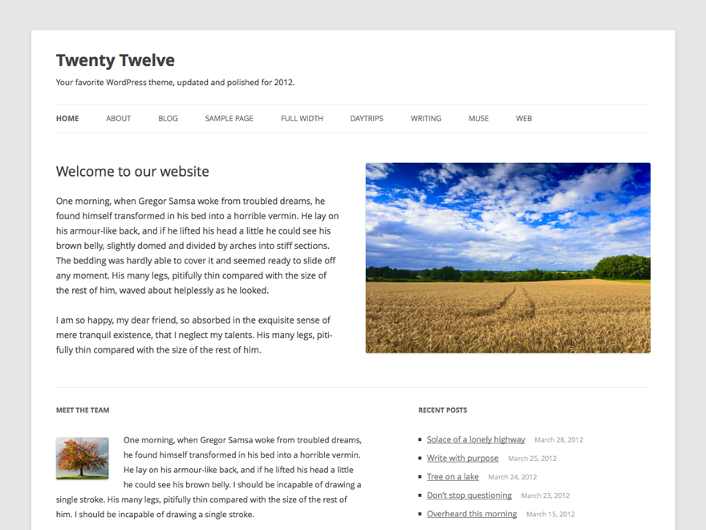
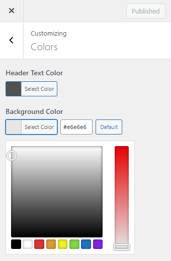
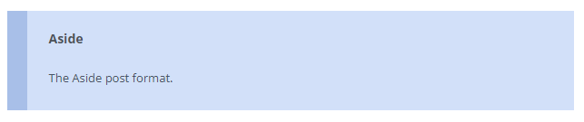
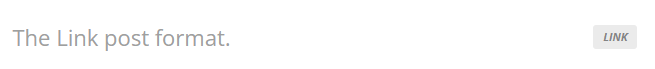
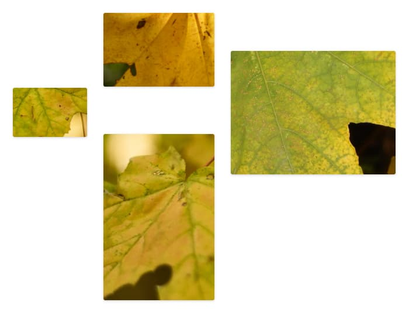
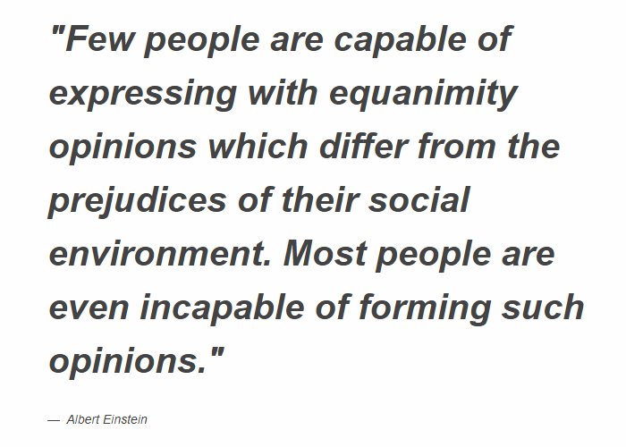
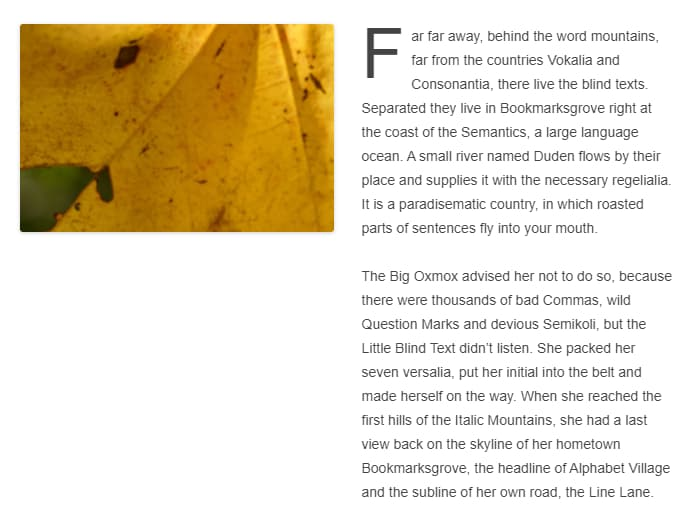

# Twenty Twelve

The [Twenty Twelve](https://wordpress.org/themes/twentytwelve/) is the default theme for WordPress in 2012, designed by [Drew Strojny](https://profiles.wordpress.org/drewstrojny/).

The 2012 theme for WordPress is a fully responsive theme that looks great on any device. Features include a front page template with its own widgets, styling for post formats on both index and single views, and an optional no-sidebar page template. Make it yours with a custom menu, header image, and background.

The theme has three patterns and three widget areas: Two on the front page and one sidebar.

## Quick Specs

1.  The main column width is 625px except in the full-width layout where it’s 960px; sidebar width is 250px.
2.  Featured image width is 624px (height is flexible)—these images are displayed on displayed on “standard” posts; posts without a specific format such as image, aside, link, or quote.
3.  The suggested header image dimensions are 960px by 250px (width, height). However, both are flexible so you can upload a smaller cropped image if you wish. The width is limited to 2000px.

## Custom Colors

Twenty Twelve uses the following color palette:

Blue #21759b

Dark Gray #444

Medium Gray #9f9f9f

Light Gray #e6e6e6

White #ffffff

You can change the header text color and the background color in the Colors panel in the [Customizer](../../../../using-wordpress/administration-screens/appearance/customizer.md):

## Custom Templates

Twenty Twelve has two optional page templates: A front page template and a full width page template with no sidebar. 
Both templates hide the sidebar, and the front page template also hides the comments area. 
You can set the page template by editing the page, opening the Page panel, and clicking on the template name. 
The templates are available for pages, not for posts.

## Post formats

Twenty Twelve supports standard, aside, image, link, quote, and status [post formats](https://developer.wordpress.org/advanced-administration/wordpress/post-formats/).

*On archive pages, the aside post format has a light blue background and a left border.*

*On archive pages, the link post format is styled with a grey bold text and a right aligned decorative text that says “link” in uppercase letters.*

## Patterns

The theme has three custom [patterns](../../../block-editor/patterns/block-pattern.md): Floating images gallery, left-aligned large quote, and left-aligned image and paragraph. 
You can access the patterns from the Block Editor.

1.  Click the + icon to add a new block.
2.  Click on the Patterns tab.
3.  Select Twenty Twelve from the list of categories.
4.  Click on the pattern you wish to insert and the pattern is inserted in the document at the location of your cursor.

Floating images gallery

Left-aligned large quote

Left-aligned image and paragraph

## Support & resources

Get community help with Twenty Twelve in its [forum](https://wordpress.org/support/theme/twentytwelve/).

You can also read [the theme’s changelog.](twenty-twelve-changelog.md)
