# Twenty Twenty-Five

[Twenty Twenty-Five](https://wordpress.org/themes/twentytwentyfive/) is the new default theme for [WordPress Version 6.7.](https://wordpress.org/documentation/wordpress-version/version-6-7/) Twenty Twenty-Five emphasizes simplicity and adaptability. It offers flexible design options, supported by a variety of patterns for different page types, such as services and landing pages, making it ideal for building personal blogs, professional portfolios, online magazines, or business websites.

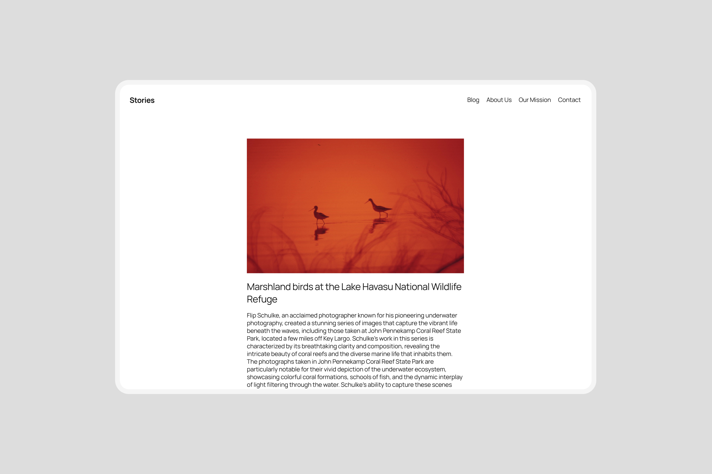

Its templates cater to various blog styles, from text-focused to image-heavy layouts. Additionally, it supports international typography and diverse color palettes, ensuring accessibility and customization for users worldwide.

## Quick specs

-   Requires at least WordPress 6.7.
-   Requires at least PHP version 7.2.

## Site editing support

Twenty Twenty-Five is designed to support site editing features, including:

-   [Site Editor](../../../site-editor/README.md): an editor that allows you to edit all parts of your site, navigate between templates, create new pages, and more.
-   [Styles](../../../site-editor/styles-overview.md): a feature that allows you to customize your site, including individual blocks, as much as you’d like with different colors, typography, layouts, and more.
-   Select from multiple color palettes and font pairs, or download and install your own fonts.
-   [Templates](../../../site-editor/template-editor.md): edit, create, and manage templates used by pages, posts, and other content.
-   [Patterns](../../../block-editor/patterns/block-pattern.md): build your site with the help of pre-made designs, from full-page designs to smaller elements.

## A versatile set of template designs

The theme features a versatile set of templates, site headers and footers.

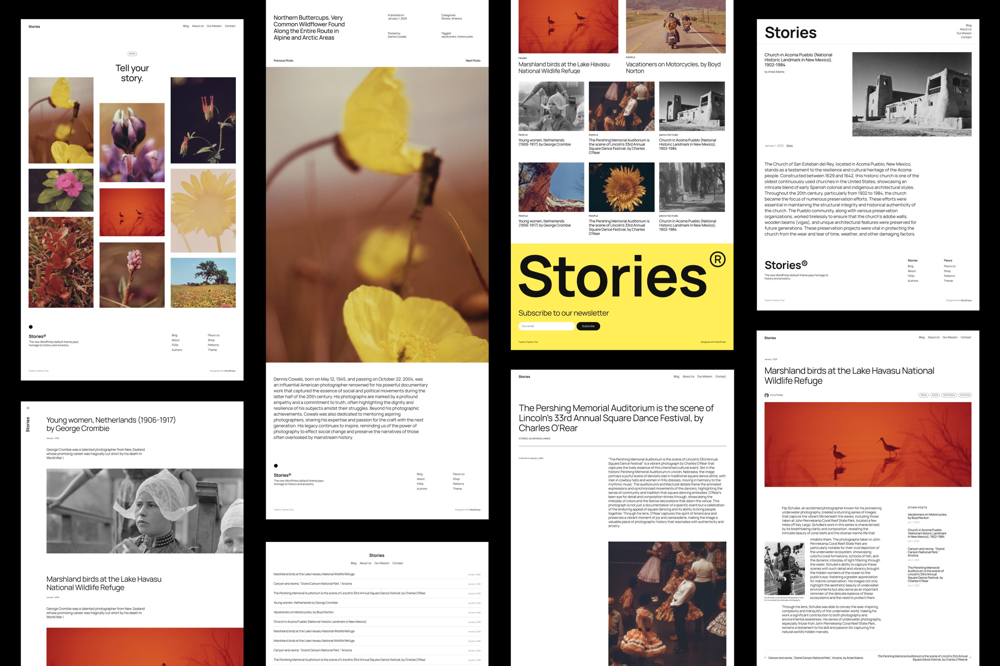

### How to switch template designs

To change the design, you must first open the template in the Site Editor and select the design from the sidebar.

1.  Open the **Site Editor** from **Appearance > Editor**.
2.  Select **Templates**.
3.  Chose which template you want to update.
4.  In the Site Editor, open the **Settings** sidebar and select the **Template** tab.
5.  Open the **Design** panel.
    -   In the **Design** panel you will find the previews of the available template patterns. Click on the pattern that you want to use.
6.  Save the changes to your template and repeat the process for each template.

<video controls preload="metadata" src="https://wordpress.org/documentation/files/2024/10/tt5-switch-template.mp4"></video>

*How to switch template designs in the site editor.*

### Personal Blog (Default)

The default blog templates have an incredibly simple, straightforward layout suitable for any post (with or without a title, with or without a featured image, long or short). The templates also show the entire post’s content, not just excerpts.

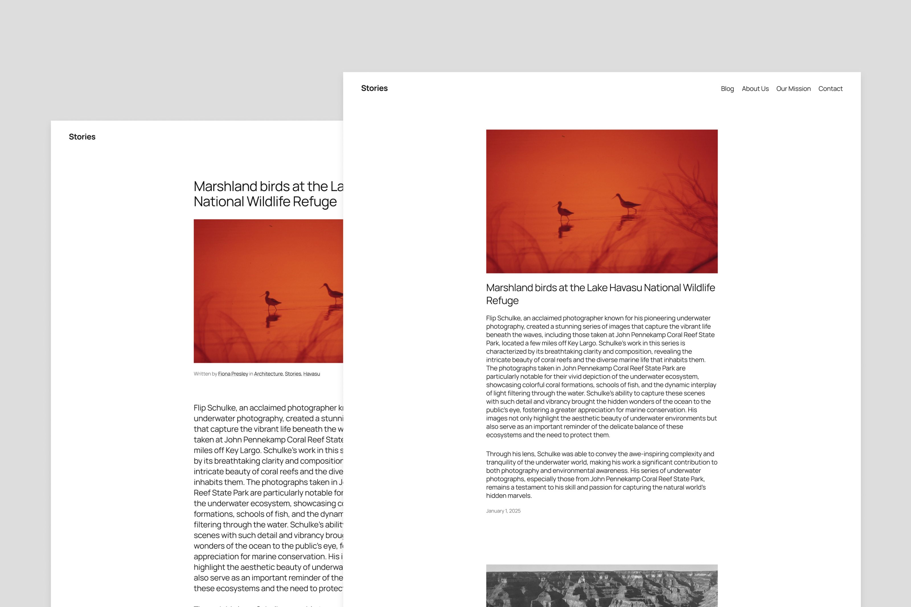

### Text-Only Blog

The theme offers a template option for those who want to keep their blogs text-only, both for the home page, archives, search as well as the post.

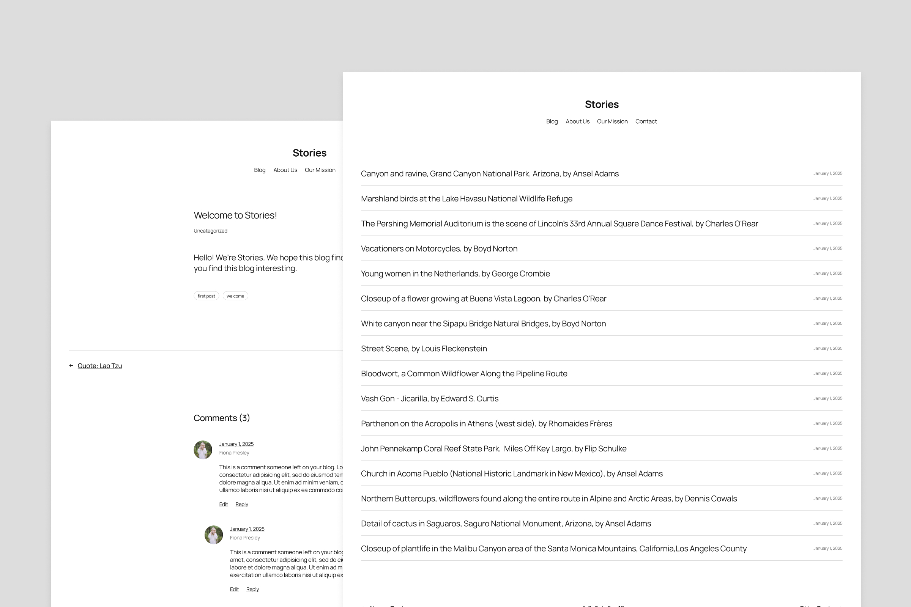

### Photo Blog

The photo blog templates are tailored primarily for photography or portfolios lean on an image-heavy approach, with interesting layouts that can be used for a variety of purposes.

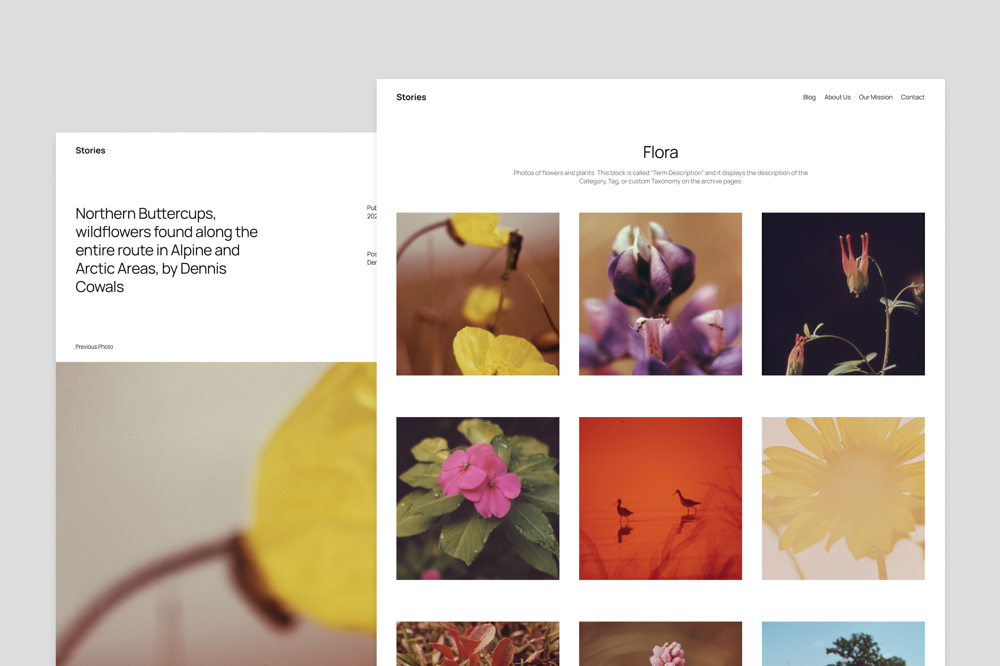

### News Blog

The news blog has three advanced home page designs to choose from. The default news single post template includes a sidebar to the right of the content.

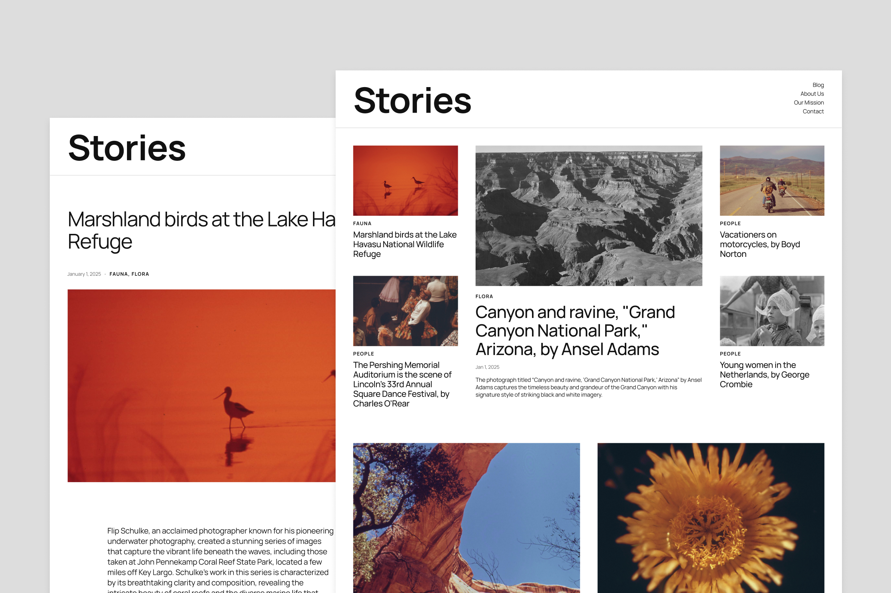

### Additional templates

#### Vertical header, right-aligned

This alternative blog design featured a split layout built with the columns block. There’s a narrow vertical header with the menu and site title are on the left, and all the content is on the right.

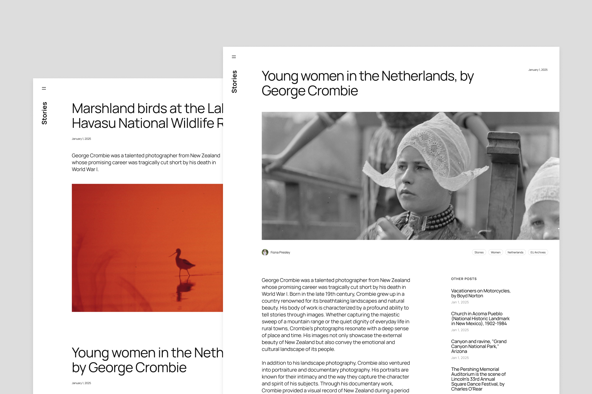

#### Single post with left-aligned content

This alternative template features a more opinionated top section displaying a left-aligned post title and post author in the left column, and the featured image on the right column. Below this section is the post date and categories. The post content is also left-aligned, creating an offset layout that works harmoniously.

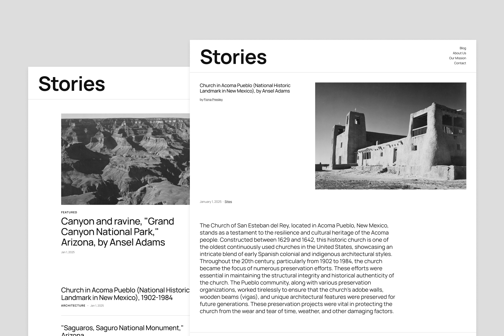

#### Single offset post without featured image

This alternative template displayed a large post title followed by the post categories. A separator divides this top section from the content section below it, which features a two-column layout with the post date on the left and the post content on the right.

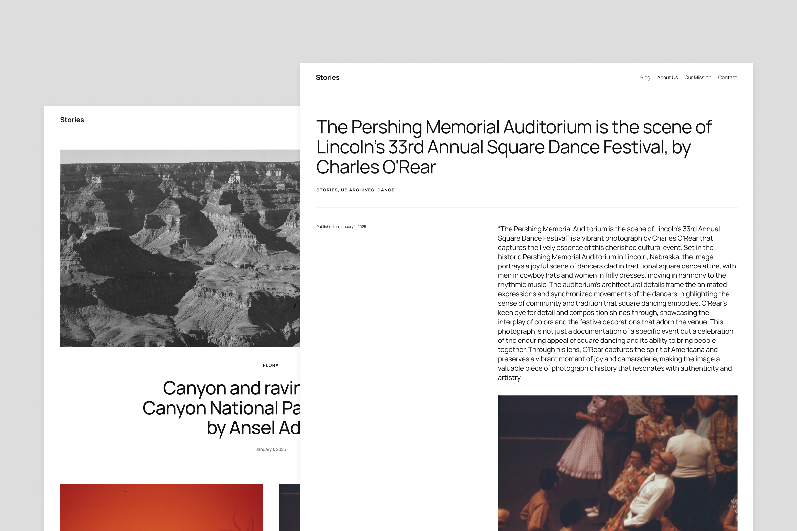

#### Page without page title

This alternative template is most suitable for pages where you only want the content to be visible, not the page title or featured image.

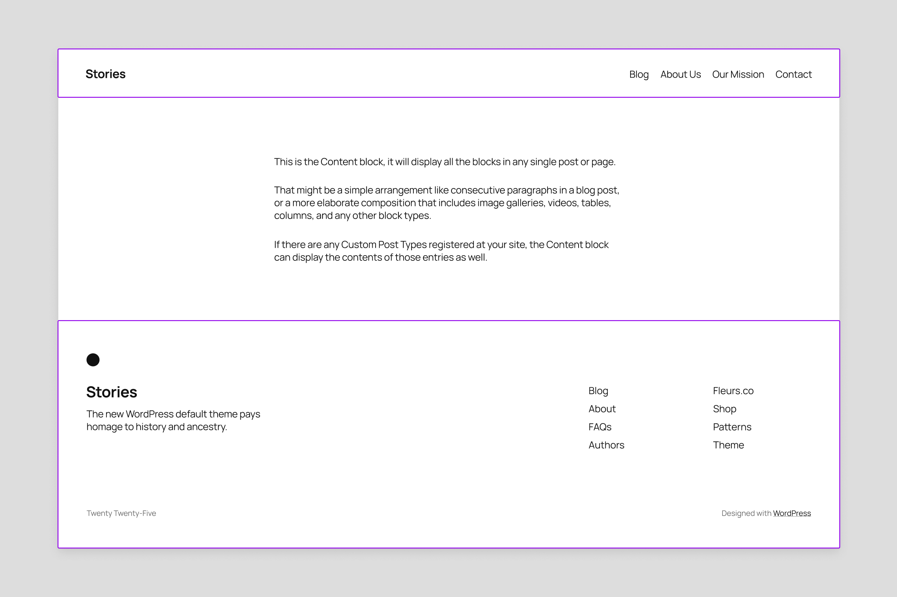

This template can be useful if you want to create a landing page using one of the full-page patterns available in Twenty Twenty-Five, as shown in the example below:

<video controls preload="metadata" src="https://wordpress.org/documentation/files/2024/11/tt5-pagenotitle-video-preview.mp4" poster="../../../../assets/images/2024/11/tt5-pagenotitle-video-cover.jpg"></video>

## Edit templates and pages in Zoom Out view

With WordPress 6.7’s Zoom Out view, you can get a broader view of the template or page you’re editing. You can add, arrange, shuffle, or remove patterns as you see fit.

<video controls preload="metadata" src="https://wordpress.org/documentation/files/2024/10/tt5-zoom-out-mode.mp4" poster="../../../../assets/images/2024/10/tt5-zoom-out-view.jpg"></video>

*How to select the zoom out view.*

## Style variations and presets

Twenty Twenty-Five has **nine style variations** with unique color palettes, font families and typography settings. 
Each color palette and font pair are also available as individual presets, which means that you can combine them in any way you want.

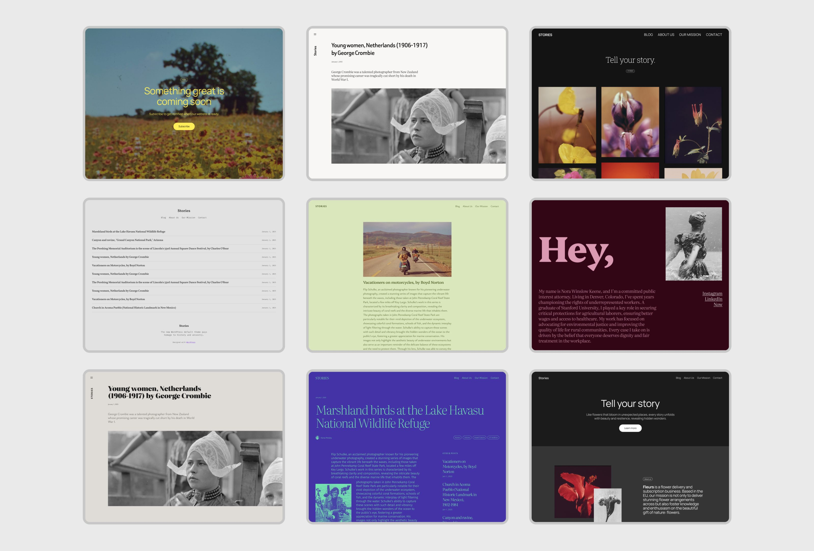

*Twenty Twenty-Five’s styles: Default, Evening, Noon, Dusk, Afternoon, Twilight, Morning, Sunrise and Midnight.*

The default style variation of Twenty Twenty-Five uses the font [Manrope](https://fonts.google.com/specimen/Manrope?query=manrope) for headlines and paragraphs. This style has white with dark grey and accents in yellow, pink and purple.

The alternative fonts shipped with the theme are [Beiruti](https://fonts.google.com/specimen/Beiruti), [Fira Code](https://fonts.google.com/specimen/Fira+Code), [Fira Sans](https://fonts.google.com/specimen/Fira+Sans), [Literata 72pt](https://fonts.google.com/specimen/Literata?query=literata), [Platypi](https://fonts.google.com/specimen/Platypi?query=platypi), [Roboto Slab](https://fonts.google.com/specimen/Roboto+Slab), [Vollkorn](https://fonts.google.com/specimen/Vollkorn) and [Ysabeau Office](https://fonts.google.com/specimen/Ysabeau+Office).

## Patterns

Twenty Twenty-Five features **more than 70 patterns**, including Section Patterns such as About, Contact, Call to Action, Events, Hero, Services and Testimonials as well as Full-Page Patterns such as Landing and Home Pages.

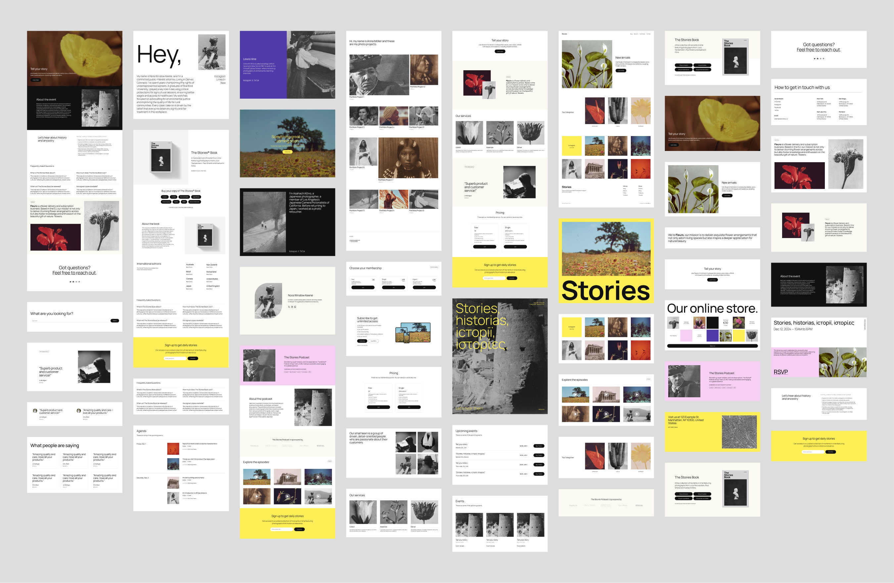

### Full Page Patterns and Landing Pages

The landing page patterns can be inserted when you create a new page. They include:

-   Event RSVP
-   Business homepage
-   Coming Soon
-   CV/Bio
-   Landing page for book launch
-   Landing page for an event
-   Landing page for a podcast
-   Portfolio homepage
-   Shop homepage

## Section styles

You can use section styles in your content or templates to create a diverse design and highlight or separate different content types. A section is created by inserting a columns or group block and selecting one of the six section styles. Each section will have a unique accessible color combination based on the current color palette.

<video controls preload="metadata" src="https://wordpress.org/documentation/files/2024/10/tt5-section-styles.mp4" poster="../../../../assets/images/2024/10/tt5-section-styles-preview-1.jpg"></video>

*Trying different section styles in a Group block.*

## Text styles

Text styles can be applied from the Styles section in the Settings sidebar. The heading and paragraph blocks have three custom text styles:

-   Display
-   Subtitle
-   Annotation

<video controls preload="metadata" src="https://wordpress.org/documentation/files/2024/11/tt5-text-styles.mp4" poster="../../../../assets/images/2024/11/tt5-text-styles-preview.jpg"></video>

## Block style variations

Block style variations can be applied from the Styles section in the Settings sidebar.

List block with checkmark:

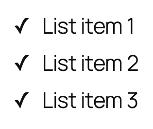

Pill-shaped tags:

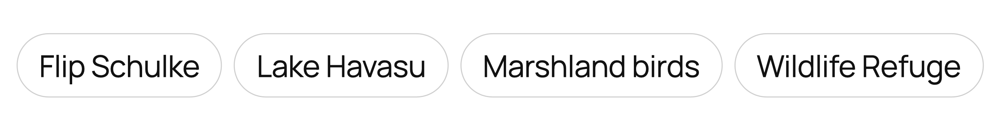

## Post Formats

The theme registers support for all post formats: aside, audio, chat, gallery, image, link, quote, status, and video. To style your post formats differently from your other posts, you can use section styles and patterns in your content. 
 
The theme includes three patterns for post formats:

-   Post format name (Displays a single word, for example “Video”)
-   A premade design for the Audio format
-   A premade design for the Link format

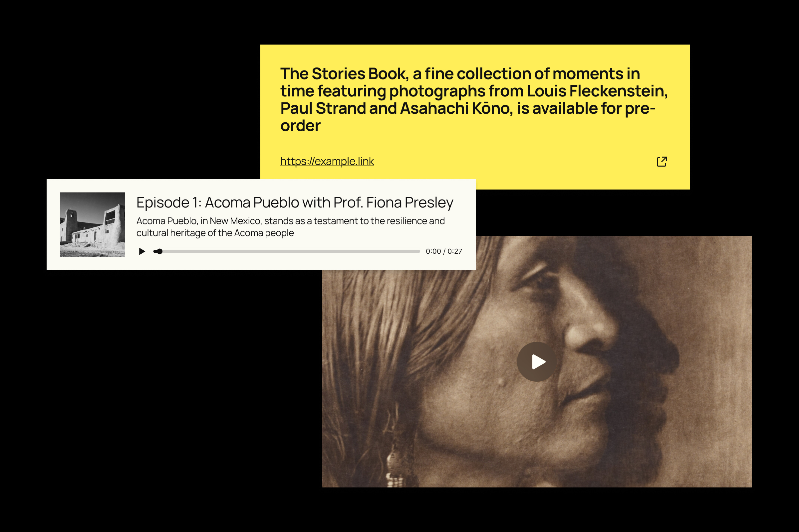

*Available post format patterns.*

### How to include Post Formats in Query Loops

You can use the Query Loop block to list posts with a specific format.

1.  Insert the **Query Loop** block.
2.  In the **Settings** sidebar, select the **Custom** query type.
3.  Next open the **Filters** panel at the bottom of the **Settings** sidebar, and enable **Formats**.
4.  In the **Format** option, enter the name of one or more formats.
5.  Style your query and post template blocks.

## Support and resources

[Get community help with Twenty Twenty-Five in its support forum](https://wordpress.org/support/theme/twentytwentyfive/?view=all).

Learn how to take full advantage of full site editing with the [Simple Site Design with Full Site Editing course on Learn.WordPress.org](https://learn.wordpress.org/course/simple-site-design-with-full-site-editing/).

Read more about the Twenty Twenty-Five theme in [the introduction post](https://make.wordpress.org/core/2024/08/15/introducing-twenty-twenty-five/).

[Twenty Twenty-Five changelog.](twenty-twenty-five-changelog.md)
