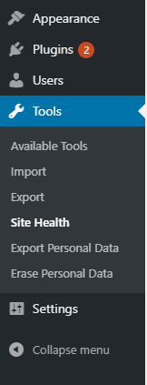

# Site Health: keep your website healthy

WordPress’ Site Health feature checks the overall health of your website, and provides information so you can ensure your website gets and then stays healthy.

This page has extra information to ensure you’re able to use the Site Health feature as effectively as possible, and ensure you are a good citizen of the internet!

## What makes for a healthy website?

A healthy website is:

-   fully up-to-date (including WordPress itself, your plugins, and your themes)
-   runs on the minimum recommended version of PHP and related software
-   well maintained
-   secure

It’s important to have a healthy website! An unhealthy website is at a higher risk of being targeted by malicious actors. It may also be slower than it could be, and uses more energy to run.

The Site Health feature helps ensure your website is healthy by checking all of these items, and giving you a report. If your website fails any of the checks, you’ll receive instructions on how to address these.

## How do I use the Site Health features?

If you are maintaining a WordPress website, you will find the page on your WordPress Dashboard under `Tools > Site Health`, where the very first screen will perform a check on your site.

The Site Health Check may also include information about configuration errors relating to your plugins and themes, as they are able to use this new module to provide more useful feedback to you, the user.

Once the checks are completed, you will be presented with either a message letting you know everything is looking good, or a list of critical or recommended improvements and changes.

If you cannot find the Site Health page, you either need to update your WordPress version (Site Health was added in 5.2) or contact a Site Administrator.

## Now run the Site Health check!

You’re now ready to check your website’s health! Head to your WordPress Dashboard to start. You should check your website’s health on a regular basis.

If you have any problems, use the [WordPress support forum](https://wordpress.com/support/forums/), or contact the relevant provider.
