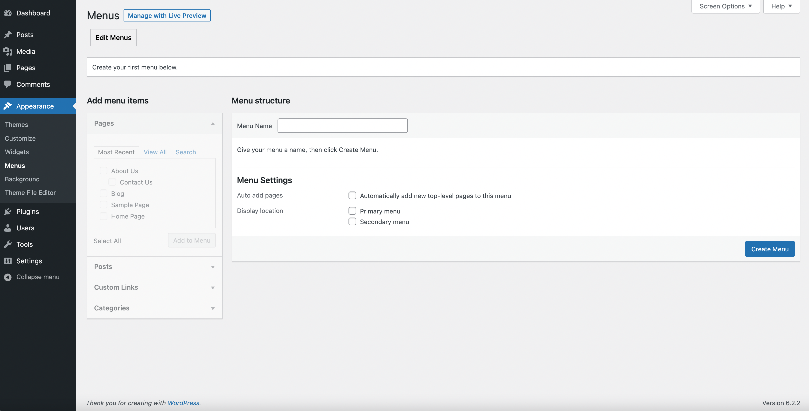
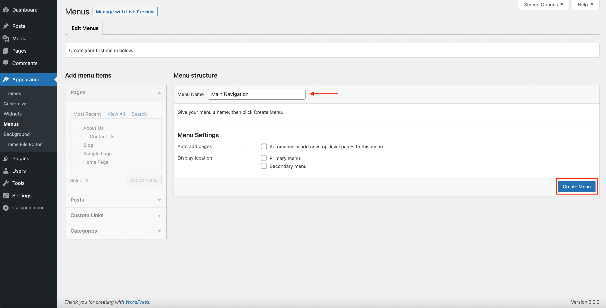
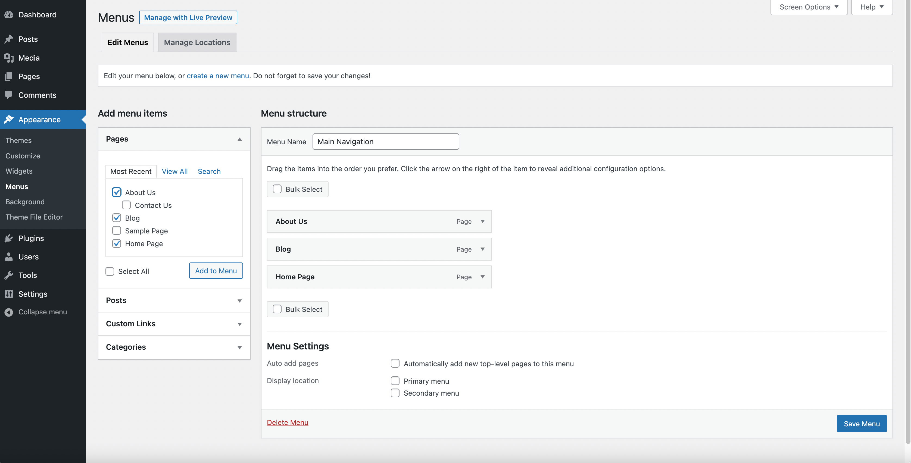
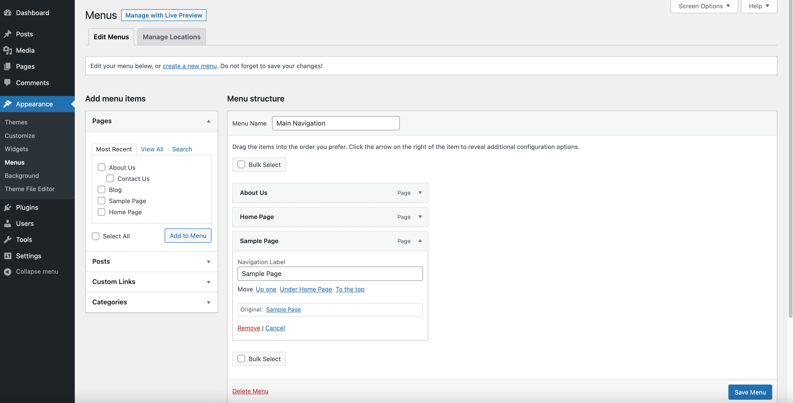
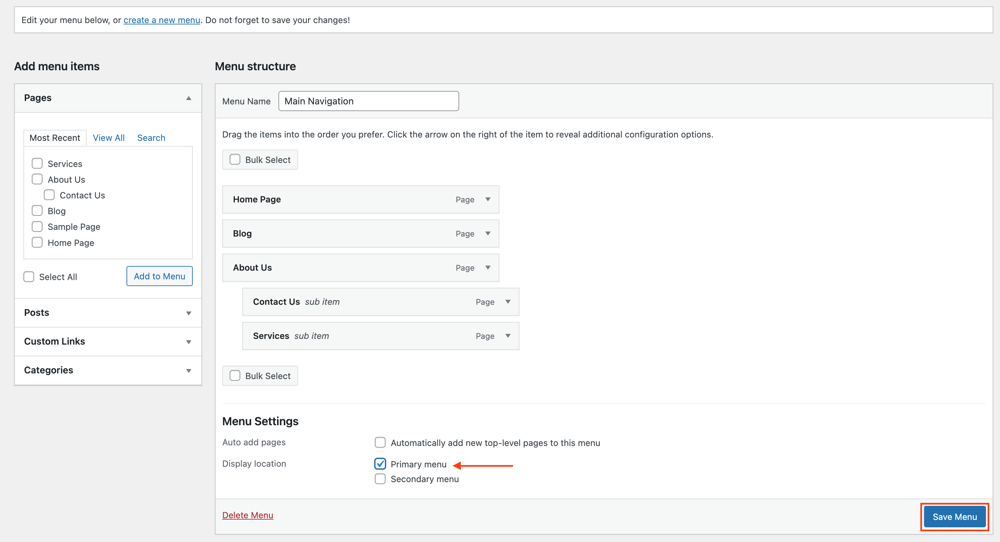
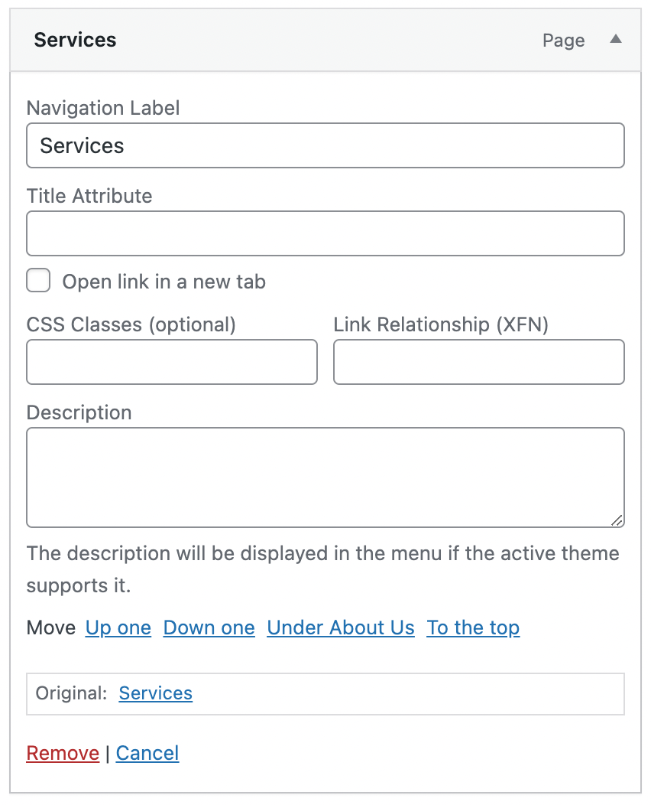

# Appearance Menus Screen

> [!NOTE]
> WordPress 5.9 was the last version to include the Appearance Menus screen for all sites by default. In WordPress 6.0 and later, when using a block theme, navigation is managed via the [Navigation block](../../customization/theme-blocks/navigation-block.md). The Appearance Menus screen may still be available when using classic or hybrid themes, or on sites using plugins that enable this functionality.

The Menus Screen enables the user to create a custom menu (also known as a navigation bar, navigation menu, or main menu). It is a section of the site that helps visitors to navigate the site. Depending on the theme used, typically a site will have one navigation menu, while some themes may enable secondary or footer menus. It is essential to have a simplified navigation menu, so as not to confuse your visitors.

In your menu, you can add different items such as links to pages, articles, categories, or custom links to the url of your choice, such as another site, and then choose the order of the items and their hierarchy (possibility of creating submenus). In short, your menu is fully customizable.

The Appearance Menus Screen is accessible from the Dashboard via **Appearance** > **Menus.**

## Screen options

The [Screen Options](administration-screens.md#screen-options) allow you to choose which modules are displayed, or not displayed, in the underlying Screen. Clicking on the Screen Options tab shows a list of the possible modules and options with a check-box next to each. Check the box for each module or option you want displayed, or uncheck the box to not display that module. Click the Screen Options tab again to close the Screen Options.

Certain modules, like **Posts** are hidden by default.

## Creating menus

1.  Go to the WordPress Dashboard.
2.  From the ‘Appearance’ menu on the left-hand side of the Dashboard, select the ‘Menus’ option to bring up the Menu Editor.
3.  Click the link **Create a new menu** at the top of the page.
4.  Enter a name for your new menu in the Menu Name box
5.  Click the **Create Menu** button.

## Adding items to a menu

You can add different item types into your menu, such as Pages, Categories, or even Custom Links. These are split between panes left of the menu you’re currently editing. An example on how to add link to a page:

1.  Locate the pane entitled **Pages**.
2.  Within this pane, select the *View All* link to bring up a list of all the currently published Pages on your site.
3.  Select the Pages that you want to add by clicking the checkbox next to each Page’s title.
4.  Click the **Add to Menu** button located at the bottom of this pane to add your selection(s) to the menu that you created in the previous step.
5.  Click the **Save Menu** button once you’ve added all the menu items you want.

Your custom menu has now been saved.

**Note:** The [Screen Options](administration-screens.md#screen-options) allow you to choose which items you can use to add to a menu. Certain items, like **Tags** are hidden by default.

## Deleting a menu item

1.  Locate the menu item that you want to remove in the menu editor window
2.  Click on the arrow icon in the top right-hand corner of the menu item to expand it.
3.  Click on the *Remove* item. The menu item will be immediately removed.
4.  Click the **Save Menu** button to save your changes.

## Deleting menu items in bulk

1.  To delete multiple menu items at once, click on the checkbox *Bulk Select*.
2.  Select the checkbox next to each of the menu items you wish to delete.
3.  Click *Remove Selected Items*. This will delete the selected menu items from the menu in bulk.

<video controls preload="metadata" src="https://wordpress.org/documentation/files/2024/02/247964487-f42e8935-745e-481d-8559-33b0d6df72d0.mov"></video>

## Creating multi-level menus

When planning the structure of your menu, it helps to think of each menu item as a heading in a formal report document. In a formal report, main section headings (Level 1 headings) are the nearest to the left of the page; sub-section headings (Level 2 headings) are indented slightly further to the right; any other subordinate headings (Level 3, 4, etc) within the same section are indented even further to the right.

The WordPress menu editor allows you to create multi-level menus using a simple ‘drag and drop’ interface. Drag menu items up or down to change their order of appearance in the menu. Drag menu items left or right in order to create sub-levels within your menu.

To make one menu item a subordinate of another, you need to position the ‘child’ underneath its ‘parent’ and then drag it slightly to the right.

1.  Position the mouse over the ‘child’ menu item.
2.  Whilst holding the left mouse button, drag it to the right.
3.  Release the mouse button.
4.  Repeat these steps for each sub-menu item.
5.  Click the **Save Menu** button in the Menu Editor to save your changes.

<video controls preload="metadata" src="https://wordpress.org/documentation/files/2024/02/247964816-55434209-44b8-41d5-9da7-701a78c8100a.mov"></video>

## Adding your menu to your site

If your current theme supports custom menus, you will be able to add your new menu to one of the **Theme Locations**.

1.  Scroll to the bottom of the menu editor window.
2.  Under *Menu Settings* -> *Display location*, click the check box for the location where you want your menu to appear.
3.  Click **Save Menu** once you’ve made your selection.

If your current theme does not support custom menus, you will need to add your new menu via the Custom Menu widget in the [Appearance Widgets Screen](appearance-widgets-screen-classic-editor.md).

## Rearranging, configuring menu items

Once an item is added to a menu, those menu items can be rearranged. Placing the mouse cursor over the menu item title, when the mouse cursor changes to cross-arrow, hold the left mouse button down, drag the module to where you want to place it, then release the mouse button (this is called drag-and-drop). Remember you can drag a menu item slightly to the right of the menu item above it to create a **hierarchy** (parent/child) relationship in the menu.

Each Menu Item has a configuration arrow on the right side of the Menu Item title, that when clicked opens the configuration box. Click the arrow a second time to close the configuration box. If you don’t see Link Target, Title Attribute, CSS Classes, Link Relationship (XFN), and Description, then under Screen Options make sure those boxes are checked to expose them here.

Then configuration choices are:

**Navigation Label**

The label for this particular menu item

**Title Attribute**

The attribute used when displaying the label

**Open link in new tab**

Click the checkbox to open the menu item in a new tab

**CSS Classes**

Optional CSS Classes for this menu item

**Link Relationship (XFN)**

Allows for the generation of XFN attributes automatically so you can show how you are related to the authors/owners of site to which you are linking. See [Link Relationship](<https://codex.wordpress.org/Links_Add_New_Screen#Link_Relationship_.28XFN.29%20Link%20Relationship>) for details.

**Description**

Description for this link. The description will be displayed in the menu if the current theme supports it.

**Original**

A link to the original source of the menu item (e.g. a link to view the post or page).

**Move**

Links to move the menu item *Up one* level, *Down one* level, *Under the previous menu item* as its child, *To the top*

**Remove**

Remove this menu item from the menu

**Cancel**

Cancel the configuration of the menu item

#### Changelog

-   Updated 2026-07-28 (props @sebastienserre @awetz583)
    -   Updated note at top of page referencing Navigation block for block themes
-   Updated 2024-02-27
    -   Updated screenshots and video
    -   Fixed headings formatting
-   Updated 2022-06-07
    -   Add 6.0 warning at the top
    -   Add the first screenshot, state when screen is open
-   Updated 2022-06-02
    -   Updated “Create menu” image
    -   Updated to sentence case
