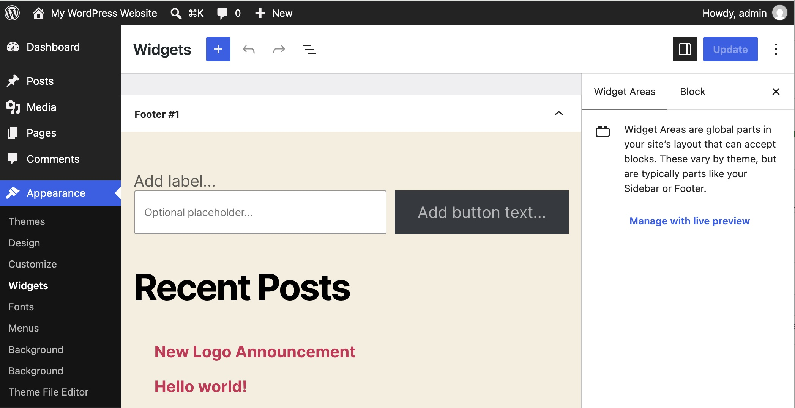
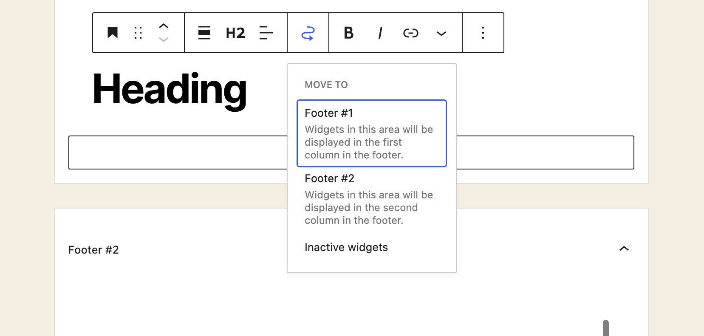

# Block-based Widgets Editor

The Block-based Widgets Editor brings the power of blocks to the **Theme Customizer** and **Appearance** > **Widgets** sections in the WordPress Administration Screens allowing you to add blocks right next to any current widgets. You can now customize your Widget Areas using blocks, just like how you use the [block editor](wordpress-block-editor.md) to create content.

The Block-based Widgets Editor was introduced in 5.8 for those who use classic themes with [widgets](manage-wordpress-widgets.md). With WordPress 5.8 or higher and a classic theme like [Twenty Twenty](../../customization/default-themes/twenty-twenty.md), you can see the Block-based Widgets Editor.

*Appearance > Widgets View in Twenty Twenty theme*

**Note**: This article applies to classic themes that support widget areas. Block themes such as [Twenty Twenty-Five](../../customization/default-themes/twenty-twenty-five.md) use the Site Editor, and widget areas no longer exist in the traditional sense. As a result, the Appearance > Widgets menu is intentionally removed, and editing is done through patterns, template parts, and other Site Editor features.

## How to use blocks in the Widget editor

The interface replicates the [Post Editor](wordpress-block-editor.md) experience, allowing you to use similar workflows like drag and drop. The biggest difference is that you will see distinct editing areas that represent the various Widget Areas as part of your theme, like Footer and Sidebar.

Within each of these areas, you can add blocks like you would in the Post Editor. You can edit any previous Widgets you’ve added using the **Legacy Widgets** block. Of note, [Theme blocks](../../customization/block-editor/blocks-list.md#theme-blocks) (Site Logo, Site Title, etc) and [Synced patterns](../../customization/block-editor/reusable-blocks.md) have been disabled in this editor.

**How to add a block**

1.  Navigate to **Appearance** > **Widgets**.
2.  Click on a specific Widget Area you’d like to edit.
3.  Select the **+** prompt to add a block. You can use the search functionality to find the block you want or select **Browse All** to see the various options.

**How to move items between areas**

There are two ways to move items between areas:

1.  You can use drag and drop by hovering over the block toolbar, selecting and holding it, and dragging it to a new section.
2.  You can use the option shown below in the block toolbar to move to the desired Widget Area:

## How to use blocks in the Customizer

If you’re more comfortable managing your Widget Areas in the Customizer, you can now add widgets and blocks with the same ability to live preview, schedule changes, and publish that you’re used to. The main thing to keep in mind is that, due to the small size of the Customizer, some settings require a few more steps to find. To find all block settings, follow the steps below:

1.  Use the **+** to add a new block.
2.  After adding the block, select the three-dot ellipsis menu and choose the top option of **Show more settings**.
3.  From there, you’ll see more options to customize your block to your liking.

<video controls preload="metadata" src="https://wordpress.org/documentation/files/2022/12/Loom-Message-4-November-2022.mp4"></video>

## How to manage Legacy Widgets

For any widget that doesn’t come with WordPress and that hasn’t been converted to a block, you can use the Legacy Widget block to manage any existing widgets or third-party widgets.

<video controls preload="metadata" src="https://wordpress.org/documentation/files/2022/12/Widgets-‹-catcatgirls.com-—-WordPress-4-November-2022.mp4"></video>

## How to opt-out

A user may install and activate [the Classic Widgets plugin](https://wordpress.org/plugins/classic-widgets/) to opt-out of this feature. This will return you to the [original view](appearance-widgets-screen-classic-editor.md) of the **Appearance** > **Widgets** and the **Customizer**.

## Demonstration of the Block-based Widgets Editor

<!-- VideoPress embed (iframe removed): https://video.wordpress.com/embed/63dxpgzD -->

https://videopress.com/v/63dxpgzD

*Demonstration of the block-based Widgets Editor and blocks in Customizer experience*

## Resources

-   [Block-based Widgets Editor in WordPress 5.8](https://make.wordpress.org/core/2021/06/29/block-based-widgets-editor-in-wordpress-5-8/)

## Changelog

-   Updated 2026-09-21
    -   added a note explaining that block themes do not include the Widgets menu.
    -   updated screenshot
-   Updated 2022-12-06
    -   Added ALT tags for the images
    -   Added internal links to other support articles.
    -   Updated videos.
-   Created 2021-07-08
