# Use keyboard shortcuts (Block Editor)

Several keyboard shortcuts are available for you in WordPress visual (block) editor. These shortcuts allow you to do simple tasks without reaching for your mouse.

You can access the list of all the available shortcuts by clicking **Shift + Alt + H** or **⌃ + ⌥ + H**

## Windows

**Global Shortcuts**

|  |  |
| --- | --- |
| [Switch between visual editor and code editor](#switch-between-visual-editor-and-code-editor) | **Ctrl + Shift + Alt + M** |
| [Toggle fullscreen mode](#toggle-fullscreen-mode) | **Ctrl + Shift + Alt + F** |
| [Open the block list view](#open-the-block-list-view) | **Shift + Alt + O** |
| [Show or hide the settings sidebar](#show-or-hide-the-settings-sidebar) | **Ctrl + Shift + ,** |
| [Navigate to the next part of the editor](#navigate-to-the-next-part-of-the-editor) | **Ctrl + \` Shift + Alt + N** |
| [Navigate to the previous part of the editor](#navigate-to-the-previous-part-of-the-editor) | **Ctrl + Shift + \` Shift + Alt + P** |
| [Navigate to the nearest toolbar](#navigate-to-the-nearest-toolbar) | **Alt + F10** |
| [Save your changes](#save-your-changes) | **Ctrl + S** |
| [Undo your last changes](#undo-your-last-changes) | **Ctrl + Z** |
| [Redo your last undo](#redo-your-last-undo) | **Ctrl + Shift + Z** |
| [Zoom out toggle](#zoom-out-toggle) | **Ctrl + Shift + `0`** |

**Selection shortcuts**

|  |  |
| --- | --- |
| [Select all text / blocks when typing](#select-all-text-blocks-when-typing) | **Ctrl + A** |
| [Clear selection](#clear-selection) | **escape** |
| [Unselect selected blocks](#unselect-selected-blocks) | **double escape** |

**Block shortcuts**

|  |  |
| --- | --- |
| [Duplicate the selected block(s)](#duplicate-the-selected-blocks) | **Ctrl + Shift + D** |
| [Unselect selected block(s)](#unselect-selected-blocks) | **double escape** |
| [Remove the selected block(s)](#remove-the-selected-blocks) | **Shift + Alt + Z** |
| [Insert a new block before the selected block(s)](#insert-a-new-block-before-the-selected-blocks) | **Ctrl + Alt + T** |
| [Insert a new block after the selected block(s)](#insert-a-new-block-after-the-selected-blocks) | **Ctrl + Alt + Y** |
| [Remove multiple selected blocks](#remove-multiple-selected-blocks) | **del backspace** |
| [Move the selected block(s) up](#move-the-selected-blocks-up) | **Ctrl + Shift + Alt + T** |
| [Move the selected block(s) down](#move-the-selected-blocks-down) | **Ctrl + Shift + Alt + Y** |
| [Create a group block from the selected multiple blocks](#create-group-block-from-selected-multiple-blocks) | **Ctrl + G** |
| [Change the block type after adding a new paragraph](#change-the-block-type-after-adding-a-new-paragraph) | **/** |
| [Paste styles after copying styles from a block](#paste-styles-after-copy) | **Ctrl + Alt + V** |

**Text formatting**

|  |  |
| --- | --- |
| [Make the selected text bold](#make-the-selected-text-bold) | **Ctrl + B** |
| [Make the selected text italic](#make-the-selected-text-italic) | **Ctrl + I** |
| [Convert the selected text into a link](#convert-the-selected-text-into-a-link) | **Ctrl + K** |
| [Add a link selected from available links](#add-a-link-from-available-links) | **[[** |
| [Remove a link](#remove-a-link) | **Ctrl + Shift + K** |
| [Underline the selected text](#underline-the-selected-text) | **Ctrl + U** |

**List view shortcuts**

|  |  |
| --- | --- |
| [Collapse all other items](#collapse-all-other-items) | **Alt + L** |

## Mac

**Global shortcuts**

|  |  |
| --- | --- |
| [Switch between visual editor and code editor](#switch-between-visual-editor-and-code-editor) | **⇧ + ⌥ + ⌘ + M** |
| [Toggle fullscreen mode](#toggle-fullscreen-mode) | **⇧ + ⌥ + ⌘ + F** |
| [Open the block list view](#open-the-block-list-view) | **⌃ + ⌥ + O** |
| [Show or hide the settings sidebar](#show-or-hide-the-settings-sidebar) | **⇧ + ⌘ + ,** |
| [Navigate to the next part of the editor](#navigate-to-the-next-part-of-the-editor) | **⌃ + \` ⌃ + ⌥ + N** |
| [Navigate to the previous part of the editor](#navigate-to-the-previous-part-of-the-editor) | **⌃ + ⇧ + \` ⌃ + ⌥ + P** |
| [Navigate to the nearest toolbar](#navigate-to-the-nearest-toolbar) | **⌥ + F10** |
| [Save your changes](#save-your-changes) | **⌘ + S** |
| [Undo your last changes](#undo-your-last-changes) | **⌘ + Z** |
| [Redo your last undo](#redo-your-last-undo) | **⇧ + ⌘ + Z** |
| [Zoom out toggle](#zoom-out-toggle) | **⇧ + ⌘ + `0`** |

**Selection shortcuts**

|  |  |
| --- | --- |
| [Select all text / blocks when typing](#select-all-text-blocks-when-typing) | **⌘ + A** |
| [Clear selection](#clear-selection) | **escape** |

**Block shortcuts**

|  |  |
| --- | --- |
| [Duplicate the selected block(s)](#duplicate-the-selected-blocks) | **⇧ + ⌘ + D** |
| [Unselect selected blocks](#unselect-selected-blocks) | **double**  **escape** |
| [Remove the selected block(s)](#remove-the-selected-blocks) | **⌃ + ⌥ + Z** |
| [Insert a new block before the selected block(s)](#insert-a-new-block-before-the-selected-blocks) | **⌥ + ⌘ + T** |
| [Insert a new block after the selected block(s)](#insert-a-new-block-after-the-selected-blocks) | **⌥ + ⌘ + Y** |
| [Remove multiple selected blocks](#remove-multiple-selected-blocks) | **del backspace** |
| [Move the selected block(s) up](#move-the-selected-blocks-up) | **⇧ + ⌥ + ⌘ + T** |
| [Move the selected block(s) down](#move-the-selected-blocks-down) | **⇧ + ⌥ + ⌘ + Y** |
| [Create a group block from the selected multiple blocks](#create-group-block-from-selected-multiple-blocks) | **⌘ + G** |
| [Change the block type after adding a new paragraph](#change-the-block-type-after-adding-a-new-paragraph) | **/** |
| [Paste styles after copying styles from a block](#paste-styles-after-copy) | **⌘ + ⌥ + v** |

**Text formatting**

|  |  |
| --- | --- |
| [Make the selected text bold](#make-the-selected-text-bold) | **⌘ + B** |
| [Make the selected text italic](#make-the-selected-text-italic) | **⌘ + I** |
| [Convert the selected text into a link](#convert-the-selected-text-into-a-link) | **⌘ + K** |
| [Add a link selected from available links](https://wordpress.org/support/wp-admin/post.php?post=13981395&action=edit#add-a-link-from-available-links) | **[[** |
| [Remove a link](#remove-a-link) | **⇧ + ⌘ + K** |
| [Underline the selected text](#underline-the-selected-text) | **⌘ + U** |

**List view shortcuts**

|  |  |
| --- | --- |
| [Collapse all other items](#collapse-all-other-items) | **⌥ + L** |

Block editor keyboard shortcuts are divided into four parts:

1.  [Global shortcuts](#global-shortcuts)
2.  [Selection shortcuts](#selection-shortcuts)
3.  [Block shortcuts](#block-shortcuts)
4.  [Text formatting shortcuts](#text-formatting)
5.  [Specific blocks shortcuts](#specific-blocks-shortcuts)

## Global shortcuts

**Switch between visual editor and code editor**

You can switch between the Visual (Block) Editor and Code editor using :

**Ctrl + Shift + Alt + M** or **⇧ + ⌥ + ⌘ + M**

If you are on your visual editor screen

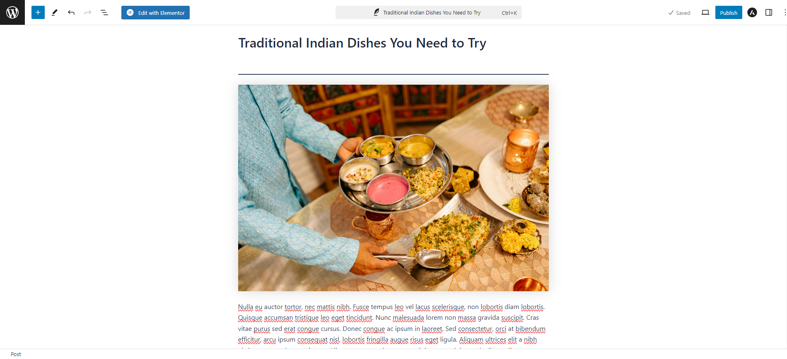

You can press **Ctrl + Shift + Alt + M** or **⇧ + ⌥ + ⌘ + M**, the screen switches to the code editor and vice versa.

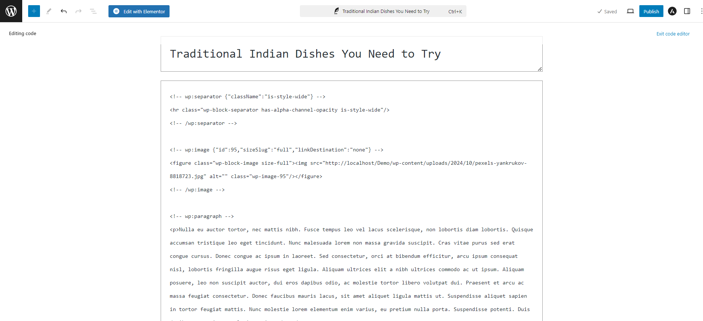

**Toggle fullscreen mode**

You can toggle full screen mode by pressing **Ctrl + Shift + Alt + F** or **⇧ +** **⌥ +** **⌘ +** **F**

**Open the block list view**

You can open the block list view by pressing **Shift + Alt + O** or **⌃ +** **⌥ +** **O**

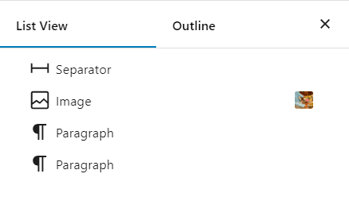

**Show or hide the settings sidebar**

You can show or hide the settings sidebar by pressing **Ctrl + Shift + ,** or **⇧ + ⌘ + ,**

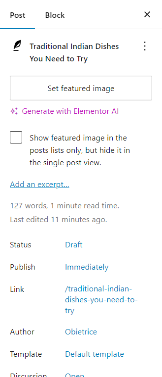

**Navigate to the next part of the editor**

You can navigate to the next part of the editor using two different shortcuts:

-   Windows: **Ctrl + \`** or **Shift + Alt + N**
-   Mac: **⌃ + \`** or **⌃ + ⌥ + N**

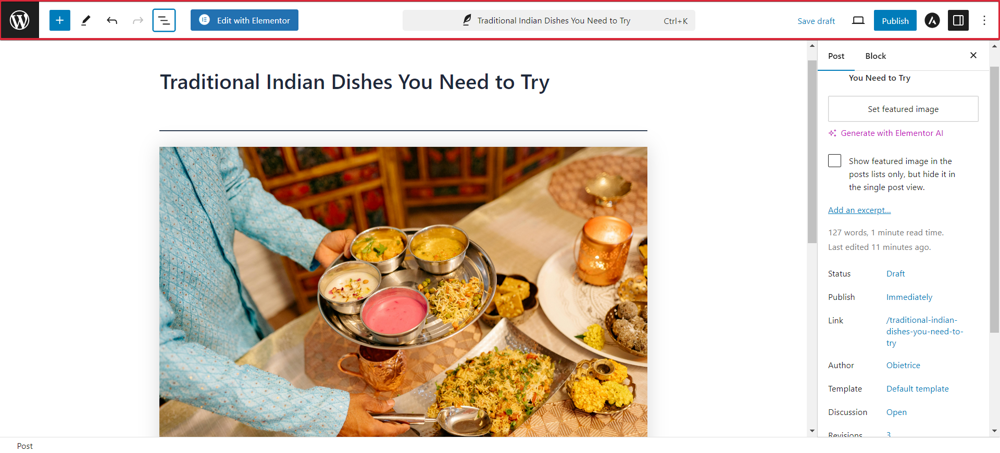

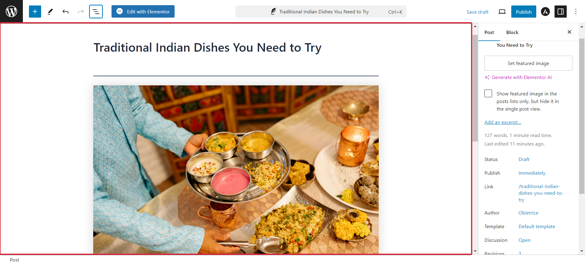

In the above pictures, the red highlight shows the block which you are accessing.

**Navigate to the previous part of the editor**

You can navigate to the previous part of the editor using two different shortcuts:

-   Windows: **Ctrl + Shift + \`** or **Shift + Alt + P**
-   Mac: **⌃ + ⇧ + \`** or **⌃ + ⌥ + P**

**Navigate to the nearest toolbar**

You can navigate to the nearest toolbar by pressing **Alt + F10** or **⌥ + F10**

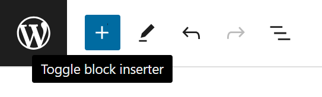

**Save your changes**

You can save your changes by pressing: **Ctrl + S** or **⌘ + S**

Suppose you are in the visual editor and made some changes.

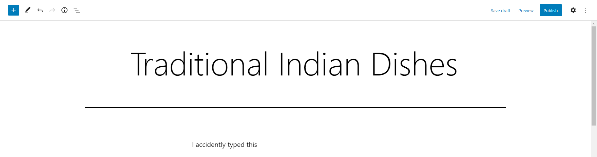

When you press **Ctrl + S** or **⌘ + S**, the *Save draft* changes to *Saved* indicating that the changes you made are successfully saved.

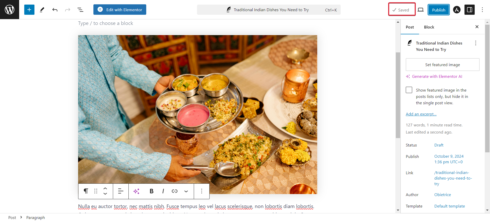

**Undo your last changes**

Suppose if you typed or did something which you want to undo immediately, you can do it by pressing **Ctrl + Z** or **⌘ + Z**

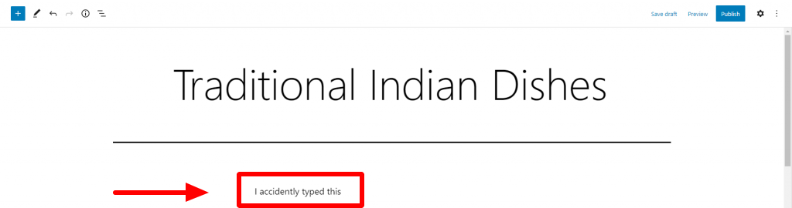

After using shortcuts:

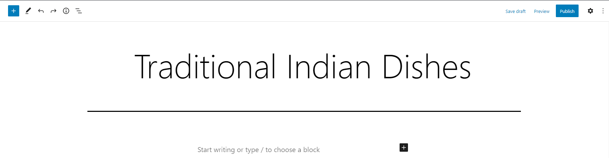

**Redo your last undo**

Similarly, you can redo your last undo by pressing **Ctrl + Shift + Z** or **⇧ + ⌘ + Z**. If you are on Windows you can use the default shortcut as well, **Ctrl + Y**.

This brings back what you just undo.

### Zoom out toggle

Use the Zoom out shortcut to switch between a standard width view and a zoomed out view that provides a condensed visual overview of the entire page structure. Use **Shift + Ctrl + `0`** or **Shift + Command + `0`** to toggle Zoom out view on or off when **Show template** is active while editing a page or template in a theme that supports Full Site Editing.

[Learn more about Zoom out mode.](../../customization/site-editor/zoom-out-view.md)

## Selection shortcuts

**Select all text / blocks when typing**

You can use these shortcuts to select text.

You can select all text in current block when typing **Ctrl + A** or **⌘ + A**. Press again to select parent block or all blocks (if no parrent).

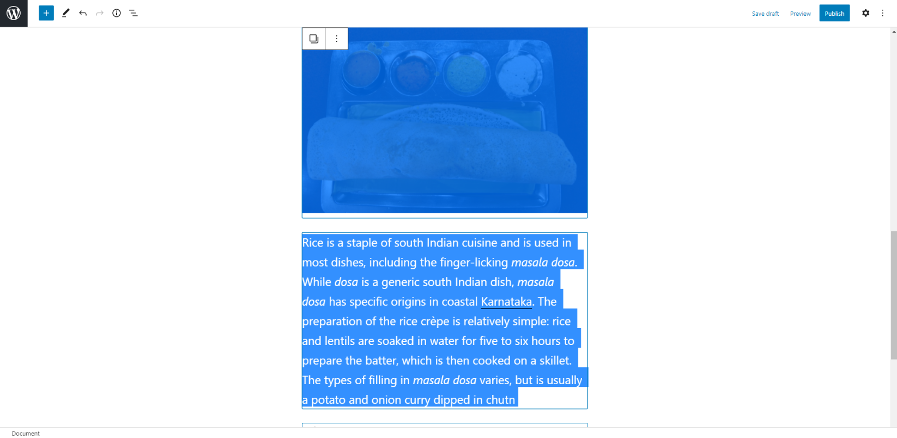

**Clear selection**

You can clear the selection by pressing **Esc**

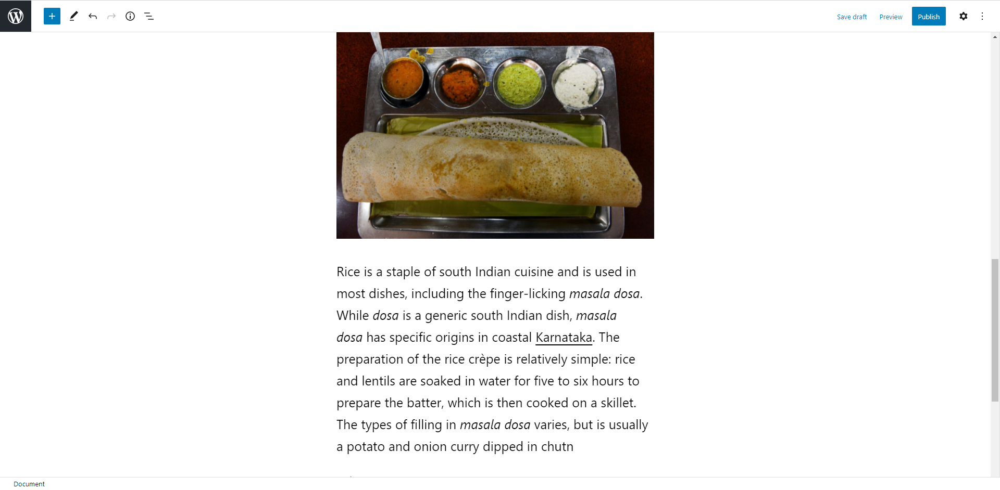

## Block shortcuts

These shortcuts are specific to the block which you are accessing them.

**Duplicate the selected block(s)**

Suppose you are typing in a block.

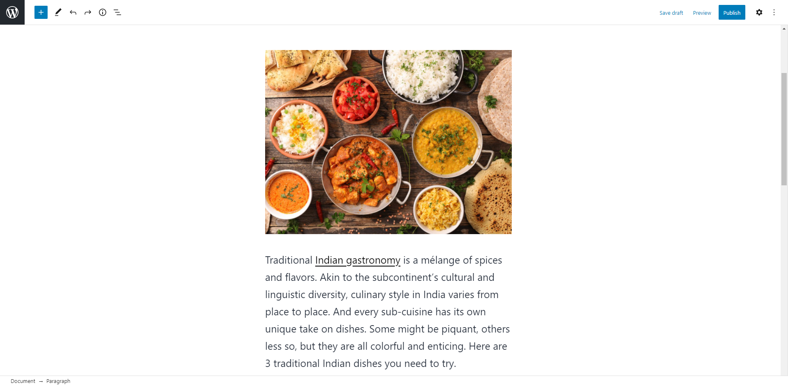

If you press **Ctrl + Shift + D** or **⇧ + ⌘ + D**, the whole block is duplicated and appears just underneath the block which you were typing.

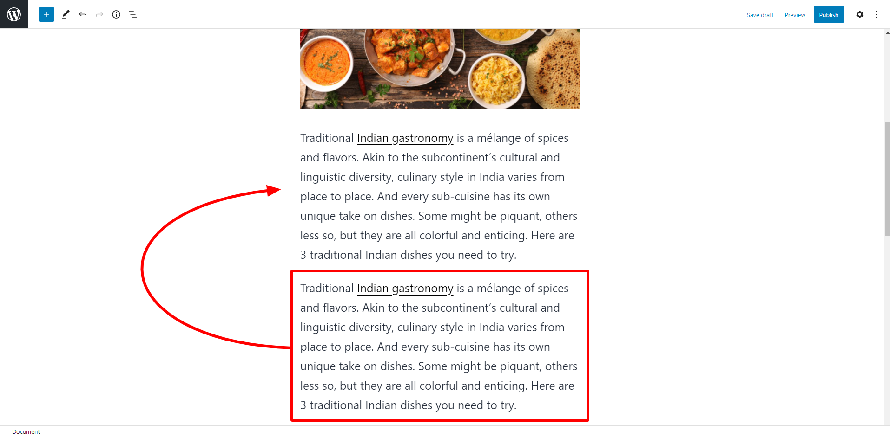

**Remove the selected block(s)**

You can remove the selected block(s) by pressing **Shift + Alt + Z** or **⌃ + ⌥ + Z**

**Unselect selected block(s)**

You can unselect the selected block(s) by pressing **Esc** twice

**Insert a new block before the selected block(s)**

You can insert a new block before the selected block(s) by pressing **Ctrl + Alt + T** or **⌥ + ⌘ + T**

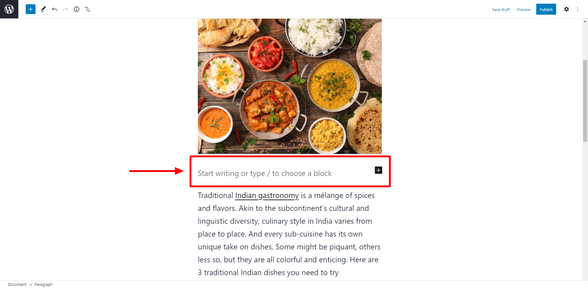

**Insert a new block after the selected block(s)**

You can insert a new block after the selected block(s) by pressing **Ctrl + Alt + Y** or **⌥ + ⌘ + Y**

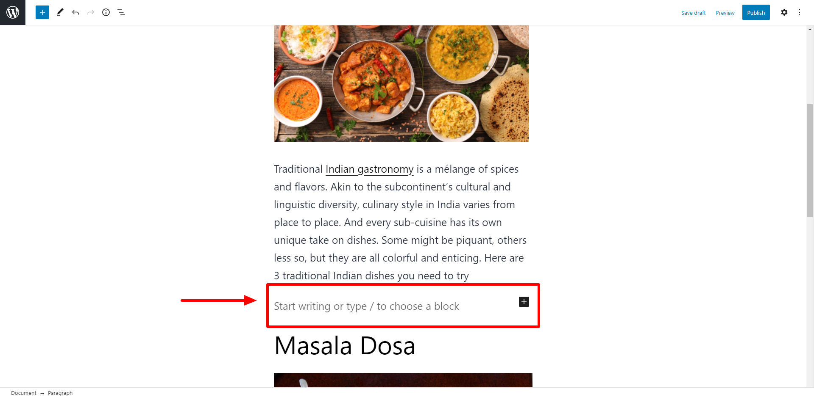

**Remove multiple selected blocks**

Suppose you have selected multiple blocks.

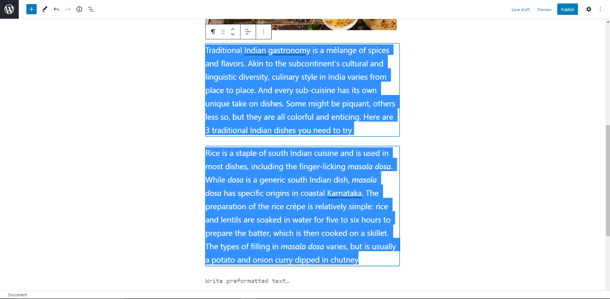

If you press **del / backspace**, all the selected blocks are removed.

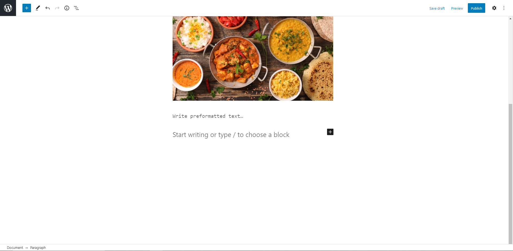

**Move the selected block(s) up**

Suppose you have selected a block.

If you press **Ctrl + Shift + Alt + T** or **⇧ + ⌥ + ⌘ + T**, the whole block moves one step upward.

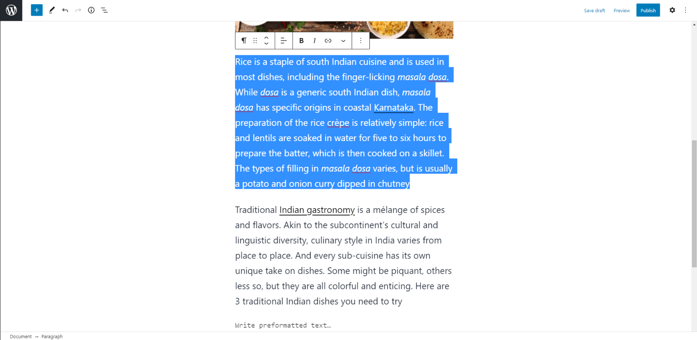

You can use this shortcut multiple times to bring the block further upwards.

**Move the selected block(s) down**

Similarly, you can move the selected block(s) down by pressing **Ctrl + Shift + Alt + Y** or **⌥ + ⌘ + ⇧ + Y**

You can use this shortcut multiple times to bring the block further downwards.

**Create a group block from the selected multiple blocks**

Suppose you have selected multiple blocks.

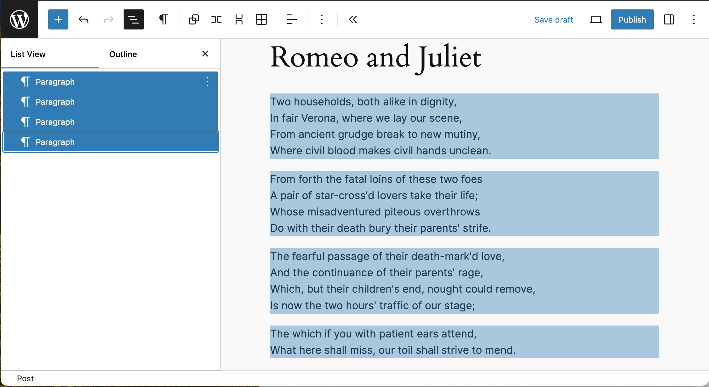

*Screenshot*

If you press **Ctrl + G** or **⌘ + G**, all the selected blocks are transformed to a single group block. Note: This shortcut will not allow to create a group block if a single block is selected.

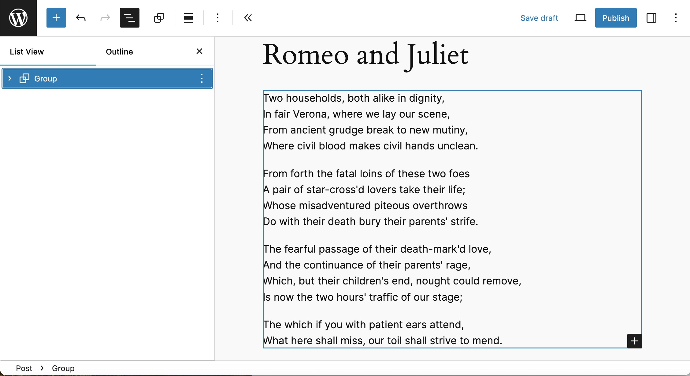

*Screenshot*

**Change the block type after adding a new paragraph**

Suppose you have added paragraph to a block and selected that block.

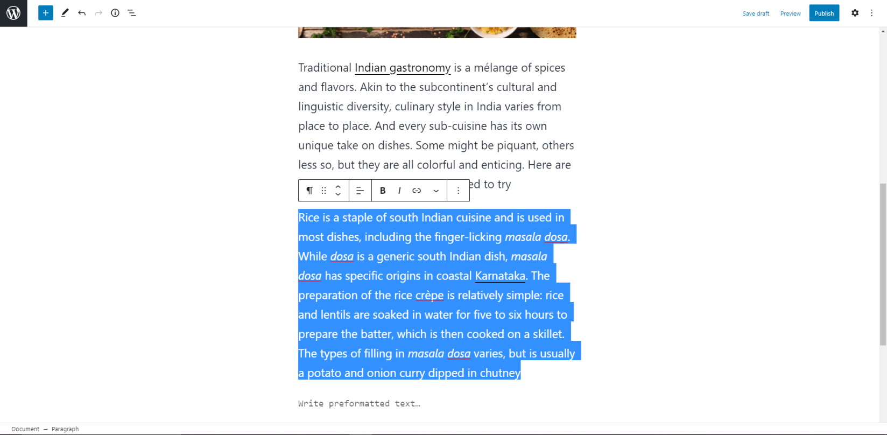

If you press **/** the menu to change the block type appears.

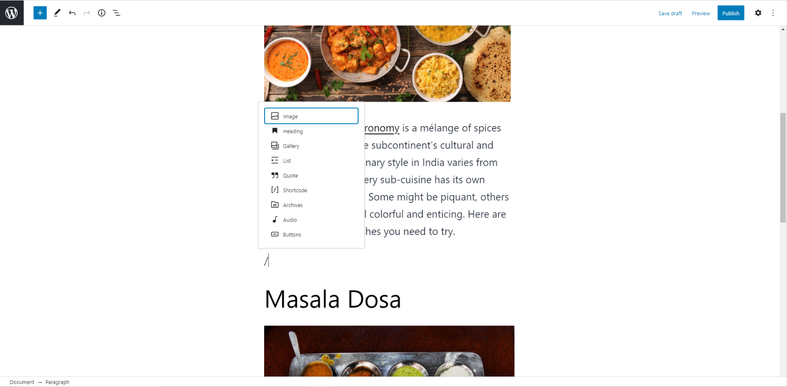

**Paste styles after copying styles from a block**

After selecting a block, opening the more option menu, and selecting “Copy styles” you can use this shortcut to paste the styles onto a block of the same type without needing to open up the more option menu again to select “Paste styles”.

**Insert links to existing posts and pages**

Typing **[[** trigger autocompleter for internal links.

<video controls preload="metadata" src="https://wordpress.org/documentation/files/2021/01/315318428-b67d8d96-bb5f-4c46-b548-572e1d4ac6b4.mp4"></video>

## Text formatting

These shortcuts can be used for formatting the text within a block.

**Make the selected text bold**

You can make the selected text bold by pressing **Ctrl + B** or **⌘ + B**

Example: This is the **bold text**.

**Make the selected text italic**

You can make the selected text italic by pressing **Ctrl + I** or **⌘ + I**

Example: This is a *italic text*.

**Convert the selected text into a link**

You can convert the selected text into a link by pressing **Ctrl + K** or **⌘ + K**

Example: This is [link text](https://wordpress.org/).

**Remove a link**

Suppose you have selected a text with a link.

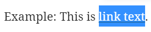

If you press **Ctrl + Shift + K** or **⇧ + ⌘ + K**, the selected link is removed.

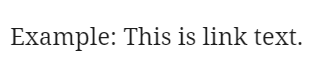

**Underline the selected text**

You can underline the selected text by pressing **Ctrl + U** or **⌘ + U**

Example: This is underline text.

**Inline code**

Convert selected text to inline code with **Ctrl + Alt + X** or **⌘ + Alt + X**

## Transform blocks

Convert the current paragraph or heading to a heading of level 1 to 6 with **Shift + Alt + 1-6** or **⌘ + Alt + 1-6**.

Convert the current heading to a paragraph with **Shift + Alt + 0**.

<video controls preload="metadata" src="https://wordpress.org/documentation/files/2021/01/315319468-4e20daec-0cf5-404c-ac80-4399cfe9b78b.mp4"></video>

## List view shortcuts

These shortcuts are specific to the List View.

**Collapse all other items**

You can collapse all other nested groups except the one you have selected by pressing **Alt + L** or **⌥ + L**.

<video controls preload="metadata" src="https://wordpress.org/documentation/files/2021/01/use-keyboard-shortcuts_alt-l_6.6.mp4"></video>

## Specific blocks shortcuts

| Block name | Shortcut description | Shortcut |
| --- | --- | --- |
| [Social Icons block](../../customization/widget-blocks/social-icons.md) | Navigate between social icons. | **←** or **→** |

### Changelog

-   2026-09-14 (props @karthickmurugan @awetz583)
    -   Added Zoom out
-   2025-12-02 (props to @annezazu)
    -   Updated to add paste styles shortcut
-   2025-04-17 (props to [@nikunj8866](https://profiles.wordpress.org/nikunj8866/))
    -   Add Social Icons block shortcuts
    -   Add missing ALT tags
-   2024-10-09
    -   Updated broken images and videos
-   2024-07-23
    -   Updates for 6.6 version
-   2023-12-08
    -   Update screenshots
    -   Add ALT attributes to all images
    -   Updates for 6.0 version
    -   Updates for 6.1 version
    -   Updates for 6.2 version
-   Updated up to WordPress 5.7
-   Created 2021-01-31
