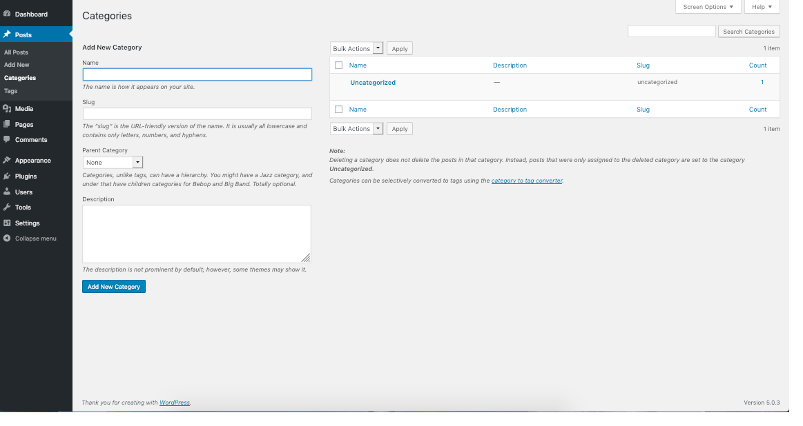

# Posts Categories screen

Each post in WordPress is filed under one or more Categories. This
aids in navigation and allows posts to be grouped with others of similar
content.

Each Category may be assigned to a Category Parent, allowing you
to set up a hierarchy within the Category structure. In creating
Categories, recognize that each Category Name must be unique. Thus,
even if two Categories have two different Parents, they must still have
different names.

Links to your Categories are, by default, shown in two different places on your blog’s home page if you are using the [WordPress Twenty Seventeen theme](https://wordpress.org/themes/twentyseventeen/). First, WordPress lists these Category as links in your sidebar. Second, WordPress shows all the Categories to which a given post belongs under that post. When someone viewing your blog clicks on one of these Category links, an archive page with all the posts belonging to that Category will be displayed.

This Screen allows you to create new Categories, edit or delete existing ones, and organize your Categories hierarchically.

## Categories Screen

This Screen is divided into the Add New Category and Category Table sections.

### Add New Category

This part of the Screen, which is conveniently linked to from the top of the Table of Categories, allows you to create a new Category. There are four pieces of information associated with each new Category: the name, slug, category parent, and description.

**Name**: To reiterate, the Category Name must be unique.

**Slug**: The Category slug must be unique. The Category Slug is used in the URL. For example, setting a Category Name of “Animals” and a Category Slug of “animals” would show all “Animals” posts with a URL like example.com/category/animals/.

**Parent**: Use this drop-down if you want to make this Category a sub-Category; you will select the sub-Category’s Parent here. For example, you may have two Categories, one called “Animals” and another called “Plants” but want to add further clarification about the subject of a particular “Animals” post. You could add “Mammals”, “Reptiles” and “Birds” as sub-Categories to the “Animals” Category; “Animals” would be the Parent of these three new sub-Categories.

Sub-Categories show up on your blog’s page just like Categories, except they will typically be nested under their Parent Categories. When someone visits your site and clicks the “Animals” Category link, all posts in “Animals” and all its sub-Categories will be displayed. Clicking the “Mammals” Category link only displays those posts in that sub-Category. If you assign a post to a sub-Category (e.g. “Mammals”), you can choose to assign that post to the sub-Category’s parent (“Animals”) or not. Either way, all “Animals” posts will show up in the “Animals” Category page. The only difference is that the list of Categories of which a particular post is actually a member. In the WordPress [WordPress Twenty Seventeen theme](https://wordpress.org/themes/twentyseventeen/), this list is shown below the text of each post. Please note that when creating templates, you cannot match a child category based on the parent (ie: if category “bar” has parent “foo”, a template file named “category-foo.php” will not match any “bar” category posts.)

**Description:**  Category Descriptions are optional. Some themes take advantage of Category Descriptions, others do not, so having Descriptions may or may not modify the way Categories are displayed for your site. Even if they are not used by your site’s theme, you may still find them useful from an administration point of view.

**Add New Category**: The most important part of the Add New Category box. Once you’ve entered in all the information about your new Category, use this button to save it.

### Table of Categories

This table lists all of your categories by row. Categories are
displayed hierarchically and alphabetically; subcategories are
displayed beneath their parents and are prefaced by long dashes. These
dashed are *not* part of a Category’s name; they are there only to show hierarchy.

The table of categories contains the following columns:

-   **[ ]** – A checkbox that when clicked (checked), ‘selects’ that particular Category to be deleted when the Delete Action is Applied.
-   **Name** – The name of the Category. (Each name must be unique)
-   **Description** – Categories may have an optional description. By default, the description is shown to viewers when they hover over the category’s link.
-   **Slug** – The slug of a Category. (Usually in lower case letters)
-   **Posts** – The number of posts which are members of the Category. Click on the number in the Posts column to be directed to the All [Posts Screen](https://wordpress.org/support/articles/posts-screen) to manage the Posts in that Category.

#### Screen Options

The Screen Options allow you to choose which columns are displayed, or not displayed, in the underlying Table. Clicking on the Screen Options tab shows a list of the columns with a check-box next to each column. Check the box for each column you want displayed in the Table, or uncheck the box to not display that column. In addition, the number of Categories to display in the Table of Categories can be set. Click the Screen Options tab again to close the Screen Options.

#### Search

Above the Table, to the right, is a search box where you can enter a
word, or series of words, and click the “Search Categories” button to
search and display all the Categories meeting your search words.

### Using Selection, Actions, and Apply

#### Selection

This section allows Actions to be performed on one or more
Categories displayed in the Table. For Actions to be performed on
multiple Categories at once, those Categories must be first **selected** via one of these methods:

-   **Select one Category at a time** – To select a Category, the 
     checkbox to the left of the Category entry must be checked (clicked). 
    It is possible to keep selecting more Categories by checking their 
    respective checkbox.
-   **Select all Categories in given Table** – All Categories in a 
    given table can be selected by checking the checkbox in the Table’s 
    title, or footer bar. Of course, unchecking the header or footer title 
    bar checkbox will cause all entries in that Table to be unchecked (NOT 
    selected).
-   **Reverse Selection** – A Reverse Selection means checked items 
    become unchecked, and unchecked items become checked. A Reverse 
    Selection is accomplished by holding the Shift key on the keyboard and 
    clicking the header or footer title bar checkbox.

#### Actions

Actions describe the process to be performed on particular
Categories. There are two styles of Actions that will be referred to as
*Bulk Actions* and *Immediate Actions*. The follow describes these Actions:

-   **Bulk Actions** – These Actions can be performed on one, or more Categories, at one time, if those Categories have been previously selected. Bulk Actions are available, when appropriate, as choices in the Actions pull-down box, above each Table. The only Bulk Action allowed is Delete.
-   **Immediate Actions** – Immediate Actions are performed immediately, on an individual Category. Hovering the mouse cursor over the Category row reveals the Edit, Quick Edit, Delete and View options under the Name column in that Category row. Clicking on a Category Name will also initiate the Edit Action.

The available Actions are described below:

-   **Edit** – This Immediate Action displays the Edit Category Screen to edit the Category fields. This Action can be initiated by click on the Category Name or clicking on the Edit option just below the Category Name.
-   **Quick Edit** – This Immediate Action initiates the Quick Edit of that Category.
-   **Delete** – This Action deletes the Category. Delete is available as a Bulk Action and an Immediate Action. Note: Deleting a category does not delete the posts in that Category, but the posts that were assigned to the deleted Category are assigned to the **Default Category**, as defined in the Settings Writing Screen. Note that the Default Category cannot be deleted.
-   **View** – This Action, if supported by the active theme’s template, will display the Posts belonging to the Category. View is available only as an Immediate Action.

#### Apply

After one or more Categories are *selected*, and after a *Bulk* Action is specified, the **Apply** button performs the given Action on the selected Categories.

-   **Apply** – Click the Apply button to execute the Bulk Action, specified in the Actions pull-down, on the selected Categories. Remember, prior to executing Actions, one or more Categories must be **selected**, as described before.

### Quick Edit

The following fields can be change via the Quick Edit Action:

**Category name**: To reiterate, the Category name *must* be unique. Category slug Again, the Category slug *must* be unique.

**Cancel**: Click this button to cancel any changes and return to the Table of Categories

**Update Category**: Once you’ve edited all the information about the Category, use this button to save the changes.

### Edit Category

This Screen is displayed by clicking on a Categories’ Name in the Table of Categories or clicking on the Edit option just below the Category Name. It is possible to edit four pieces of information associated with each Category: the name, the slug, the parent, and the description.

**Category name** and **Category Slug**: Category name and Category Slug must be unique.

**Category Parent**: Use this drop-down if you want to make this Category a sub-Category; you will select the sub-Category’s Parent here. For example, you may have a Category called “Animals” but want to add further clarification about the subject of a particular “Animals” post. You could add “Reptiles” and “Aquatic” as sub-Categories to the “Animals” Category; “Animals” would be the parent of these two new sub-Categories.

**Description**: Category descriptions are optional. Some themes take advantage of Category descriptions, others do not, so having Descriptions may or may not modify the way Categories are displayed for your site.

**Update**: Once you’ve changed the Category information, use this button to save the changes.
