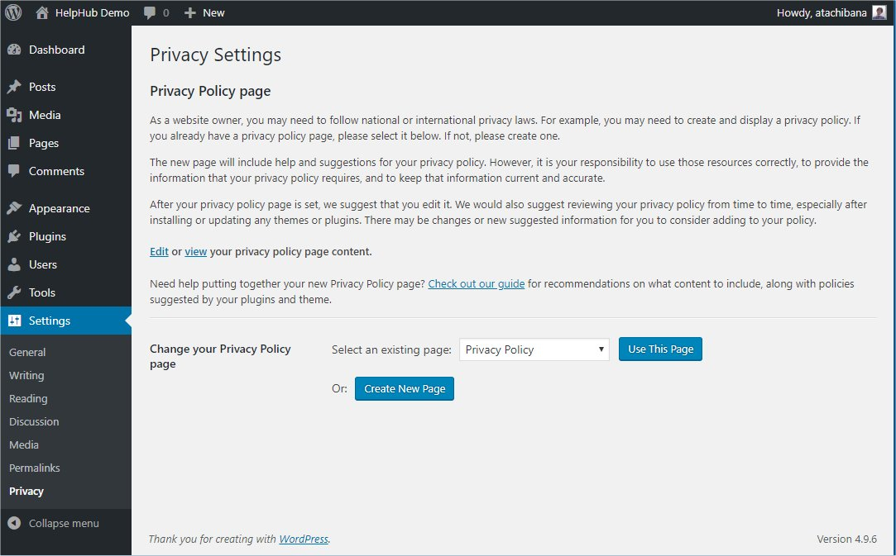
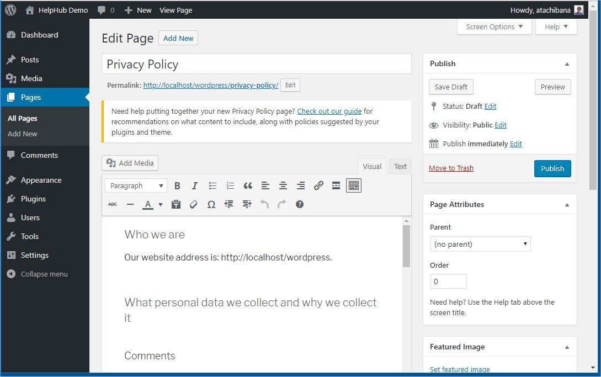
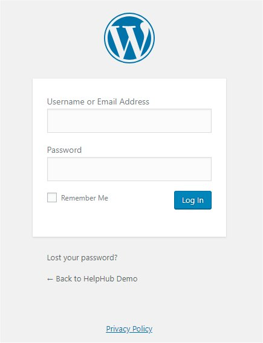

# Settings Privacy screen

WordPress 4.9.6 included a Privacy Settings tool. Administrator can
create new page or specify existing one as Privacy Policy page of the
site.

Note: The new page will include help and suggestions for your
privacy policy. However, it is your responsibility to use those
resources correctly, to provide the information that your privacy policy
requires, and to keep that information current and accurate.

### Using Privacy Settings tool

1\. Select **Settings** -> **Privacy** from Administration Screens.

[](https://wordpress.org/support/?attachment_id=11188507)

2\. Click **Create New Page** to generate a Privacy Policy Page. Or, Select an existing page which you want to use from drop down box and click **Use This Page**.

3\. If you click **Create New Page**, then template page titled Privacy Policy will be opened. Modify the contents and click Publish.

Hint: If you need help, click the link of ‘Check out our guide’ for recommendations on what content to include.

[](https://wordpress.org/support/?attachment_id=11188509)

## Where is the Privacy Policy page displayed?

The Privacy Policy page will be shown on your login and registration pages. Notice the bottom Link ‘Privacy Policy’.

[](https://wordpress.org/support/?attachment_id=11188516)

It is your responsibility to create a link to the Privacy Policy page to every page on your site. But theme will support such function soon. For example, Twenty Seventeen adds the link to the Privacy Policy page at the bottom.

## To Theme Developers

For users convenience, you should refer these new functions.

-   `get_privacy_policy_url()` – Retrieves the URL to the privacy policy page.
-   `the_privacy_policy_link()` – Displays the privacy policy link with formatting, when applicable.
-   `get_the_privacy_policy_link()` – Returns the privacy policy link with formatting, when applicable.

This is the example from Twenty Seventeen (twentyseventeen/template-parts/footer/site-info.php)

```
if ( function_exists( 'the_privacy_policy_link' ) ) {
    the_privacy_policy_link( '', '<span role="separator" aria-hidden="true"></span>' );
}
```
