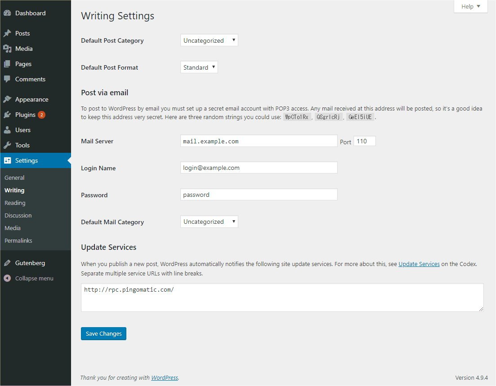

# Settings Writing screen

Use the Settings Writing Screen to control the interface you use when writing new posts. These settings control WordPress’s features in the adding and editing posts, Pages, and [Post Types](what-is-post-type.md), as well as the optional functions like Remote Publishing, Post via e-mail, and Update Services.

### Writing Settings

**Default Post Category** 
The [Category](../../wordpress-overview/where-to-start/wordpress-glossary.md#category) you select from this drop-down is called the default post Category. The default post Category is Category assigned to a post if you fail to assign any other Categories with writing your posts. If you delete a Category, the posts in that Category will be assigned the default post Category. If you have several Categories, but use one of those Categories more frequently, select that Category here to make your life a little easier.

**Default Post Format** 
The Post Format you select from this drop-down is called the default Post Format. Post Formats are used by themes to create different styling for different types of posts. This settings is only visible if the current activated theme supports Post Formats. The WordPress default theme is an example of a theme that supports various Post Formats including Standard (no special format), Aside, and Gallery.

### Post via e-mail

With this option, you can set up your blog to publish e-mails as blog posts. To do this, you would send an e-mail to a specific address you’ve established for the purpose. More than likely, you will need the help of your web host and/or your e-mail provider.

This messages is displayed at the beginning of this section: “To post to WordPress by e-mail you must set up a secret e-mail account with POP3 access. Any mail received at this address will be posted, so it’s a good idea to keep this address very secret. Here are three random strings you could use: *FKZXx8EK*, *P6snQ5Lq*, *YcrfBw03*.”

Complete the following fields to post by e-mail:

**Mail Server** 
A mail server receives e-mails on your behalf and stores them for retrieval. Your mail server will have a URI address, such as mail.example.com, which you should enter here.

**Port** 
Servers usually use port 110 to receive requests related to emails. If your mail server uses a different port, enter that port number here.

**Login Name** 
If, for example, the e-mail address that you will be using for the writing by e-mail feature is wordpress@example.com, then ‘wordpress’ is the **Login name**.

**Password** 
Enter the password for the above e-mail address here. Three possible passwords are displayed by WordPress in the introduction section of this Screen.

**Default Mail Category** 
WordPress will assign this [Category](../../wordpress-overview/where-to-start/wordpress-glossary.md#category) to all of the posts published via the Post by e-mail feature. Note: You can create new Categories in [Administration](administration-screens.md) > [Posts](administration-screens.md#posts-make-some-content) > [Categories](https://codex.wordpress.org/Posts_Categories_Screen).

### Update Services

When you publish a new post, WordPress automatically notifies the update services of the sites listed in the box. For more about this, see [Update Services](https://developer.wordpress.org/advanced-administration/wordpress/update-services/) on the Codex. When entering services, separate multiple URIs with line breaks.

### Save Changes

Click the **Save Changes** button to ensure any changes you have made to your Settings are saved to your database. Once you click the button, a confirmation text box will appear at the top of the page telling you your settings have been saved.
