# Site Health screen

Site Health screen is located in your dashboard under **Tools** > **Site Health** > **Info**.

WordPress offers a diagnosis of your site’s health. There are two tabs on the site health screen:

1\. Status:

The status tab allows you to see critical information about your WordPress configuration, along with anything else that requires your attention.

2\. Info:

The info tab is a granular view of the technical aspects of your WordPress website. You can see detailed information about every aspect of your site such as themes, plugins, and media. There is also a useful export feature that allows you to copy all of the information about your site to the clipboard.

Find more detailed information on both tabs below.

## Status

The site health check shows critical information about your WordPress configuration and items that require your attention. Information is grouped by severity: critical issues recommended improvements and passed tests.

### Critical issues

Critical issues refer to parts of your website that can be potential security vulnerabilities or serious performance issues; suggesting how to fix them. Some of the possible critical issues are:

**Auto-updates for plugins and/or themes appear to be disabled, but settings are still set to be displayed.**

This could cause auto-updates to not work as expected. 
Type: Security

[Learn more about auto-updates for plugins and themes](../../technical-guides/maintenance/plugins-themes-auto-updates.md)

**Background updates are not working as expected.**

Background updates ensure that WordPress can auto-update if a security update is released for the version you are currently using.

[Configuring automatic updates](https://developer.wordpress.org/advanced-administration/upgrade/upgrading/) 
 
**Could not reach WordPress.org**

Communicating with the WordPress servers is required to check for new versions, and install and update WordPress core, themes, or plugins. This message means your site is unable to reach WordPress.org at api.wordpress.org

**File upload**

file_uploads is set to 0. You won’t be able to upload files on your site.

The ini_get() function has been disabled, some media settings are unavailable because of this.

**HTTP requests are blocked**

HTTP requests have been blocked by the WP_HTTP_BLOCK_EXTERNAL constant, with no allowed hosts.

Site maintainers can now block all, or some, communication to other sites and services. If set up incorrectly, this may prevent plugins and themes from working as intended.

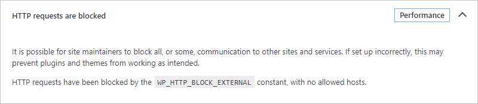

**Your site is set to display errors to site visitors**

Debug mode is often enabled to gather more details about an error or site failure, but may contain sensitive information which should not be available on a publicly available website.

The value, WP_DEBUG_DISPLAY, has either been enabled by WP_DEBUG or added to your configuration file. This will make errors display on the front end of your site.

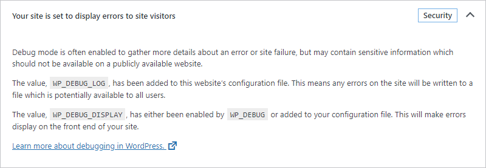

**Your site is set to log errors to a potentially public file**

Debug mode is often enabled to gather more details about an error or site failure but may contain sensitive information which should not be available on a publicly available website.

The value, WP_DEBUG_LOG, has been added to this website’s configuration file. This means any errors on the site will be written to a file that is potentially available to all users.

[Learn more about debugging in WordPress](https://developer.wordpress.org/advanced-administration/debug/debug-wordpress/)

**Your site could not complete a loopback request**

Loopback requests are used to run scheduled events and are also used by the built-in editors for themes and plugins to verify code stability.

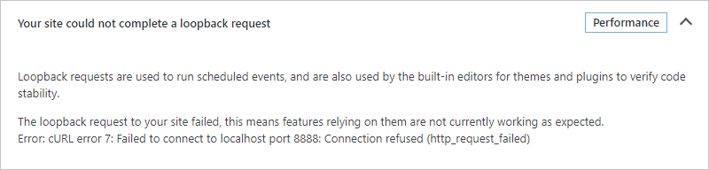

**PHP default timezone is invalid**

PHP default timezone was changed after WordPress was loaded. This interferes with the calculations of dates and times.

**One or more required modules are missing**

The required module, json_last_error, is not installed or has been disabled.

**An active PHP session was detected**

A PHP session was created by a session_start() function call. This interferes with REST API and loopback requests. The session should be closed by session_write_close() before making any HTTP requests.

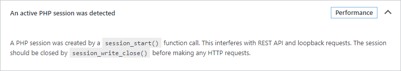

**Your site is running an outdated version of PHP, which requires an update**

PHP is the programming language used to build and maintain WordPress. Newer versions of PHP are created with increased performance in mind, so you may see a positive effect on your site’s performance

Type: Security

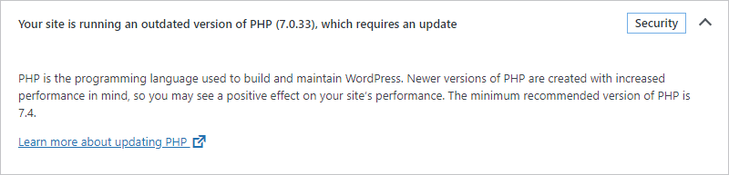

**You have plugins waiting to be updated**

Plugins extend your site’s functionality with things like contact forms, eCommerce, and much more. That means they have deep access to your site, so it’s vital to keep them up to date.

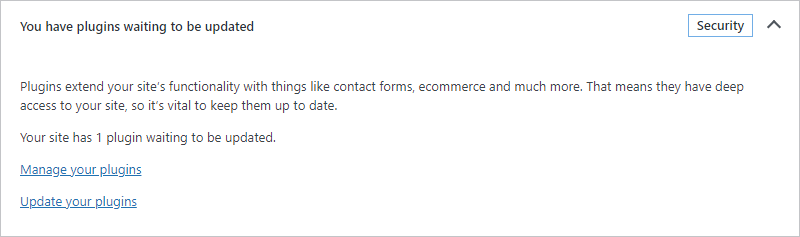

### Recommended improvements

Recommended improvements section lists all the items that are not critical for your website but should be modified for better security and performance.

### Passed tests

The passed tests section lists all the other items that are tested by the Site Health tool and showing no issues.

## Info

The site health info screen contains details about the configuration of your WordPress site. For example, here you can find information on which version of WordPress you are using or the number of active and inactive plugins and themes you have. But, this screen also contains technical information about your server setup, your database, and your permissions. Note that the screen only contains information. So, you cannot configure any of the settings from it.

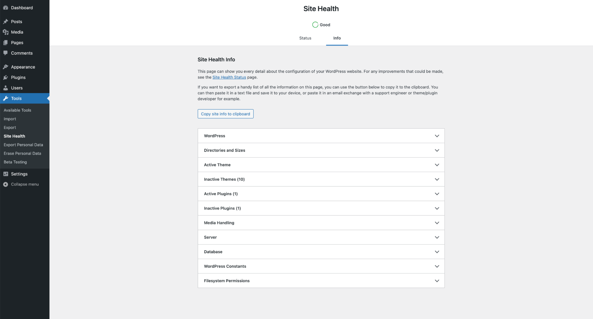

*Site Health Info Screen*

Find detailed information on each tab below.

### WordPress

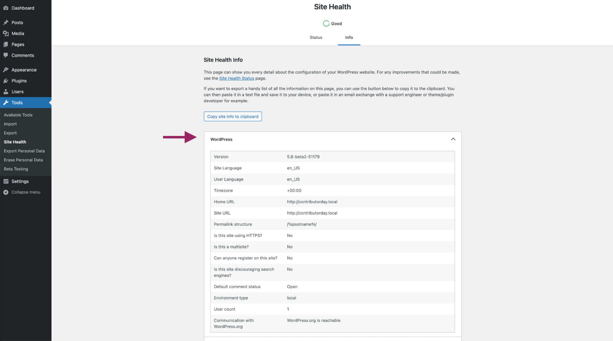

*Site Health Info Screen – WordPress*

Click on the downward pointing arrow on the right to expand this section. You will find the following information here:

-   Version: This is the version of WordPress you are currently using. If you want to update to a newer version, you’ll need to [use the Updates screen](administration-screens.md#updates).
-   Site language: The language of the site that your visitors see. If you want to change the language you can do that in the [General Setting Screen](settings-general-screen.md).
-   User language: The language you will see in your backend, but your visitors will not see it. If you want to change the User language, go to the [Your profile](users-your-profile-screen.md) screen.
-   Timezone: shows the time zone you have set. If you want to change it, go to the [General Settings screen](settings-general-screen.md#timezone).
-   Home URL: this is the URL where your core WordPress files are installed. You can learn more about it in the article on the [General settings](settings-general-screen.md#wordpress-address-url).
-   Site URL: this is the address people use to find your site. Learn more about it in the [General settings](settings-general-screen.md#site-address-url) article.
-   Permalink structure: Shows how your permalinks are set to appear i.e., what you are showing in your URLs. You can edit your permalink structure in the [Permalink settings screen](settings-permalinks-screen.md).
-   Is this site using HTTPS?:  Shows whether your site uses HTTPS. HTTPS improves the security of your website, so if you site is not yet using it, it is recommended that you switch to HTTPS. Since [WordPress 5.7 you can do that easily](https://make.wordpress.org/core/2021/02/22/improved-https-detection-and-migration-in-wordpress-5-7/).
-   Is this a multisite?: Shows whether your site is a multisite. A multisite is a feature of WordPress that lets you [create a network of sites on a single WordPress installation](../../wordpress-overview/where-to-start/wordpress-glossary.md#multisite).
-   Can anyone register on this site?: Shows whether you allow registrations of your site. You can configure the registration settings in the [General settings screen](settings-general-screen.md#membership).
-   Is this site discouraging search engines?: Shows whether you have selected the option to prevent search engines from indexing your site. You can change those settings in the [Reading settings screen](settings-reading-screen.md).
-   Default comment status: Shows whether your site is open for comments. You can change the comments settings in the [Discussion Settings screen](settings-discussion-screen.md).
-   Environment type: Shows the [type of environment your current system is in](https://make.wordpress.org/core/2020/08/27/wordpress-environment-types/).
-   User count: shows how many users of your site there are. You can add or remove users in the [Users Settings screen](administration-screens.md#users-your-blogging-family).
-   Communication with WordPress.org: shows if WordPress.org is reachable for your site. That means that, when it’s reachable, your site can fetch updates from the WordPress.org network.

### Directories and Sizes

The Directories and Sizes section shows you all the information about where the different elements of your WordPress installation are located, and what size these directories are. You can see the location and size of the WordPress directory, uploads directory, themes directory, and plugins directory. Finally, you can see the total size of the database and the total installation size.

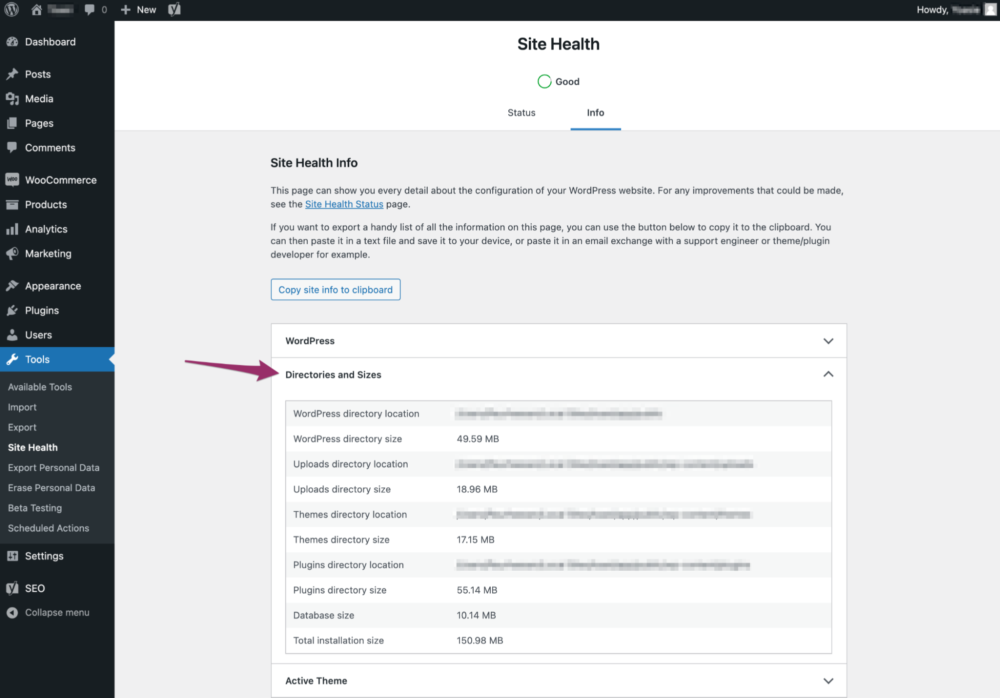

*Site Health Info Screen – Directories and Sizes*

### Active Theme

Selecting the third tab will expand this section named ‘Active theme’.

This section will show you information on the WordPress theme you currently have activated. The following information can be found here:

-   Name: The name of your active theme.
-   Version: The current version of the theme.
-   Author: The author of this theme.
-   Author website: The website of the theme author.
-   Parent theme: If you are using a [child theme](https://developer.wordpress.org/themes/advanced-topics/child-themes/), this will show you what parent theme your active theme belongs to. It will show ‘None’ if you are not using a child theme.
-   Theme features: A list of all the features that are included with this active theme. Think of features like [Block Templates](https://developer.wordpress.org/block-editor/reference-guides/block-api/block-templates/), [Editor Style](https://codex.wordpress.org/Editor_Style), and many more features including more advanced features.
-   Theme directory location: the directory in which this active theme has been installed.
-   Auto-updates: whether you have enabled or disabled automatic updates. You can access the setting for this by going to the Themes section, looking up your current theme and clicking Theme Details when hovering on it. It will then show in the main section underneath the Theme title.

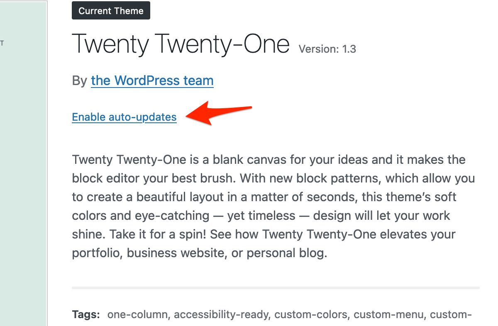

*Enabling theme auto-updates*

### Inactive Themes

Expanding this section will show you a list of all other themes which you have installed in WordPress, but are not activated.

For each theme it will show the name, version together with the theme author, and whether you enabled or disabled automatic updates for that theme.

If you are not planning on using them, it is recommended to [remove the inactive themes](../../technical-guides/maintenance/wordpress-housekeeping.md#theme-housekeeping).

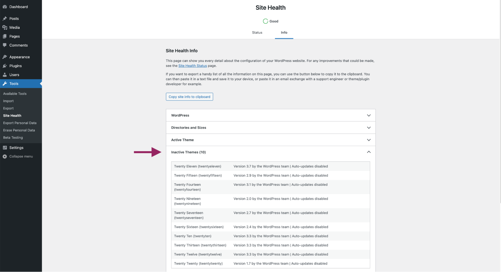

*Site Health Info Screen – Inactive Themes*

### Active Plugins

The Active Plugins section shows you which plugins you have installed on your WordPress site. Moreover, you can see extra information about the installed plugins. You can see the version of the plugin, the creator of the plugin, and whether auto-updates are enabled for these plugins.

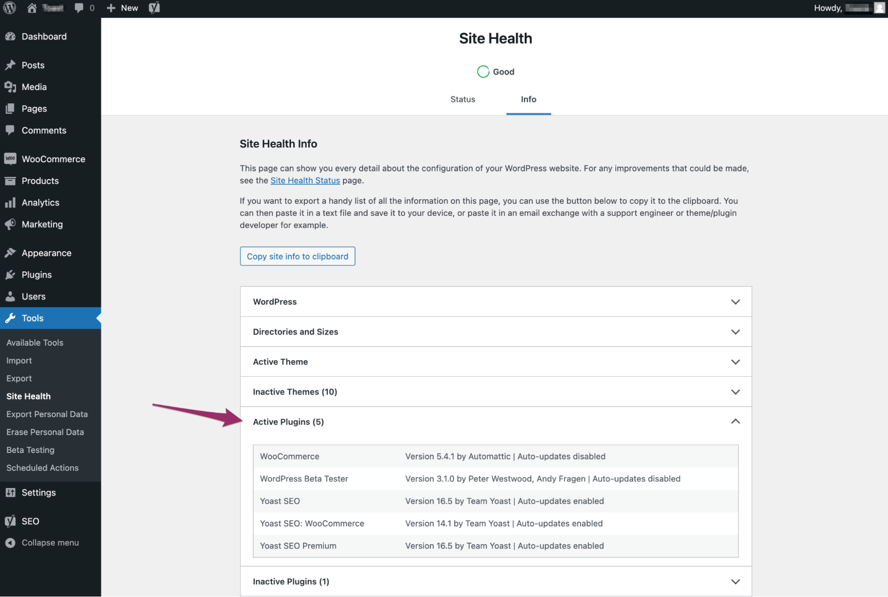

*Site Health Info Screen – Active Plugins*

### Inactive Plugins

The Inactive Plugins section shows you which plugins you have installed on your WordPress site, but aren’t activated. Moreover, you can see extra information about the installed plugins. You can see the version of the plugin, the creator of the plugin, and whether auto-updates are enabled for these plugins.

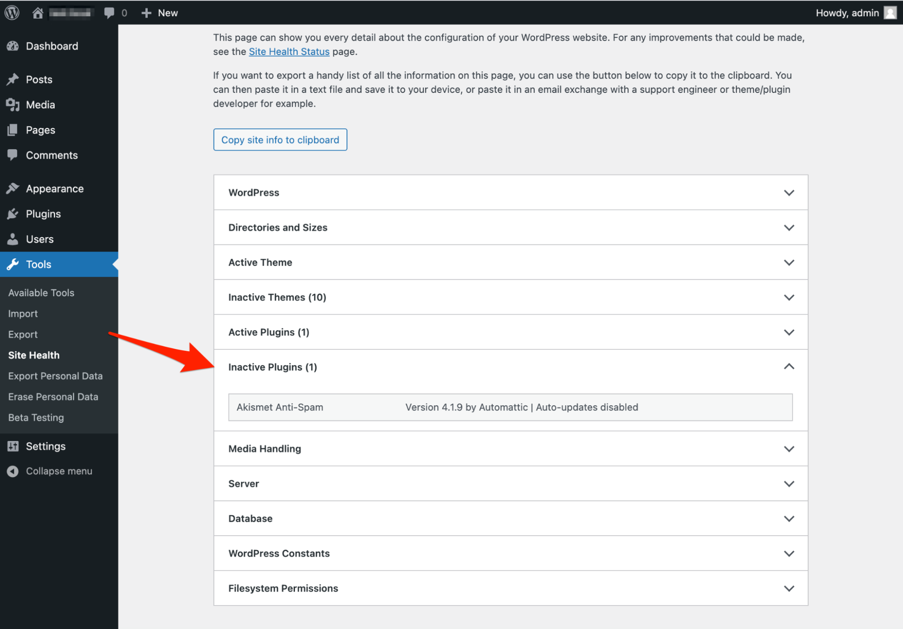

*Site Health Info Screen – Inactive Plugins*

### Media handling

This section shows how the media on your site is handled. The following information can be found here:

-   **Active editor:** Shows which editor is active for editing and optimizing your image files. The default is [WP_Image_Editor_GD](https://developer.wordpress.org/reference/classes/wp_image_editor_gd/), which is the site editor that uses the GD PHP image processing library. [WP_Image_Editor_Imagick](https://developer.wordpress.org/reference/classes/wp_image_editor_imagick/) will be displayed, if the site image editor uses the Imagick library. The GD PHP library is included by default since PHP 4.3 so it is available in most hosting server environments. Availability of the Imagick library depends on the hosting company.
-   **ImageMagick version number**: Shows the ImageMagick version number as a simple interger representation. [ImageMagick](https://www.php.net/manual/en/intro.imagick.php) is a software used to create and edit the site images.
-   **ImageMagick version string**: Shows the ImageMagick version as a string in x.y.z format with the release date, and the URL for the ImageMagick site.
-   **Imagick version**: Shows the version of [Imagick](https://www.php.net/manual/en/intro.imagick.php) installed. This will help to debug issues caused when generating images on the PHP side.
-   **File uploads**: Shows whether you can upload files to your site. If this is disabled, contact your host.
-   **Max size of post data allowed**: Shows the maximum combined size of an http POST request that sends data from the browser to the server.
-   **Max size of an uploaded file:** Shows the maximum size of a single file that you can upload in your media library.
-   **Max effective file size:** Shows the smaller of the maximum post data size and max upload file size.
-   **Max number of files allowed**: Shows the maximum number of files allowed in a single http POST request.
-   **GD version**: Shows the GD version you have installed. GD is an image optimization library in PHP.
-   **GD supported file formats**: Shows the file formats the GD library supports. The current formats supported are GIF, JPEG, PNG, BMP, WebP.
-   **Ghostscript version**: Shows the Ghostscript (a PDF rendering engine) version installed, if it is available.

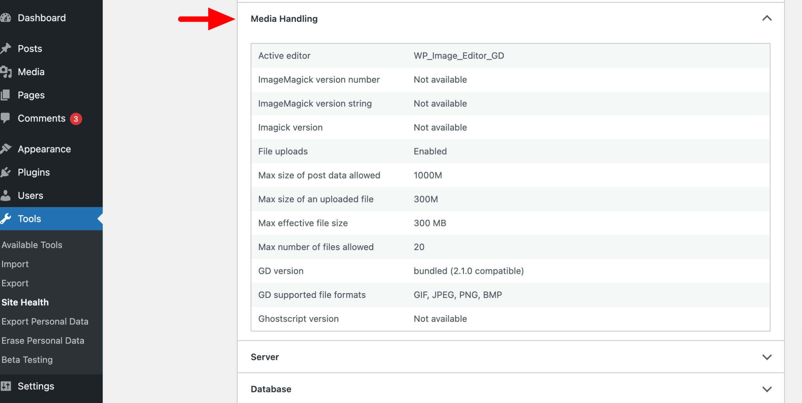

*Site Health Info Screen – Media Handling*

### Server

The Server section shows information related to your server setup. It shows information about your server architecture, web server, various PHP variables, maximum input time, maximum upload file size, cURL version, SUHOSIN, Imagick library, pretty permalinks, and .htcaccess rules.

If you want to change any of these settings, such as increasing the PHP time limit, enabling extensions, or modifying server rules, you may need to contact your hosting provider, as these configurations are often restricted or managed at the server level. Alternatively, if your hosting environment allows it, you can set these values in your PHP configuration file (php.ini).

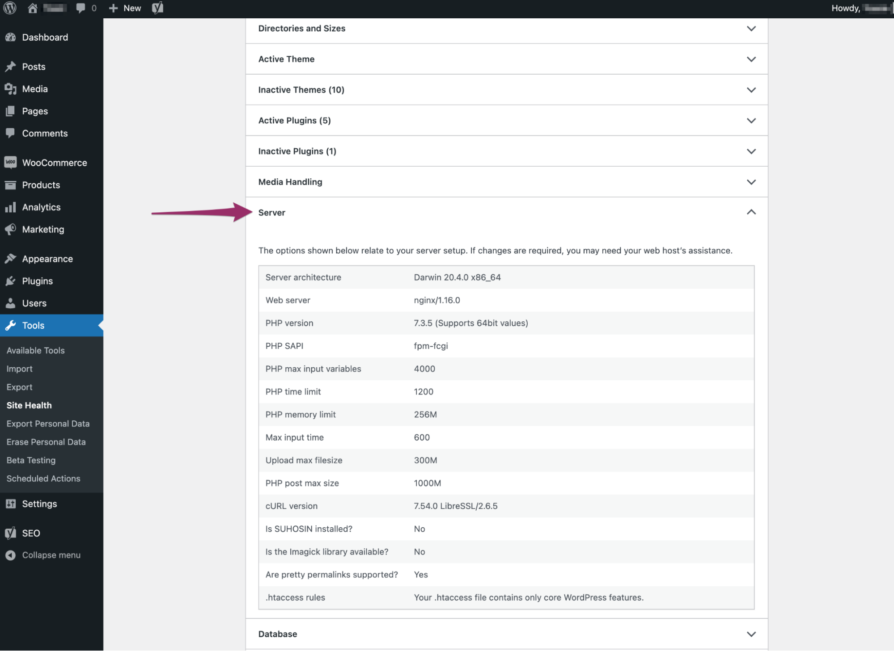

*Site Health Info Screen – Server*

### Database

### WordPress Constants

In this section, you can see where parts of your WordPress site are loaded.

### Filesystem Permissions

The Filesystem Permissions section shows whether WordPress is able to write to the directories it needs access to. It should be able to write to the main WordPress directory, wp-content directory, uploads directory, plugins directory, and a themes directory. If any of these are not writable, you might need to contact your host for assistance.

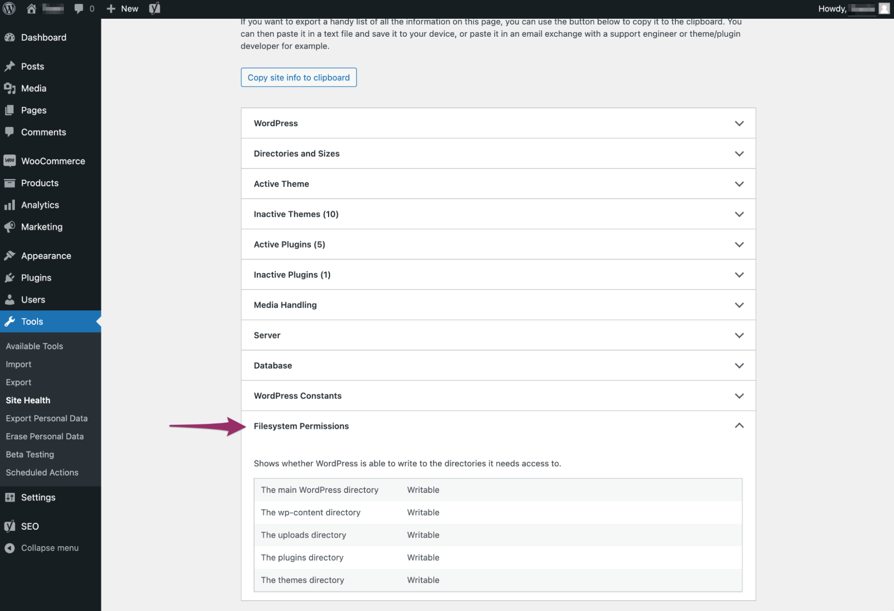

*Site Health Info Screen – Filesystems Permissions*
