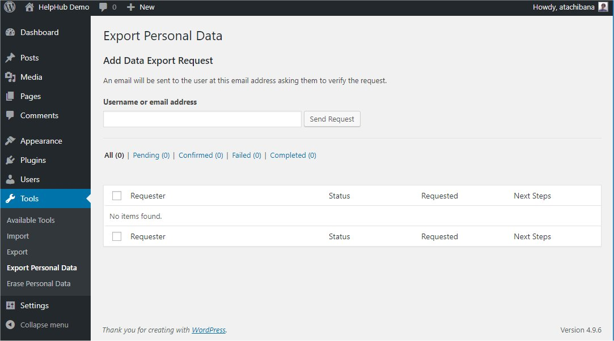
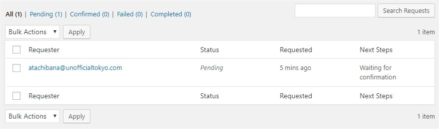
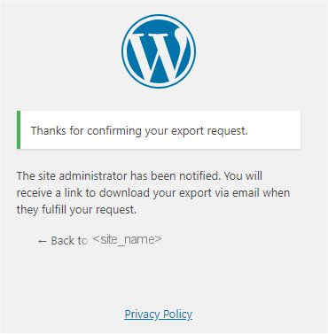
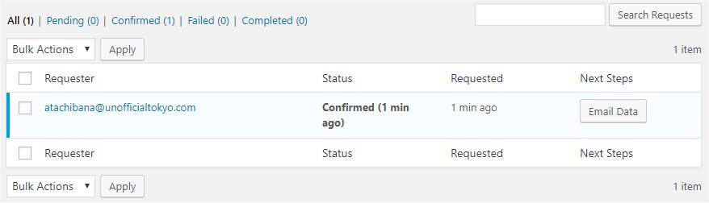
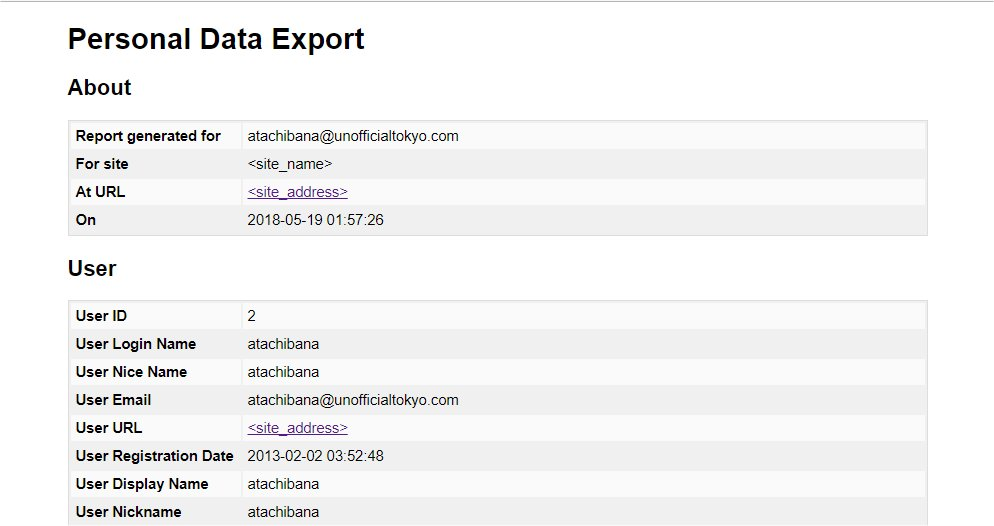

# Tools Export Personal Data screen

WordPress 4.9.6 included a feature to archive user data for export. Export Personal Data tool can generate a (`.zip` format) file containing the personal data which exists about a user within your WordPress site.

Note: As this tool ONLY gathers data from WordPress and
participating plugins, you may need to go beyond to comply with export
requests.

## Using Export Personal Data

### Basic Usage

Export Personal Data tool uses email validation to send a user’s request to an administrator.

1\. Select **Tools** -> **Export Personal Data** from Administration Screens.

[](https://wordpress.org/support/?attachment_id=11158276)

*Export Personal Data Screen*

2\. Specify Username or email address and click **Send Request**.<br>
If Confirmation request initiated successfully, the request will be shown in below Requester Table and **Status** will be changed to *Pending*.

[](https://wordpress.org/support/exportpersonaldata_4-9-6_pending/)

*Export Personal Data Pending Screen*

User will receive the following mail with subject ‘[&lt;site_name>] Confirm Action: Extract Personal Data’.

```
Howdy,

A request has been made to perform the following action on your account:

     Export Personal Data

To confirm this, please click on the following link:
https://<site_address>/wp-login.php?action=confirmaction&request_id=94&confirm_key=99rqZB4CcRct8JwL55Ov

You can safely ignore and delete this email if you do not want to
take this action.

This email has been sent to atachibana@unofficialtokyo.com.

Regards,
All at <site_name>
http://<site_address>/
```

3\. If user click link in the mail, below page is shown.

[](https://wordpress.org/support/exportpersonaldata_4-9-6_confirmation/)

At the same time, the Status of Request will be changed to *Confirmed*, and **Next Steps** shows **Email Data** button.

[](https://wordpress.org/support/exportpersonaldata_4-9-6_confirmed/)

*Export Personal Data Confirmed Screen*

4\. Click **Email Data**.<br>
 **Next Steps** will be changed to **Email Sent**.

[](https://wordpress.org/support/exportpersonaldata_4-9-6_confirmed-2/)

User will receive following mail with subject ‘[&lt;site_name>] Personal Data Export’.

```
Howdy,

Your request for an export of personal data has been completed. You may
download your personal data by clicking on the link below. For privacy
and security, we will automatically delete the file on <expired_date>,
so please download it before then.

https://<site_address>/wp-content/uploads/sites/3/wp-personal-data-exports/wp-personal-data-file-atachibana-at-unofficialtokyo-com-TONWbmz8GqwFi5ScUBTrClel0zc4DkU0.zip

This email has been sent to atachibana@unofficialtokyo.com.

Regards,
All at <site_name>
http://<site_address>
```

**Note:** Link is available only 48 hours.

5\. If user click the link, `.zip` file will be downloaded that includes one index.html file. For detail format, refer below section Exported Personal Data.

At the same time, the **Status** of Request will be changed to *Completed*, and **Next Steps** displays **Remove request** button.


6\. Click **Remove request**. The request will be removed.

Note: There are no ‘Trash’ status such as Posts’.

### Downloading Personal Data

You can download Personal Data from popup menu **Download Personal Data**.

1.  Move mouse cursor on the Requester’s mail address in the Requester Table. **Download Personal Data** will be displayed.
2.  Click **Download Personal Data**.


`.zip` file will be downloaded that includes one index.html file. For detail format, refer below section Exported Personal Data.<br>
 At the same time, the Status of Request will be changed to *Completed*, and **Next Steps** shows **Remove request** button.

Note: Even in the *Pending* status, you can download the Personal Data.

### Filtering Request

You can filter requests by Status or Requester’s mail address.

To Filter by Status

-   Click **All**, **Pending**, **Confirmed**, **Failed** and **Completed** above Requester Table.

To Filter by Requester’s email address

-   Insert full or part of email address in the box above Requester Table, and Click **Search Results**.

### Resending the mail

1.  Select checkbox of the Request that you want to resend the mail.
2.  Select **Resend email** from **Bulk Actions** dropdown box and click **Apply**.

### Removing Request

1.  Select checkbox of the Request that you want to remove.
2.  Select **Remove** from **Bulk Actions** dropdown box and click **Apply**.

## Exported Personal Data

In the `.zip` file, one `index.html` file exists. To see the data double click the icon from Explorer (Windows) or Finder (Mac).

[](https://wordpress.org/support/exportpersonaldata_4-9-6_indexhtml/)

Export Personal Data tool only exports data from WordPress and participating plugins.
From WordPress, following data are exported as Personal Data:

-   About WordPress site
-   User Information
-   Comments
-   Media
