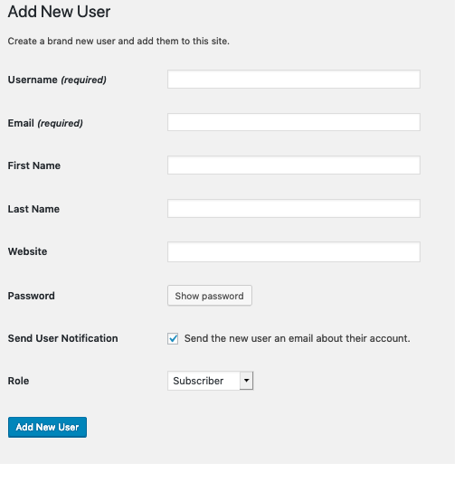

# Users Add New screen

The **Users Add New Screen** allows you to add new users who can login to your site.

## Add New User

In this Screen, you may add new Users to your site. If the **Anyone can register** option is set in the Membership section of Administration > Settings > General, users can register themselves at http://your wordpress url/wp-register.php. Regardless of that setting, you can manually create new users here.

-   **Username (required)** – Enter the username of the new user here. This will also be used as the **Login** name of the new user.
-   **E-mail (required)** – Enter a valid e-mail address of the new
    user here. The e-mail address must be unique for each user. If a
    published post or page is authored by this user, then when approved
    comments are made to that post or page, a notification e-mail is sent to
    this e-mail address.
-   **First Name** – Enter the first name of the new user here.
-   **Last Name** – Enter the last name of the new user in this text box (the display name defaults to first and last name).
-   **Website** -: You may enter the new user’s website URL in this text box.
-   **Password (twice)** – Enter a password for the new user twice here, once in each text box.

**Strength Indicator** This indicates if the password you
entered is Very Weak, Weak, Medium, or Strong (displayed in green). The
stronger the password the more secure the login. Hint: The password
should be at least seven characters long. To make it stronger, use upper
and lower case letters, numbers and symbols like *!”?$%^&)*.

-   **Send Password?** – Check the box to **Send this password to the new user by email**.
-   **Role** – Select the desired [Role](roles-and-capabilities.md) for this User from the drop-down box. Default: Administration > Settings > General – New User Default Role
-   **Add New User** – Click this important button to save the new user’s information into WordPress’ database. If you don’t click this button, the user will not be added. A flash message at the top of the screen will advise you that the new user has been added.
