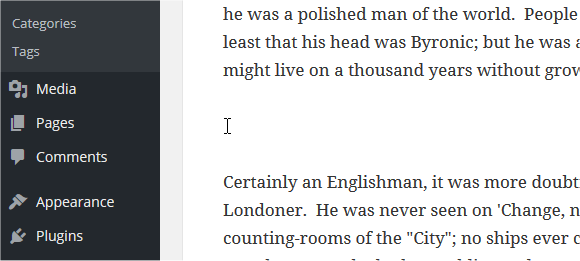
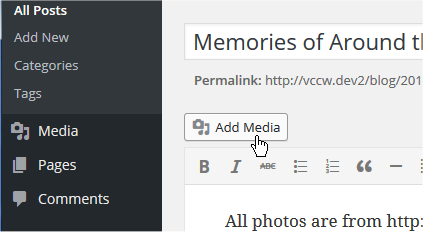
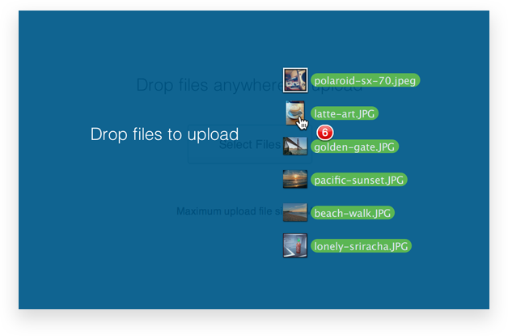
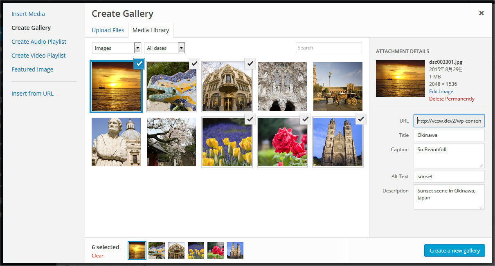
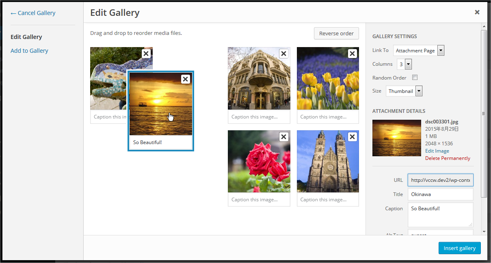
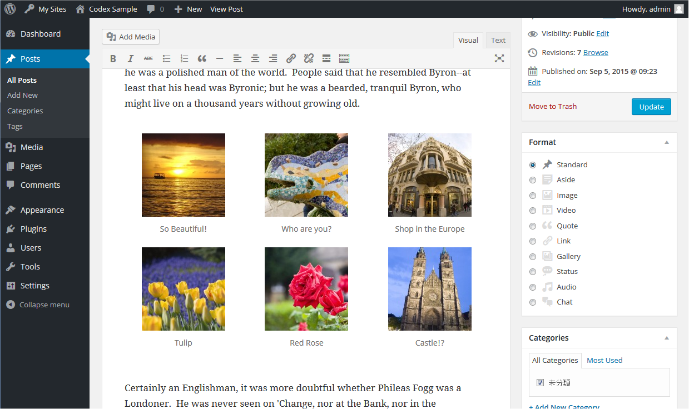
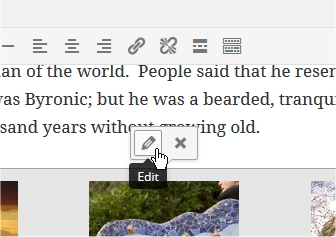

# The WordPress Gallery (Classic Editor)

*Note: This document is for the Classic Editor. If you are using the block-editor on your site, the [Gallery Block is documented on this page](../../customization/media-blocks/gallery-block.md).*

## Overview

Image galleries are a great way to share groups of pictures on your WordPress site. The **Create Gallery** feature of the WordPress media uploader allows you to add a simple image gallery to pages or posts on your site.


*End result of published gallery*

This article introduces how to add an image gallery using the media library, and explains gallery shortcode which will be generated and embedded into the post or page.

## Adding image gallery using media library

Here’s how to add an image gallery step-by-step, using the media uploader:

*Note: Before adding a gallery, you should be comfortable using the* Add media *feature and the media uploader to [add images to your media library and place them into posts](inserting-images-into-posts-and-pages-classic.md).*

### Step 1 – Place your cursor

A gallery can go anywhere on a page or post – by itself on a blank page, or above, below, or in the midst of text. Start by placing your cursor where you want the gallery to appear – if it’s in between blocks of text, like in the photo example below, consider adding a return and placing your cursor on a new line so there’s space above and below.



*Place cursor where gallery should be*

### Step 2 – Click the Add Media button

Once you’ve placed your cursor where you want your image gallery to appear, click on the Add Media button (located left above the editing window) to launch the media uploader interface. In the resulting popup window, select the ‘Create a Gallery’ option from the list of actions on the left.



*Click “Add Media” button*

### Step 3 – Add and/or Select the Images You Want to Include

You can add or select the images you want to include in your image gallery by choosing from either of the following options in the center of the media uploader window:

-   **Upload Files:** Upload the images you want to use from your computer by dragging them into the upload area. You can add more than one image, and they will be automatically grouped together as an image gallery.
-   **Media Library:** Select from previously uploaded images in the media library by clicking on the ones you wish to add to the gallery. You will see a checkbox next to your selections.



*Drag and drop multiple files to Media Library*

*Note: You can create an image gallery using any combination of new images and previously uploaded images simply by switching back and forth between the Upload Files and Media Library tabs.*

As you upload and/or select images, you will see your selection confirmed on the Insert Media screen by check boxes at the top corner of each thumbnail. Also, a row of thumbnails appears at the bottom of the window to help you keep track of all the images you’ve selected. When you are happy with your selection, click the **Create a new gallery** button.



*Selecting images to appear in gallery*

### Step 4 – Edit Your Gallery

On the Edit Gallery page, you can do the following things before inserting the gallery you have created into your page or post:

-   **Rearrange your images:** Drag and Drop image thumbnails to rearrange the order of images in your gallery.
-   **Reverse Order:** Reverses the order of the images in your gallery.
-   **Add image descriptions:** Add descriptions to your images (optional) which appear as image captions below each thumbnail in the gallery.
-   **Remove images:** Hover over a thumbnail and click on the “X” to remove any of the images you previously selected.
-   **Add more images:** Click on the “Add to Gallery” link in the left hand sidebar and add or select the images you want to include in your image gallery by choosing from either “Upload Files” or “Media Library” tabs.
-   **Cancel Gallery:** Click on the “Cancel Gallery” link from the actions on the left to exit the Edit Gallery page and cancel your image gallery.



*Drag and drop images to organize gallery*

Before inserting your gallery, you also have several Gallery Settings available in a pane on the right to control the following:

-   **Links To:** Controls whether the gallery thumbnails (on the published page/post) link to the image attachment page or directly to the source image file itself.
-   **Columns:** Set the number of columns you would like to have in your gallery. 3 Columns is the default settings, which is ideal for most sites.
-   **Random Order:** Enables your gallery to display your image thumbnails in a random order each time they are viewed on the site.
-   **Size:** Changes each image size in gallery. Available options are Thumbnail, Media, Large and Full Size.

### Editing Existing Galleries

Within the visual editor, the image gallery is displayed as a series of thumbnail images.



*Gallery in WordPress editor*

When you click any area of the image gallery, icon buttons appear top of the area. At any time, you can edit the images or settings of your gallery by clicking on the Edit button. You can remove the image gallery at any time by clicking on the Remove button.



*Edit image to edit*

## Gallery shortcode

Above steps generates Gallery shortcode with image ids and other options, and embedded into the Post or Page, like this:

```
[gallery ids="729,732,731,720"]
```

You can specify options direct to this shortcode.

### Usage

There are several options that may be specified using this syntax:

```
[gallery option1="value1" option2="value2"]
```

### Options

The following basic options are supported:

**orderby**

Specifies how to sort the displayed thumbnails. The default is “menu_order.”

Options:

-   **menu_order** – You can reorder the images in the Gallery tab of the Add Media pop-up.
-   **title** – Order images in the Media Library, based on the image title.
-   **post_date** – Sort images by date/time.
-   **rand** – Order images randomly.
-   **ID**

**order**

Specifies the sort order used to display thumbnails. ASC or DESC. For example, to sort by ID, use DESC:

```
[gallery order="DESC" orderby="ID"]
```

**columns**

Specifies the number of columns. The gallery will include a break tag at the end of each row, and calculate the column width as appropriate. The default value is 3. If columns is set to 0, no row breaks will be included. For example, to display a 4 column gallery:

```
[gallery columns="4"]
```

**id**

Specifies the post ID. The gallery will display images which are attached to that post. The default behavior, if no ID is specified, is to display images attached to the current post. For example, to display images attached to post 123:

```
[gallery id="123"]
```

**size**

Specifies the image size to use for the thumbnail display. Valid values include “thumbnail,” “medium,” “large,” “full” or any other additional image size that was registered with  [add_image_size()](https://developer.wordpress.org/reference/functions/add_image_size). The default value is “thumbnail.” The size of the images for “thumbnail,” “medium,” and “large” can be configured in the WordPress admin panel under Settings > Media. For example, to display a gallery of medium sized images:

```
[gallery size="medium"]
```

Some advanced options include:

**itemtag**

The name of the XHTML tag used to enclose each item in the gallery. The default is “dl.”

**icontag**

The name of the XHTML tag used to enclose each thumbnail icon in the gallery. The default is “dt.”

**captiontag**

The name of the XHTML tag used to enclose each caption. The default is “dd.” For example, to change the gallery markup to use div, span and p tags:

```
[gallery itemtag="div" icontag="span" captiontag="p"]
```

**link**

Specify where you want the image to link. The default value links to the attachment’s permalink. Options:

-   **file** – Link directly to the image file.
-   **none** – No link.

```
[gallery link="file"]
```

**include**

Comma-separated attachment IDs that include only the images from these attachments.

```
[gallery include="23,39,45"]
```

**exclude**

Comma-separated attachment IDs that exclude specific images from these attachments. Please note that **include** and **exclude** cannot be used together.

```
[gallery exclude="21,32,43"]
```

## Resources & Gallery Plugins

-   [Gallery Plugins](https://wordpress.org/plugins/search/gallery)
