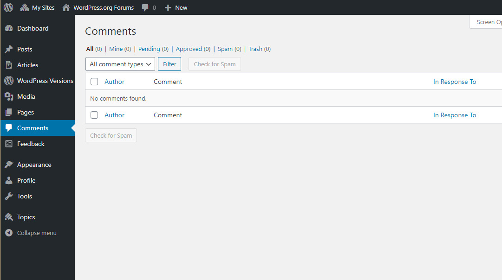
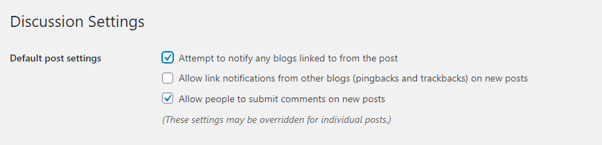
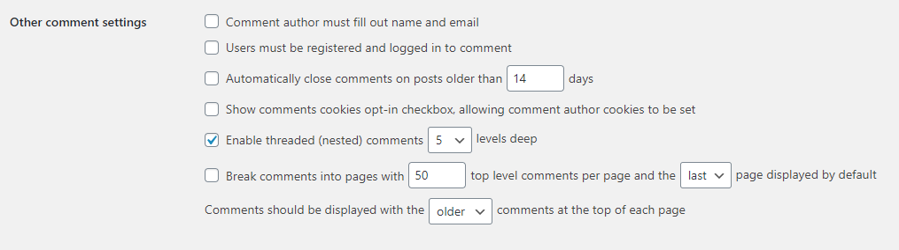
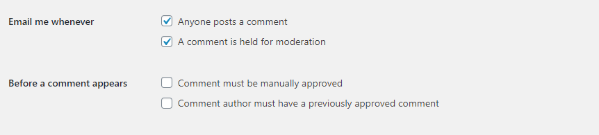
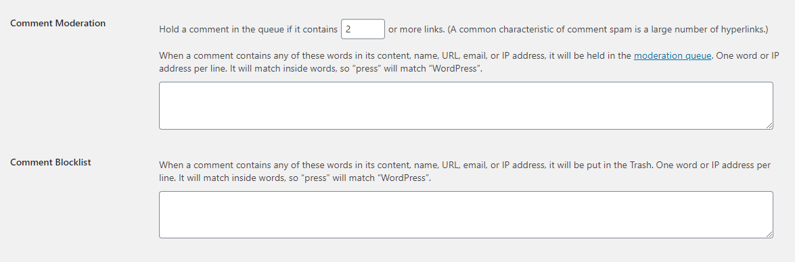

# Comments in WordPress

Comments allow your website’s visitors to have a discussion with you and each other. When you activate comments on a [Page](create-pages.md) or post, WordPress inserts several text boxes after your content where users can submit their comments. Once you approve a comment, it appears underneath your content. Whether you want to customize how you receive comments or tweak how your site displays comments, WordPress provides a thorough set of options to build a community from the visitors to your site.

## Comment screen

All comments on a WordPress website are displayed on the **Comments** dashboard in your WordPress admin area. It displays all comments by default

You can switch the view to see Pending, Approved, Spam, and Trash comments:

-   **Pending:** comments submitted by your visitors, but won’t be visible on your blog posts unless you approve them.
-   **Approved:** comments published and are publicly visible on your blog posts by all your website visitors.
-   **Spam**: comments flagged as possibly unwanted or irrelevant, and aren’t visible to your site visitors.
-   **Trash**: comments marked as unwanted and will be automatically deleted for good after 30 days.

Moving your mouse over to a comment will display the action links for it. You can approve a comment to make it visible to all your site visitors, or unapprove it to put it in pending status again.

You can also reply to comments. By replying to a specific comment, your reply will appear right under that comment. This is called “threaded” or “nested” comments.

You can also choose to edit anyone’s comments on your own site. The **Quick Edit** option opens a text area so you can edit the comment without reloading the page. **Edit**, on the other hand, gives you more options to edit the name, user email, and more.

Once a visitor submits his or her comment, WordPress follows your preferences and either hold the comment for your approval or posts it immediately.

If you see a comment marked as spam that’s actually a real comment, then you can mark it as **Not Spam** by hovering your mouse over it.

Comments in the trash section are comments that have been deleted by you. Any comment in the trash can be restored by clicking on **Restore**. Comments in trash remain there for 30 days after this time WordPress deletes them permanently.

## Discussion settings

Before you enable comments on posts or [Pages](create-pages.md), reviewing the options under [Settings](../dashboard/settings-general-screen.md) > [Discussion](../dashboard/settings-discussion-screen.md) can help make your life as a moderator easier. Use these settings to restrict comments and reduce the amount of spam you receive.

### Notification

If you link another site post on your site, **Attempt to notify any blogs linked to from the post** will enable your site to notify the website owners that you have linked to them. They can then choose to tell their users that another site linked to them through a [trackback or pingback](../../wordpress-overview/where-to-start/introduction-to-blogging.md).

Just like the option above, you can enable your site to accept pingbacks and trackbacks from other websites by checking **Allow link notifications from other blogs (pingbacks and trackbacks) on new posts**.

### Comment rules

**Allow people to post comments on new articles** will enable you to disable comments if you don’t need comments on your websites.

**Comment author must fill out name and e-mail** prevents people from leaving anonymous comments.

**Users must be registered and logged in to comment** will only allow registered users of your site to post comments.

**Automatically close comments on articles older than _____ days** will close comments on a post that have reached a set time. This is a good way to limit spam comments.

### Comment display

**Enable threaded (nested) comments _____ levels deep**: will allow your users to reply to one another. A reply to a comment is shown “nested” underneath the original comments. You can limit how many levels (a reply to a reply) of replies your site will allow by changing the number of levels.

**Break comments into Pages with _____top level comments per Page and the _____ Page displayed by default** will change how your comments are displayed. You can set how many comments you see per Page and if the oldest or newest comments are displayed first.

**Comments should be displayed with the _____ comments at the top of each Page** will place newer or older comments at the top of each page.

### Comment administration

**Email me whenever … Anyone posts a comment** and/or **A comment is held for moderation** will help you stay up to date on your comments. If you don’t check your site often.

**Comment must be manually approved** will help you moderate the comments published on your site.

**Comment author must have a previously approved comment** will help moderate the comments published on your site.

### Comment spam

**Hold a comment in the queue if it contains _____ links**, Spam comments are designed to get users to click on links in order to drive traffic to other sites. As a result, many spam comments contain multiple links. Setting this option to hold all comments that contain 2 or more links will help catch more spam.

You can experiment with **Comment Moderation and Comment Blacklist** to catch spam that contains certain words or is posted from a particular IP address. Comments caught through blacklisting are not deleted but instead [moved to your spam folder](comment-moderation.md).

Because spam is pervasive on the Web, some of the comments you receive will most likely be spam. However, WordPress developers and administrators have already developed a number of [successful strategies to help you prevent spam comments](../../wordpress-overview/faqs/faq-work-with-wordpress.md#what-can-i-do-to-stop-comment-spam) from appearing on your site. In addition to experimenting with different options in [Settings](../dashboard/settings-general-screen.md) > [Discussion](../dashboard/settings-discussion-screen.md), you can install a [WordPress Plugin](https://wordpress.org/plugins/) like [Akismet](http://akismet.com/) or [make other changes](https://codex.wordpress.org/Combating_Comment_Spam) to help you keep spam comments under control.

### Avatars

The settings under “Avatars” control the images your site displays next to comments. For an introduction to Gravatars, read the WordPress Lesson about  [How to Use Gravatars in WordPress](../../customization/appearance/use-gravatars.md).

## Enabling comments on your site

Once you have decided on your discussion options, you are ready to enable comments. If you chose not to enable comments on all articles automatically, you can turn on comments for a specific post or Page in several ways.

### Turning on comments for a single post or page

On the post or page you wish to add comments to, find the “Discussion” box, and check “Allow Comments.” (If you do not see the “Discussion” box on the Edit Page, click “Screen Options” in the upper right corner of the browser window. Make sure the box next to “Discussion” is checked.) Save your changes by clicking “Publish”, “Save Draft” or “Update.

### Turning on comments from the posts or pages screen

Navigate to the Posts/Pages screen. In the list of pages or posts, find the one you want and hover your cursor over the title of the post. You will see several links appear underneath the title. Click “Quick Edit” and check “Allow Comments.” Click “Update” to turn comments on for that post.

### Turning on comments for multiple posts or pages

From the Posts/Pages screen, check the boxes next to the posts or Pages on which you want to enable comments. Select “Edit” from the “Bulk Edit” Dropdown box and click Apply. Then, select “Allow” next in the Comments dropdown box and finish by clicking “update.”
