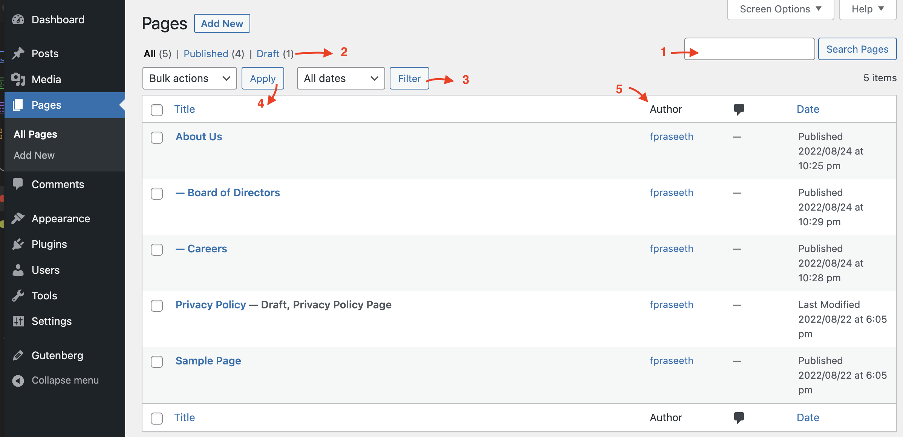
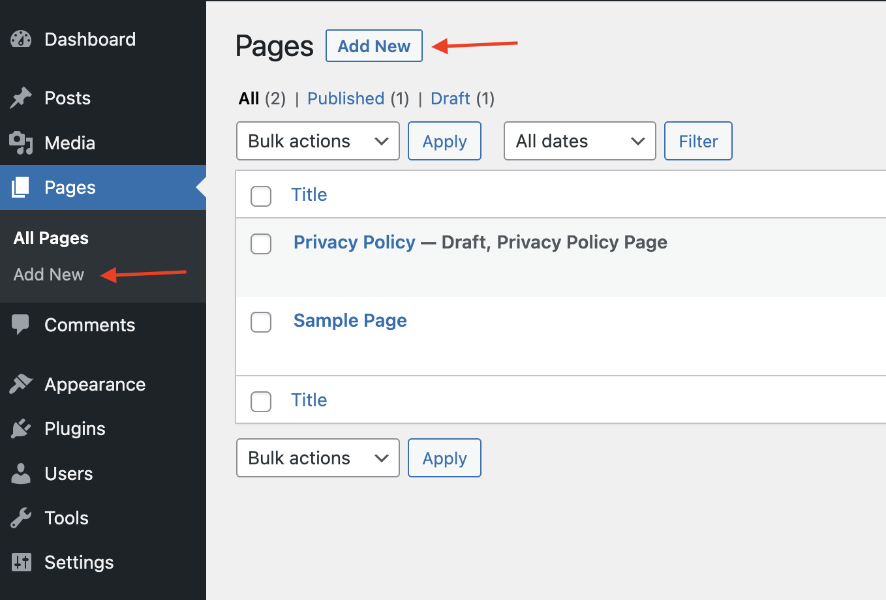
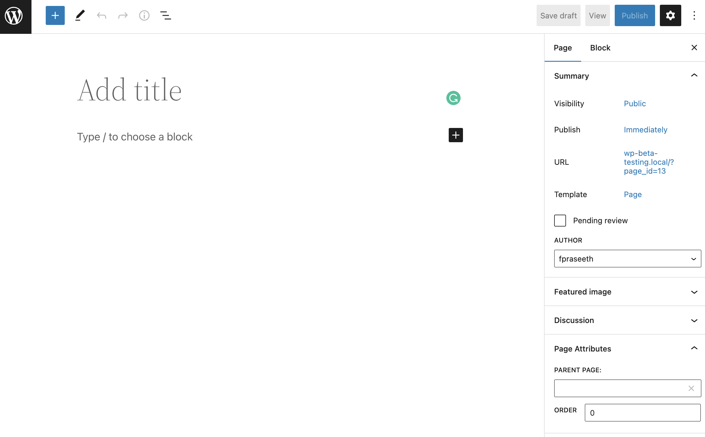
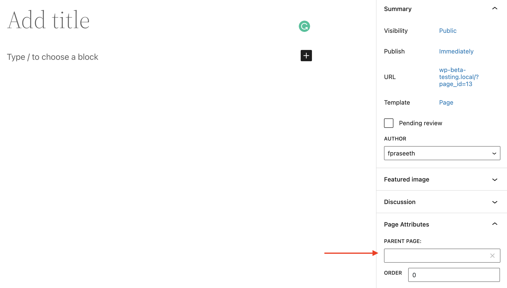
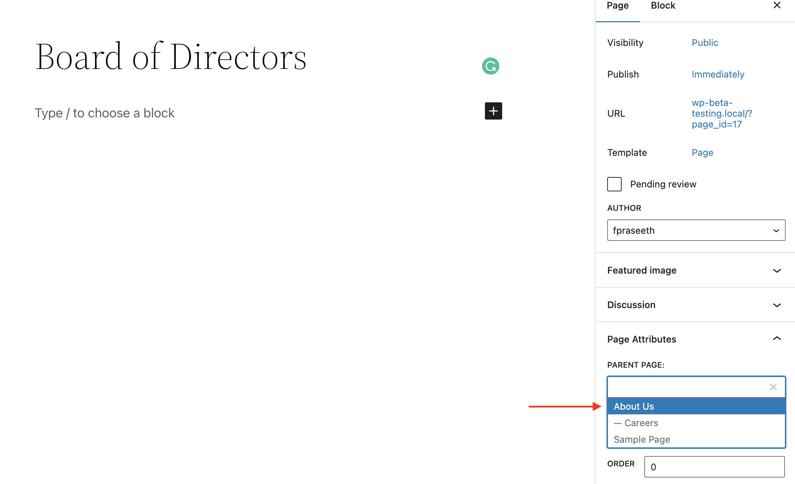
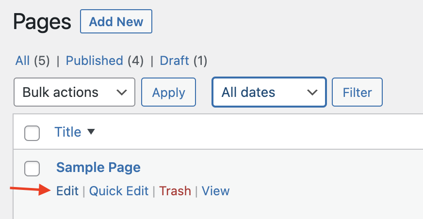
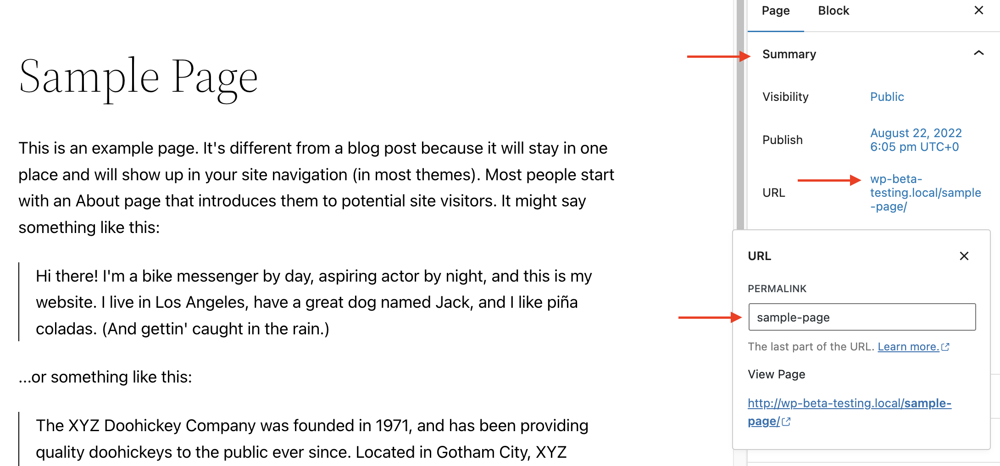
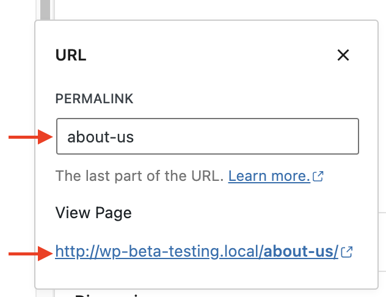
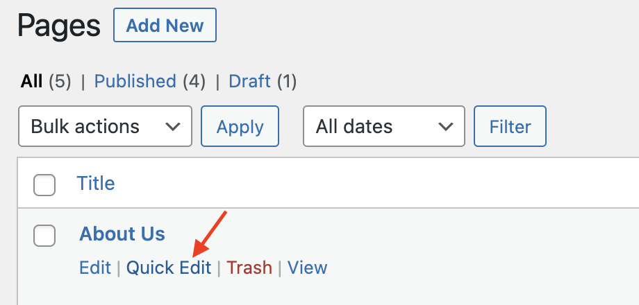
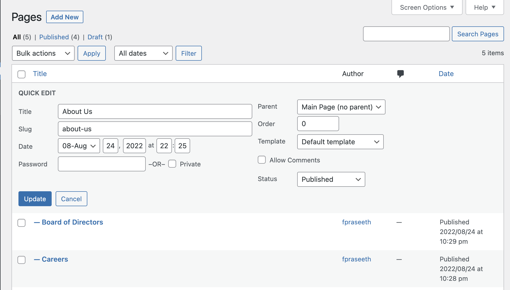

# Create pages

In WordPress, you can put content on your site as either a *Post* or a *Page*.

When you’re writing a regular blog entry, you write a *Post*. *Posts*, in a default setup, appear in reverse chronological order on your blog’s home page.

In contrast, *Pages* are for non-chronological content. *Pages* live outside of the normal blog chronology and are often used to present timeless information about yourself or your site – information that is always relevant.

You can use *Pages* to organize and manage the structure of your website content. You can add as many pages to your site as you would like, and you can update your pages as many times as you want.

After you create a page, you can add it to your site’s navigation menu so your visitors can find it.

Here are a few examples for *Pages*:

-   About
-   Contact
-   Privacy Policy
-   Copyright
-   Disclosure
-   Legal Information
-   Reprint Permissions
-   Company Information
-   Accessibility Statement

In general, *Pages* are very similar to *Posts* in that they both have titles and content. WordPress Theme template files maintain a consistent look throughout your site. *Pages*, though, have several key distinctions that make them different from *Posts*.

**What Pages are**

-   *Pages* are for content that isn’t time-dependent, or which is not part of the blog content.
-   *Pages* can be organized into parent pages and subpages.
-   *Pages* can use different page templates, including template files, and Template Tags.
-   Some themes may provide different display options for individual *Pages*.
-   You can have a WordPress website with only *Pages*.

**What Pages are not**

-   *Pages* don’t appear in the chronological view in the blog of a website.
-   *Pages* by default do not allow taxonomy (categories, tags, and any custom taxonomies). You can enhance it via plugins.
-   *Pages* are not files. They are stored in your database, just like *Posts*.
-   *Pages* are not included in your site’s feeds. (e.g. RSS or Atom.)
-   *Pages* and *Posts* can be interpreted differently by site visitors and by search engines. Search engines place more relevance on *Posts* because a newer post on a topic may be more relevant than a static page.
-   A specific *page* (or a specific *post*) can be set as a [static front page](create-a-static-front-page.md). Websites that are set up this way have a blog page that displays the latest blog posts.

## Pages screen

To view all the Pages in your site:

-   Log in to your [WordPress admin screen](../dashboard/administration-screens.md).
-   Click **Pages** in the left sidebar. This will show the Pages screen with a list of all the pages you have in your site.



1.  You can easily search for a *Page* based on the Page Title.
2.  You can get a list of all the Published *Pages* or Draft *Pages*.
3.  You can filter *Pages* based on dates.
4.  You can perform **Bulk actions** > **Edit** or **Move to Trash** by selecting multiple *Pages* from the list.
5.  You can sort the *Pages* list based on Title, Date, Author etc by clicking the Header columns.

## Organizing Pages

You can organize your *Pages* into parent and child pages and create a hierarchy.

For example, you can have an About Page as a parent page and create subpages under it for Careers, Board of Directors, Locations, Company Culture, Press etc. You can also have a Services Page as a parent page and create subpages for each of the services such as Web Design, Web Development, Stationery Design etc

The structure of the pages on the site would then look like this.

-   About Us
    -   Board of Directors
    -   Company Culture
    -   Press
    -   Careers
    -   Locations
-   Services
    -   Web Design
    -   Web Development
    -   Stationery Design

## Creating a new Page

To create a new *Page*:

1.  Log in to your [WordPress admin screen](../dashboard/administration-screens.md).
2.  Click the **Pages** > **Add New** in the left sidebar.
3.  Alternatively, you can also click the *Add New* button in the Pages screen.



4.  Add a title for the page.
5.  Add body content for the page. If you are using the [WordPress block editor](../dashboard/wordpress-block-editor.md), you can use the different [blocks](../../customization/block-editor/blocks-list.md) available in the WordPress block editor to design the Page.
6.  Customize the [sidebar settings](../../customization/block-editor/page-post-settings-sidebar.md) for the page.
7.  When the page is completed, click *Publish*.



If you are using a classic editor, refer to this support article for details about the [Add new screen in the Classic editor](pages-add-new-screen.md).

### Creating a subpage

Using Parent Pages is a good way to organize your site’s *Pages* into hierarchies. A parent page is a top-level page, with sub pages nested under it.

To create a subpage under a parent page:

1.  Log in to your [WordPress admin screen](../dashboard/administration-screens.md).
2.  Click the **Pages** > **Add New** in the left sidebar. Alternatively, you can also click the *Add New* button in the Pages screen.
3.  In the [sidebar settings](../../customization/block-editor/page-post-settings-sidebar.md) for the page, under ***Page Attributes*,** open the *Parent Page* drop-down menu. This will list all the *Pages* already created in your site.



4.  Select the desired page from the drop-down menu that you want to be the parent page for the current you are creating. The current page you are creating now becomes the sub page for the parent page you choose.



5.  You can change the order that your pages are displayed when using a default menu, by using the Order field of the Page Attributes module. Put the number **1** in the box for Order. This tells WordPress to display this page first on your site.
6.  Add a title for the sub page.
7.  Add body content for the sub page.
8.  Click *Publish* when ready.

Repeat the process for your other sub pages you want to be disapled under a Parent page, but use higher numbers for the Order field: 2, 3, etc. This tells WordPress to display these pages second and third on your site.

When your *Pages* are [listed](#creating-a-list-of-pages), the child *Page* will be nested under the parent *Page*. The [Permalinks](customize-permalinks.md) of your *Pages* will also reflect this page hierarchy. In the above example, the [Permalink](customize-permalinks.md) for the Board of Directors Page would be:

```
http://example.com/about/board-of-directors/
```

## Changing the URL of a Page

### Using the Edit option

To change the URL (also referred to as “slug”) containing the name of your Page, hover over the Page title of the Page in the [Pages screen](#pages-screen) and select *Edit*.



In the [Page Sidebar settings](../../customization/block-editor/page-post-settings-sidebar.md), under *Summary* click the URL link to open the URL popup. Change the Permalink entry to change the URL of the page.



As you type in a new URL in the *Permalink* field, you can view the updated Page URL under *View Page*.



Select *Update* to save the new URL changes.

### Using the Quick Edit option

To change the URL (also referred to as “slug”) containing the name of your Page, hover over the Page title of the Page in the [Pages screen](#pages-screen) and select *Quick Edit*.



This will open a Quick Edit Panel while you are still in the Pages screen. The Quick Edit panel allows you to modify page details such as Title, Slug, Date, Author. You can also Password protect the page or mark the page as Private. You can also change the Parent page, page order, template for the page and the Status of the page between Published, Pending Review and Draft.



Select *Update* button to save the changes.

## Page Templates

A *template* controls the layout of your pages. Not to be confused with Themes (that set the design of your entire site), the *template* affects the look and feel of an individual page (or post) or groups of pages (or posts.)

Individual pages can be set to use a specific [**Page Template**](https://developer.wordpress.org/themes/template-files-section/page-template-files/) created within your theme. You can also create [custom Page Templates](https://developer.wordpress.org/themes/template-files-section/page-template-files/#creating-custom-page-templates-for-global-use) that can be used for a page. These custom Page Templates will then override the default Page Template included with your Theme.

## The dynamic nature of Pages

A web page can be *static* or *dynamic.*

Static pages, such as a regular HTML page created with Dreamweaver, do not have to be regenerated every time a person visits the page.

An example of a static page might be an [HTML](../../wordpress-overview/where-to-start/wordpress-glossary.md#html) document (without any [PHP](../../wordpress-overview/where-to-start/wordpress-glossary.md#php) code). The problem with purely static pages is that they are difficult to maintain.

In contrast, dynamic pages, such as those created with WordPress, need to be regenerated every time they are viewed. The code for what needs to be generated on the page has been specified by the theme author, and not the actual page itself. They use extensive PHP code which is evaluated each time the page is visited, and the entire page is generated upon each new visit.

Almost everything in WordPress is generated dynamically, including **Pages**. Everything published in WordPress (Posts, Pages, Comments, Blogrolls, Categories, etc…) is stored in the [MySQL](../../wordpress-overview/where-to-start/wordpress-glossary.md#mysql) database. When the site is accessed, the database information is used by your WordPress [Templates](https://developer.wordpress.org/themes/basics/template-files/) from your current [Theme](../../customization/appearance/work-with-themes.md) to generate the web page being requested.

Changes you make to your WordPress settings, Themes, and [Templates](https://developer.wordpress.org/themes/basics/template-files/) will not be propagated to pages coded only in HTML. The Page feature of WordPress was developed to alleviate this problem. By using Pages, you no longer have to update your static pages every time you change the style of your site. If written properly, your dynamic Pages will update along with the rest of your blog.

Despite the dynamic nature of Pages, many people refer to them as being static. They are actually called “pseudo-static” web pages. In other words, a Page contains *static information* but is *generated dynamically*. Thus, either “static,” “dynamic,” or “pseudo-static” may be validly used to describe the nature of the WordPress Page feature.
