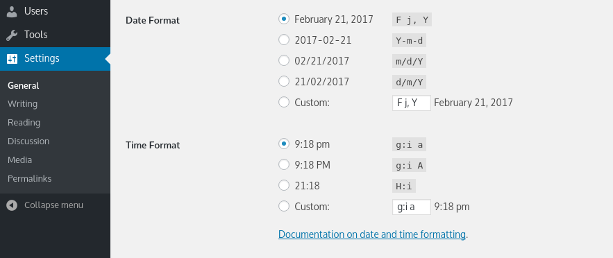

# Customize date and time format

## Customizing the Time and Date Format

Certain WordPress tag functions are used to display or return date and time information; [the_date()](https://developer.wordpress.org/reference/functions/the_date/) and [the_time()](https://developer.wordpress.org/reference/functions/the_time/) are examples of this.

By default, these functions will display or return date and time in format as it is set in [Administration](../dashboard/administration-screens.md) > [Settings](../dashboard/administration-screens.md#general) > [General](../dashboard/settings-general-screen.md). This is the place where customizing format for Date and Time will take effect throughout the whole WordPress installation.



*Formatting Date and Time*

Notice the string of characters next to each Date and Time formatting in screenshot. This string is called a **format string**. Each letter represents specific part of Date or Time.

For example, the format string:

```
l, F j, Y
```

creates a date that look like this (note that commas are read literally):

```
Friday, September 24, 2004
```

Here is what each format character in the string above represents:

-   `l` = Full name for day of the week (lower-case L).
-   `F` = Full name for the month.
-   `j` = The day of the month.
-   `Y` = The year in 4 digits. (lower-case y gives the year’s last 2 digits)

Format characters are standardized and globally used in [PHP](https://codex.wordpress.org/Glossary#PHP) programming language. As WordPress is written in PHP programming language you can use the table of Date and Time format characters [directly from the PHP website](http://php.net/date).

Here is a table of some of the more useful items found there:

<table>
<tbody>
<tr>
<th colspan="3">Day of Month</th>
</tr>
<tr>
<td><code>d</code></td>
<td>Numeric, with leading zeros</td>
<td>01–31</td>
</tr>
<tr>
<td><code>j</code></td>
<td>Numeric, without leading zeros</td>
<td>1–31</td>
</tr>
<tr>
<td><code>S</code></td>
<td>The English suffix for the day of the month</td>
<td>st, nd or th in the 1st, 2nd or 15th.</td>
</tr>
<tr>
<th colspan="3">Weekday</th>
</tr>
<tr>
<td><code>l</code></td>
<td>Full name  (lowercase ‘L’)</td>
<td>Sunday – Saturday</td>
</tr>
<tr>
<td><code>D</code></td>
<td>Three letter name</td>
<td>Mon – Sun</td>
</tr>
<tr>
<th colspan="3">Month</th>
</tr>
<tr>
<td><code>m</code></td>
<td>Numeric, with leading zeros</td>
<td>01–12</td>
</tr>
<tr>
<td><code>n</code></td>
<td>Numeric, without leading zeros</td>
<td>1–12</td>
</tr>
<tr>
<td><code>F</code></td>
<td>Textual full</td>
<td>January – December</td>
</tr>
<tr>
<td><code>M</code></td>
<td>Textual three letters</td>
<td>Jan – Dec</td>
</tr>
<tr>
<th colspan="3">Year</th>
</tr>
<tr>
<td><code>Y</code></td>
<td>Numeric, 4 digits</td>
<td>Eg., 1999, 2003</td>
</tr>
<tr>
<td><code>y</code></td>
<td>Numeric, 2 digits</td>
<td>Eg., 99, 03</td>
</tr>
<tr>
<th colspan="3">Time</th>
</tr>
<tr>
<td><code>a</code></td>
<td>Lowercase</td>
<td>am, pm</td>
</tr>
<tr>
<td><code>A</code></td>
<td>Uppercase</td>
<td>AM, PM</td>
</tr>
<tr>
<td><code>g</code></td>
<td>Hour, 12-hour, without leading zeros</td>
<td>1–12</td>
</tr>
<tr>
<td><code>h</code></td>
<td>Hour, 12-hour, with leading zeros</td>
<td>01–12</td>
</tr>
<tr>
<td><code>G</code></td>
<td>Hour, 24-hour, without leading zeros</td>
<td>0-23</td>
</tr>
<tr>
<td><code>H</code></td>
<td>Hour, 24-hour, with leading zeros</td>
<td>00-23</td>
</tr>
<tr>
<td><code>i</code></td>
<td>Minutes, with leading zeros</td>
<td>00-59</td>
</tr>
<tr>
<td><code>s</code></td>
<td>Seconds, with leading zeros</td>
<td>00-59</td>
</tr>
<tr>
<td><code>T</code></td>
<td>Timezone abbreviation</td>
<td>Eg., EST, MDT …</td>
</tr>
<tr>
<th colspan="3">Full Date/Time</th>
</tr>
<tr>
<td><code>c</code></td>
<td>ISO 8601</td>
<td>2004-02-12T15:19:21+00:00</td>
</tr>
<tr>
<td><code>r</code></td>
<td><a href="http://tools.ietf.org/html/rfc2822" title="RFC 2822">RFC 2822</a></td>
<td>Thu, 21 Dec 2000 16:01:07 +0200</td>
</tr>
<tr>
<td><code>U</code></td>
<td>Unix timestamp (seconds since Unix Epoch)</td>
<td>1455880176</td>
</tr>
</tbody>
</table>

## Format String Examples

Here are some examples of date format with the result output.

-   `F j, Y g:i a` – November 6, 2010 12:50 am
-   `F j, Y` – November 6, 2010
-   `F, Y` – November, 2010
-   `g:i a` – 12:50 am
-   `g:i:s a` – 12:50:48 am
-   `l, F jS, Y` – Saturday, November 6th, 2010
-   `M j, Y @ G:i` – Nov 6, 2010 @ 0:50
-   `Y/m/d \a\t g:i A` – 2010/11/06 at 12:50 AM
-   `Y/m/d \a\t g:ia` – 2010/11/06 at 12:50am
-   `Y/m/d g:i:s A` – 2010/11/06 12:50:48 AM
-   `Y/m/d` – 2010/11/06

## Overriding General Settings Formatting

Functions for Time and Date accept **format string** as a parameter in order to override default Date and Time formatting for certain places in theme or plugin files. Just the same as in [General Settings](../dashboard/settings-general-screen.md), this format string is a template of characters where each character represents specific part of Date or Time.

Inside the template file, setting the Date and Time format string as a parameter for [`the_time()`](https://developer.wordpress.org/reference/functions/the_time/) template tag, would look something like this:

```
Posted on <?php the_time( 'l, F jS, Y' ); ?>.
```

Which will render on the frontend of your site as following:

```
Posted on Friday, September 24th, 2004.
```

## Localization

To localize Date and Time, use the [wp_date()](https://developer.wordpress.org/reference/functions/wp_date/) function. The `wp_date()` function basically behaves like the PHP [date()](http://php.net/manual/en/function.date.php) function, except that it also translates things like month names and weekdays and similar into the current locale for the site. You can replace a call to `date()` with a call to `wp_date()`, using the same arguments.

```
$date = wp_date( 'F j, Y' );
$time = wp_date( 'g:i a' );
```

Alternatively, you can wrap your predefined format in [__()](https://developer.wordpress.org/reference/functions/__/) or [_e()](https://developer.wordpress.org/reference/functions/_e/) in order to allow translators to adjust the Date and Time to the proper local format. If you do so, then you should also include a translator comment, to let the translators know what the date format is referring to and where it is used, so they can convert it accurately.

```
__( 'Y/m/d g:i:s a', 'textdomain' );
```

## Escaping

Some letters do not have an associated format in the PHP date function. For example `x` passed in the format string will currently return a literal `x`. However, this can change at some point in the future and `x` may have a format associated with it.

This is why you should always escape literal character in a date formatted string with `\`. Note that, in following example, every letter of word `of` is escaped.

```
wp_date( __( 'l jS \o\f F Y', 'textdomain' ) );
```

This example will render as following on the frontend of your site:

```
Saturday 25th of February 2017
```
