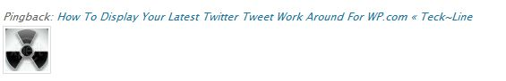
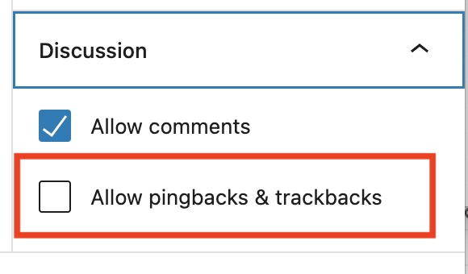
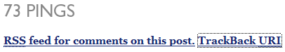
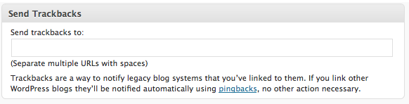

# Trackbacks and Pingbacks

Trackbacks and pingbacks are methods for alerting blogs that you have linked to them. The difference between them is:

-   **Trackbacks** – must be created manually, and send an excerpt of the content.
-   **Pingbacks** – are automated and don’t send any content.

Check out the [article on the WordPress user document](../../wordpress-overview/where-to-start/introduction-to-blogging.md#pingbacks) for a more detailed explanation.

## Pingbacks

A pingback is a type of comment that’s created when you link to another blog post where pingbacks are enabled. The best way to think about pingbacks is as remote comments:

-   Person A posts something on his blog.
-   Person B posts on her own blog, linking to Person A’s post. This automatically sends a pingback to Person A when both have pingback enabled blogs.
-   Person A’s blog receives the pingback, then automatically goes to Person B’s post to confirm that the pingback did, in fact, originate there.

To create a pingback, just link to another blog post. If that post has pingbacks enabled, the blog owner will see a pingback appear in their comments section that they can approve. Comments are styled differently for each theme. Here is an example of how a pingback appears:



### Can I stop self-pings?

Yes. Self-pings (pings within your own blog) are found useful by some, annoying by others. Those who find them useful feel that if someone finds the old post that they will see the link to the new post. But some still disagree. Normally when you create a link, the entire URL including `http://` is used. That will cause a self-ping. To prevent self-pings, shorten the URL from

```
http://example.com/2021/06/16/twitter-widget
```

to

```
/2021/06/16/twitter-widget
```

Note: Editor’s visual mode may add the domain information back into the link. To check that, you must switch to the HTML mode and make sure the link is displayed correctly in the href attribute for the link before publishing.

### Disabling Pingbacks

You can easily disable pingbacks on individual posts via the Discussion metabox on your Add New or Edit Post page:



## Trackbacks

Trackbacks are a way to notify legacy blog systems that you’ve linked to them. If you link to a WordPress blog they’ll be notified automatically using pingbacks, no other action necessary. Think of trackbacks as the equivalent of acknowledgements and references at the end of an academic paper or chapter in a text book. To send a trackback, add the trackback URI from the other blog post to the Send Trackbacks module in your blog post before you publish it. A trackback URI from a WordPress blog will end with /trackback/.

### How do I send a Trackback (Classic Editor Only)

Go to the post on the other person’s blog and look for the ‘Trackback URI’ or similar.



Once you have that link you need to copy the URL of the link. In Chrome, Right-click on the link and **Copy Link Address**.

Back on your blog, scroll down from the editor to the **Trackbacks** module and paste the URL into that box. If the blog where it was copied from is a WordPress blog, the URL will end with /trackback/.



Publish your post and the trackback will be sent. Please note that your trackback might be sent but the receiving site may choose not to display it.
